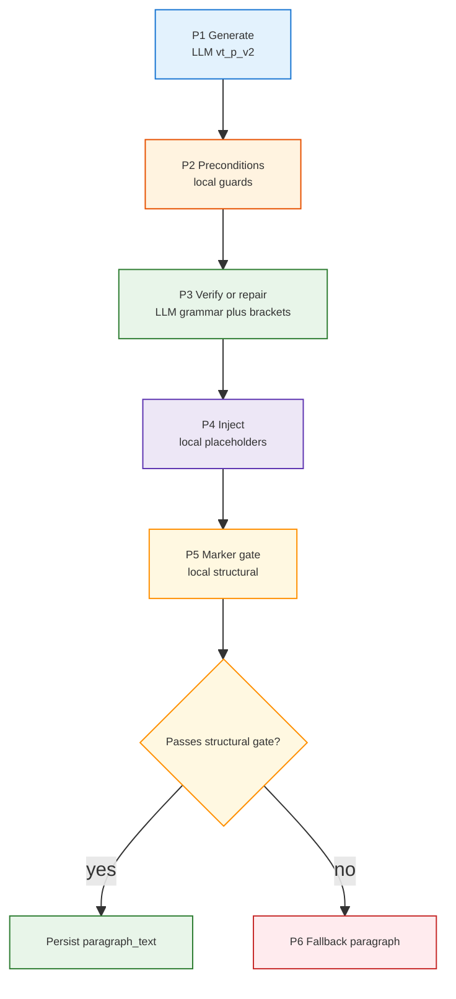

<h1 id="port-learn-samples-title" style="color:#0d47a1;font-size:1.5em;font-weight:700;border-bottom:2px solid #90caf9;padding-bottom:0.25em;margin-top:0">Brazilian Portuguese learner stack — sample war stories (excerpt)</h1>

**Purpose:** Curated **copy** of three entries from the main collection **`war_stories/WAR_STORIES.md`** for quick reference and onboarding. **Authoring discipline:** `.cursor/rules/exwar-war-stories-extraction.mdc` and `.cursor/rules/mrkd-markdown-authoring.mdc`.

**Source:** `war_stories/WAR_STORIES.md` (stories **14**, **26**, **30**) — text reproduced without editorial change.

**excerpted_as_file:** 20260509 — do not treat this file as the canonical index; append new lessons only to **`war_stories/WAR_STORIES.md`** per **exwar**.

---

<h2 id="document-outline" style="color:#1565c0;font-size:1.22em;font-weight:650;border-left:4px solid #42a5f5;padding-left:10px;margin-top:1.1em">Document outline</h2>

1. [Reading guide](#reading-guide) — metadata and subsection labels.
2. [Story index](#story-index) — links to excerpts.
3. [14. Client Draft Map…](#war-story-14)
4. [26. Natural Paragraph First…](#war-story-26)
5. [30. Manual Save + Periodic Autosave…](#war-story-30)

---

<h2 id="reading-guide" style="color:#1565c0;font-size:1.22em;font-weight:650;border-left:4px solid #42a5f5;padding-left:10px;margin-top:1.1em">Reading guide</h2>

<table>
<thead>
<tr style="background:#1565c0;color:white"><th style="padding:8px">Field / label</th><th style="padding:8px">Meaning</th></tr>
</thead>
<tbody>
<tr><td style="background:#e3f2fd;padding:8px"><strong>creation</strong> / <strong>last_updated</strong></td><td style="background:#e8f5e9;padding:8px">Timestamp style from the source collection (YYMMDD-HHMMSS).</td></tr>
<tr><td style="background:#e3f2fd;padding:8px"><strong>keywords</strong></td><td style="background:#e8f5e9;padding:8px">Grep-friendly index into problem area and stack.</td></tr>
<tr><td style="background:#e3f2fd;padding:8px"><strong>N.1–N.5</strong></td><td style="background:#e8f5e9;padding:8px">Context → Root Cause → Key Insight → Resolution → Takeaway.</td></tr>
</tbody>
</table>

---

<h2 id="story-index" style="color:#1565c0;font-size:1.22em;font-weight:650;border-left:4px solid #42a5f5;padding-left:10px;margin-top:1.1em">Story index</h2>

<table>
<thead>
<tr style="background:#1565c0;color:white"><th style="padding:8px">#</th><th style="padding:8px">Title</th><th style="padding:8px">Gist</th></tr>
</thead>
<tbody>
<tr><td style="background:#e3f2fd;padding:8px;text-align:right">14</td><td style="padding:8px;background:#fff3e0"><a href="#war-story-14">Client Draft Map Keyed Only by Verb Id Leaked Inputs Across Tense Sub-Tables</a></td><td style="padding:8px;background:#fff3e0">Key drafts by finer scope than verb id alone.</td></tr>
<tr><td style="background:#e3f2fd;padding:8px;text-align:right">26</td><td style="padding:8px;background:#fff3e0"><a href="#war-story-26">Natural Paragraph First, Authoritative Bracket Markers Second: Why One LLM Shot Was Not Enough</a></td><td style="padding:8px;background:#fff3e0">Brackets carry author intent; local code injects blanks.</td></tr>
<tr><td style="background:#e3f2fd;padding:8px;text-align:right">30</td><td style="padding:8px;background:#fff3e0"><a href="#war-story-30">Manual Save + Periodic Autosave Need One Versioned Workbench Contract</a></td><td style="padding:8px;background:#fff3e0">Unify Save and timer writes behind versioned merge + conflict retry.</td></tr>
</tbody>
</table>

---

<h2 id="war-story-14" style="color:#1565c0;margin-top:1.35em;margin-bottom:0.5em;font-weight:650;border-left:4px solid #42a5f5;padding-left:10px">14. Client Draft Map Keyed Only by Verb Id Leaked Inputs Across Tense Sub-Tables</h2>

**creation:** 260501-190100  
**last_updated:** 260501-190100  
**keywords:** react, state management, conjugation practice, draft state, keying, bug, frontend  
**difficulty:** 4  
**significance:** 7  

<h3 id="war-story-14-sec-1" style="color:#00695c;margin-top:1.05em;margin-bottom:0.4em;font-weight:600">14.1 Context</h3>

The conjugation practice page renders **one matrix per tense**. Learners type answers per **verb column** inside each matrix.

<h3 id="war-story-14-sec-2" style="color:#00695c;margin-top:1.05em;margin-bottom:0.4em;font-weight:600">14.2 Root Cause</h3>

Draft text lived in `Record<verbId, personCode → string>`. **Tense was not part of the key**, so the same verb column in different tense tables **shared one draft**. Submitting or typing in one tense **appeared** in another.

<h3 id="war-story-14-sec-3" style="color:#00695c;margin-top:1.05em;margin-bottom:0.4em;font-weight:600">14.3 Key Insight</h3>

<span style="background:#fff3e0;padding:2px 6px">UI state keys must match the identity of the unit being edited</span>—here **`tenseCode::verbId`** (plus person), not verb alone.

<h3 id="war-story-14-sec-4" style="color:#00695c;margin-top:1.05em;margin-bottom:0.4em;font-weight:600">14.4 Resolution</h3>

Draft storage was scoped to a **column key** combining tense and verb. Feedback had already been keyed that way; aligning drafts removed the cross-matrix bleed.

<h3 id="war-story-14-sec-5" style="color:#00695c;margin-top:1.05em;margin-bottom:0.4em;font-weight:600">14.5 Takeaway</h3>

When multiple tabs or sections reuse the same entity id (**verb**), ask whether another dimension (**tense**) is part of **row identity** for client state—the bug hides in the key, not the render.

---

<h2 id="war-story-26" style="color:#1565c0;margin-top:1.35em;margin-bottom:0.5em;font-weight:650;border-left:4px solid #42a5f5;padding-left:10px">26. Natural Paragraph First, Authoritative Bracket Markers Second: Why One LLM Shot Was Not Enough</h2>

**creation:** 260510-093000  
**last_updated:** 260606-120000  
**keywords:** design, system design, vt_p_v2, conjugation paragraph, two-phase pipeline, pedagogical scaffolding, bracket markup, syncretism, deterministic injection, conjugation_paragraph_generator, paragraph_bracket_markup, language learning  
**difficulty:** 6  
**significance:** 8  

<h3 id="war-story-26-sec-1" style="color:#00695c;margin-top:1.05em;margin-bottom:0.4em;font-weight:600">26.1 Context</h3>

We first asked the language model—**in one completion**—to write **natural Portuguese** and to insert **`⟦i⟧`**-style blanks in the **same** string.

That bundles **two conflicting goals**:

- Produce **fluent**, human-sounding prose.
- Keep **deterministic**, machine-checkable drill markers.

Paragraphs came back **thin or awkward**—the model traded story quality so it could babysit placeholders.

The next naive fix was **beautiful Portuguese only**, then infer blanks with **local code** (**lemma**, **tense**, **`ordered_blanks`**, verbs in sentence order). That **does** isolate “writer” from “slot math,” but it still omits something critical: **which grammatical person each blank is supposed to rehearse.**

<h3 id="war-story-26-sec-2" style="color:#00695c;margin-top:1.05em;margin-bottom:0.4em;font-weight:600">26.2 Root Cause</h3>

Portuguese often **drops the subject**. Readers infer it from discourse, **not** from a lone finite verb sitting on the page.

**Syncretism** tightens the trap: **one written verb form** can match **multiple** persons and still be “correct Portuguese.” Example instructors cite: **`soube`** lines up with several readings (e.g. **Eu / Você** in the tense family we were drilling). Similar collisions recur across lemmas.

If software blanks a verb **without recording the intended pronoun beside that token**, grading cannot know whether the learner’s alternate-but-valid conjugation belongs to the narrative the author mentally wrote. Practice becomes **guess the author’s hidden reading**, not **reproduce an agreed conjugation.**

So **intent must be authored**, not reconstructed after the fact from plain text alone.

<h3 id="war-story-26-sec-3" style="color:#00695c;margin-top:1.05em;margin-bottom:0.4em;font-weight:600">26.3 Key Insight</h3>

<span style="background:#e8f5e9;padding:2px 4px">Treat **pronoun-aligned intent** like **structured data**, not conversational subtext.</span>

While drafting, the model already **picked** subjects and coreference. We ask it to mirror that intent in **small, typed brackets immediately before each target conjugation**—**`(...)` / `{...}`** with fixed meanings (see bracket table below). A **follow-up LLM phase** revises **Portuguese plus bracket fidelity** before any `⟦⟧` learner markers exist. Only then does **`inject_placeholders_from_augmented`** (**`paragraph_bracket_markup.py`**) replace **verb surfaces** with **`⟦slot⟧`** in a repeatable way.

Outcome: **one model pass no longer edits learner blanks**; it **annotates semantics** local code can trust.

<h3 id="war-story-26-sec-4" style="color:#00695c;margin-top:1.05em;margin-bottom:0.4em;font-weight:600">26.4 Resolution</h3>

Expose the pipeline behind **`prompt_version` `vt_p_v2`**; keep **`vt_p_v1`** available as rollback (<span style="background:#fff9c4;padding:2px 4px">legacy</span>: one shot emitted **`⟦⟧`** alongside prose).

<table style="margin:0.75em 0">
<thead><tr style="background:#1565c0;color:white"><th style="padding:8px">Concern</th><th style="padding:8px"><code>vt_p_v1</code> (“markers in-model”)</th><th style="padding:8px"><code>vt_p_v2</code> (“brackets + local inject”)</th></tr></thead>
<tbody>
<tr><td style="background:#e3f2fd;padding:8px">What leaves the generator LLM</td><td style="padding:8px;background:#ffebee">Paragraph already contains **`⟦i⟧`**.</td><td style="padding:8px;background:#e8f5e9"><strong>No</strong> learner placeholders yet—only **typed brackets** tagging each conjugation.</td></tr>
<tr><td style="background:#e3f2fd;padding:8px">Where **`⟦⟧`** appears</td><td style="padding:8px;background:#ffebee">Straight from completion.</td><td style="padding:8px;background:#e8f5e9">After deterministic **`inject_placeholders_from_augmented`** aligns bracket spans to **`ordered_blanks`**.</td></tr>
<tr><td style="background:#e3f2fd;padding:8px">Second LLM pass</td><td style="padding:8px;background:#fff3e0">Mixed correction (markers + wording).</td><td style="padding:8px;background:#e8f5e9"><strong>Labeled prose only</strong>—Portuguese polish plus **bracket QA** before inject.</td></tr>
<tr><td style="background:#e3f2fd;padding:8px">Marker-only verification</td><td style="padding:8px;background:#fff3e0">Often needed LLM help.</td><td style="padding:8px;background:#e8f5e9">After placeholders exist → **purely local structural** checks (**duplicates**, **leaks**, malformed markers).</td></tr>
</tbody>
</table>

**Operational pipeline (`vt_p_v2`).** Implemented around **`apps/api/app/services/conjugation_paragraph_generator.py`** orchestrating **`apps/api/app/services/paragraph_bracket_markup.py`** (injector):

<table style="margin:0.75em 0">
<thead><tr style="background:#1565c0;color:white"><th style="padding:8px">Step</th><th style="padding:8px">Actor</th><th style="padding:8px">Output / intent</th></tr></thead>
<tbody>
<tr><td style="background:#e3f2fd;padding:8px"><strong>P1</strong> Generate</td><td style="padding:8px;background:#e8f5e9">LLM (<code>vt_p_v2</code> prompts)</td><td style="padding:8px;background:#e8f5e9">Augmented story: fluent PT, bracket tag **before each** conjugation of the target verb, **no** numeric blanks, **no** <code>⟦⟧</code>.</td></tr>
<tr><td style="background:#e3f2fd;padding:8px"><strong>P2</strong> Preconditions</td><td style="padding:8px;background:#fff3e0">Local</td><td style="padding:8px;background:#fff3e0">Cheap guards (nesting, counts vs blanks, coarse length band).</td></tr>
<tr><td style="background:#e3f2fd;padding:8px"><strong>P3</strong> Verify / repair</td><td style="padding:8px;background:#e8f5e9">LLM (<strong>grammar + bracket fidelity</strong>)</td><td style="padding:8px;background:#e8f5e9">Repaired augmented prose: teaches “missing bracket,” wrong `{}` persona, stray <code>⟦</code>, etc.—mirroring generation few-shots inverted.</td></tr>
<tr><td style="background:#e3f2fd;padding:8px"><strong>P4</strong> Inject</td><td style="padding:8px;background:#fff3e0">Local</td><td style="padding:8px;background:#fff3e0">Swap each tagged verb surface → **`⟦i⟧`**, preserve bracket prefixes beside stored text.</td></tr>
<tr><td style="background:#e3f2fd;padding:8px"><strong>P5</strong> Marker gate</td><td style="padding:8px;background:#e8f5e9">Local</td><td style="padding:8px;background:#e8f5e9">Structural QA only (counts, duplication, conjugation leakage heuristics aware of scaffolding pronouns).</td></tr>
<tr><td style="background:#e3f2fd;padding:8px"><strong>P6</strong> Fallback</td><td style="padding:8px;background:#ffebee">Local (<code>build_fallback_paragraph</code>)</td><td style="padding:8px;background:#ffebee">If inject or gate fails irrecoverably—never ship malformed learner text silently.</td></tr>
</tbody>
</table>



**Bracket tagging contract (day-one whitelist: `(...)` / `{...}` only).**

<table style="margin:0.75em 0">
<thead><tr style="background:#1565c0;color:white"><th style="padding:8px">Syntax</th><th style="padding:8px">Meaning for the injector</th><th style="padding:8px">Example cues</th></tr></thead>
<tbody>
<tr><td style="background:#e3f2fd;padding:8px"><code>(você)</code>, <code>(nós)</code>, …</td><td style="padding:8px;background:#e8f5e9">Restores **dropped/overt pronoun alignment** customary in conversational PT.</td><td style="padding:8px;background:#e8f5e9"><code>Nós abrimos cedo; (você) vê o movimento…</code></td></tr>
<tr><td style="background:#e3f2fd;padding:8px"><code>{ele}</code> after <strong>named NP</strong></td><td style="padding:8px;background:#fff3e0">Binds conjugation to coreference (**João ↔ ele**, etc.). Needed when two subjects share identical surface conjugations (**homographs**).</td><td style="padding:8px;background:#fff3e0"><code>… quando João {ele} está… e Maria {ela} está…</code></td></tr>
</tbody>
</table>

**Grammar LLM versus structural QA — budget split.**

<table style="margin:0.75em 0">
<thead><tr style="background:#1565c0;color:white"><th style="padding:8px">Artefact</th><th style="padding:8px">Grammar-capable LLM?</th><th style="padding:8px">Structural local?</th></tr></thead>
<tbody>
<tr><td style="background:#e3f2fd;padding:8px">Augmented prose (pre-<code>⟦⟧</code>)</td><td style="padding:8px;background:#e8f5e9"><span style="background:#c8e6c9;padding:2px 4px">yes</span> — **P3** is where wording + bracket correctness get corrected.</td><td style="padding:8px;background:#fff3e0"><span style="background:#fff9c4;padding:2px 4px">light</span> — **P2** cheap fences only.</td></tr>
<tr><td style="background:#e3f2fd;padding:8px">After placeholders exist</td><td style="padding:8px;background:#ffebee"><span style="background:#ffcdd2;padding:2px 4px">no</span> by default.</td><td style="padding:8px;background:#e8f5e9"><span style="background:#c8e6c9;padding:2px 4px">yes</span> — **P5** duplicate/broken-marker scans; leakage heuristics tuned so pronoun scaffolding does not false-positive.</td></tr>
</tbody>
</table>

**Pedagogy + learner API (concise)** — summary:

- Practice UI goal: learner supplies **exact spelling per slot** labeled in **`slots`**; inferring pronouns **purely from context** is explicitly **outside** MVP responsibility.
- **Persisted authoring string** retains **`⟦i⟧` plus `(...)`/`{...}` neighbors**—that full surface is evidence for admins and verifier code.
- **Learner-facing list/detail** sanitizes with **`strip_bracket_scaffolding_for_display`**: unwrap non-nested **`(...)`/`{...}`** so reading stays natural while **`⟦⟧`** and dictionary words remain. **Grading** compares answers against structured blanks, not prettified prose.

Supporting modules: **`conjugation_paragraph_corrector.py`** rewired so **labeled** verify dominates; **`conjugation_paragraph_admin.py`** persists the augmented→injected artefact. **Future** bracket families (**`[[ ]]`**, **`{{ }}`**, …) remain **blocked** until spec + whitelist parser + golden tests ship—tracked as code backlog on **`paragraph_bracket_markup`** when needed.

<h3 id="war-story-26-sec-5" style="color:#00695c;margin-top:1.05em;margin-bottom:0.4em;font-weight:600">26.5 Takeaway</h3>

<span style="background:#fff3e0;padding:2px 4px">Separate **fluent writing** from **machine-gradable scaffolding**.</span> If subject choice is latent in prose, learners will fight ambiguous blanks—so **freeze intent in parentheses/braces**, verify that layer with language-model help once, inject blanks locally, **hide author-only brackets** where the learner reads.

---

<h2 id="war-story-30" style="color:#1565c0;margin-top:1.35em;margin-bottom:0.5em;font-weight:650;border-left:4px solid #42a5f5;padding-left:10px">30. Manual Save + Periodic Autosave Need One Versioned Workbench Contract</h2>

**creation:** 260508-235800  
**last_updated:** 260508-235800  
**keywords:** design, system design, workbench, autosave, checkpoint, optimistic concurrency, React context, FastAPI  
**difficulty:** 6  
**significance:** 8  

<h3 id="war-story-30-sec-1" style="color:#00695c;margin-top:1.05em;margin-bottom:0.4em;font-weight:600">30.1 Context</h3>

We wanted learners to have two complementary protections for in-progress work:

- a visible **Save My Workbench** button for explicit control,
- periodic background save (every `auto_save_workbench_interval_in_min`, default `5`) so progress survives tab closes and accidental navigation.

The same persisted state must serve both matrix and paragraph practice flows, with safe behavior under concurrent writes.

<h3 id="war-story-30-sec-2" style="color:#00695c;margin-top:1.05em;margin-bottom:0.4em;font-weight:600">30.2 Root Cause</h3>

Treating manual save and timer save as separate code paths creates subtle drift:

- different payload shapes,
- inconsistent version handling,
- higher chance of lost updates with multiple tabs.

Because writes are user-visible progress data, race behavior had to be explicit rather than "last write wins by accident."

<h3 id="war-story-30-sec-3" style="color:#00695c;margin-top:1.05em;margin-bottom:0.4em;font-weight:600">30.3 Key Insight</h3>

<span style="background:#e8f5e9;padding:2px 4px">Manual and periodic saves should differ only by trigger label, not persistence semantics.</span>  
One server contract (`PUT /practice/workbench`) with version checks, content hashing, and merge rules gives predictable behavior while preserving UX flexibility.

<h3 id="war-story-30-sec-4" style="color:#00695c;margin-top:1.05em;margin-bottom:0.4em;font-weight:600">30.4 Resolution</h3>

Implemented a unified end-to-end contract:

<table style="margin:0.75em 0">
<thead><tr style="background:#1565c0;color:white"><th style="padding:8px">Layer</th><th style="padding:8px">What we shipped</th><th style="padding:8px">Why it matters</th></tr></thead>
<tbody>
<tr><td style="background:#e3f2fd;padding:8px"><strong>Frontend trigger model</strong></td><td style="padding:8px;background:#e8f5e9"><code>WorkbenchContext</code> exposes <code>saveWorkbench(trigger)</code>; AdminNav button calls <code>"manual"</code>; interval timer calls <code>"autosave"</code>.</td><td style="padding:8px;background:#e8f5e9">One save pipeline for both interaction modes; only trigger metadata differs.</td></tr>
<tr><td style="background:#e3f2fd;padding:8px"><strong>Interval config</strong></td><td style="padding:8px;background:#fff3e0"><code>GET /practice/workbench-config</code> returns <code>auto_save_workbench_interval_in_min</code> from <code>config/main_config.yaml</code> (default <code>5</code>).</td><td style="padding:8px;background:#fff3e0">Ops controls cadence centrally; UI stays aligned without hardcoding.</td></tr>
<tr><td style="background:#e3f2fd;padding:8px"><strong>Optimistic concurrency</strong></td><td style="padding:8px;background:#e8f5e9">Client sends <code>client_version</code>; backend rejects stale writes with <code>409 Workbench version conflict</code>.</td><td style="padding:8px;background:#e8f5e9">Prevents silent overwrite when two tabs/devices race.</td></tr>
<tr><td style="background:#e3f2fd;padding:8px"><strong>Conflict recovery</strong></td><td style="padding:8px;background:#fff3e0">On 409, frontend rehydrates with <code>GET /practice/workbench</code> then retries one save.</td><td style="padding:8px;background:#fff3e0">Converts common races into self-healing behavior instead of user data loss.</td></tr>
<tr><td style="background:#e3f2fd;padding:8px"><strong>Durable + compatible storage</strong></td><td style="padding:8px;background:#e8f5e9">Server stores consolidated snapshot (<code>learner_workbench_snapshot</code>) and syncs legacy per-practice rows (<code>user_practice_checkpoint</code>).</td><td style="padding:8px;background:#e8f5e9">Keeps new model authoritative while preserving compatibility for existing endpoints.</td></tr>
<tr><td style="background:#e3f2fd;padding:8px"><strong>Auditability</strong></td><td style="padding:8px;background:#fff3e0">Every save writes <code>learner_workbench_save_event</code> with <code>trigger</code>, <code>result_version</code>, and <code>content_changed</code>.</td><td style="padding:8px;background:#fff3e0">Explains whether saves are manual or periodic and whether they actually changed content.</td></tr>
</tbody>
</table>

```mermaid
graph TD
  A[Save My Workbench button] --> C[saveWorkbench(trigger)]
  B[setInterval every N minutes] --> C
  C --> D[PUT /practice/workbench\nclient_version + practices + trigger]
  D --> E{version matches?}
  E -->|yes| F[merge + hash + persist snapshot\nsync legacy checkpoints\nwrite save event]
  E -->|no 409| G[GET /practice/workbench\nrehydrate + retry once]
  G --> D

  style A fill:#e3f2fd,stroke:#1976d2,stroke-width:1px,font-size:9px
  style B fill:#e3f2fd,stroke:#1976d2,stroke-width:1px,font-size:9px
  style C fill:#fff3e0,stroke:#e65100,stroke-width:1px,font-size:9px
  style D fill:#e8f5e9,stroke:#2e7d32,stroke-width:1px,font-size:9px
  style E fill:#fff8e1,stroke:#ff8f00,stroke-width:1px,font-size:9px
  style F fill:#e8f5e9,stroke:#2e7d32,stroke-width:1px,font-size:9px
  style G fill:#ffebee,stroke:#c62828,stroke-width:1px,font-size:9px
```

Primary implementation anchors:

- Frontend: `apps/web/src/contexts/WorkbenchContext.tsx`, `apps/web/src/components/AdminNav.tsx`
- Backend: `apps/api/app/routes/practice_workbench.py`
- Schema/migration: `apps/api/alembic/versions/20260506_0006_workbench_and_session_audit.py`
- Guard tests: `tests/integration/test_practice_workbench_and_session_audit.py`

<h3 id="war-story-30-sec-5" style="color:#00695c;margin-top:1.05em;margin-bottom:0.4em;font-weight:600">30.5 Takeaway</h3>

<span style="background:#fff3e0;padding:2px 4px">For learner progress state, pair explicit user save with periodic autosave, but enforce one versioned server contract so convenience never compromises correctness.</span>
