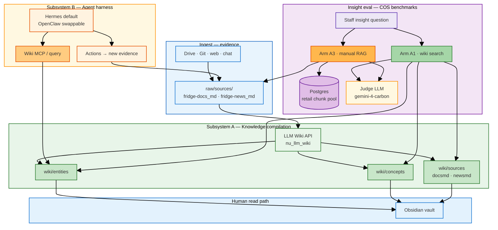
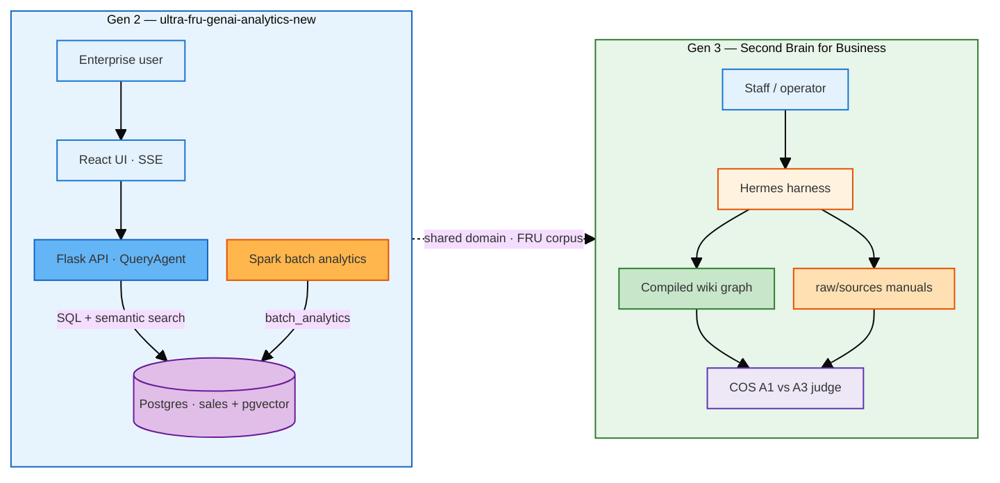
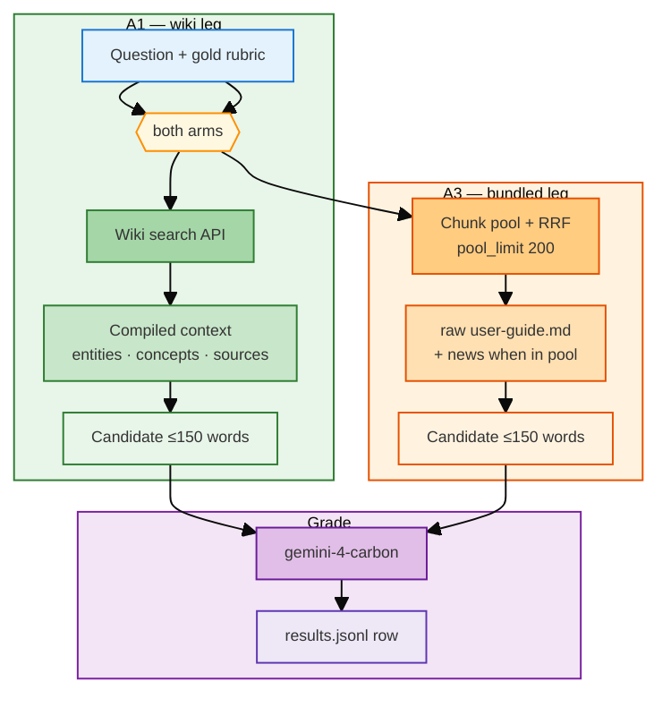

# Second Brain for Business (FRU GenAI Analytics Gen 3) — Chief-of-Staff insight - Knowledge Compilation + Reciprocal Rank Fusion (RRF)

**Second Brain for Business** is **FRU GenAI Analytics Gen 3**: **chief-of-staff (COS) insight** grounded in **LLM Wiki knowledge compilation** and **reciprocal rank fusion (RRF)** hybrid retrieval on the manual leg—not analytics-only chat. It keeps a durable **`wiki/**` graph** (entities, concepts, sourced pages) compiled by **[LLM Wiki](https://github.com/horselord-joe-8053/llm-wiki)** from manuals, news, and captures—so staff answers can **join** policy, limits, and facts without re-chunking PDFs on every turn.

**Gen 3** of [ultra-fru-genai-analytics-new](https://github.com/horselord-joe-8053/ultra-fru-genai-analytics-new) (**Gen 2**): Gen 2 is conversational analytics over structured sales + vector search on feedback. **Gen 3 adds the compile loop** (`raw → wiki → harness → human`), **dual retrieval arms** on the same FRU refrigerator corpus, and **frozen COS benchmarks** that justify **when** the wiki leg wins—**not** on every question type.

Default harness: **[Hermes](https://hermes-agent.nousresearch.com/)** (OpenClaw swappable). Human UI: **Obsidian** on compiled Markdown.

---

 📋 Table of Contents 

- [🧩 1. System architecture](#architecture)
- [🗺 2. Gen 2 → Gen 3 map](#gen-evolution)
- [🤖 3. COS insight query flow (A1 vs A3)](#cos-query-flow)
- [✨ 4. Golden separation](#golden-separation)
- [📊 5. Evidence: when A1 beats A3](#evidence)
- [🚀 6. Quick start](#quick-start)
- [⚙️ 7. Configuration](#configuration)
- [📦 8. Technology reference](#tech-reference)
- [🗄 9. Corpus & data layout](#data-model)
- [🧪 10. Testing & benchmarks](#testing)
- [📚 11. Docs & plans](#war-stories-docs)

---

 🧩 1. System architecture {#architecture}

One logical system: **two subsystems** that share the FRU corpus but serve different roles—**compilation** (offline / batch-ish) and **insight QA** (interactive eval). They do not share a single search index; they share **paths and provenance**.

**Legend:** blue = people & harness · green = compiled wiki · amber = raw manuals & RAG · purple = stores · orange = external LLMs / judge



| Subsystem | Serves | Reads | Writes |
|-----------|--------|-------|--------|
| **A — LLM Wiki compile** | Durable `wiki/**`, Obsidian, A1 retrieval | `raw/sources/**` | `wiki/entities`, `wiki/concepts`, `wiki/sources` |
| **B — Harness + COS eval** | Staff-style Q&A, benchmark rows | Wiki (A1) or raw manuals + PG pool (A3) | `ops/runs/retail-cos-insight/*/results.jsonl` |

Deeper design: [`docs_manual_gen/second-brain-llm-wiki-architecture.md`](docs_manual_gen/second-brain-llm-wiki-architecture.md).

---

 🗺 2. Gen 2 → Gen 3 map {#gen-evolution}

**Same FRU refrigerator domain**; **different center of gravity.**



| | Gen 2 (analytics) | Gen 3 (Second Brain for Business) |
|---|-------------------|----------------------|
| **Primary question** | “What do sales + feedback say?” | “What may staff **promise** given manuals + news + compile?” |
| **Grounding** | SQL + pgvector on `fridge_sales` | Wiki compile + manual RAG on support corpus |
| **Proof** | Interactive query + batch aggregates | Frozen **insight suites** + blinded judge |
| **UI** | Web app + execution log | Obsidian + harness MCP (web optional later) |

---

 🤖 3. COS insight query flow (A1 vs A3) {#cos-query-flow}

Both arms answer the **same** frozen question; retrieval differs. Entry: `tests/retail_multi_profiles/lib/cos_insight_runner.py` · CLI: `tests/retail_multi_profiles/run_cos_insight_qa.py`.



### 3.1 Arms at a glance

| Step | A1 wiki | A3 bundled |
|------|---------|------------|
| **Index** | `brain/retail-md/wiki/**` | Hybrid search over `raw/sources/**` (+ Postgres chunk pool) |
| **Wins when gold is in…** | Compiled news limits, entity+concept joins | Long procedural steps still dominant in PDF manual |
| **Typical failure** | Thin concept pages, wrong entity rank | News chunk missing from pool → hedge → critical miss |

Glossary: [`GLOSSARY.md`](GLOSSARY.md) (`TYPE_C_C20` insight orientation).

---

 ✨ 4. Golden separation {#golden-separation}

> **LLM Wiki compiles durable knowledge.**  
> **Manual RAG serves procedural depth.**  
> **Route by question class—do not pick one arm globally.**

Gen 3 does **not** claim wiki search is faster or always more accurate. It claims a **second brain** is justified when **graded benchmarks** show A1 ahead **only for defined constructs** (see §5). Cross-manual W20 synthesis and pure procedure rows remain **shared problems** or **A3-favorable**.

---

 📊 5. Evidence: when A1 beats A3 {#evidence}

Frozen suites: `tests/retail_multi_profiles/data/`. Full matrices: `docs_manual_gen/artifacts/`. Scores are mean **graded 0–100** unless noted.

### 5.1 Limit–join (staff must not over-promise)

Gold: valid guide context + **refusal** in compiled `wiki/sources/*newsmd*`.

| Suite | Run id | n | A1 | A3 | A1 ahead | Report |
|-------|--------|---|----|----|----------|--------|
| `limit_join_v2` | `limit-join-v2-full20-20261113` | 20 | **76.0** | 55.4 | **14/20** | [LIMIT_JOINS_V2](docs_manual_gen/artifacts/TEST_ANALYSIS_A1_A3_LIMIT_JOINS_V2.md) |

### 5.2 News briefing smoke

| Run id | n | A1 score | A3 score | News in top-5 |
|--------|---|----------|----------|----------------|
| `news-n5-smoke-20261112` | 5 | **66.8** | 49.0 | A1 **5/5**, A3 **3/5** |

Detail: [`TEST_ANALYSIS_A1_LLM_WIKI.md`](docs_manual_gen/artifacts/TEST_ANALYSIS_A1_LLM_WIKI.md).

### 5.3 Multi-layer wiki (entity + concept, no news-only)

| Run id | n | A1 | A3 | A1 ahead | Report |
|--------|---|----|----|----------|--------|
| `wiki-compile-join-l10-20261113` | 10 | **87.2** | 74.9 | 5/10 (2 ties) | [WIKI_COMPILE_JOIN](docs_manual_gen/artifacts/TEST_ANALYSIS_A1_A3_WIKI_COMPILE_JOIN.md) |

### 5.4 Routing cheat sheet

| ① Question class | ② Gold lives in… | ③ Prefer |
|------------------|------------------|----------|
| Limit–join / policy | `wiki/sources/*newsmd*` | **A1** |
| News briefing fact | Compiled news | **A1** |
| Entity + concept join | `wiki/entities` + `wiki/concepts` | **A1** (check ties) |
| Button / procedure | `user-guide.md` chunks | **A3** |
| Cross-manual W20 | Thin concepts | **Not proven** for A1 (`w20-v3-briefing-20261112`: A1 **35.1**, A3 **42.4**) |

---

 🚀 6. Quick start {#quick-start}

```bash
# CPython 3.12 via repo shim (not system 3.9)
./scripts/brain/agent.sh setup
./scripts/brain/agent.sh start

./scripts/verify.sh
RUN_BRAIN_SETUP=1 ./scripts/verify-local.sh
```

| Step | Notes |
|------|--------|
| LLM Wiki for A1 eval | Sibling `../nu_llm_wiki/` debug on port **19828**; token in `.env` |
| Postgres for A3 pool | Docker `retail_retail_pg_1` (see COS runbooks) |
| Contract tests | `./scripts/py -m pytest tests/retail_multi_profiles/test_limit_join_v2.py -q` |

Operator runbook: [`docs_manual_gen/SECOND_BRAIN_RUNBOOK.md`](docs_manual_gen/SECOND_BRAIN_RUNBOOK.md).

---

 ⚙️ 7. Configuration {#configuration}

Copy env from project `.env` (see `load_repo_env` in COS harness). Typical keys:

| Group | Keys / files | Purpose |
|-------|----------------|---------|
| Wiki API | `LLM_WIKI_API_TOKEN`, wiki base URL | A1 retrieval |
| Judge | Provider config for `gemini-4-carbon` | Graded benchmarks |
| Harness | Hermes / OpenClaw per `scripts/brain/` | Default agent |
| Suites | `tests/retail_multi_profiles/data/*.json` | Frozen gold + caps (`gold_max_words`, `answer_max_words`) |

---

 📦 8. Technology reference {#tech-reference}

| Lane | Stack | In repo |
|------|-------|---------|
| Compile | LLM Wiki + Markdown graph | `brain/retail-md/wiki/**`, sibling `nu_llm_wiki` |
| Raw evidence | PDF/md manuals + news | `brain/retail-md/raw/sources/**` |
| COS eval | Python harness + blinded judge | `tests/retail_multi_profiles/` |
| Harness | Hermes (default), OpenClaw | `scripts/brain/`, `docs_manual_gen/RUNBOOK_HERMES.md` |
| Delivery kit | Fabrication / EXECUTE_GEN | `.cursor/skills/fabrication/` |

---

 🗄 9. Corpus & data layout {#data-model}

| Path | Role |
|------|------|
| `brain/retail-md/raw/sources/fridge-docs_md/{model}/user-guide.md` | A3 procedural source |
| `brain/retail-md/raw/sources/fridge-news_md/*_news.md` | Limits & announcements (raw) |
| `brain/retail-md/wiki/entities/*.md` | Model & product entities |
| `brain/retail-md/wiki/concepts/*.md` | Cross-cutting features & policy concepts |
| `brain/retail-md/wiki/sources/*` | Compiled slices tied to doc/news provenance |
| `ops/runs/retail-cos-insight/<run-id>/results.jsonl` | Benchmark rows (reproducible) |

---

 🧪 10. Testing & benchmarks {#testing}

```bash
# Full limit–join v2 (20 Q, both arms)
./scripts/py tests/retail_multi_profiles/run_cos_insight_qa.py --full --arm both \
  --suite tests/retail_multi_profiles/data/retail-limit-join-v2.json \
  --run-id limit-join-v2-full20-YYYYMMDD

# Wiki compilation join (10 Q)
./scripts/py tests/retail_multi_profiles/run_cos_insight_qa.py --full --arm both \
  --suite tests/retail_multi_profiles/data/retail-wiki-compile-join-l10.json \
  --run-id wiki-compile-join-l10-YYYYMMDD

# Regenerate analysis HTML tables
./scripts/py scripts/retail/tools/render_limit_join_v2_analysis.py --run-id <run-id>
./scripts/py scripts/retail/tools/render_wiki_compile_join_analysis.py --run-id <run-id>
```

**Principles:** suites locked **before** scores; no retrieval tuning mid-run; same judge for both arms.

---

 📚 11. Docs & plans {#war-stories-docs}

| Doc | Role |
|-----|------|
| [`docs_manual_gen/second-brain-llm-wiki-architecture.md`](docs_manual_gen/second-brain-llm-wiki-architecture.md) | Full architecture narrative |
| [`docs_manual_gen/PLAN_SECOND_BRAIN_HERMES_V1.md`](docs_manual_gen/PLAN_SECOND_BRAIN_HERMES_V1.md) | Hermes v1 plan |
| [`docs_manual_gen/README.md`](docs_manual_gen/README.md) | Manual docs + refactor plan index |
| [`docs_manual_gen/artifacts/`](docs_manual_gen/artifacts/) | A1/A3 analysis reports |
| [`seed_grow/plans/second-brain-hermes-v1-plan.md`](seed_grow/plans/second-brain-hermes-v1-plan.md) | Delivery checklist |
| [`AGENTS.md`](AGENTS.md) | SPEC → ALIGN → PLAN → IMPLEMENT |

**Bootstrap delivery:**

```text
Run .cursor/skills/fabrication/references/EXECUTE_GEN.md implementing docs_manual_gen/PLAN_SECOND_BRAIN_HERMES_V1.md
```

**Lineage:** [ultra-fru-genai-analytics](https://github.com/horselord-joe-8053/ultra-fru-genai-analytics) (Gen 1) · [ultra-fru-genai-analytics-new](https://github.com/horselord-joe-8053/ultra-fru-genai-analytics-new) (**Gen 2**) · **this repo** — **Second Brain for Business**, FRU GenAI Analytics **Gen 3**.

---

**README style:** follow [`.cursor/rules/readme-fru-genai-platform.mdc`](.cursor/rules/readme-fru-genai-platform.mdc) for root `README.md` (emoji TOC, Mermaid palette, golden separation)—not the `mrkd` doc rule.
