# user-guide.pdf — extracted Markdown

> Original PDF: `user-guide.pdf`; PDF page references below are 1-based.

> Source fidelity: Text and diagrams are extracted from this PDF only; image links are rasterized views of their original PDF pages.

## PDF page 1

SAFETY INFORMATION . . . . . 3

OWNER’S MANUAL &

OPERATING INSTRUCTIONS

INSTALLATION

Features . . . . . . . . . . . . . . . . . . . . . . . . . . 6

INSTRUCTIONS

Controls . . . . . . . . . . . . . . . . . . . . . . . . . . 8

Sabbath Modes . . . . . . . . . . . . . . . . . . . 12

GE and GE Profile

Dispenser* . . . . . . . . . . . . . . . . . . . . . . . 13

Models 18, 19, 21, 22, 24, 25,

Water Filter - XWFE . . . . . . . . . . . . . . 14

26 & 27 cuft

Shelves and Bins . . . . . . . . . . . . . . . . . . 16

Pans . . . . . . . . . . . . . . . . . . . . . . . . . . . . 17

Freezer Drawer* . . . . . . . . . . . . . . . . . . 18

bkdifpeLco^kÇ^fpL

Freezer Compartment . . . . . . . . . . . . . 19

ESPAÑOL

Automatic Icemaker . . . . . . . . . . . . . . . 20

CARE AND CLEANING . . . . . . 21

Replacing the Lights . . . . . . . . . . . . . . 22

INSTALLATION INSTRUCTIONS

Preparing to Install the

Refrigerator . . . . . . . . . . . . . . . . . . . . . 23

Appliance Dimensions . . . . . . . . . . . . . 24

Installing the Refrigerator . . . . . . . . . . 25

Installing the Water Line . . . . . . . . . . .40

TROUBLESHOOTING TIPS

Normal Operating Conditions . . . . . . 43

Troubleshooting . . . . . . . . . . . . . . . . . . 44

LIMITED WARRANTY . . . . . . . 47

CONSUMER SUPPORT

Water Filter Limited Warranty . . . . . 48

Performance Data Sheets . . . . . . . . . . 49

Appliance Communication . . . . . . . . . 50

Consumer Support . . . . . . . . . . . . . . . . 52

*Select Models Only

Write the model and serial

numbers here:

Model # _________________

Serial # _________________

Find these numbers on a label

on the left side, near the middle

of the refrigerator compartment.

GE is a trademark of the General Electric Company. Manufactured under trademark license.

Pub No. 49-1000472 Rev. 9 04-26

## PDF page 2

THANK YOU FOR MAKING GE APPLIANCES A PART OF YOUR HOME.

Whether you grew up with GE Appliances, or this is your first, we’re happy to have you in the family.

We take pride in the craftsmanship, innovation and design that goes into every GE Appliances

product, and we think you will too. Among other things, registration of your appliance ensures that we

can deliver important product information and warranty details when you need them.

Register your GE appliance now online. Helpful websites and phone numbers are available in the

Consumer Support section of this Owner’s Manual. You may also mail in the pre-printed registration

card included in the packing material.

2

49-1000472 Rev. 9

## PDF page 3

### IMPORTANT SAFETY INFORMATION

### READ ALL INSTRUCTIONS BEFORE USING THE APPLIANCE

WARNING To reduce the risk of fire, explosion, electric shock, or injury when using your refrigerator, follow

these basic safety precautions:

- This refrigerator must be properly installed

and located in accordance with the Installation

Instructions before it is used.

- Unplug the refrigerator before making repairs or

cleaning.

NOTE: Power to the refrigerator cannot be

disconnected by any setting on the control panel.

NOTE: Repairs must be performed by a qualified

Service Professional.

- Replace all parts and panels before operating.

- Do not use an extension cord.

- Do not store or use gasoline or other flammable

vapors and liquids in the vicinity of this or any other

appliance.

- Do not store explosive substances such as aerosol

cans with a flammable propellant in this appliance.

- To prevent suffocation and entrapment hazards

to children, remove the refrigerator and freezer

doors from any refrigerator before disposing of it or

discontinuing its use.

- To avoid serious injury or death, children should not

stand on, or play in or with the appliance.

- Children and persons with reduced physical, sensory

or mental capabilities or lack of experience and

knowledge can use this appliance only if they are

supervised or have been given instructions on safe

use and understand the hazards involved.

- This appliance is intended to be used in household

and similar applications such as: staff kitchen areas

in shops, offices and other working environments;

farm houses; by clients in hotels, motels, bed

breakfast and other residential environments;

catering and similar non-retail applications.

- Do not apply harsh cleaners to the refrigerator.

Certain cleaners will damage plastic which may

cause parts such as the door or door handles to

detach unexpectedly. See the Care and Cleaning

section for detailed instructions.

- Connect to potable water supply only. A cold water

supply with water pressure between 25 and 120 psi

(172 – 827 kilopascals) is required to operate the

water dispenser and ice maker.

CAUTION To reduce the risk of injury when using your refrigerator, follow these basic safety precautions.

#### INSTALLATION

#### FIRE AND EXPLOSION HAZARD

Keep flammable materials and vapors away from refrigerator. Failure to do so can result in fire, explosion, or death.

- Do not clean glass shelves or covers with warm

water when they are cold. Glass shelves and

covers may break if exposed to sudden temperature

changes or impact, such as bumping or dropping.

Tempered glass is designed to shatter into many

small pieces if it breaks.

- Keep fingers out of the ³pinch point´ areas;

clearances between the doors and between the

doors and cabinet are necessarily small. Be careful

closing doors when children are in the area.

WARNING

- Do not touch the cold surfaces in the freezer

compartment when hands are damp or wet, skin

may stick to these extremely cold surfaces.

- Do not refreeze frozen foods which have thawed

completely.

- In refrigerators with automatic icemakers, avoid

contact with the moving parts of the ejector

mechanism, or with the heating element that

releases the cubes. Do not place fingers or hands

on the automatic ice making mechanism while the

refrigerator is plugged in.

### READ AND SAVE THESE INSTRUCTIONS

49-1000472 Rev. 9

3

## PDF page 4

### IMPORTANT SAFETY INFORMATION

### READ ALL INSTRUCTIONS BEFORE USING THE APPLIANCE

#### CONNECTING ELECTRICITY

ELECTRICAL SHOCK HAZARD

Failure to follow these instructions can result in death, fire, or electrical shock.

WARNING

Plug into a grounded 3-prong outlet

Do not remove the ground prong

Do not use an adapter

Do not use an extension cord.

Do not, under any circumstances, cut or remove the third (ground) prong from the power cord. For

personal safety, this appliance must be properly grounded.

The power cord of this appliance is equipped with a

3-prong (grounding) plug which mates with a standard

3-prong (grounding) wall outlet to minimize the

possibility of electric shock hazard from this appliance.

Have the wall outlet and circuit checked by a qualified

electrician to make sure the outlet is properly

grounded.

Where a standard 2-prong wall outlet is encountered, it

is your personal responsibility and obligation to have it

replaced with a properly grounded 3-prong wall outlet.

Do not use an adapter.

The refrigerator should always be plugged into its own

individual electrical outlet which has a voltage rating

that matches the rating plate.

A 115 Volt AC, 60 Hz, 15- or 20-amp fused, grounded

electrical supply is required. This provides the best

performance and also prevents overloading house

wiring circuits which could cause a fire hazard from

overheated wires.

Never unplug your refrigerator by pulling on the power

cord. Always grip plug firmly and pull straight out from

the outlet.

Immediately discontinue use of a damaged supply

cord. If the supply cord is damaged, it must be

replaced by a qualified service professional with an

authorized service part from the manufacturer.

When moving the refrigerator away from the wall, be

careful not to roll over or damage the power cord.

#### PROPER DISPOSAL OF YOUR OLD REFRIGERATOR

#### WARNING SUFFOCATION AND ENTRAPMENT HAZARD

Failure to follow these disposal instructions can result in death or serious injury

WARNING REFRIGERANT AND FOAM DISPOSAL:

Dispose of or recycle your appliance in accordance with Federal and Local Regulations. Flammable refrigerant

and insulation material used requires special disposal procedures. Contact your local authorities for the

environmentally safe disposal or recycling of your refrigerator.

IMPORTANT: Child entrapment and suffocation

are not problems of the past. Junked or abandoned

refrigerators are still dangerous even if they will sit

for ³just a few days.´ If you are getting rid of your old

refrigerator, please follow the instructions below to help

prevent accidents.

Before You Throw Away Your Old Appliance

- Take off the refrigerator and freezer doors.

- Leave the shelves in place so that children may not

easily climb inside.

### READ AND SAVE THESE INSTRUCTIONS

4

49-1000472 Rev. 9

## PDF page 5

### IMPORTANT SAFETY INFORMATION

### READ ALL INSTRUCTIONS BEFORE USING THE APPLIANCE

Check the rating label for refrigerant type. If R600a, follow the warning instructions below.

WARNING

#### FIRE OR EXPLOSION HAZARD Flammable Refrigerant

This appliance contains isobutane refrigerant,

your local authorities for the environmentally safe

also known as R600a, a natural gas with high

disposal of your refrigerator.

environmental compatibility. However, it is also

4.Keep ventilation openings in the appliance

combustible. Adhere to the warnings below to

enclosures or in the built-in structure clear of

reduce the risk of injury or property damage.

obstruction.

1.When handling, installing and operating the

5.To remove frost, scrape with a plastic or wood

appliance, care should be taken to avoid damage to

spatula or scraper. Do not use an ice pick or a metal

the refrigerant tubing.

or sharp-edged instrument as it may puncture the

2.Service shall only be performed by authorized

freezer liner and then the flammable refrigerant

service personnel. Use only manufacturer-authorized

tubing behind it.

service parts.

6.Do not use electrical appliances inside the food

3.Dispose of refrigerator in accordance with the

storage compartment of the appliance.

Federal and Local Regulations. The flammable

7.Do not use any electrical device to defrost your

refrigerant and insulation material used in this

freezer.

product require special disposal procedures. Contact

### READ AND SAVE THESE INSTRUCTIONS

5

49-1000472 Rev. 9

## PDF page 6

### Features

#### French Door Models

Space-saving icemaker (on some models)

QuickSpace™ shelf (on some models)

Icemaker and bin are located on the door creating

Functions as a normal full-sized shelf when needed

more usable storage space.

and easily slides back to store tall items below.

LED lighting

Removable/adjustable door bins

LED lights in the refrigerator compartment are

Can be moved up or down to accommodate your

located at the top center and on the left and right

needs.

sides ofclimate zone pans. LED lights are also

located in the freezer; see page 22.

Climate zone drawers

Separate pans for produce storage.

Full-width drawer

A full-width drawer that can accommodate larger

Water filter

items is located at the bottom of the refrigerator

Accessible for easy replacement.

compartment.

6

49-1000472 Rev. 9

### Original figure / page illustration (PDF page 6)

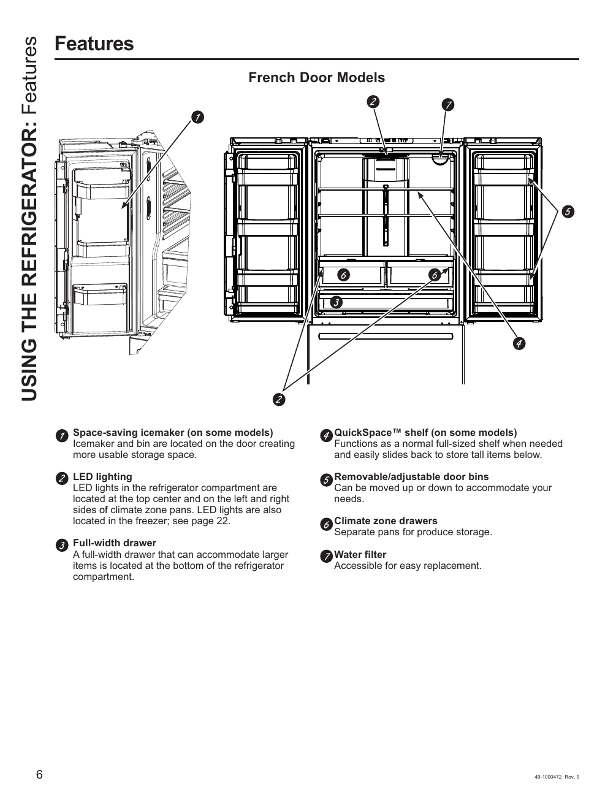

## PDF page 7

### Features

#### Single Door Models

Floating snack pan

Climate zone pans

Can be moved to different locations to best serve

Separate bins for produce storage.

your needs.

Water filter (on some models)

LED lighting

Accessible for easy replacement.

LED light is located at the top of the refrigerator

compartment. LED lights are also located in the

Adjustable door bins

freezer; see page 22.

Can be moved up or down to accommodate your

needs.

Full-width shelves

Full-width shelves that can accommodate larger

Icemaker (on some models)

items.

Icemaker is located in the freezer on some

models. Icemaker Kit IM4D is available for

Full-width gallon door bins

models that are icemaker-ready. For installation

Nonadjustable full-width door bins that will hold

instructions see the IM4D owner¶s manual found

gallon containers.

at GEAppliances.com.

7

49-1000472 Rev. 9

### Original figure / page illustration (PDF page 7)

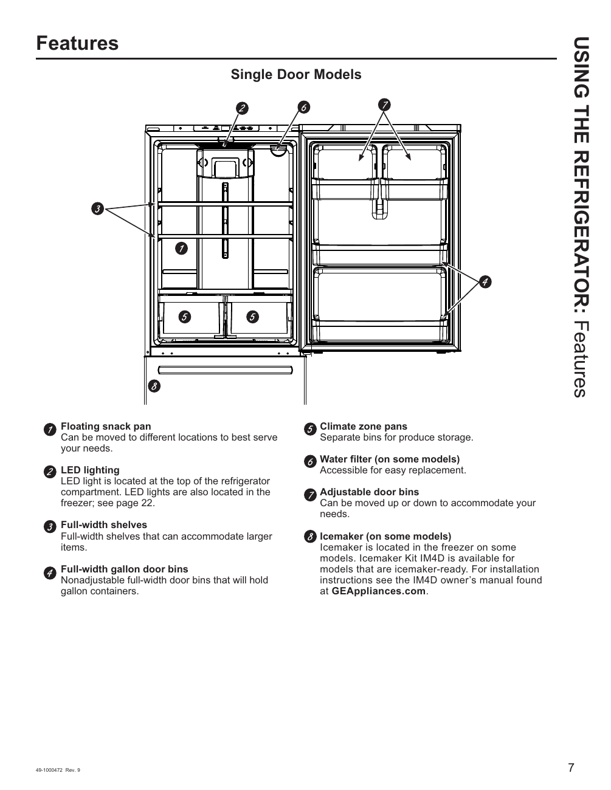

## PDF page 8

#### GBE21D, GBE21A Internal Control

NOTE: Do not block air outlet by placing food items

directly against it. Erratic temperatures may result.

### Controls

Figure A

Freezer Compartment Temperature Control

Adjust freezer compartment temperature. The

freezer temperature is preset in the factory at the

Colder position. Allow 24 hours for temperature to

stabilize to the preset recommended setting.

0 - OFF

Refrigerator Compartment Temperature Control

Adjust refrigerator compartment temperature. The

refrigerator temperature is preset in the factory at the

Colder position. Allow 24 hours for temperature to

stabilize to the preset recommended setting.

NOTE: Power to the refrigerator cannot be disconnected

by any setting on the control panel.

#### GDE21D, GDE21E, GDE25E, GNE21D, GNE21F, PNE21N, GWE19J, GWE22J,

#### GNE25D, GNE25J, PNE25N, GNE27J, GNE27E

Top Control (some models)

Figure B

Freezer Compartment Temperature Control

Adjust freezer compartment temperature. The

freezer temperature is preset in the factory at 0°F

(-17.8°C). Allow 24 hours for temperature to stabilize

to the preset recommended setting.

Refrigerator Compartment Temperature Control

Adjust refrigerator compartment temperature. The

refrigerator temperature is preset in the factory

at 37°F (2.8°C). Allow 24 hours for temperature to

stabilize to the preset recommended setting.

Water Filter

Press and hold 3 seconds to reset the Water Filter.

Turbo Cool

To set the TurboCool™, press the Turbo Cool pad

for 3 seconds. The display will show tc.

TurboCool™ rapidly cools the refrigerator

compartment in order to more quickly cool foods.

8VH TurboCool™ when adding a large amount of

the food to the refrigerator compartment, putting

away foods after they have been sitting out at room

temperature, or when putting away warm leftovers. It

can also be used if the refrigerator has been without

power for an extended period.

8

NOTE: The refrigerator temperature cannot

be changed during TurboCool™. The freezer

temperature is not affected during Turbo Cool.

When opening the refrigerator door during

TurboCool™, the fans will continue to run if they

have cycled on.

Door Alarm

To set the alarm, press the Door Alarm pad. This

alarm will sound if either door is open for more than

2 minutes. The beeping stops when you close the

door.

NOTE: To put the refrigerator control in the OFF position,

simultaneously touch the words Freezer and Fridge

for 3 seconds. Power to the refrigerator cannot be

disconnected by any setting on the control panel.

Changing °F to °C or °C to °F: Press and hold the

"DOOR ALARM" and "FREEZER" buttons simultaneously

for 5 seconds to set ƒC to ƒF or ƒF to ƒC.

49-1000472 Rev. 9

### Table (PDF page 8)

| Knob Position Temperature Guide Refrigerator Freezer |  |
| --- | --- |
| \`oldest 34ƒF (1.1°C) | \`oldest -6ƒF (-21.1°C) |
| \`older 37ƒF (2.8°C) | \`older 0ƒF (-17.8°C) |
| \`old 44ƒF (6.7°C) | \`old 6ƒF (-14.4°C) |

### Original figure / page illustration (PDF page 8)

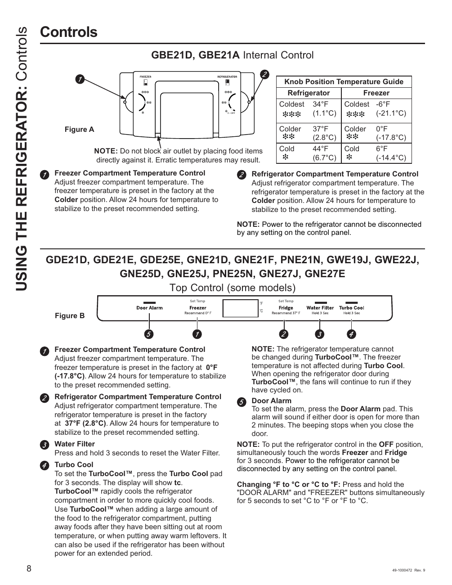

## PDF page 9

### Controls

#### GDE21D, GDE21E, GDE25E, GNE21D, GNE21F, PNE21N, GWE19J, GWE22J,

#### GNE25D, GNE25J, PNE25N, GNE27J, GNE27E

Top Control (some models)

Figure B

Freezer Compartment Temperature Control

Adjust freezer compartment temperature. The

freezer temperature is preset in the factory at 0°F

(-17.8°C). Allow 24 hours for temperature to stabilize

to the preset recommended setting.

Refrigerator Compartment Temperature Control

Adjust refrigerator compartment temperature. The

refrigerator temperature is preset in the factory

at 37°F (2.8°C). Allow 24 hours for temperature to

stabilize to the preset recommended setting.

Filter Status

Press the Filter Status pad to display the water

filter's life percentage (%).

Turbo Cool

To set the TurboCool™, press the Turbo Cool pad

for 3 seconds. The display will show tc.

TurboCool™ rapidly cools the refrigerator

compartment in order to more quickly cool foods.

8VH TurboCool™ when adding a large amount of

the food to the refrigerator compartment, putting

away foods after they have been sitting out at room

temperature, or when putting away warm leftovers. It

can also be used if the refrigerator has been without

power for an extended period.

49-1000472 Rev. 9

NOTE: The refrigerator temperature cannot

be changed during TurboCool™. The freezer

temperature is not affected during TurboCool. When

opening the refrigerator door during TurboCool™,

the fans will continue to run if they have cycled on.

Door Alarm

To set the alarm, press the Door Alarm pad. This

alarm will sound if either door is open for more than 2

minutes. The beeping stops when you close the door.

NOTE: To put the refrigerator control in the OFF position,

simultaneously touch the words Freezer and Fridge

for 3 seconds. Power to the refrigerator cannot be

disconnected by any setting on the control panel.

Changing °F to °C or °C to °F: Press and hold the

"DOOR ALARM" and "FREEZER" buttons simultaneously

for 5 seconds to set ƒC to ƒF or ƒF to ƒC.

9

### Original figure / page illustration (PDF page 9)

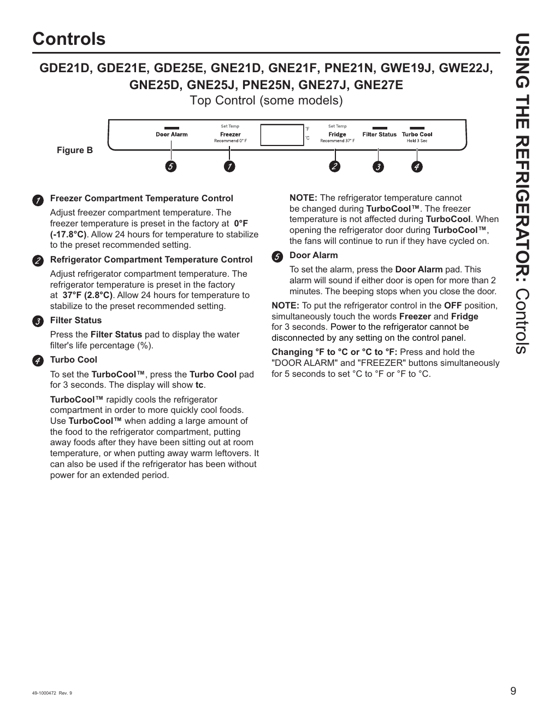

## PDF page 10

### Controls

#### GYE18J, GYE21J, PYE18H, GFE24J, PFE24H, GFE26J

External Control (some models)

Figure C

Freezer Compartment Temperature Control

Adjust freezer compartment temperature. The

freezer temperature is preset in the factory at 0°F

(-17.8°C). Allow 24 hours for temperature to stabilize

to the preset recommended setting.

Refrigerator Compartment Temperature Control

Adjust refrigerator compartment temperature. The

refrigerator temperature is preset in the factory

at 37°F (2.8°C). Allow 24 hours for temperature to

stabilize to the preset recommended setting.

Water Filter

Press and hold 3 seconds to reset the Water Filter.

Turbo Cool

To set the Turbo Cool™, press the Alarm pad for 3

seconds. The display will show tc.

Turbo Cool™ rapidly cools the refrigerator

compartment in order to more quickly cool foods.

8VH Turbo Cool™ when adding a large amount of

the food to the refrigerator compartment, putting

away foods after they have been sitting out at room

temperature, or when putting away warm leftovers. It

can also be used if the refrigerator has been without

power for an extended period.

NOTE: The refrigerator temperature cannot

be changed during Turbo Cool™. The freezer

temperature is not affected during Turbo Cool. When

opening the refrigerator door during Turbo Cool™,

the fans will continue to run if they have cycled on.

10

Alarm

Press the Alarm pad to toggle the door alarm

between off and on. The alarm will sound if either

door is left open for more than 2 minutes. The

beeping stops when you close the door.

Lock

Press and hold the Lock pad for 3 seconds to lock

out ice and water dispenser and all other controls.

Press and hold to unlock the controls.

LED dispenser Light

Press the Light pad to turn your dispenser light on

and off.

NOTE: To put the refrigerator control in the OFF

position, simultaneously touch the words Freezer and

Fridge for 3 seconds. Power to the refrigerator cannot

be disconnected by any setting on the control panel.

Changing °F to °C or °C to °F: Press and hold the

"FREEZER" and "ALARM" buttons simultaneously for 5

seconds to set ƒC to ƒF or ƒF to ƒC.

NOTE: The refrigerator is shipped with protective film

covering the temperature controls.

If this film was not removed during installation, remove it

now.

49-1000472 Rev. 9

### Original figure / page illustration (PDF page 10)

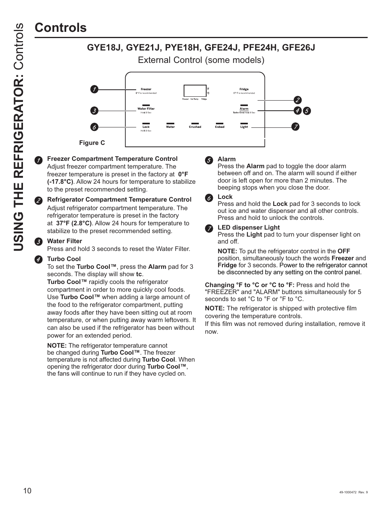

## PDF page 11

### Controls

#### GYE18J, GYE21J, PYE18H, GFE24J, PFE24H, GFE26J

External Control (some models)

Figure C

Freezer Compartment Temperature Control

Adjust freezer compartment temperature. The

freezer temperature is preset in the factory at 0°F

(-17.8°C). Allow 24 hours for temperature to stabilize

to the preset recommended setting.

Refrigerator Compartment Temperature Control

Adjust refrigerator compartment temperature. The

refrigeratortemperature is preset in the factory at

37°F (2.8°C). Allow 24 hours for temperature to

stabilize to the preset recommended setting.

Filter Status

Press the Filter Status pad to display the water

filter's life percentage (%).

Turbo Cool

To set the TurboCool™, press the Alarm pad for 3

seconds. The display will show tc.

TurboCool™ rapidly cools the refrigerator

compartment in order to more quickly cool foods.

8VH TurboCool™ when adding a large amount of

the food to the refrigerator compartment, putting

away foods after they have been sitting out at room

temperature, or when putting away warm leftovers. It

can also be used if the refrigerator has been without

power for an extended period.

NOTE: The refrigerator temperature cannot

be changed during TurboCool™. The freezer

temperature is not affected during TurboCool. When

opening the refrigerator door during TurboCool™,

the fans will continue to run if they have cycled on.

Alarm

Press the Alarm pad to toggle the door alarm

between off and on. The alarm will sound if either

door is left open for more than 2 minutes. The

beeping stops when you close the door.

Lock

Press and hold the Lock pad for 3 seconds to lock

out ice and water dispenser and all other controls.

Press and hold to unlock the controls.

LED dispenser Light

Press the Light pad to turn your dispenser light on

and off.

NOTE: To put the refrigerator control in the OFF

position, simultaneously touch the words Freezer

and Fridge for 3 seconds. Power to the refrigerator

cannot be disconnected by any setting on the control

panel.

Changing °F to °C or °C to °F: Press and hold the

"FREEZER" and "ALARM" buttons simultaneously for 5

seconds to set ƒC to ƒF or ƒF to ƒC.

NOTE: The refrigerator is shipped with protective film covering the temperature controls. If this film was not removed

during installation, remove it now.

49-1000472 Rev. 9

11

### Original figure / page illustration (PDF page 11)

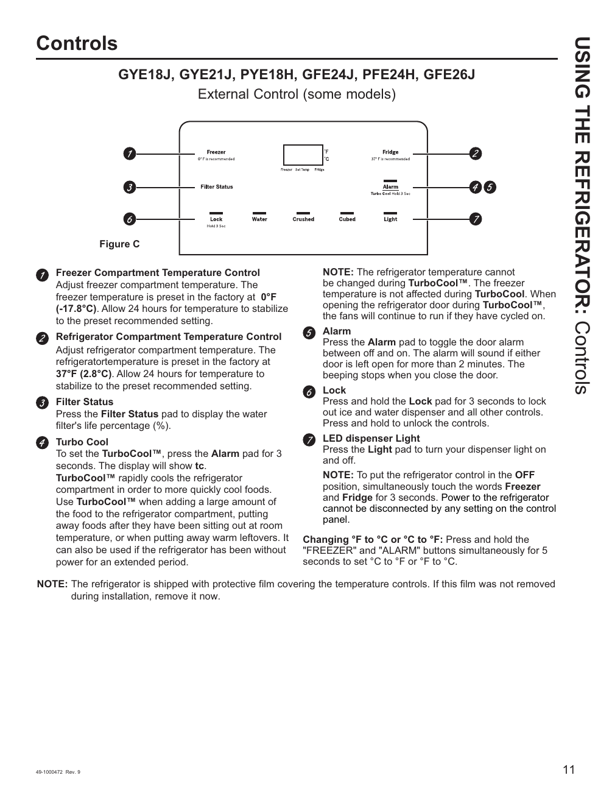

## PDF page 12

### Sabbath Modes (on some models)

Activate Sabbath Mode to turn off the temperature control and advanced features (ex. door alarm). Depending on

the model, the interior lights will be off, or on low brightness regardless of whether the door is open or closed. The

compressor will run on a timed defrost when in Sabbath mode.

#### Models with External Controls (see figure D)

(refer to Fig. C, page 10 & 11)

CAUTION To minimize the risk of personal injury,

avoid contact with the moving parts of the ice maker. Do

not place fingers or hands on the ice making mechanism

while the refrigerator is plugged in.

- Press and hold the LOCK and LIGHT buttons

simultaneously for 5 seconds to enter/exit Sabbath

Mode.

- The icemaker must be turned off manually during

Sabbath mode. To turn off the icemaker, set the switch

to the OFF position. To turn the icemaker on, set the

switch to the ON position.

NOTE: There are two different types of ice makers,

Switch

depending on your model, please refer to the below

(on some models)

pictures.

Figure E

Switch

Icemaker

Figure D

Green

Power Light

Feeler Arm

(On some models)

#### Models with Top Controls

(refer to Fig. B, page 8 & 9)

- Depending on the model, press and hold the Alarm

and WaterFilter or the Alarm and FilterStatus

simultaneously for 5 seconds to enter and exit the

Sabbath mode

- The icemaker must be turned off manually during

Sabbath mode. To turn off the icemaker,

set the switch to the OFF position. To turn the icemaker

on, set the switch to the ON position. Some ice makers

have different locations for the on/off switch.

(see figure D or E)

12

49-1000472 Rev. 9

### Original figure / page illustration (PDF page 12)

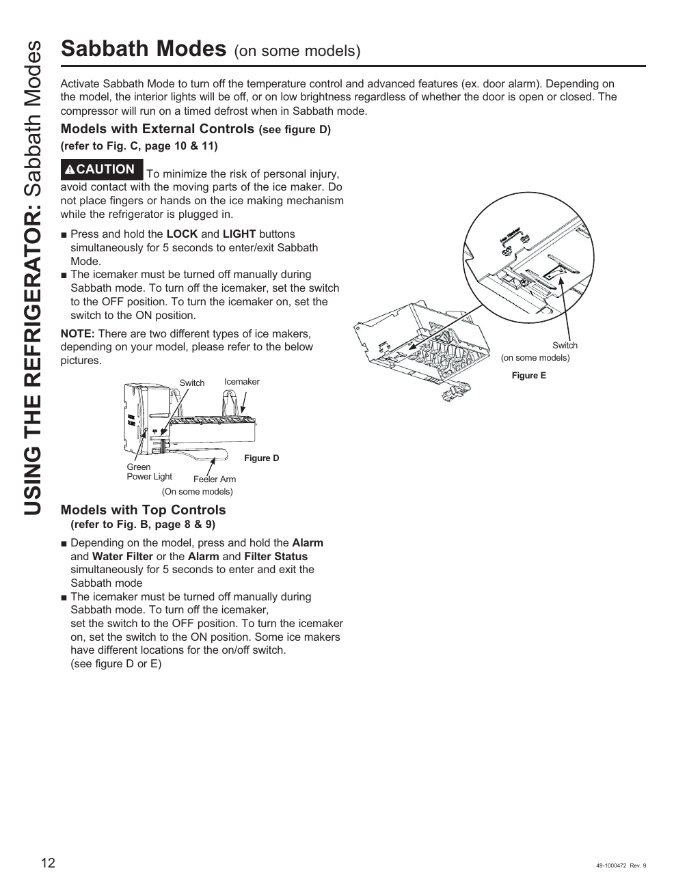

## PDF page 13

### Dispenser (on some models)

#### Water & Ice Dispenser

(See Controls)

Dispenser

Tray

Press the glass gently against the dispenser cradle.

The spill shelf is not self-draining. To reduce water

spotting, the shelf should be cleaned regularly.

If no water is dispensed when the refrigerator is first

installed, there may be air in the water line system.

Press the dispenser paddle for at least five minutes to

remove trapped air from the water line and to fill the

water system. To flush out impurities in the water line,

throw away the first six full glasses of water.

CAUTIONLaceration Hazard

- Never put fingers or any other object into ice crusher

discharge opening. Doing so can result in contacting

the ice crushing blades and lead to serious injury or

amputation

- Use a sturdy glass when dispensing ice. A delicate

glass may break and result in personal injury.

To remove Dispenser Tray

- Pull Dispenser Tray out.

To reinstall Dispenser Tray

- Push in until it is firmly in place.

#### Door Ice Bin

1. Open left refrigerator door.

2. Pull down latch to release bin

Ice bucket

door.

fork

3. Using handhold, lift ice bucket

up and out to clear locators in

bottom of bin.

4. To replace the ice bucket, set

it on the guide brackets and

push until the ice bucket seats

Latch

properly.

Ice bucket

5. If bucket cannot be replaced,

rotate the Ice Bucket Fork 1/4 turn clockwise.

49-1000472 Rev. 9

#### Internal Water Dispenser

(on some models)

The water dispenser is located on the left wall inside the

refrigerator compartment.

To dispense water:

1. Hold the glass against the recess.

2. Push the water dispenser button.

3. Hold the glass underneath the

dispenser for 2–3 seconds after

releasing the dispenser button.

Water may continue to dispense

after the button is released.

If no water is dispensed when the refrigerator is first

installed, there may be air in the water line system. Press

the dispenser button for at least 5 minutes to remove

trapped air from the water line and to fill the water

system. During this process, the dispenser noise may be

loud as the air is purged from the water line system. To

flush out impurities in the water line, throw away the first

6 glassfuls of water.

NOTE: To avoid water deposits, the dispenser should

be cleaned periodically by wiping with a clean cloth or

sponge.

#### Important Facts About Your Dispensers

- Do not add ice from trays or bags to the door icemaker

bucket. It may not crush or dispense.

- Avoid overfilling glass with ice and use of narrow

glasses. Backed-up ice can jam the chute or cause the

door in the chute to freeze shut. If ice is blocking the

chute remove the ice bucket, poke it through with a

wooden spoon.

- Beverages and foods should not be quick-chilled in the

door icemaker bin. Cans, bottles or food packages in

the storage drawer may cause the icemaker or auger

to jam.

- To keep dispensed ice from missing the glass, put the

glass close to, but not touching, the dispenser opening.

- Some crushed ice may be dispensed even though you

selected CUBED ICE. This happens occasionally when

a few cubes accidentally get directed to the crusher.

- After crushed ice is dispensed, some water may drip

from the chute.

- Sometimes a small mound of frost will form on the

door in the ice chute. This condition is normal and

usually occurs when you have dispensed crushed ice

repeatedly.

13

### Original figure / page illustration (PDF page 13)

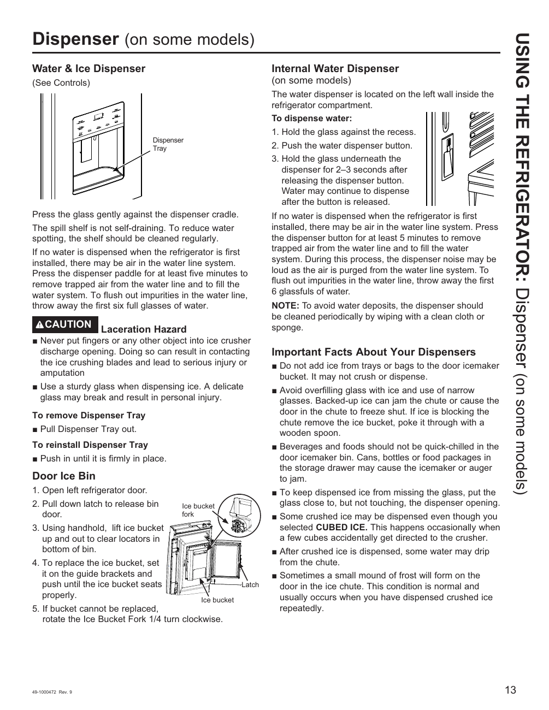

## PDF page 14

### Water Filter Cartridge - XWFE (on some models)

#### WATER FILTER CARTRIDGE

The water filter cartridge holder is located in the back

upper-right corner of the refrigerator refrigerator

compartment.

Select models use radio frequency identification (RFID)

to detect leaks and monitor filter status. The RFID

technology is certified by the FCC.

Contains

FCC ID: ZKJ-294D2018 IC: 10229A-294D2018

“This device complies with part 15 of the FCC Rules.

Operation is subject to the following two conditions:

(1) This device may not cause harmful interference, and (2)

this device must accept any interference received, including

interference that may cause undesired operation.”

“This device complies with Industry Canada licence-exempt

RSS standard(s). Operation is subject to the following two

conditions: (1) this device may not cause interference,

and (2) this device must accept any interference, including

interference that may cause undesired operation of the

device.”

#### WHEN TO REPLACE THE FILTER

If there is a replacement indicator light for the water filter

cartridge on the dispenser, the red filter light will start

blinking to tell you that you need to replace the filter soon.

- For external control models, the filter light will blink

while you are dispensing until the filter is replaced.

- For top control models, the filter light will blink while

the door is open until the filter is replaced.

For models that don¶t have the indicator light, the filter

cartridge should be replaced every six months, or earlier

if the flow of water to the dispenser or icemaker

decreases.

#### REMOVING THE FILTER

If you are replacing the filter, first remove the previous

one:

1. Open the filter cartridge housing by squeezing the 2

front tabs and gently pulling down.

2. Rotate the filter down.

3. Gently grasp the filter and slowly turn it

counterclockwise about a ¼ turn. The filter should

automatically release itself when you have rotated it far

enough to the left. A small amount of water may drip

down.

#### CAUTION

If air has been trapped in the system,

the filter cartridge may be ejected as it is removed. Use

caution when removing.

14

#### FILTER BYPASS PLUG

To reduce the risk of property damage due to water

leakage, you MUST use the filter bypass plug when a

replacement filter cartridge is not available. Some models

do not come equipped with the filter bypass plug. To obtain

a free bypass plug, call 833.4BODEWELL. In Canada, call

800.561.3344. The dispenser and icemaker will not operate

without either the filter or bypass plug installed. The bypass

plug is installed in the same way as a filter cartridge.

#### INSTALLING THE FILTER IN A BOTTOM

#### FREEZER REFRIGERATOR

1. Open the filter cartridge housing

by squeezing the 2 front tabs and

gently pulling down.

2. Line up the ports on the filter

with the ports on the filter

cartridge holder, and gently

insert the filter.

3. Slowly turn the filter to the

right until it stops. DO NOT

OVERTIGHTEN. As you turn

the filter, it will automatically

adjust itself into position. The

filter will move about a ¼ turn or

90 degrees, until the arrow on

the filter aligns with the arrow on

the filter cartridge holder.

4. Slowly push the filter up into the clips.

5. Close the filter cartridge housing by gently pushing the

lid upwards until the tabs lock into place.

6. For dispenser-only models - Run water from the

dispenser for 2 gallons (7.6 liters) or approximately 5

minutes to clear the system. Water may spurt out and

air bubbles may be visible during this process. If water

is not flowing, check to make sure the filter has been

fully rotated to the right.

For icemaker-only models - Discard the first bin

of ice to allow air to purge from the system. A newly

installed filter cartridge will cause water to spurt into

the icemaker body, which could lead to ice droplets

around the icemaker area. NOTE: ,W LV QRUPDO IRU

these droplets and initial ice production to appear

discolored during the initial system flush. Ice color will

return to normal after the first bin of ice production.

7. Press and hold the RESET WATER FILTER button on

the dispenser for 3 seconds. On select models, filter

reset will be automatic when a new filter is installed.

49-1000472 Rev. 9

### Original figure / page illustration (PDF page 14)

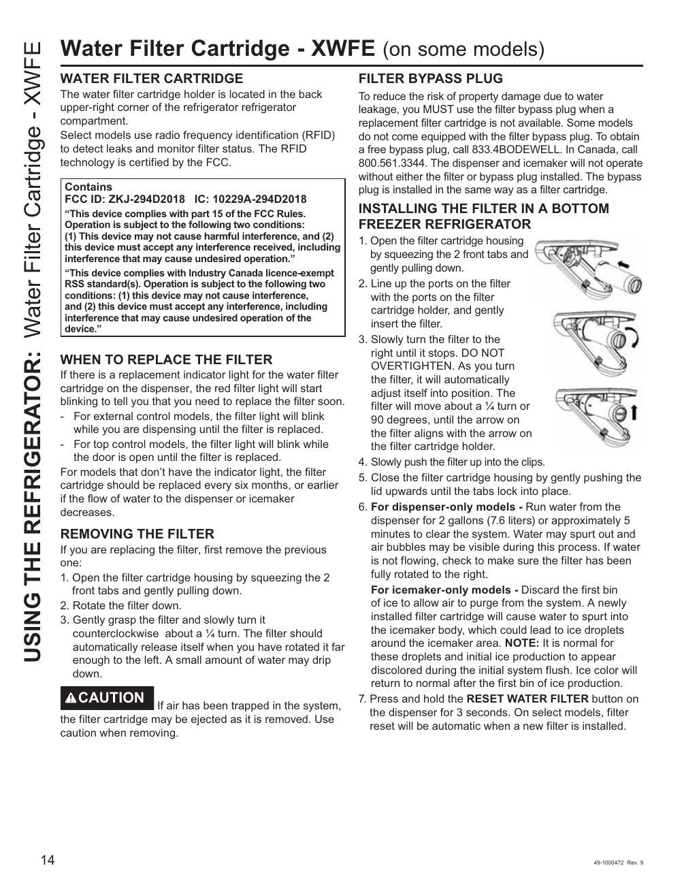

## PDF page 15

### Water Filter Cartridge - XWFE (on some models)(Cont.)

#### Application Guidelines/Water Supply

pignJup for qbuq objfkabop by texting obmi^\`b to TMRQPK

WARNING To reduce the risk associated with choking, do not allow children under 3 years of age to

have access to small parts during the installation of this product. The disposable filter cartridge should be

replaced every 6 months at the rated capacity, or sooner if a noticeable reduction in flow rate occurs.

For the maximum benefit of your filtration system, GE Appliances recommends the use of GE Appliances-branded

filters only. Using GE Appliances-branded filters in GE Appliances and HotpointŠ refrigerators provides optimal

performance and reliability. GE Appliances filters meet rigorous industry standards for safety and quality that are

important for products that are filtering your water. GE Appliances has not qualified non-GE Appliances-branded

filters for use in GE Appliances and Hotpoint refrigerators and there is no assurance that non-GE Appliances-

branded filters meet GE Appliances standards for quality, performance and reliability.

If you have questions, or to order additional filter cartridges, visit our website at gewaterfilters.com

or call GE Appliances Parts and Accessories, 877.959.8688. In Canada, call 800.661.1616.

15

49-1000472 Rev. 9

### Table (PDF page 15)

| Service Flow | 0.5 gpm (1.89 lpm) |
| --- | --- |
| Water Supply | Potable Water |
| Water Pressure | 25-120 psi (172-827 kPa) |
| Water Temperature | 33ƒF-100ƒF  0.6ƒC-38ƒC |
| Capacity | 170 gallons (643.5 liters) |

### Original figure / page illustration (PDF page 15)

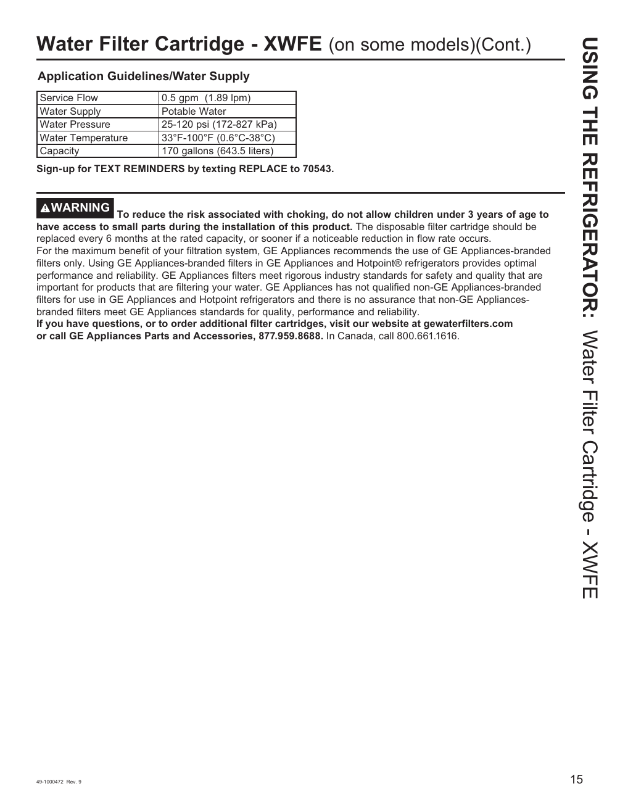

## PDF page 16

### Shelves and Bins

Not all features are on all models.

#### Rearranging the Refrigerator Shelves

Shelves in the refrigerator compartment are adjustable.

To remove the shelves:

1. Remove all items from the

shelf.

2. Tilt the shelf up at the

front.

3. Lift the shelf up at the back

and bring the shelf out.

#### Quick Space Shelf (on some models)

This shelf splits in half

and slides under itself

for storage of tall items

on the shelf below.

This shelf can be

removed and replaced

or relocated.

#### Adjustable Door Bins (on some models)

To remove: Lift the bin straight up; then pull out.

To replace: Engage the bin in the molded supports on

the door and push down to lock in place.

16

To replace the shelves:

1. While tilting the shelf up, insert the

top hook at the back of the shelf in

a slot on the track.

2. Lower the front of the shelf until

the bottom of the shelf locks into

place.

NOTE: The back half of

the Quick Space Shelf is

not adjustable.

#### Non-Adjustable Gallon Door Bins (on some

models)

To remove: Lift the bin straight up; then pull out.

To replace: Engage the bin in the molded supports on

the door and push down to lock in place.

49-1000472 Rev. 9

### Original figure / page illustration (PDF page 16)

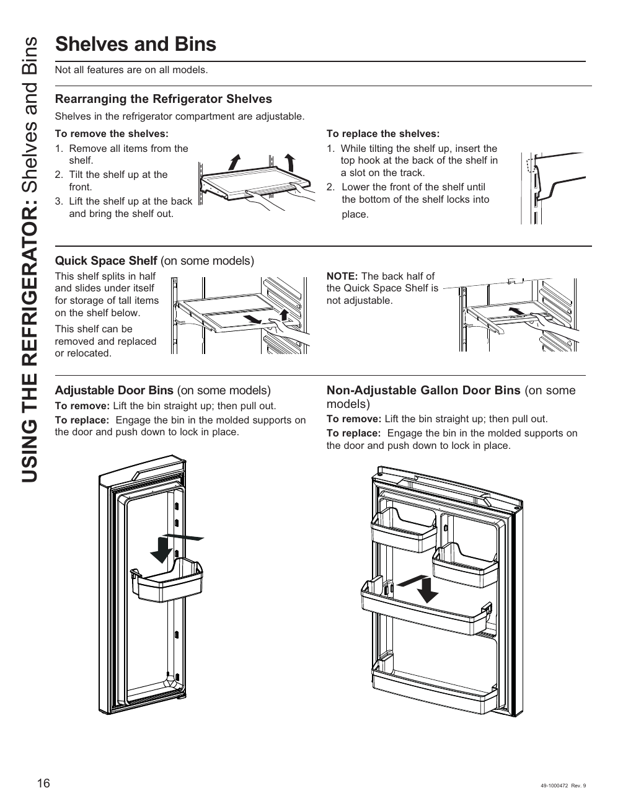

## PDF page 17

### Pans

Not all features are on all models.

#### Climate Zone Pans

Keep fruits and vegetables organized in separate

compartments for easy access. Excess water that may

accumulate in the bottom of the drawers or under the

drawers should be wiped dry.

To remove pan:

Slide the pan out to the stop position, lift the pan up and

past the stop position and pull forward.

#### Full -Width Pan (on some models)

To remove pan:

1. Pull the pan out to the stop position.

2. Lift the front of the drawer up and out.

To replace pan:

1. Place back of the drawer in first and rotate drawer

front down to seat it on the slides.

2. Push the drawer in to the closed position.

How to Remove and Replace Drawer Divider

To remove:

1. Pull the drawer out to the stop position.

2. Slide pan divider to right to release it from pan.

To replace:

Reverse steps 1 and 2 to replace drawer divider.

#### Floating Snack Pan (on some models)

This pan can be moved to the most useful location for

your family’s needs.

To remove, slide the pan out to the stop position, lift the

pan up and past the stop position and lift it out.

17

49-1000472 Rev. 9

### Original figure / page illustration (PDF page 17)

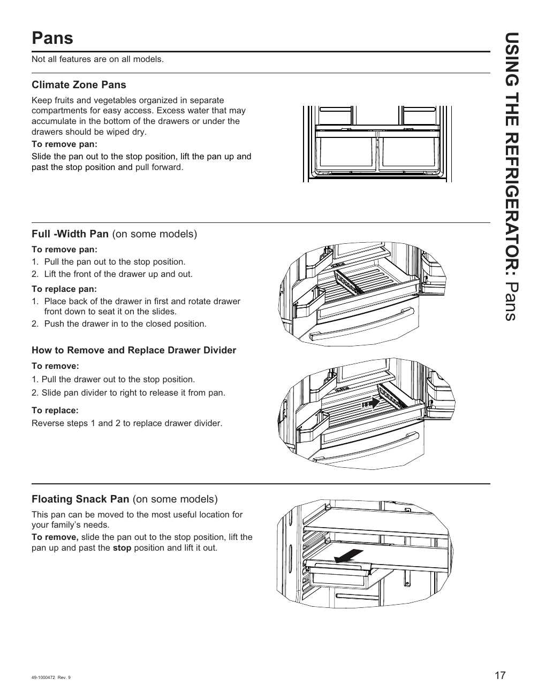

## PDF page 18

### Freezer Drawer (on some models)

Not all features are on all models.

#### FREEZER BASKETS

Ice Bucket

(on some models)

1. An ice bucket in the top basket

Top Basket

'LYLGHU

(on some models).

Top Basket

2. A top full-width basket.

3. A bottom full-width basket (with

divider - in some models).

NOTE: Do not fill baskets higher

Bottom

than the rim of the basket. This

Basket

Appearance and features

may cause baskets to stick or jam

may vary

when opening or closing.

#### Top Basket Removal

LED lights are located on

To remove the top full-width basket on freezer

both sides of the freezer

drawer models:

1. Pull the basket out to the stop location.

2. Lift basket up to release it from the slides.

When replacing the basket, make sure that the basket

remains mounted on the side rails and over the slides of

the bottom basket.

NOTE: Always be sure to fully close this basket.

#### Bottom Basket Removal

To remove the bottom full-width basket on freezer

drawer models:

1. Open the bottom freezer drawer until it stops.

2. Remove the top freezer basket.

3. The bottom freezer basket rests on the inside tabs on

the drawer slides.

4. Lift the front of the basket and pull forward.

5. Release the pin from the slot to remove the basket.

When replacing the bottom full-width basket, tilt the

basket back and lower it into the drawer. Rotate the

basket to a horizontal position and press down. Make

sure to place the pin back into the slot.

NOTE: Always be sure that the basket is seated on

the bracket tabs before sliding the drawer back into the

freezer.

18

49-1000472 Rev. 9

### Table (PDF page 18, 1)

| W models) | T ' T B B |
| --- | --- |
| e located on   the freezer |  |

### Table (PDF page 18, 2)

| 1 |  |  |  |
| --- | --- | --- | --- |
| 2 |  |  |  |
| 3 |  |  |  |

### Original figure / page illustration (PDF page 18)

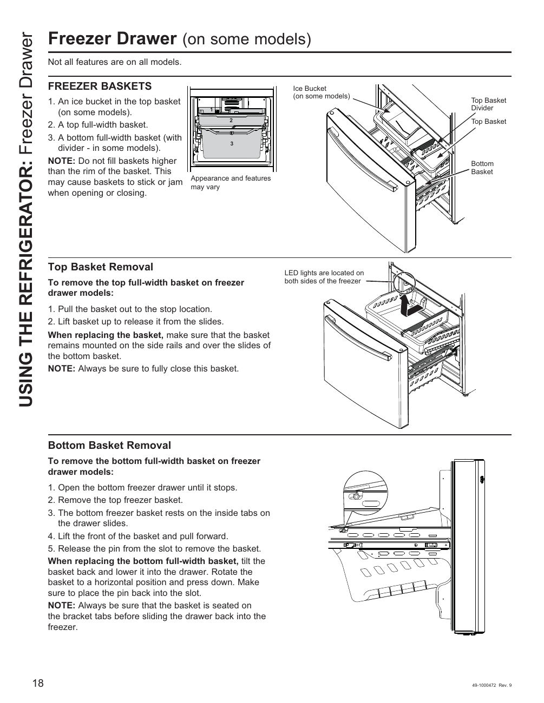

## PDF page 19

### Freezer Compartment

Not all features are on all models.

#### FREEZER SHELF AND BASKET

LED lights are located

on both sides of the

1. A full-width fixed wire shelf

freezer

2. A full-width sliding plastic

basket

NOTE: Do not fill baskets

1

higher than the rim. This may

cause basket to stick or jam

2

when opening or closing.

#### Basket Removal

To remove the full-width sliding basket on freezer

door models:

1. Open the basket out to its full extension.

2. Lift up the front of the basket and pull straight out to

remove.

When replacing the basket, insert the plastic basket

into the lower liner rails and push back into place.

#### Fixed Shelf Removal

NOTE: The full-width wire shelf is not intended to slide.

To remove for cleaning, push the shelf to one side

while then pull up on the opposite side and out to

remove.

To replace the full-width wire shelf, insert one side of

the shelf into the supports, pushing the shelf to that side

until the opposite side will fit into its supports.

19

49-1000472 Rev. 9

### Original figure / page illustration (PDF page 19)

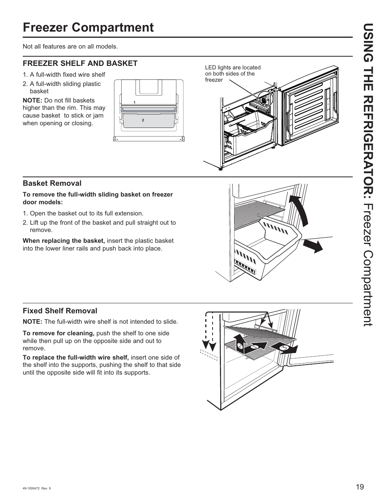

## PDF page 20

A newly installed refrigerator may take 12 to 24 hours to begin making ice.

To minimize the risk of personal injury, avoid contact with the moving parts of the ejector

mechanism, or with the heating element that releases the cubes. Do not place fingers or hands on the automatic ice

#### For Refrigerator Models with Icemaker in the Door

### Automatic Icemaker

WARNING Connect to potable water supply

only. A cold water supply is required for automatic

icemaker operation. The water pressure must be

between 25-120psi (172-827 kilopascals).

#### Automatic Icemaker (on some models)

The icemaker will produce seven cubes per cycle

approximately 100–130 cubes in a 24-hour period,

depending on freezer compartment temperature, room

temperature, number of door openings and other use

conditions.

If the refrigerator is operated before the water connection

is made to the icemaker, set the slide switch in the OFF

position. See Figure D.

When the refrigerator has been connected to the water

supply, set the slide switch to the ON position. See Figure D.

The icemaker will fill with water when it cools to 15ƒF

(–10°C). A newly installed refrigerator may take 12 to 24

hours to begin making ice cubes.

You may hear a buzzing sound each time the icemaker fills

with water.

#### CAUTION

making mechanism while the refrigerator is plugged in.

Ice Bucket and Dispenser

- Open the ice box door on inside of the left door.

- Pull up and out on the ice bucket in the left hand door

to remove it from the compartment .

‡ If the ice bucket is removed the ice maker will continue

to make ice unless you turn it off. To turn off the ice

maker, slide the on/off switch to off. See above figure D

for on/off instructions.

- To replace the ice bucket, set it on the guide brackets

and push until the ice bucket seats properly.

‡ If bucket cannot be replaced, rotate the ice bucket fork

1/4 turn clockwise.

- Ensure ice maker is turned back on, if it was switched

off during the bucket removal and installation.

20

Slide ON/OFF Switch

Icemaker

Figure D

Green

Power Light

Feeler Arm

(Green/Power light is always on)

(on some models)

Throw away the first few batches of ice to allow the water

line to clear.

Be sure nothing interferes with the sweep of the feeler arm.

When the bin fills to the level of the feeler arm, the

icemaker will stop producing ice. It is normal for several

cubes to be joined together.

If ice is not used frequently, old ice cubes will become

cloudy, taste stale and shrink.

NOTE: In homes with lower-than-average water pressure,

you may hear the icemaker cycle multiple times when

making one batch of ice.

Ice bucket

Latch

Ice bucket fork

49-1000472 Rev. 9

### Original figure / page illustration (PDF page 20)

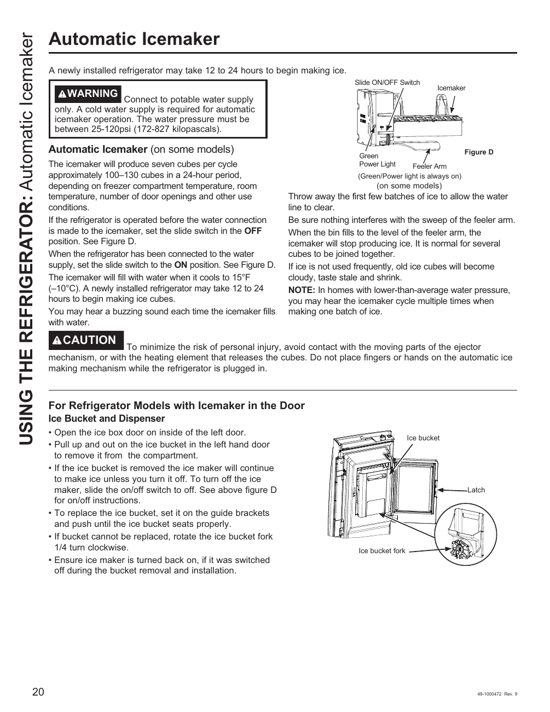

## PDF page 21

### Automatic Icemaker

#### For Refrigerator Models with Icemaker in the Freezer Compartment

Some models come with an icemaker installed in the

freezer compartment. For those models that come

ice-maker ready, you can purchase Kit IM4D. Visit our

Ice bucket

website at GEAppliances.com or call GE Appliances

Parts and Accessories, 877.959.8688 (in Canada

visit geappliances.ca/en/products/parts-filters-

accessories or call 1.800.661.1616).

There is ice storage in the freezer compartment located

on the left side of the upper basket. Pull the upper basket

forward to remove the ice bucket.

### Freezer Compartment Ice Maker (On Some Models)

#### A newly installed refrigerator may take 12 to 24 hours to begin making ice.

The icemaker will produce ten cubes per cycle

approximately 100-130 cubes in a 24-hour period

(On some models)

depending on the freezer compartment temperature,

room temperature, number of door opening and other

use conditions.

#### CAUTION

To minimize the risk of personal

injury, avoid contact with the moving parts of the ice

maker. Do not place fingers or hands on the ice making

mechanism while the refrigerator is plugged in.

Ice Maker Frame

ON/OFF Switch

ON/OFF Switch

Ice Maker

(On some models)

Figure E

21

49-1000472 Rev. 9

### Original figure / page illustration (PDF page 21)

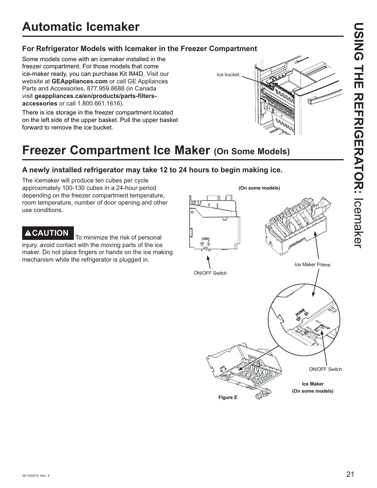

## PDF page 22

### Care and Cleaning

#### Cleaning the Outside

#### FINGERPRINT RESISTANT STAINLESS STEEL*, BLACK STAINLESS, SLATE, DARK

#### SLATE, PAINTED - Outside surfaces, door handles, and trim

DO NOT use Stainless Steel cleaners on the door surfaces.

IMPORTANT: The use of incorrect products may damage the outer finish of Fingerprint Resistant Stainless and

Black Stainless models. Please follow these instructions and use only the appropriate items below to clean your

Ɣ Clean interior/exterior surfaces with warm water, mild soap or detergent, and a soft or microfiber cloth to avoid

Ɣ Wipe the appliance surface dry with a soft clean cloth or microfiber towel to avoid streaking or water spotting.

appliance surfaces.

damage.

*Easily wipe away smudges and fingerprints.

#### STAINLESS STEEL - Outside surfaces, door handles, and trim

NOTE: DO NOT allow stainless steel cleaner to come in contact with any plastic parts such as trim pieces, handle

hardware and liners. If unintentional contact of cleaners with plastic parts does occur, clean plastic part with a

sponge and mild detergent mixed with warm water.

#### Cleaning the Inside

Unplug the refrigerator before cleaning.

If this is not practical, wring excess moisture out of

sponge or cloth when cleaning around switches, lights or

controls.

Use an appliance wax polish on the inside surface

between the doors.

Use warm water and baking soda solution²about a

tablespoon (15 ml) of baking soda to a quart (1 liter) of

water. This both cleans and neutralizes odors. Rinse and

wipe dry.

22

To clean the inside metal panel, open the outer door

using the Door in Door Latch. Clean the panel with a

mild detergent and then wipe dry with a soft cloth. Do not

use any stainless steel cleaner on the panel as it may

damage the surrounding plastic.

#### CAUTIONDo not clean glass shelves or covers

with warm water when they are cold. Glass shelves and

covers may break if exposed to sudden temperature

changes or impact such as bumping or dropping.

Tempered glass is designed to shatter into many small

pieces if it breaks.

49-1000472 Rev. 9

### Table (PDF page 22, 1)

| DO USE | DO NOT USE |
| --- | --- |
| Soft, clean cloth or sponge Microfiber cloth | Abrasive cloths, paper towels, scrubbing sponges (with or without soap), scouring or steel wool pads |
| Mild detergent mixed with warm water | Abrasive powders, liquids, or sprays Oven cleaners Window sprays, ammonia, or bleach Alkaline cleaners Citrus or plant oil-based cleaners Stainless steel cleaners Acidic or vinegar-based cleaners |

### Table (PDF page 22, 2)

| DO USE | DO NOT USE |
| --- | --- |
| Soft, clean cloth or sponge | Abrasive cloths, scrubbing sponges (with or without soap), scouring or steel wool pads |
| Mild detergent mixed with warm water Approved stainless steel cleaners  Visit the GE  Appliances parts store for approved stainless steel cleaners: GEApplianceparts.com or call 877.959.8688 Cleaners with oxalic acid such as Bar Keepers Friend Soft  Cleanser™ can be used to remove surface rust, tarnish and small blemishes on stainless steel surfaces only. | Abrasive powders or sprays Window Sprays or Ammonia Citrus or plant oil-based cleaners Acidic or vinegar-based cleaners Oven cleaners Cleaners containing acetone (propanone) Any cleaner with WARNING about plastic contact |

### Original figure / page illustration (PDF page 22)

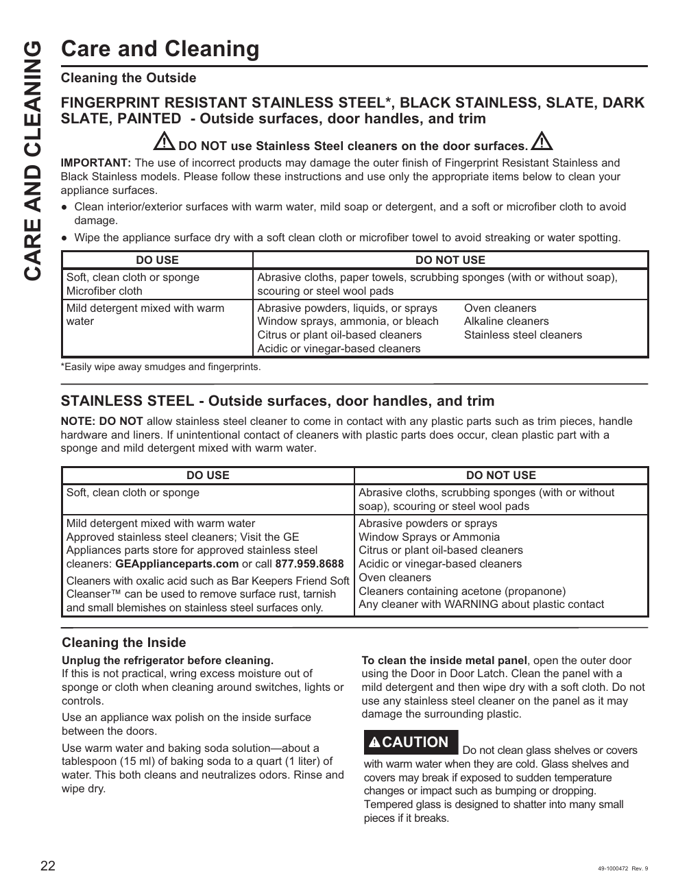

## PDF page 23

### Care and Cleaning

#### Behind the Refrigerator

Be careful when moving the refrigerator away from

the wall. All types of floor coverings can be damaged,

particularly cushioned coverings and those with

embossed surfaces.

Raise the leveling legs located at the bottom front of the

refrigerator.

#### Preparing for Vacation

For long vacations or absences, remove food and

unplug the refrigerator. Clean the interior with a baking

soda solution of one tablespoon (15 ml) of baking soda

to one quart (1 liter) of water. Leave the doors open.

If the temperature can drop below freezing, have a

qualified service technician drain the water supply

system to prevent serious property damage due to

flooding.

1) Turn refrigerator off (pages 8 and 9) or unplug the

refrigerator.

#### Preparing to Move

Secure all loose items such as shelves and drawers by

taping them securely in place to prevent damage.

When using a hand truck to move the refrigerator, do not

rest the front or back of the refrigerator against the hand

truck. This could damage the refrigerator.

#### Replacing the Lights

There is LED lighting in the refrigerator compartment

at the top center and on the left and right sides above

the climate zone pans on the french door models.

LED lighting is located at the top of the refrigerator

compartment on the single door models.

LED lights are also located at the top of the left and right

sides of the freezer in all models.

An authorized technician will need to replace the LED

light.

If this assembly needs to be replaced, call GE

Appliances Service at 1.833.4BODEWELL in the United

States or 1.800.561.3344 in Canada.

49-1000472 Rev. 9

Pull the refrigerator straight out and return it to position

by pushing it straight in. Moving the refrigerator in a side

direction may result in damage to the floor covering or

refrigerator.

Lower the leveling legs until they touch the floor.

When pushing the refrigerator back, make sure you

don’t roll over the power cord or water supply line.

2) Empty ice bucket

3) Turn water supply off

If you cut the water supply off, turn off the icemaker

(pg. 20).

Upon returning from vacation:

1) Replace the water filter.

2) Run 2 gallons of water through the cold water

dispenser (about 5 minutes) to flush the system.

Handle only from the sides of the refrigerator.

Be sure the refrigerator stays in an upright position

during moving.

LEDs (locations

may vary by

model)

23

### Original figure / page illustration (PDF page 23)

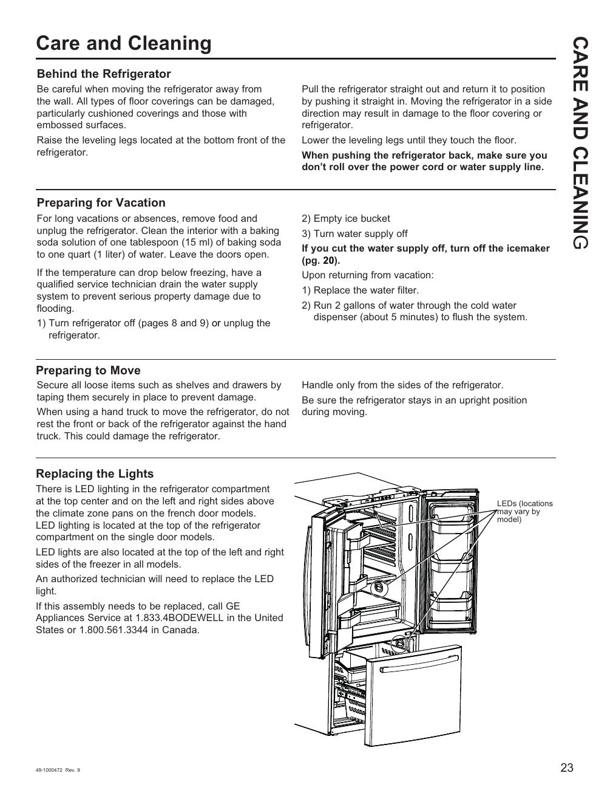

## PDF page 24

### Installation

### Instructions

### Refrigerator

nuestions\ \`all UPPKQ_labtbii or visit our tebsite atW db^ppliancesKcom

In Canada, call 1.800.561.3344 or visit our Website at: GEAppliances.ca

#### BEFORE YOU BEGIN

Read these instructions completely and

carefully.

### • IMPORTANT — Observe all

governing codes and ordinances. Save these

instructions for local inspector’s use.

- Note to Installer – Be sure to leave these

instructions with the Consumer.

- Note to Consumer – Keep these instructions

for future reference.

- Skill level – Installation of this appliance

requires basic mechanical skills.

- Completion time – Refrigerator Installation

20 minutes

Water Line Installation

30 minutes

- Proper installation is the responsibility of the

installer.

- Product failure due to improper installation is

not covered under the Warranty.

#### PREPARATION

MOVING THE REFRIGERATOR INDOORS

If the refrigerator will not fit through a doorway,

the refrigerator door and freezer drawer or door

can be removed.

- To remove the refrigerator door, see Step 1 in the

Reversing the Door Swing section.

‡ To remove the freezer drawer, see the Removing

the Freezer Drawer section.

WATER SUPPLY TO THE ICEMAKER AND

DISPENSER

If the refrigerator has an icemaker, it will have to be

connected to a cold water line. A GE Appliances

water supply kit (containing tubing, shutoff valve,

fittings and instructions) is available at extra

cost from your dealer, by visiting our website at

GEAppliances.com (in Canada at GEAppliances.

ca) or from Parts and Accessories, 877.959.8688 (in

Canada 1.800.661.1616).

24

#### TOOLS YOU MAY NEED

Ǫ´ and ǫ´ Socket

Adjustable Wrench

Ratchet/Driver

1/4´ Outer Diameter

Compression Nut

Phillips-Head Screwdriver

and Ferrule (sleeve)

(icemaker models only)

3/32´, 1/8´ & 3/16´ Allen

Wrenches

1/8´ Drill Bit and

Tape Measure

Electric or Hand Drill

Pencil

1/4´ Nut Driver

Level

Wire Cutters

Torx T20, Driver

49-1000472 Rev. 9

### Original figure / page illustration (PDF page 24)

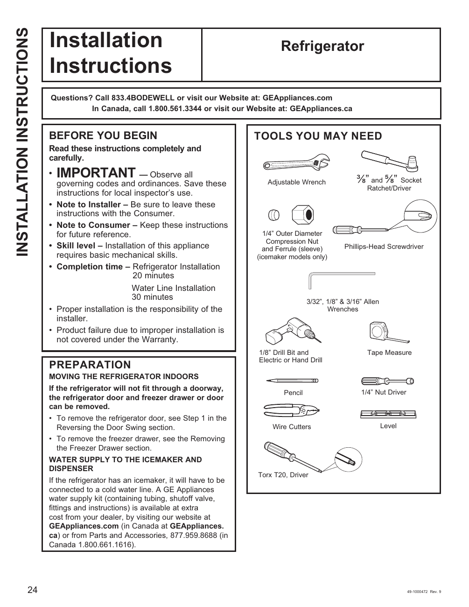

## PDF page 25

### Installation Instructions

Single Door Models with

Refrigerator and Freezer Doors

(some models)

#### NOTE: The height of the refrigerator to the top of the door. Includes the handle.

Measure width of cabinet opening where refrigerator will be placed, B.

Be sure to account for any countertop overhang, baseboard thickness

and any clearance desired. Width, B, should not be less than 30´-36´

(76.2 cm - 91.4 cm) (depending on model). The refrigerator will be

### APPLIANCE DIMENSIONS

Single Door Models

with Drawer (some models)

C

A

D

B

French Door Models

C

A

F

D

B

### MEASURE THE CABINET OPENING

### ACCORDING TO THE WIDTH OF THE

### REFRIGERATOR

placed approximately in the middle of this opening.

49-1000472 Rev. 9

G

F

H

90Û

155Û

I

E

G

155Û

E

I

Baseboard

Back Wall

Thickness or

Countertop

Overhang

(Whichever is

### B

Larger) Plus

Any Desired

Clearance

Right

REFRIGERATOR

Side

Front

25

### Table (PDF page 25, 1)

| G |  |  | H |
| --- | --- | --- | --- |
|  | 90Û I |  |  |

### Table (PDF page 25, 2)

| ITEM | 18/19 cuft models with french doors | 21 cuft models with single door | 21 cuft models with french doors | 21/22 cuft models with french doors | 25 cuft models with single door | 24/25 cuft models with french doors | 26/27 cuft models with french doors |
| --- | --- | --- | --- | --- | --- | --- | --- |
| A* | 69-7/8" (177.5 cm) | 69-7/8” (177.5 cm) | 69-7/8” (177.5 cm) | 69-7/8” (177.5 cm) | 69-7/8” (177.5 cm) | 69-7/8” (177.5 cm) | 69-7/8" (177.5 cm) |
| B | 33" (83.8 cm) | 30” (76.2 cm) | 30” (76.2 cm) | 36" (91.4 cm) | 33” (83.8 cm) | 33” (83.8 cm) | 36" (91.4 cm) |
| C** | 30-7/8" (78.4 cm) | 36-1/8” (91.8 cm) | 36-3/8” (92.4 cm) | 31" (78.7 cm) | 37-3/8” (94.9 cm) | 37-1/8” (94.3 cm) | 36-5/16" (92.2 cm) |
| D** | 41-3/32" (104.4 cm) | - | 54” (137.2 cm) | 42-3/4" (108.6 cm) | 54-3/4” (139.1 cm) | 54-3/4” (139.1 cm) | 50-3/16" [127.5 cm] |
| E | 48-3/8" (122.8 cm) | 55” (139.7 cm) | 54-7/8” (139.4cm) | 54-13/16" (139.2 cm) | 60-1/2” (153.7 cm) | 60-1/2” (153.7 cm) | 54-13/16" (139.2 cm) |
| F | 39-17/32" (100.4 cm) | 45-5/8” (115.9 cm) | 37” (94 cm) | 38-13/32" (97.55 cm) | 48” (121.9 cm) | 38-3/4” (98.4 cm) | 43-23/32" (111.1 cm) |
| G | 28-7/8" (73.3 cm) | 33-7/8” (86 cm) | 34-3/8” (87.3 cm) | 26-3/4" (67.9 cm) | 34-7/8” (88.6 cm) | 35-3/8” (89.9 cm) | 33-13/16" (85.9 cm) |
| H | 41-15/16" (106.5 cm) | 61” (154.9 cm) | 45-7/8” (116.5 cm) | 43-3/8" (110.2 cm) | 65” (165.1 cm) | 48-3/8” (122.9 cm) | 48-3/4" (123.8 cm) |
| I** | 40-1/2" (102.9 cm) | 33-1/2” (85.1 cm) | 37-5/8” (95.6 cm) | 43-3/8" (110.2 cm) | 36” (91.4 cm) | 40-1/2” (102.9 cm) | 43-3/8" (110.2 cm) |

### Original figure / page illustration (PDF page 25)

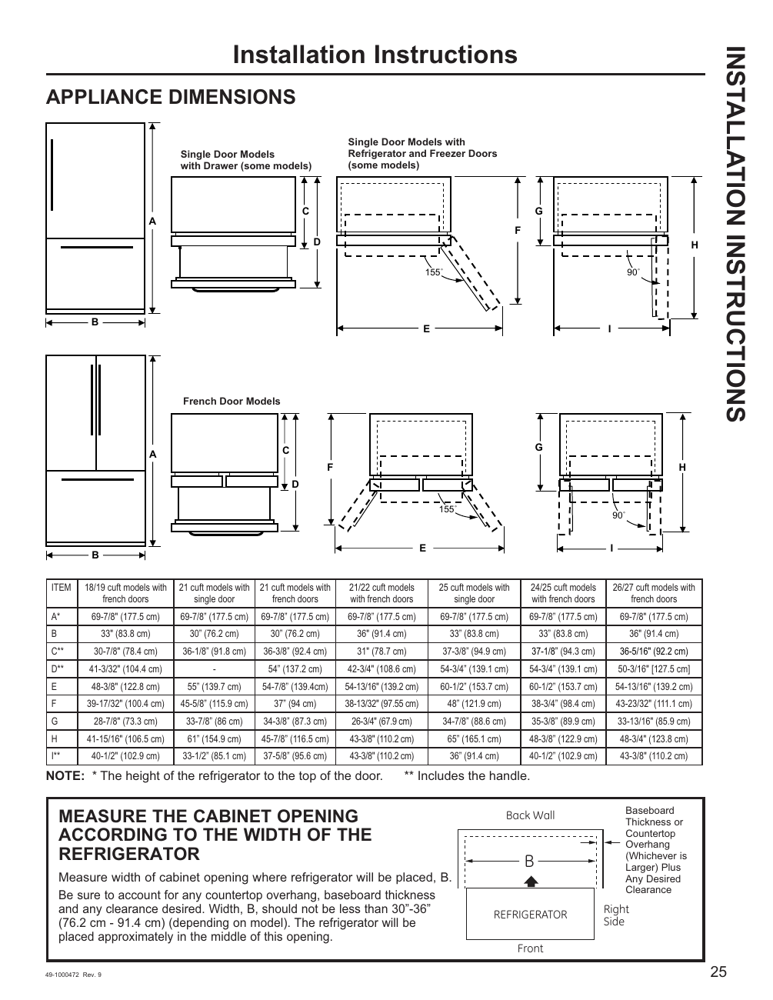

## PDF page 26

### Installation Instructions

#### INSTALLING THE REFRIGERATOR

#### REFRIGERATOR LOCATION

- Do not install the refrigerator where the

temperature will go below 60ƒF (16ƒC) because

it will not run often enough to maintain proper

temperatures.

- Do not install the refrigerator where the

temperature will go above 100ƒF (37ƒC) because it

will not perform properly.

- Do not install the refrigerator in a location exposed

to water (rain, etc.) or direct sunlight.

- Install it on a floor strong enough to support it fully

loaded.

#### CLEARANCES

Allow the following clearances for ease of installation,

proper air circulation and plumbing and electrical

connections.

Sides

1/8´ (3 mm)

Top

1´ (25 mm) Cabinet/Hinge Cover

Back

2´ (50 mm)

#### IMPORTANT NOTES

This refrigerator without the handles ranges from

26-3/4´ to 35-3/8´ (67.9 cm - 89.9 cm) depending

on your model (see dimension G on the previous

page). Doors and passageways leading to the

installation location must be at least 36´ (91.4 cm) in

order to leave the doors attached to the refrigerator

while transporting it into the installation location.

If passageways are less than 36´ (91.4 cm), the

refrigerator doors can easily be scratched and

damaged. The doors can be removed to allow the

refrigerator to be safely moved indoors.

- If you need to remove the door and you have the

french door model, see Removing French Doors.

- If you need to remove the door and you have the

single refrigerator door model, see Reversing the

Door.

- To remove the freezer door and you have the

model with a freezer drawer see Removing

Freezer Drawer.

- If you have the model with the hinged freezer door

see Reversing the Door.

- If it is NOT necessary to remove doors, skip to

Page 31. Leave tape and all packaging on doors

until the refrigerator is in the final location. Once in

place, install door handles (see Steps 1 and 2).

- SKID REMOVAL: Tilt refrigerator to each side to

remove skid.

- NOTE: Use a padded hand truck to move this

refrigerator. Place the refrigerator on the hand

truck with a side against the truck. We strongly

recommend that TWO PEOPLE move and

complete this installation.

26

#### ATTACH REFRIGERATOR

1

#### HANDLES

Attach refrigerator handle to the mounting

fasteners by aligning the slots on the handle with

the mounting fasteners. Slide the handle down

until it comes to a hard stop.

NOTE: For French

Mounting

Door models,

)DVWHQHUV

follow the same

procedure for both

doors.

Verify handle is

securely attached

by pulling handle

upwards.

#### ATTACH FREEZER HANDLE

Follow instructions for corresponding

fastener type

WARNING

Improper handle installation

may allow the handle to detach when it is used to

open the freezer door. A handle that detaches while

in use may cause the user to lose their balance,

which creates a fall risk.

Before You Start….

- To avoid injury, wear closed-toe shoes when

installing the handles.

- While installing the handle, grasp the handle

firmly to ensure it does not fall or scratch the

appliance’s finish.

- IMPORTANT: To make sure the handles are

accurately installed, please review the instructions

and graphics before you begin installation.

49-1000472 Rev. 9

### Original figure / page illustration (PDF page 26)

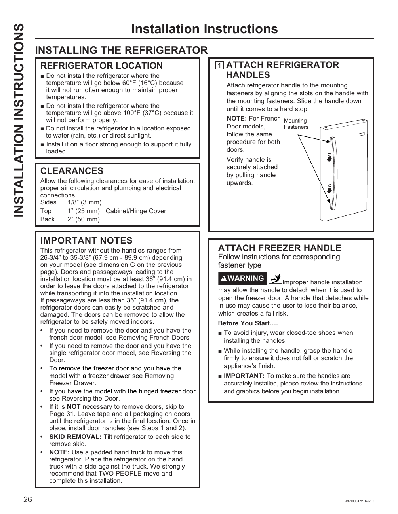

## PDF page 27

### Installation Instructions

#### INSTALLING THE REFRIGERATOR

#### SLIDE-ON TYPE FREEZER

2A

#### HANDLE

Install the freezer handle to the mounting fasteners by

aligning the slots inside the handle endcap with the

mounting fasteners. Being careful to avoid scratching

the door finish, slide the handle to the right until it comes

to a hard stop.

)DVWHQHUV

Slot

Freezer Handle

Endcap

Use a rubber mallet (if unavailable, a hammer with a

towel wrapped around head of hammer can be used as

well), to gently tap the left side of handle until the handle

no longer moves left or right. A few taps should be

used rather than using heavy force which can cause

handle/endcaps to get damaged.

49-1000472 Rev. 9

#### 2BFREEZER HANDLE WITH

#### SET-SCREWS

- IMPORTANT: Do not use power tools to

tighten set screws.

Tools Provided:

- 1/8´ hex key

Handle appearance may vary based on model;

however, the installation process is the same.

Remove any protective film from the door

A

or drawer fronts before installing handles (if

applicable).

Remove handle from packaging and locate

B

the provided 1/8´ hex key.

C

Place the handle over the mounting fasteners

until it is flush against the surface of the door.

Tighten both set screws in the handle end

'

caps by turning the 1/8´ hex key clockwise

until the handle will not hang loose or fall

from its mounting. Do not fully tighten yet.

IMPORTANT: Hold the handle firmly against

E

the door, make sure there are no gaps

between the handle end caps and the door,

and fully tighten the set screws.

To remove, reverse the installation process.

)

27

### Original figure / page illustration (PDF page 27)

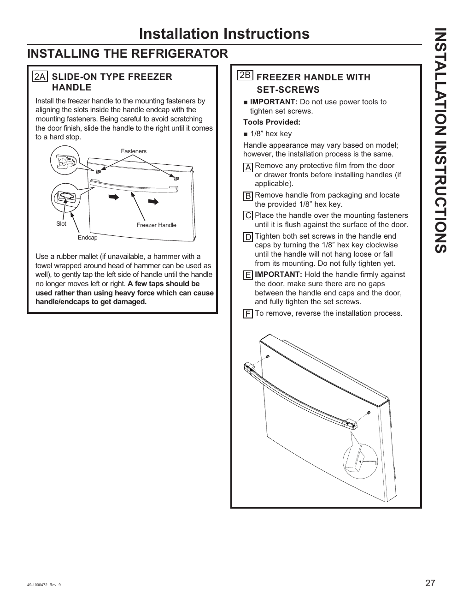

## PDF page 28

### Installation Instructions

#### INSTALLING THE REFRIGERATOR (Cont.)

#### REMOVING FRENCH DOORS

(on some models)

WARNINGFollow all steps when reversing

the door swing. Failure to follow these instructions,

leaving off parts, or overtightening screws, can lead

to the door falling off and result in injury and property

damage.

#### IMPORTANT NOTES

When removing french doors:

- Read the instructions all the way through before

starting.

- Handles are included inside the refrigerator.

- Place the screws by their related parts to avoid

using them in the wrong places.

- Provide a non-scratching work surface for the

doors.

#### CAUTIONLifting Hazard.

Single person lift can cause injury. Use assistance

when handling, moving or lifting the refrigerator

doors.

NOTE: When moving door, to prevent damage to

door and electronics carefully place the door in a

proper location.

WARNING

To eliminate the risk of electric shock or injury

during installation, you must first unplug the

refrigerator before proceeding. Failure to follow

these instructions can result in electrical shock.

Tape the doors shut with adhesive tape.

28

#### 1 REMOVINGRIGHT DOOR

A. Remove the hinge cover on top of the right

refrigerator door by removing the screw using

a Phillips screwdriver.

B Using a 5/16´ socket ratchet/driver, remove the

bolts securing the top hinge to the cabinet. Lift

the hinge support straight up to free the hinge

pin from the socket in the top of the door.

C. Remove the tape from the right door and tilt

the door away from the cabinet. Lift the door

off the center hinge pin.

D. Set the door on a non-scratching surface with

the inside up.

#### 2REMOVING LEFT DOOR

A. For Ice and Water Models Only: Unplug the

water line from the back of the refrigerator

and remove all tape that fixes the water line

to the refrigerator.

49-1000472 Rev. 9

### Original figure / page illustration (PDF page 28)

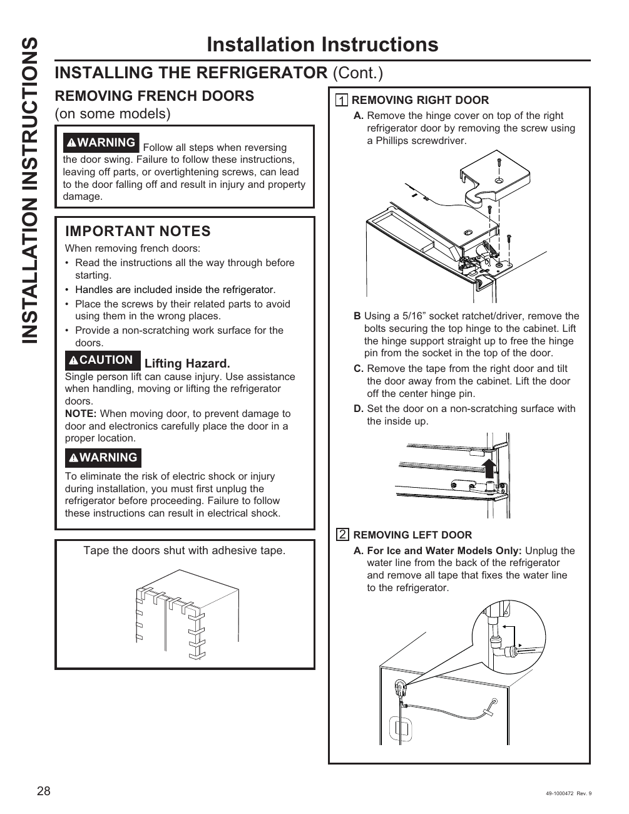

## PDF page 29

### Installation Instructions

#### INSTALLING THE REFRIGERATOR (Cont.)

#### 2 REMOVING LEFT DOOR (cont.)

B. Remove the hinge cover on top of the left

refrigerator door by removing the screw using

a Phillips screwdriver.

C. Unplug the 3 wire connectors and move the

wires until you can see the screws holding

the hinge.

For Ice and Water Models Only: Pull the

water line very carefully.

Water Line

Wire

(Ice and Water

Connectors

Models Only)

D. Using a 5/16´ socket/ratchet driver, remove

the bolts securing the top hinge to the

cabinet.

Wire Connectors

Bolts

Water Line

(Ice and

Water

Models

Only)

49-1000472 Rev. 9

29

### Table (PDF page 29)

| For NON Ice and Water Models Only: Lift the hinge straight up to free the hinge pin from the socket in the top of the door and pass the wire through the slot in the hinge. For Ice and Water Models Only: Do not remove hinge from the door. E. Remove the tape from the door, open the door 90 degrees and tilt the door away from the cabinet. Lift the door off the center hinge pin. F. Set the door on a non-scratching surface with the inside up. |  |
| --- | --- |
| 3 REMOVING CENTER HINGES AND BRACKETS ^K Using a 1/4´ Allen wrench, remove the 2 hinge pins from the hinge brackets. _K  Using a 5/16´ socket/ratchet driver, remove the bolts securing the center hinge brackets to the cabinet. |  |

### Original figure / page illustration (PDF page 29)

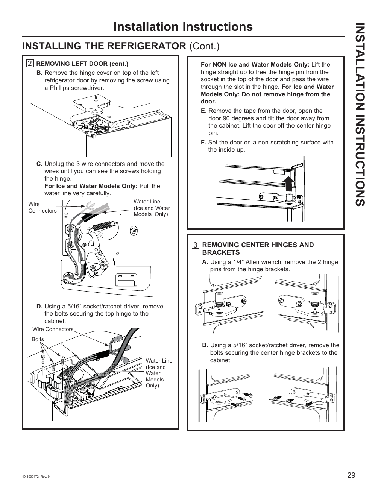

## PDF page 30

### Installation Instructions

#### INSTALLING THE REFRIGERATOR (Cont.)

#### REINSTALLING FRENCH DOORS (on some models)

#### IMPORTANT NOTES

When replacing the french doors:

- Read the instructions all the way through before

starting.

#### CAUTIONLifting Hazard.

Single person lift can cause injury. Use assistance

when handling, moving or lifting the refrigerator

doors.

NOTE: When moving door, to prevent damage to

door and electronics carefully place the door in a

proper location.

WARNING

To eliminate the risk of electric shock or injury

during installation, you must first unplug the

refrigerator before proceeding. Failure to follow

these instructions can result in electrical shock.

#### 1REINSTALLINGCENTER HINGE

BRACKETS AND HINGES

A. Using a 5/16´ socket/ratchet driver, reinstall

the bolts and center hinge brackets to the

cabinet.

B. Using a 1/4´ Allen wrench, reinstall the 2

hinge pins into the hinge brackets.

30

#### 2 REHANGING THERIGHT DOOR

A. Lower the refrigerator door onto the right

hinge pin.

B. Make sure the door is aligned with the

cabinet. Attach the hinge to the top of the

cabinet loosely with bolts removed earlier.

C. Make sure the gasket on the door is flush

against the cabinet and is not folded. Tighten

the bolts to 60 lb/in.(6.78 Nm).

D. Replace the right hinge cover on top of the

refrigerator using a Phillips screwdriver.

#### 3REHANGING THE LEFT DOOR

A. For NON Ice and Water Models Only: Pass

the wire through the slot in the hinge. Place

the hinge pin into the top of the door.

B. Lower the refrigerator door onto the left

hinge pin.

49-1000472 Rev. 9

### Original figure / page illustration (PDF page 30)

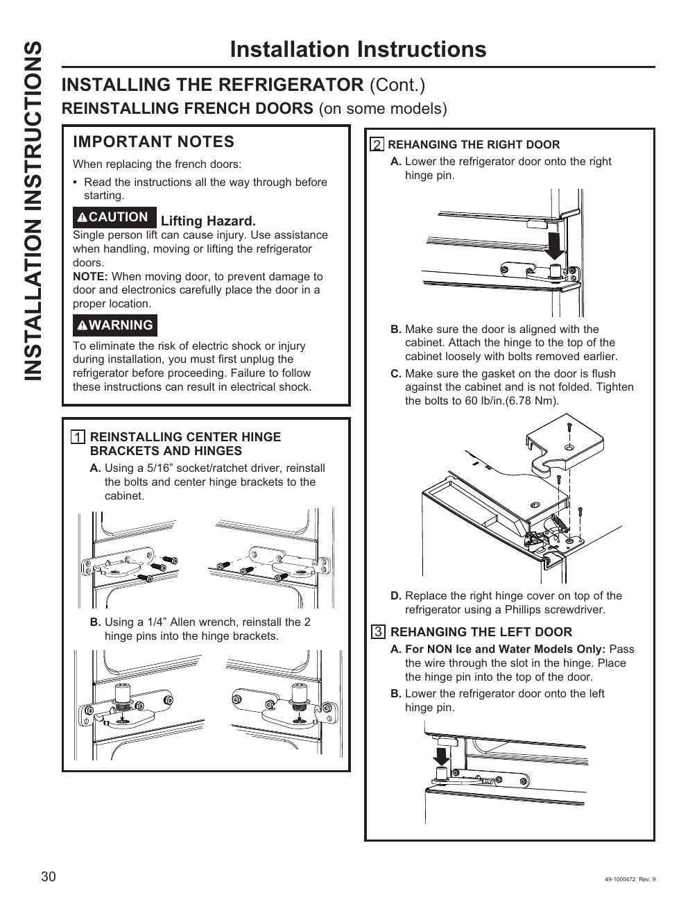

## PDF page 31

### Installation Instructions

#### INSTALLING THE REFRIGERATOR (Cont.)

#### REINSTALLING FRENCH DOORS (Cont.) (on some models)

#### 3 REHANGING THE LEFT DOOR (Cont.)

C. Make sure the door is aligned with the

cabinet. Attach the hinge to the top of the

cabinet loosely with bolts removed earlier.

D. Make sure the gasket on the door is flush

against the cabinet and is not folded. Tighten

the bolts to 60 lb/in. (6.78 Nm).

Wire Connectors

Bolts

Water Line

(Ice and

Water

Models

Only)

E. Plug the wire connectors together and rout the

wire inside the plastic port.

Water Line

Wire

(Ice and Water

Connectors

Models Only)

49-1000472 Rev. 9

F. For Ice and Water Models Only: Put the

water line into the hole and pass through the

plastic port to the back of the refrigerator.

Plug the water line back into the fixture on

back of the refrigerator. Tape water line to

the refrigerator.

G. Replace the left hinge cover on top of the

refrigerator using a Phillips screwdriver.

31

### Original figure / page illustration (PDF page 31)

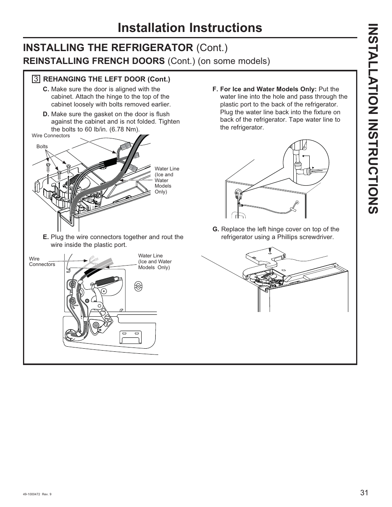

## PDF page 32

### Installation Instructions

#### INSTALLING THE REFRIGERATOR (Cont.)

#### REMOVING FREEZER DRAWER

(on some models)

#### IMPORTANT NOTES

When removing freezer drawer:

- Read the instructions all the way through before

starting.

- Provide a non-scratching work surface for the

doors.

#### 1REMOVE THE BASKETS

A. Open the freezer drawer until it stops.

B. Pull the top basket out until it stops. Lift the

basket up on the front and out to remove.

C. The lower basket rests on a frame inside the

freezer drawer. Lift the front of the basket

and pull it forward. Release the pins from the

slots on the frame to remove the basket.

32

#### 2 REMOVE THE DRAWER FRONT

A. Remove the screw on each side of the

railing.

Screw

B. Lift up on both sides of the freezer drawer

handle to separate the drawer railings from

the rail assemblies.

Drawer

Assembly

Rail

Assembly

C. Set the drawer front on a non-scratching

surface.

D. Push the rail assemblies back into locking

position.

49-1000472 Rev. 9

### Original figure / page illustration (PDF page 32)

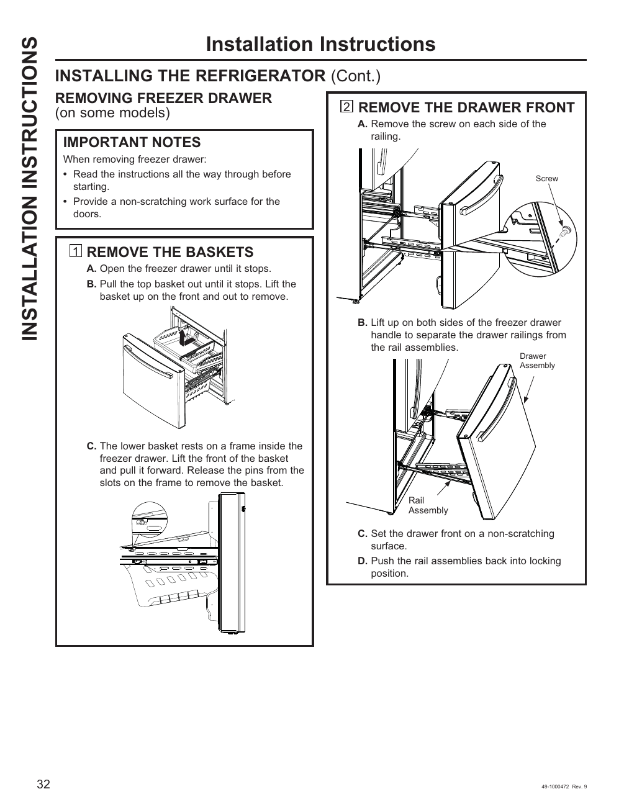

## PDF page 33

### Installation Instructions

#### INSTALLING THE REFRIGERATOR (Cont.)

#### REINSTALL FREEZER DRAWER (on some models)

#### 3REINSTALL FREEZER DRAWER FRONT

A. Pull the rail assemblies to the maximum

extension.

B. Locate the slots on the inside of each slide.

C. I nsert the hooks on the ends of the drawer

assembly extensions into the slots near the

back of the slides.

Hook

Slot

Side Tab

Front Slot

49-1000472 Rev. 9

D. Lower the front end of the freezer drawer

assembly so the side tabs fit into the front slots

on the rail assemblies.

E. Replace the safety screws in both sides of the

slide assemblies.

F. Replace lower and upper baskets (see About

freezer drawer, page 18).

33

### Original figure / page illustration (PDF page 33)

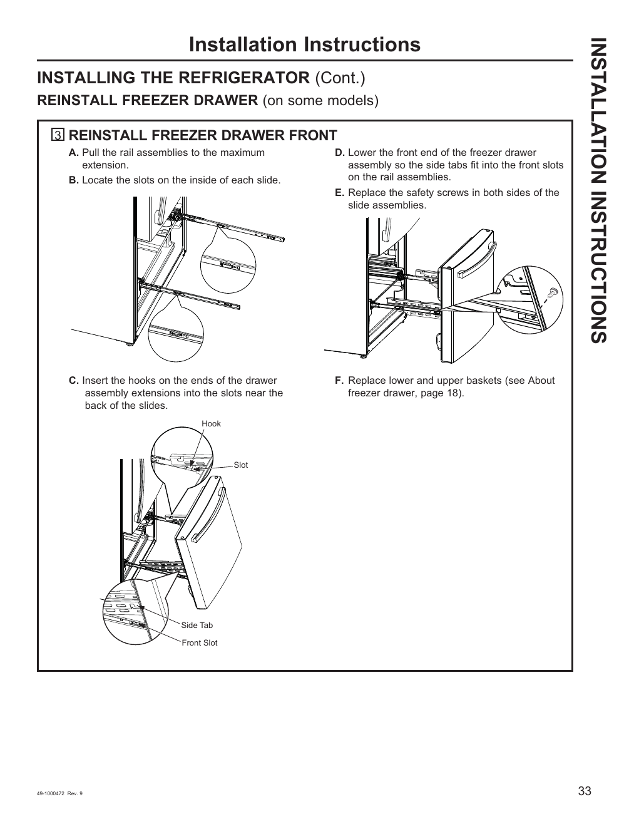

## PDF page 34

### Installation Instructions

#### INSTALLING THE REFRIGERATOR (Cont.)

#### REVERSING THE DOOR

(on some models)

WARNINGFollow all steps when reversing

the door swing. Failure to follow these instructions,

leaving off parts, or overtightening screws, can lead

to the door falling off and result in injury and property

damage.

#### IMPORTANT NOTES

When reversing doors:

- Read the instructions all the way through before

starting.

- Logo badge, handles, plugs and right hinge

cover are included inside the refrigerator (some

models).

- Place the screws by their related parts to avoid

using them in the wrong places.

- Provide a non-scratching work surface for the

doors.

#### CAUTIONLifting Hazard.

Single person lift can cause injury. Use assistance

when handling, moving or lifting the refrigerator

doors.

NOTE: When removing door, to prevent damage to

door and electronics carefully place the door in a

proper location.

NOTE: The lower door hinge pin and hinge are

keyed and must be matched correctly for the door

to self close properly. Please follow directions

carefully.

Freezer door is heavy. Use both hands to secure

the door before lifting.

WARNING

To eliminate the risk of electric shock or injury

during installation, you must first unplug the

refrigerator before proceeding. Failure to follow

these instructions can result in electrical shock.

#### 1 REMOVE THE REFRIGERATOR

#### DOORS

A. Tape the door shut with masking tape.

34

#### 1 REMOVE THE REFRIGERATOR

#### DOORS (Cont.)

B. Remove right and left hinge covers on top of

the refrigerator using a Phillips screwdriver.

C. Using a 5/16´ socket/

ratchet driver, remove

the bolts securing

the top hinge to the

cabinet. Lift the hinge

straight up to remove.

D. Remove the tape and

tilt the refrigerator door

away from the cabinet.

Lift the door off of the center hinge pin.

E. Set the refrigerator door on a non-scratching

surface with the inside up.

For Models With a Freezer DRAWER:

F. Using a 1/4´ Allen wrench,

remove the hinge pin from

the hinge bracket. The hinge

pin will be used again on the

opposite side.

G. Using a 5/16´ socket/ratchet

driver, remove the bolts

securing the center hinge to the cabinet.

49-1000472 Rev. 9

### Original figure / page illustration (PDF page 34)

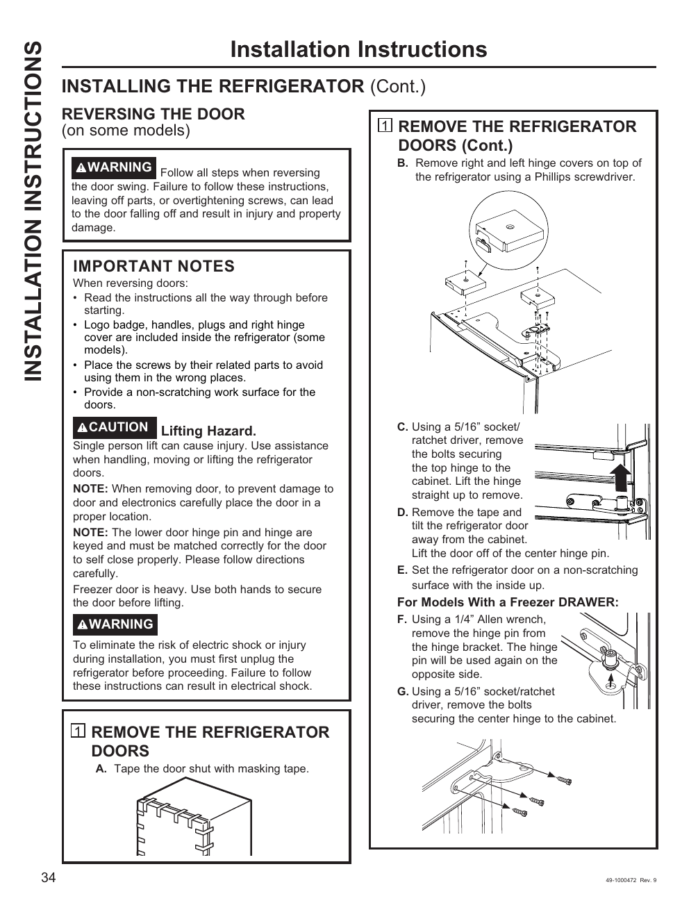

## PDF page 35

### Installation Instructions

#### INSTALLING THE REFRIGERATOR (Cont.)

#### 1 REMOVE THE REFRIGERATOR DOORS (Cont.)

H. Remove the button plugs on the left side of the

cabinet across from where the hinge bracket

was located and install in the holes where the

bracket was removed.

I. Flip the center hinge

bracket and install

on the left side of the

cabinet where the

button plugs were

removed.

J. Using a 1/4´ Allen

wrench, install the hinge pin into the center

hinge bracket.

For Models With a Freezer DOOR:

F. Tape the freezer door shut with adhesive tape.

G. Using a 1/4´ Allen wrench,

remove the hinge pin from

the hinge bracket. The

hinge pin will be used

again on the opposite

side.

H. Remove the tape and tilt the door away from

the cabinet. Lift the door off of the bottom hinge

pin.

I. Using a thing-blade screwdriver remove the

button plug from the top left side of the door

and install it on the opposite side.

J. Set the door on a non-scratching surface with

the inside up.

49-1000472 Rev. 9

K. Using a 5/16´ socket/

ratchet driver, remove

the bolts securing the

center hinge to the

cabinet.

L. Locate the button plugs in the kit and install

them in the opposite side of center hinge.

M. Flip the center hinge

bracket. Using a 5/16´

socket/ratchet driver, install

the center hinge bolt on the

left side of the cabinet and

torque to 60 in-lb.

(6.78 Nm).

N. Using a 1/4´ Allen wrench, install the hinge pin

into the center hinge bracket. Do not let the pin

go past the bottom of the bracket.

O. Using a 5/16´ socket/

ratchet driver, remove

the screws from

the bottom hinge

bracket. These will

be reinstalled on the

other side. Pull up

on the hinge pin to

remove.

P. Using a Torx T-20

screwdriver, remove the

screw from the cabinet and

install it on the other side.

Q. Using 5/16´ socket/

ratchet driver, install

the bottom hinge

bracket and torque

the screws to 60

in-lb. (6.78 Nm).

Remount the hinge

and pin in the opposite hole on the cabinet.

35

### Original figure / page illustration (PDF page 35)

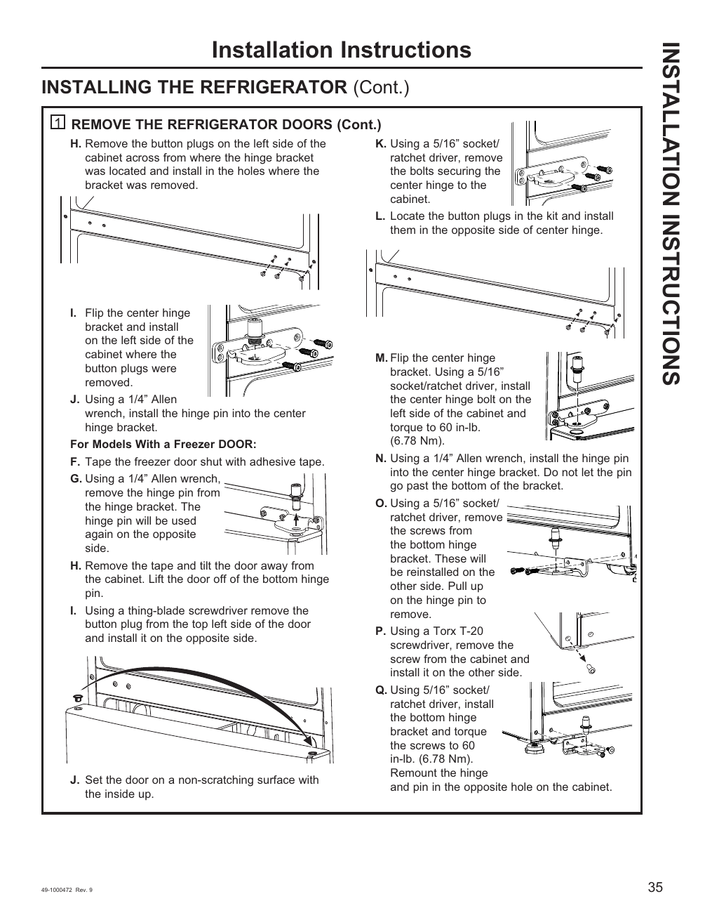

## PDF page 36

### Installation Instructions

#### INSTALLING THE REFRIGERATOR (Cont.)

WARNINGFollow all steps when reversing

the door swing. Failure to follow these instructions,

leaving off parts, or overtightening screws, can lead

to the door falling off and result in injury and property

damage.

#### 2REINSTALL FREEZER DOOR

A. Using a Torx T-20 screwdriver, remove the

bolts securing the door stop on the bottom

right of the door.

B. Using a Trox T-20 screwdriver, remove the

plastic force closure on the bottom right of the

door.

C. Flip the plastic force closure and mount it to

the bottom left of the door.

D. I nstall the door stop to the bottom left of the

door.

Force closure

Door stop

E. Lower the freezer door and make sure to insert

the hinge pin in the bottom hole of the door.

F. Straighten the door and line it up with the

center hinge bracket. Using a 1/4´ Allen

wrench, turn the hinge pin until it extends

through the hinge bracket and into the door.

36

#### 3REINSTALL REFRIGERATOR

#### DOOR

A. Using a Torx T-20 screwdriver, remove the

bolts securing the door stop on the bottom

right of the door.

Force closure

Plastic Thimble

Door stop

B. Transfer the plastic thimble to the opposite

hole. Install the door stop with the plastic

thimble on the opposite side.

C. Using a Trox T-20 screwdriver, remove the

plastic force closure on the bottom right of the

door.

D. Flip the plastic force closure and mount it to

the bottom left of the door.

E. Install the door stop to the bottom left of the

door.

F. Lower the refrigerator door and make sure to

insert the hinge pin in the bottom hole of the

door.

G. Remove the hinge base from the hinge. Flip

the hinge over and remount to hinge base.

Hinge base

Hinge

49-1000472 Rev. 9

### Original figure / page illustration (PDF page 36)

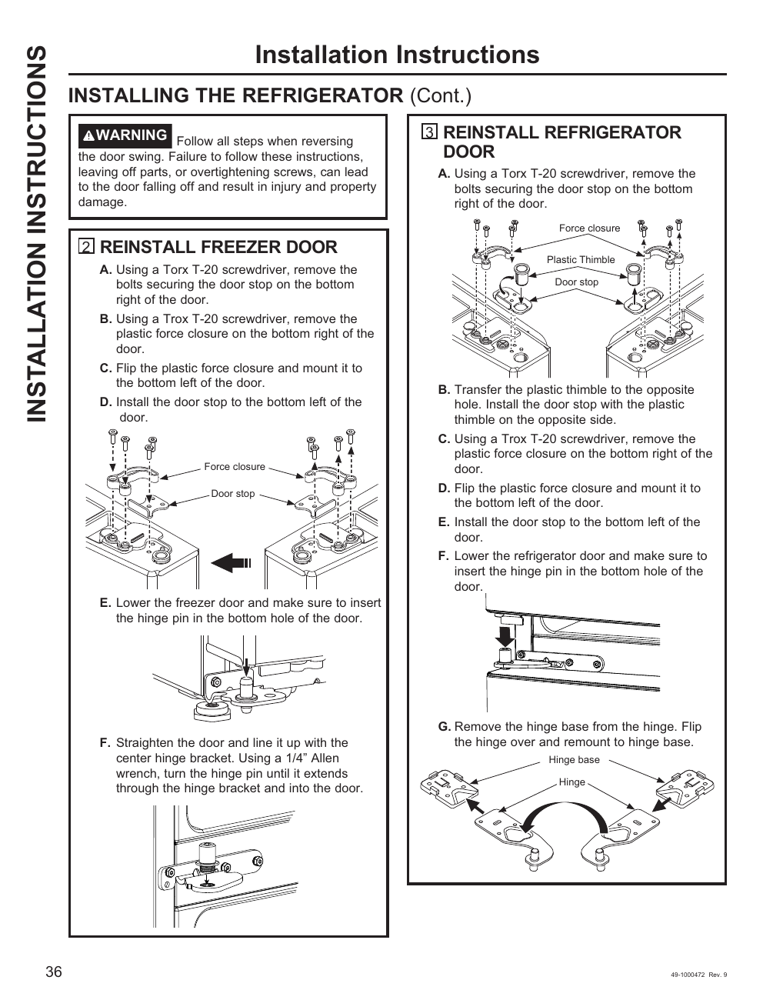

## PDF page 37

### Installation Instructions

#### INSTALLING THE REFRIGERATOR (cont.)

#### 3REINSTALL REFRIGERATOR

#### DOOR (Cont.)

H. Insert the top hinge pin inside the hole in the

top left of the refrigerator door. Make sure

the door is aligned with the cabinet. Attach

the hinge to the top of the cabinet loosely

with the bolts that were removed previously.

Make sure the gasket

on the door is flush

against the cabinet

and not folded.

Support the door on

the handle side and

make sure the door is

straight and the gap

between the doors is

even across the front.

While holding the

door in place, tighten

the screws to 60 in-lb.

(6.78 Nm).

For Models with a Freezer DRAWER:

I. Remove the front insert from the left hinge

cover. Install the left hinge cover using a

Phillips screwdriver and the screw removed

earlier.

Front insert

J. Install the front insert into the right hinge

cover. Install the right hinge cover using a

Phillips screwdriver and the screws removed

earlier.

Front

insert

For Models with a Freezer DOOR:

I. Locate the left hinge

cover that comes

with the kit. Using a

Phillips screwdriver,

install the cover with

the screws provided.

49-1000472 Rev. 9

#### 3REINSTALL REFRIGERATOR

#### DOOR (Cont.)

J. Locate the insert for the right hinge cover that

comes with the kit and install.

Front insert

K. Using a Phillips screwdriver, install the right

hinge cover with screws provided.

#### 4TRANSFER HANDLE

#### MOUNTING FASTENERS

A. Remove the plug from the lower right hole.

B. Using a Phillips screwdriver remove the

screws holding the mounting brackets from

the left side and install them on the right side.

Remove plug

#### 5INSTALLING LOGO BADGE

A. Locate the new logo

badge from the kit.

Remove the adhesive

backing paper and align

the pins on the back

of the badge with the

holes in the door. Apply

pressure to the badge to

ensure it sticks to the door.

B. Locate the button plug from

the kit and install it in the

opposite side of handle.

37

### Original figure / page illustration (PDF page 37)

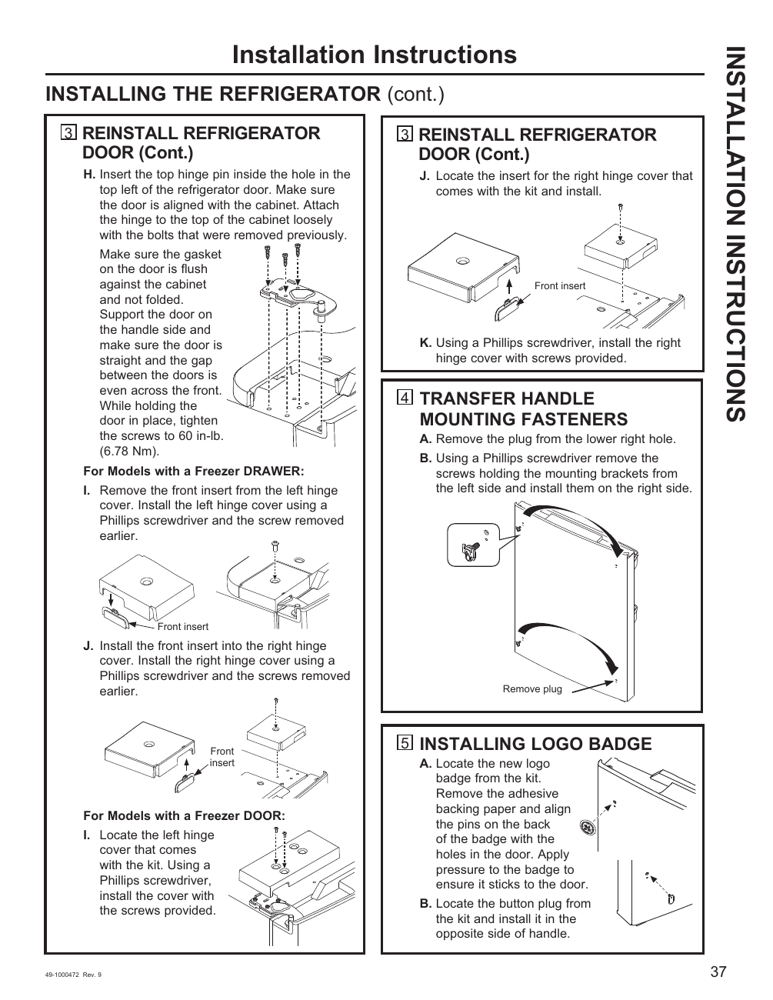

## PDF page 38

### Installation Instructions

#### INSTALLING THE REFRIGERATOR (cont.)

#### CONNECTING TO THE HOUSE WATER LINE

WARNING

Connect to potable water supply only. A cold water

supply with water pressure between 25 and 120 psi

(172 – 827 kilopascals) is required to operate the

water dispenser and ice maker.

#### (icemaker and dispenser models)

NOTES:

- Before making the connection to the refrigerator, be

sure the refrigerator power cord is not plugged into

the wall outlet.

- Before connecting the water line to the house, purge

the house line for at least 2 minutes.

- Some models have the refrigerator connection at

the water valve (Configuration 1). Other models

have the refrigerator connection at the end of

tubing located outside the compressor compartment

access cover (Configuration 2).

- On Configuration 1 Models, the

refrigeration connection is at the

water valve, remove the plastic

flexible cap, as shown here.

Water supply connection.

If you are using copper tubing, place a

compression nut and ferrule (sleeve) onto the end

of the tubing coming from the house cold water

supply.

If you are using Universal water line tubing, the

nuts are already assembled to the tubing.

Refrigerator Connection.

If you are using copper tubing, insert the end of

the tubing into the refrigerator connection, at the

back of the refrigerator, as far as possible. While

holding the tubing, tighten the fitting.

#### TURN ON THE WATER SUPPLY

(Icemaker models only)

Turn the water on at the

shutoff valve (house water

supply) and check for any

leaks.

38

WARNING

ELECTRIC SHOCK HAZARD

Attach tubing clamp using existing hole only. DO

NOT drill into the refrigerator.

If you are using Universal water line tubing,

insert the molded end of the tubing into the

refrigerator connection, at the back of the

refrigerator, and tighten the compression nut until it

is hand tight. Then tighten one additional turn with

a wrench. Overtightening may cause leaks.

Refrigerator Connection Using the Tubing

Clamp

Fasten the tubing into the clamp provided to hold it

in position. You may need to pry open the clamp.

One of the Configurations below will look like the

connection on your refrigerator.

Configuration 1

Refrigerator

Connection

Configuration 2

Universal

Water Line

Tubing

Refrigerator

Connection

#### PLUG IN THE REFRIGERATOR

On models with an icemaker,

before plugging in the

refrigerator, make sure the

icemaker switch is set to the 0

(off) position.

See the grounding information

attached to the power cord.

49-1000472 Rev. 9

### Original figure / page illustration (PDF page 38)

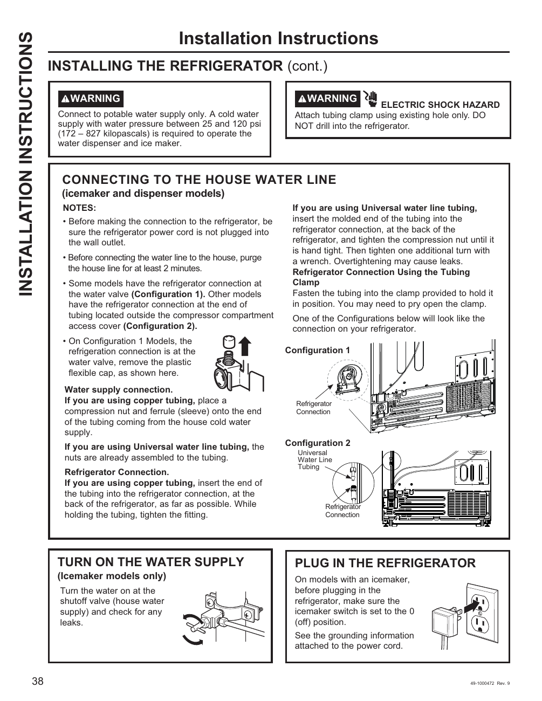

## PDF page 39

### Installation Instructions

#### INSTALLING THE REFRIGERATOR (cont.)

#### Refrigerator suggested assembly

Shelves shown in the location for best energy efficiency.

#### PUT THE REFRIGERATOR IN

#### PLACE

Move the refrigerator to its final location.

#### LEVEL THE REFRIGERATOR

Adjustable legs at the front corners of the

refrigerator should be set so the refrigerator is firmly

positioned on the floor, and the front is raised just

enough that the door closes easily when opened

about halfway.

To adjust the leveling legs, turn the

legs clockwise to raise the refrigerator,

counterclockwise to lower it.

GYE18J, PYE18H

18 cuft. Models

French Door with Freezer Drawer

49-1000472 Rev. 9

#### LEVEL THE REFRIGERATOR

#### DOORS(on some models)

Remember a level refrigerator is necessary for

getting the doors perfectly even. If you need

help, review the previous section on leveling the

refrigerator.

When

When

the left

the left

door is

door is

lower than

higher

the right

than

door.

the right

door.

Adjustment point

If the doors remain uneven, turn the adjustable pin

to raise the lowest door using a 1/4´ allen wrench to

turn the pin.

GWE19J

19 cuft. Models

French Door with

Freezer Drawer

39

### Original figure / page illustration (PDF page 39)

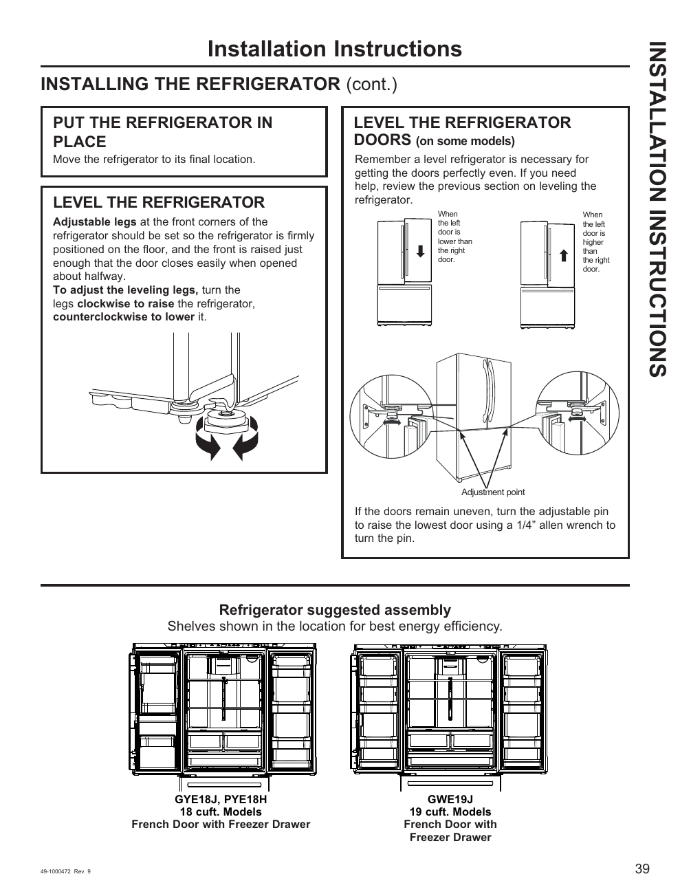

## PDF page 40

### Installation Instructions

#### Refrigerator suggested assembly (cont.)

Shelves shown in the location for best energy efficiency.

GDE21D, GDE21E,

21, 25 cuft. Models

Single Door with Freezer Drawer

PFE24H 24 cuft. Models

French Door with Freezer Drawer

GNE21D, GNE21F,

PNE21N, GNE27J

21, 27 cuft. Models

French Door with Freezer Drawer

Icemaker in the

GFE24J, PFE24H,

door is available

for all 24 and

26 french door

models.

GWE22J, GNE25D, GNE25J, PNE25N

22, 25 cuft. Models

French Door with Freezer Drawer

40

GBE21D, GBE21A

GDE25E

21 cuft. Models

Single Door with Freezer Door

GYE21J, GFE26J

21, 26 cuft. Models

French Door with Freezer Drawer

GNE27E

27 cuft. Models

French Door with Freezer Drawer

49-1000472 Rev. 9

### Original figure / page illustration (PDF page 40)

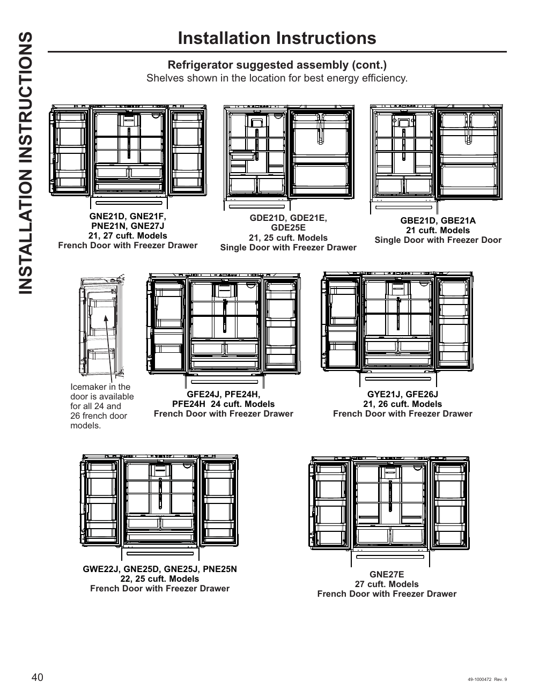

## PDF page 41

### Installation Instructions

#### INSTALLING THE WATER LINE

#### BEFORE YOU BEGIN

Recommended copper water supply kits are WX8X2,

WX8X3 or WX8X4, depending on the amount of

tubing you need. Approved plastic water supply

lines are Universal Water Line Refrigerator Tubing

(WX08X10006, WX08X10015 and WX08X10025).

When connecting your refrigerator to a GE

Appliances Reverse Osmosis Water System, the only

approved installation is with a GE Appliances RVKit.

For other reverse osmosis water systems, follow the

manufacturer’s recommendations.

If the water supply to the refrigerator is from a Reverse

Osmosis Water Filtration System (RO)AND the

refrigerator also has a water filter, use the refrigerator’s

filter bypass plug. Using the refrigerator¶s water

filtration cartridge in conjunction with an RO water filter

can result in hollow ice cubes. Some models do not

come equipped with the filter bypass plug. To order the

bypass plug, see the Water Filter Cartridge section.

This water line installation is not warranted by the

refrigerator or icemaker manufacturer. Follow these

instructions carefully to minimize the risk of expensive

water damage.

Water hammer (water banging in the pipes) in house

plumbing can cause damage to refrigerator parts and

lead to water leakage or flooding. Call a qualified

plumber to correct water hammer before installing the

water supply line to the refrigerator.

To prevent burns and product damage, do not hook

up the water line to the hot water line.

Do not install the icemaker tubing in areas where

temperatures fall below freezing.

When using any electrical device (such as a power

drill) during installation, be sure the device is double

insulated or grounded in a manner to prevent the

hazard of electric shock, or is battery powered.

All installations must be in accordance with local

plumbing code requirements.

49-1000472 Rev. 9

#### WHAT YOU WILL NEED

‡ Copper or Universal Water Line Refrigerator Tubing

kit, 1/4´ outer diameter to connect the refrigerator to

the water supply. If using copper, be sure both ends

of the tubing are cut square.

To determine how much tubing you need: measure

the distance from the water valve on the back of the

refrigerator to the water supply pipe. Be sure there is

sufficient extra tubing to allow the refrigerator to move

out from the wall after installation.

Universal Water Line Refrigerator Tubing Kits are

available in the following lengths:

6¶ (1.8 m)

± WX08X10006

15¶ (4.6 m)

± WX08X10015

25¶ (7.6 m)

± WX08X10025

WARNING

Connect to potable water supply only. A cold water

supply with water pressure between 25 and 120 psi

(172 – 827 kilopascals) is required to operate the

water dispenser and ice maker.

41

### Original figure / page illustration (PDF page 41)

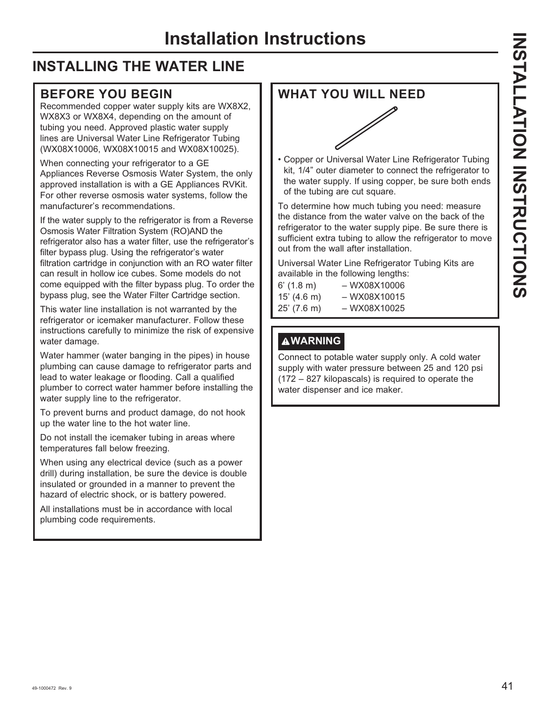

## PDF page 42

### Installation Instructions

#### INSTALLING THE WATER LINE (cont.)

#### WHAT YOU WILL NEED (cont.)

NOTE: The only GE Appliances approved plastic

tubing is that supplied in Universal Water Line

Refrigerator Tubing kits. Do not use any other plastic

water supply line because the line is under pressure

at all times. Certain types of plastic will crack or

rupture with age and cause water damage to your

home.

- A GE Appliances water supply kit (containing

tubing, shutoff valve and fittings listed below) is

available at extra cost from your dealer or from

Parts and Accessories, 877.959.8688 (in Canada

1.800.661.1616).

- A cold water supply. The water pressure must be

between 25 and 120 psi (172-827 kPa).

- Power drill.

‡ 1/2´ or adjustable wrench.

- Straight and Phillips blade screwdriver.

‡ Two 1/4´ outer diameter compression nuts and 2

ferrules (sleeves)²to connect the copper tubing to

the shutoff valve and the refrigerator water valve.

OR

- If you are using a Universal Water Line Refrigerator

Tubing kit, the necessary fittings are preassembled

to the tubing.

‡ If your existing copper water line has a flared fitting

at the end, you will need an adapter (available at

plumbing supply stores) to connect the water line to

the refrigerator OR you can cut off the flared fitting

with a tube cutter and then use a compression

fitting. Do not cut formed end from Universal Water

Line Refrigerator tubing.

- Shutoff valve to connect to the cold water line.

The shutoff valve should have a water inlet with a

minimum inside diameter of 5/32´ at the point of

connection to the COLD WATER LINE. Saddle-type

shutoff valves are included in many water supply

kits. Before purchasing, make sure a saddle-type

valve complies with your local plumbing codes.

42

Install the shutoff valve on the nearest frequently used

drinking water line.

#### 1 SHUT OFF THE MAIN WATER

#### SUPPLY

Turn on the nearest faucet long enough to clear

the line of water.

#### 2 CHOOSE THE VALVE LOCATION

Choose a location for the valve that is easily

accessible. It is best to connect into the side of

a vertical water pipe. When it is necessary to

connect into a horizontal water pipe, make the

connection to the top or side, rather than at the

bottom, to avoid drawing off any sediment from

the water pipe.

#### 3DRILL THE HOLE FOR THE

#### VALVE

Drill a 1/4´ hole in the water pipe (even if using

a self-piercing valve), using a sharp bit. Remove

any burrs resulting from drilling the hole in the

pipe.

Take care not to allow water to drain into

the drill.

Failure to drill a 1/4´ hole may result in reduced

ice production or smaller cubes.

49-1000472 Rev. 9

### Original figure / page illustration (PDF page 42)

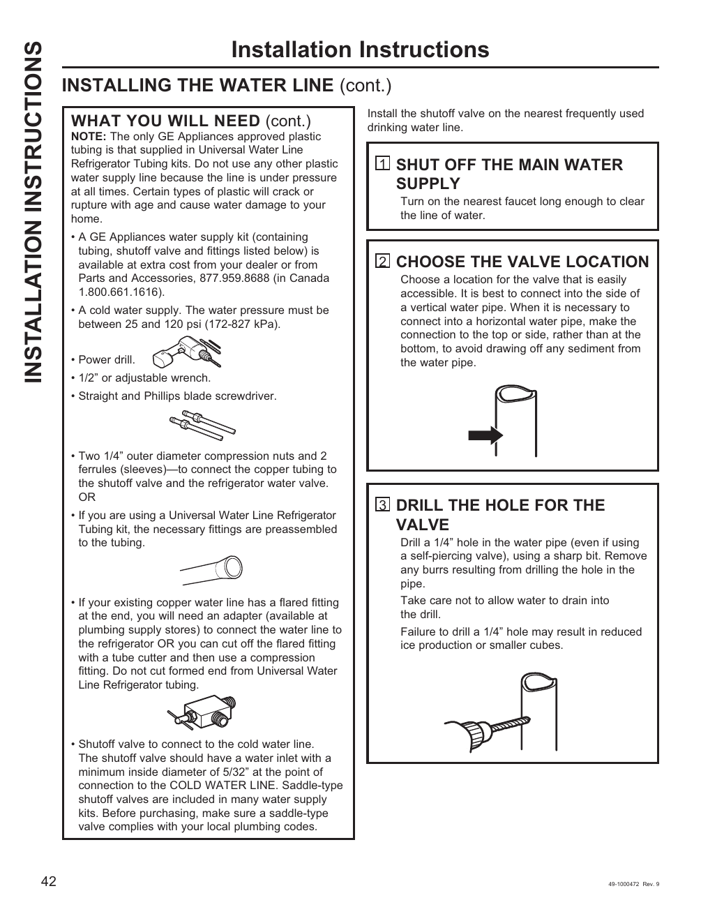

## PDF page 43

### Installation Instructions

#### INSTALLING THE WATER LINE (cont.)

#### 4FASTEN THE SHUTOFF VALVE

Fasten the shutoff valve to the cold water pipe

with the pipe clamp.

Pipe Clamp

Vertical Cold

Saddle-Type

Water Pipe

Shutoff Valve

NOTE: Commonwealth of Massachusetts

mlumbing \`odes OQU\`jo shall be adhered

to. Saddle valves are illegal and use is not

permitted in Massachusetts. Consult with your

licensed plumber.

49-1000472 Rev. 9

#### 7FASTEN THE SHUTOFF VALVE

Place the compression nut and ferrule (sleeve)

for copper tubing onto the end of the tubing

and connect it to the shutoff valve.

Make sure the tubing is fully inserted into

the valve. Tighten the compression nut securely.

For plastic tubing from a Universal Water Line

Refrigerator Tubing kit, insert the molded end

of the tubing into the shutoff valve and tighten

compression nut until it is hand tight, then

tighten one additional turn with a wrench. Over

tightening may cause leaks.

Saddle-Type

Compression Nut

Shutoff Valve

Universal Water

Line Tubing

Packing Nut

Outlet ValveFerrule (sleeve)

NOTE: Commonwealth of Massachusetts

mlumbing \`odes OQU\`jo shall be adhered

to. Saddle valves are illegal and use is not

permitted in Massachusetts. Consult with your

licensed plumber.

#### 8FLUSH OUT THE TUBING

Turn the main water supply on and flush out

the tubing until the water is clear.

Shut the water off at the water valve after about

one quart (1 liter), or 2 minutes, of water has

been flushed through the tubing.

To complete the installation of the refrigerator, go

back to Step 11 in Installing the Refrigerator.

43

### Table (PDF page 43)

| 5 T IGHTEN THE PIPE CLAMP Tighten the clamp screws until the sealing washer begins to swell. klqbW Do not over tighten or you may crush  the tubing. Washer mipe \`lamp Inlet End Clamp Screw |  |
| --- | --- |
| 6 R OUTE THE TUBING Route the tubing between the cold water line and the refrigerator. Route the tubing through a hole drilled in the wall or floor (behind the refrigerator or adjacent base cabinet) as close to the wall as possible. |  |

### Original figure / page illustration (PDF page 43)

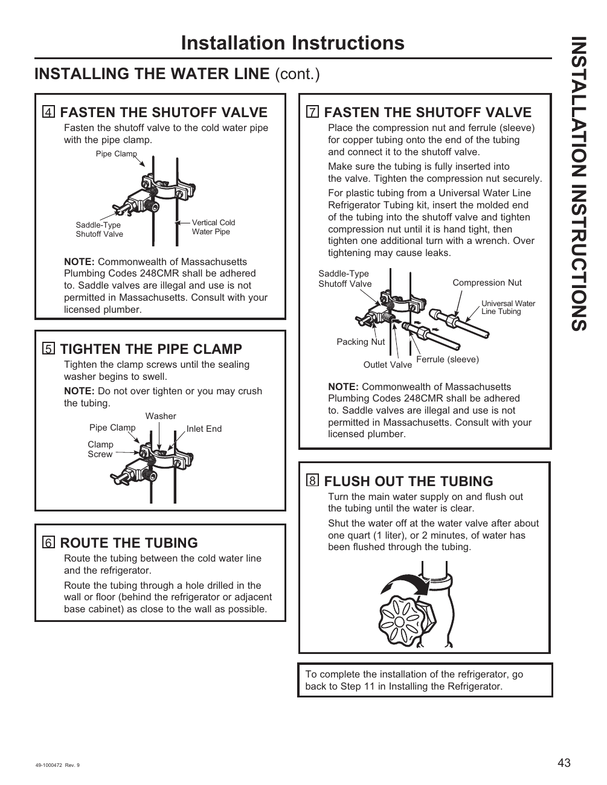

## PDF page 44

### Normal Operating Conditions

Modern refrigerators have more features and use newer technology.

Newer refrigerators sound different from older refrigerators.

#### Do you hear what I hear? These conditions are normal.

#### HUMMM...

#### WHOOSH...

- The new high efficiency compressor may run faster

and longer than your old refrigerator and you may

hear a high-pitched hum or pulsating sound while it

is operating.

- You may hear a whooshing sound when the doors

close. This is due to pressure equalizing within the

refrigerator.

### CLICKS, POPS,

#### CRACKS and SNAPS

- You may hear cracking or popping sounds when

the refrigerator is first plugged in. This happens as

the refrigerator cools to the correct temperature.

- Expansion and contraction of cooling coils during

and after defrost can cause a cracking or popping

sound.

- On models with an icemaker, after an ice making

cycle, you may hear the ice cubes dropping into the

ice bucket.

- On models with a dispenser, during water dispense,

you may hear the water lines move at initial

dispense and after dispenser button is released.

44

- You may hear the fans spinning at high speeds.

This happens when the refrigerator is first plugged

in, when the doors are opened frequently or when

a large amount of food is added to the refrigerator

or freezer compartments. The fans are helping to

maintain the correct temperatures.

- The fans change speeds in order to provide optimal

cooling and energy savings.

#### WATER SOUNDS

- The flow of refrigerant through the cooling coils may

make a gurgling noise like boiling water.

- Water dropping on the defrost heater can cause

a sizzling, popping or buzzing sound during the

defrost cycle.

- A water dripping noise may occur during the defrost

cycle as ice melts from the evaporator and flows

into the drain pan.

- Closing the door may cause a gurgling sound due to

pressure equalization.

49-1000472 Rev. 9

### Original figure / page illustration (PDF page 44)

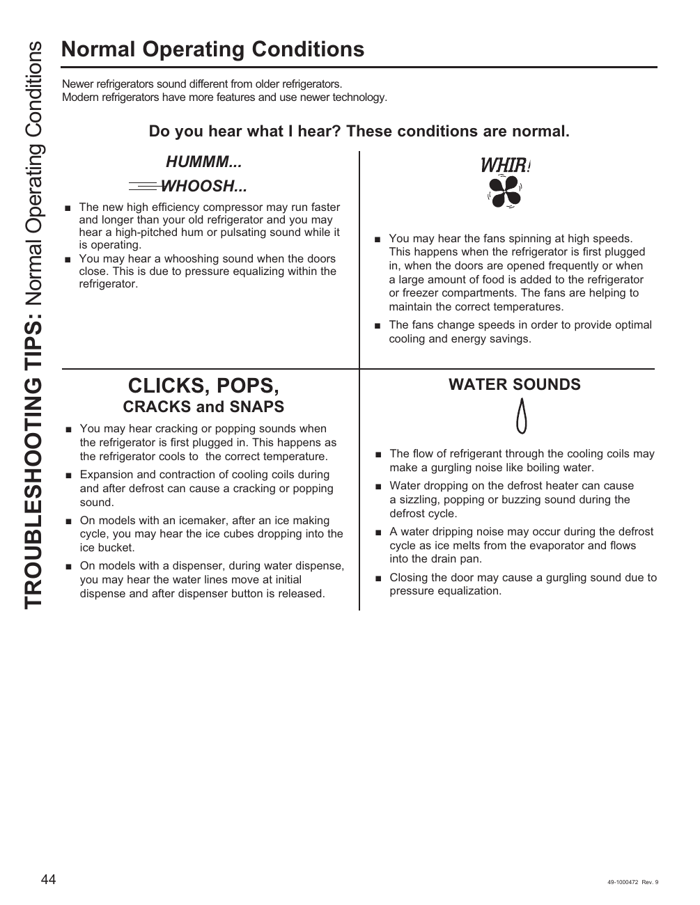

## PDF page 45

### Troubleshooting Tips... Before you call for service

Save time and money! Review the charts on the following pages first and you may not need to call for service.

49-1000472 Rev. 9

45

### Table (PDF page 45)

| Problem | Possible Causes | What to Do |
| --- | --- | --- |
| Refrigerator does not operate | Refrigerator in defrost cycle. | Wait about 30 minutes for defrost cycle to end. |
|  | Either or both controls set to OFF.  | Set the controls to a lower temperature setting. |
|  | Refrigerator is unplugged. | Push the plug completely into the outlet. |
|  | The fuse is blown/circuit breaker is tripped. | Replace fuse or reset the breaker. |
|  | Refrigerator is in showroom mode. | Unplug the refrigerator and plug it back in. |
| Vibration or rattling (slight vibration is normal) | Leveling legs need adjusting. | See Level the refrigerator. |
| Motor operates for long periods or cycles on and off frequently. (Modern refrigerators with more storage space and a larger freezer require more  operating time. They start and stop often to maintain even temperatures.) | Normal when refrigerator is first plugged in. | Wait 24 hours for the refrigerator to completely cool down. |
|  | Often occurs when large amounts of food are placed in refrigerator. | This is normal. |
|  | Door left open.  | Check to see if package is holding door open. |
|  | Hot weather or frequent door openings. | This is normal. |
|  | Temperature controls set at the coldest setting. | See Controls section |
| Refrigerator or freezer compartment  too warm | Temperature control not set cold enough. | See Controls section |
|  | Warm weather or frequent door openings. | Set the temperature control one step colder. See Controls section |
|  | Door left open.  | Check to see if package is holding door open. |
| Frost or ice crystals on frozen food  (frost within package is normal) | Door left open.  | Check to see if package is holding door open. |
|  | Too frequent or too long door openings. | This is normal. |
| Divider between refrigerator and  freezer compartments feels warm | Automatic energy saver system circulates warm liquid around front edge of freezer compartment. | This helps prevent condensation on the outside. |
| Automatic icemaker does not work | Icemaker switch is in the OFF position.  | Set the switch to the ON position. |
|  | Water supply turned off or not connected. | See Installing the Water Line section |
|  | Freezer compartment too warm.  | Wait 24 hours for the refrigerator to completely cool down. |
|  | Piled up cubes in the storage bin cause the icemaker to shut off. | Level cubes by hand. |
|  | Ice cubes stuck in icemaker.  | Turn off the icemaker, remove cubes, and turn the icemaker back on. |
|  | Filter is not properly installed Filter water leak | Replace filter or make sure the water filter is properly installed (see water filter section). |
| Freezer cooling, refrigerator not  cooling | Normal, when refrigerator first plugged in or after extended power outage | Wait 24 hours for temperature in both compartments to reach selected temperatures. |
| Ice dispenser opens after closing  freezer drawer  on some models | Normal | The ice dispenser door may open after closing freezer door to allow access.  |
| Ice cubes have odor/taste  | Ice storage bin needs cleaning.  | Empty and wash bin. Discard old cubes. |
|  | Food transmitting odor/taste to ice  cubes. | Wrap foods well. |
|  | Interior of refrigerator needs cleaning.  | See Care and Cleaning section. |
| Small or hollow cubes | Water filter clogged. | Replace filter cartridge with new cartridge or with plug. |
| Slow ice cube freezing  | Door left open.  | Check to see if package is holding door open. |
|  | Temperature control not set cold enough. | See Controls section |
| Frequent µbuzzing sound´  | Icemaker switch is in the on position,  but the water supply to the refrigerator has not been connected. | Set the switch to the off position. Keeping it in  the on position will damage the water valve. |

## PDF page 46

### Troubleshooting Tips... Before you call for service

46

49-1000472 Rev. 9

### Table (PDF page 46)

| Problem | Possible Causes | What to Do |
| --- | --- | --- |
| Water has poor taste/odor | Water dispenser has not been used for a long time. | Dispense water until all water in system is  replenished. |
| Water in first glass is warm | Normal when refrigerator is first installed. | Wait 24 hours for the refrigerator to completely cool down. |
|  | Water dispenser has not been used for a long time. | Dispense water until all water in system is  replenished. |
|  | Water system has been drained. | Allow several hours for replenished supply to chill. |
| Water dispenser does not work | Water supply line turned off or not connected. | See Installing the water line section |
|  | Water filter clogged. | Replace filter cartridge or remove filter and install plug. |
|  | Air may be trapped in the water system. | Press the dispenser arm for at least two minutes. |
|  | Dispenser is LOCKED.  | Press and hold the LOCK pad for 3 seconds. |
| Water spurting from dispenser | Newly-installed filter cartridge. | Run water from the dispenser for 3 minutes (about one and a half gallons). |
| Water is not dispensed but icemaker is working | Water in reservoir is frozen.  | Call for service. |
|  | Refrigerator control setting is too cold. | Set to a warmer setting. |
| No water or ice cube production | Supply line or shutoff valve is clogged. | Call a plumber. |
|  | Water filter clogged. | Replace filter cartridge or remove filter and install plug. See Water Filter Cartridge section, page 13 or 14. |
|  | Filter is not properly installed Filter water leak | Replace filter or make sure the water filter is properly installed (see water filter section). |
| Refrigerator has odor | Foods transmitting odor to refrigerator.  | Foods with strong odors should be tightly wrapped.  Keep an open box of baking soda in the refrigerator   replace every three months. |
|  | Interior needs cleaning.  | See Care and Cleaning section |
| Moisture forms on outside of refrigerator | Not unusual during periods of high humidity. | Wipe surface dry. |
| Moisture collects inside (in humid weather, air carries moisture into refrigerator when doors are opened) | Too frequent or too long door openings. | This is normal. |
|  | Due to the higher humidity in the  refrigerator, you may on occasion experience fog or small amounts of moisture in the refrigerator compartment. | This is normal and may come and go as different food loads and environmental conditions change. Wipe dry with a paper towel if desired. |
| Interior light does not work  | No power at outlet. | Replace fuse or reset the breaker. |
|  | LED lights are out | Call Service - see Replacing the Lights |
| Hot air from bottom of refrigerator | Normal air flow cooling motor. In the  refrigeration process, it is normal that heat be expelled in the area under the refrigerator. Some floor coverings are sensitive and will discolor at these normal and safe temperatures. | This is normal. |
| Refrigerator never shuts off but the temperatures are OK | Adaptive defrost keeps compressor running during door openings. | This is normal. The refrigerator will cycle off after the door remains closed for 2 hours. |
| Refrigerator is beeping | Door is open.  | Close door. |
| Door not closing properly | Door gasket on hinge side sticking or  folding over. | Apply paraffin wax to the face of the gasket. |
| Actual temperature not equal to Set temperature | Unit just plugged in.  | Allow 24 hours for system to stabilize. |
|  | Door open for too long.  | Allow 24 hours for system to stabilize. |
|  | Warm food added to refrigerator. | Allow 24 hours for system to stabilize. |
|  | Defrost cycle is in process.  | Allow 24 hours for system to stabilize. |

## PDF page 47

### Troubleshooting Tips... Before you call for service

49-1000472 Rev. 9

47

### Table (PDF page 47)

| Problem | Possible Causes | What to Do |
| --- | --- | --- |
| Door/drawer does not close by itself  | Leveling legs need adjusting. | See level the refrigerator |
| Freezer door/drawer pops open  when refrigerator door is closed | This is normal if, after popping open, the freezer door/drawer  closed on its own. | This indicates that there is a good seal on the freezer  door/ drawer. If the freezer door/drawer does not  automatically close after popping open, then see the mroblemW Door/ drawer does not close by itself, above. |
| Food freezing in the refrigerator  | Food too close to the air vent at  the back of the refrigerator. | Move the food away from the air vent. |
|  | Refrigerator control is set too cold. | Move the refrigerator control to a warmer temperature setting one increment at a time. |
| Water is leaking from dispenser | Glass not being held under the dispenser long enough after button is released. | Hold the glass underneath the dispenser for 2–3 seconds after releasing the dispenser button. Water may continue to dispense after the button is released |
|  | Air may be present in the water line system, causing water to drip after being dispensed. | Dispense water for at least 2 minutes to remove air from  system. |
| My display is showing tc | Turbo Cool function is activated. | See Controls section |
| Water filter indicator light changed color | This is normal. | See Water Filter Cartridge - MWF or XWFE section |
| Water filter indicator light remains red even after replacing the water filter | Improperly installed filter Leak is detected Using expired filter | Verify you have the XWFE filter and not XWF. Verify no scratches or damage to filter label. Replace filter if label shows damage. See Water Filter Cartridge - XWFE section |
|  | Water filter indicator must be reset (on some models). | Press and hold the WATER FILTER pad for 3 seconds.  See Water Filter Cartridge |
| Water filter indicator light is not lit | This is normal. The filter cartridge should be replaced when the replacement indicator light turns red. | See Water Filter Cartridge - MWF or XWFE section |
| Handle is loose / handle has a gap | Handle needs adjusting. | See Attach the Refrigerator Handle and Attach the Freezer  Handle sections |
| Refrigerator doors are not even on French Door models only | Doors need realigning.  | See Level the Refrigerator Doors section. |
| Baskets stick or jam when opening or closing | Baskets are too full. | To open: remove some of the products from the basket when opened as far as possible. Readjust the products left in the basket and try to open the basket again. To close: readjust products in the basket or remove any product that is above the rim of the basket and close the basket. |
| Filter Status Indicator LED turns  red | Filter reaching expired state or  expired | Press the Filter Status pad to show remaining filter life. If the display shows 0%, the filter needs to be replaced. When the unit has detected a new filter (a filter has been replaced  the Filter Status LED will flash 3 times and then  remain off to indicate the filter was successfully replaced. |
| LEAK or scrolling ³LEAK´ on the  display Water is disabled Filter Status indicator LED flashing  red Buzzer sound | Filter leak detected  | Replace filter. Wipe off the filter/surrounding area if there is any water from filter replacement. |
| ³Err´ on the display Water is disabled Filter Status indicator LED flashing  red Buzzer sound | Filter is not detected No communication with filter | Verify you have the XWFE filter and not the XWF. Verify there are no scratches or filter label damage. Replace filter if filter label shows damage. |
| Refrigerator beeps when pressing dispenser paddle | Filter is not properly installed Filter water leak | Replace filter or make sure the water filter is properly installed (see water filter section). |

## PDF page 48

### GE Appliances Refrigerator Limited Warranty

For US Customers, all warranty service provided by our Factory Service Centers, or an authorized Customer CareŠ technician. To

schedule service, on-line, 24 hours a day, visit us at bodewell.com/schedule-repair-service, or call 833-4BODEWELL. Please have

serial number and model number available when calling for service. In Canada, call 800.561.3344.

Servicing your appliance may require the use of the onboard data port for diagnostics. This gives a GE Appliances factory service

technician the ability to quickly diagnose any issues with your appliance and helps GE Appliances improve its products by providing GE

Appliances with information on your appliance. If you do not want your appliance data to be sent to GE Appliances, please advise your

technician not to submit the data to GE Appliances at the time of service.

#### What is Not Covered:

- Service trips to your home to teach you how to use the

- Damage to the product caused by accident, fire, floods or

product.

acts of God.

- Improper installation, delivery or maintenance.

- Incidental or consequential damage caused by possible

defects with this appliance.

- Failure of the product if it is abused, misused, or used for

other than the intended purpose or used commercially.

- Product not accessible to provide required service.

- Loss of food due to spoilage.

- Damage caused by a non-GE Brand water filter.

- Replacement of house fuses or resetting of circuit breakers.

- Damage to finish, such as surface rust, tarnish, or small

blemishes not reported within 48 hours of delivery.

- Damage caused after delivery.

- Products which are not defective, broken, or which are

- Replacement of the water filter cartridge, if included, due to

working as described in the owner’s manual.

water pressure that is outside the specified operating range

or due to excessive sediment in the water supply.

- Damage caused by running the icemaker with no water

supply to unit.

- Replacement of the light bulbs, if included, or water filter

cartridge, if included, other than as noted above.

EXCLUSION OF IMPLIED WARRANTIES—Your sole and exclusive remedy is product repair as provided in this Limited

Warranty. Any implied warranties, including the implied warranties of merchantability or fitness for a particular

purpose, are limited to one year or the shortest period allowed by law.

For US Customers: This limited warranty is extended to the original purchaser and any succeeding owner for products purchased for home use within

the USA. If the product is located in an area where service by a GE Appliances Authorized Servicer is not available, you may be responsible for a

trip charge or you may be required to bring the product to an Authorized GE Appliances Service location for service. In Alaska, the limited warranty

excludes the cost of shipping or service calls to your home.

Some states do not allow the exclusion or limitation of incidental or consequential damages. This limited warranty gives you specific legal rights,

and you may also have other rights which vary from state to state. To know what your legal rights are, consult your local or state consumer affairs

office or your state’s Attorney General.

Warrantor: GE Appliances, a Haier company Louisville, KY 40225

In Canada (including the province of Québec): This limited warranty is extended to the original purchaser and any succeeding owner for

products purchased in Canada including Qupbec for home use within Canada including Qupbec. If the product is located in an area where service

by a GE Appliances Authorized Servicer is not available, you may be responsible for a trip charge or you may be required to bring the product to an

Authorized GE Appliances Service location.

Some provinces including Québec do not allow the exclusion or limitation of incidental or consequential damages. This limited warranty gives you

specific legal rights, and you may also have other rights which vary from province to province including Québec. To know what your legal rights are,

consult your local or provincial consumer affairs office.

For Québec consumers only - Notice on the warranty of availability of spare parts, repair services and information necessary for repair

or maintenance (s. 39 of the Consumer Protection Act): Please be advised that MC Commercial Inc. (³MC Commercial´) does not guarantee,

within the meaning of section 39 of the Consumer Protection Act, CQLR, c. P-40.1 and sections 79.18 to 79.20 of the Regulation respecting the

application of the Consumer Protection Act, CQLR, c P-40.1, r. 3, the availability of replacement parts, repair services, or the information necessary

for the maintenance or repair of goods manufactured, imported, advertised, or sold by MC Commercial.

Please note that MC Commercial Inc. continues to offer the manufacturer¶s limited warranty as stated in the Owner¶s Manual or Quick Guide, and

that this limited warranty is distinct from the statutory warranty of availability provided for under section 39 of the Consumer Protection Act.

Warrantor: MC Commercial Inc., Burlington, ON, L7L 6B2

48

49-1000472 Rev. 9

### Table (PDF page 48)

| For the Period of: | GE Appliances Will Replace |
| --- | --- |
| One Year From the date of the original  purchase | Any part of the refrigerator which fails due to a defect in materials or workmanship. During the limited oneJyear warrantyI db ^ppliances will also provideI free of chargeI all labor and related service to replace the defective part. |
| Thirty Days (Water filter, if included) From the original purchase  date of the refrigerator | Any part of the water filter cartridge which fails due to a defect in materials or workmanship. During this limited thirtyJday warrantyI db ^ppliances will also provideI free of chargeI a replacement water filter cartridge. |
| GE PROFILE ™ AND GE CAFÉ™ MODELS |  |
| Five Years From the date of the purchase | Any part of the sealed refrigerating system (the compressor, condenser, evaporator an all connecting tubing) which fails due to a defect in materials or workmanship. During this limited fiveJyear sealed refrigerating system warrantyI db ^ppliances will also provide, free of charge, all labor and related service to replace the defective part in the sealed refrigerating system. |

### Original figure / page illustration (PDF page 48)

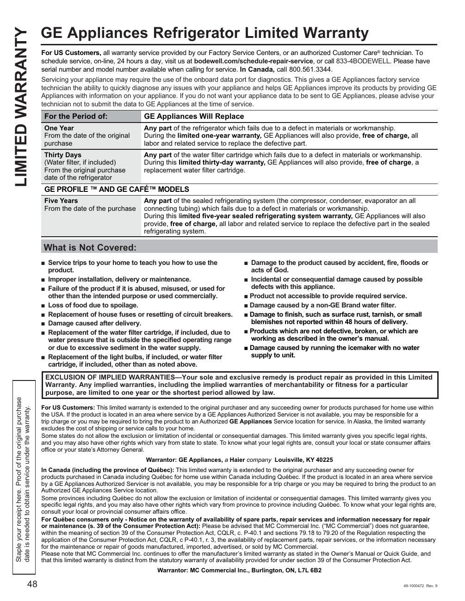

## PDF page 49

### Water Filter Cartridge XWFE Limited Warranty

#### Contact us at geapplianceparts.com, or call 833.4BODEWELL.

For the period of

GE Appliances will replace

Thirty Days

Any part of the water filter cartridge which fails due to a defect in materials

From the date

or workmanship during this limited thirty-day warranty.*

of the original

purchase

#### What GE Appliances will not cover:

- Service trips to your home to teach you how to use the product.

- Improper installation.

- Failure of the product if it is abused, misused, used for other than the intended purpose or used commercially.

- Replacement of house fuses or resetting of circuit breakers.

- Damage to the product caused by accident, fire, floods, or acts of God.

- Incidental or consequential damage caused by possible defects with this appliance.

#### EXCLUSION OF IMPLIED WARRANTIES

Your sole and exclusive remedy is part exchange as provided in this Limited Warranty. Any implied warranties,

including the implied warranties of merchantability or fitness for a particular purpose, are limited to six months or

the shortest period allowed by law.

This warranty is extended to the original purchaser and any succeeding owner for products purchased for home use

within the USA. In Alaska, the warranty excludes the cost of shipping or service calls to your home.

Some states do not allow the exclusion or limitation of incidental or consequential damages. This warranty gives you

specific legal rights, and you may also have other rights which vary from state to state. To know what your legal rights

are, consult your local or state consumer affairs office or your state’s Attorney General.

For Purchases Made In Iowa: This form must be signed and dated by the buyer and seller prior to the

consummation of this sale.

This form should be retained on file by the seller for a minimum of two years.

#### Buyer:

#### Seller:

Name

Name

Address

Address

City

State

=LS

City

State

=LS

Signature

'DWH

Signature

'DWH

If your GE Appliances part fails because of a manufacturing defect within thirty days from the date of original purchase for use, we will give

you a new or, at our option, a rebuilt part without charge. Return the defective part to the parts supplier from whom it was purchased together

with a copy of the ³proof of purchase´ for the part. If the part is defective and shows no signs of abuse, it will be exchanged. The warranty

does not cover the failure of parts which are damaged while in your possession, are abused, or have been installed improperly. It does not

cover the cost of returning the part to the supplier from whom it was purchased nor does it cover the cost of labor to remove or install it to

diagnose the fault. It does not cover parts used in products in commercial use except in the case of air conditioning equipment. In no event

shall GE Appliances be liable for consequential damages.

Warrantor: GE Appliances, a Haier company

Louisville, KY 40225

49

49-1000472 Rev. 9

### Original figure / page illustration (PDF page 49)

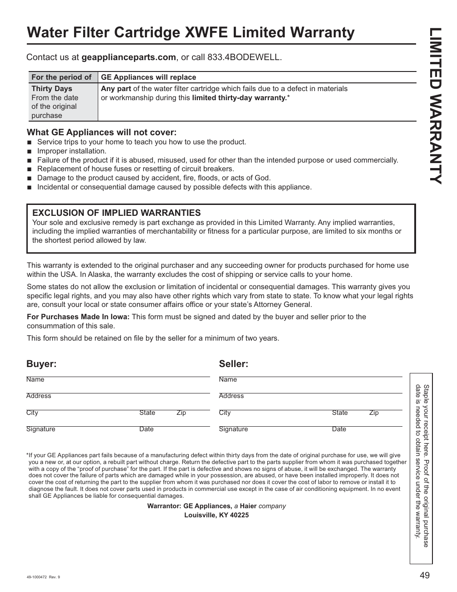

## PDF page 50

### Performance Data Sheet

### Model: GE Appliances XWFE

- System certified by IAPMO R T against NSF/ANSI Standards 42, 53, 401 and P473 for the reduction of claims specified on the performance data sheet and

at iapmort.org.

- Actual performance may vary with local water conditions.

50

Application Guidelines/Water Supply Parameters

It is essential that the manufacturer¶s recommended installation,

maintenance and filter replacement requirements be carried out for the

product to perform as advertised. See Installation Manual for Warranty

information.

NOTE: While the testing was performed under standard

laboratory conditions, actual performance may vary.

Replacement Cartridge: XWFE. For estimated costs of

replacement elements please call 1.877.959.8688 or visit our

website at gewaterfilters.com.

#### WARNING To reduce the risk associated with

ingestion of contaminants:

- Do not use with water that is microbiologically unsafe

or of unknown quality without adequate disinfection

before and after the system. Systems certified for cyst

reduction may be used on disinfected water that may contain

filterable cysts.

NOTICE

To reduce the risk of water leakage or flooding, and to

ensure optimal filter performance:

- Read and follow use instructions before installation and

use of this system.

‡ Installation and use MUST comply with all state and local

plumbing codes.

- Do not install if water pressure exceeds 120 psi (827

kPa). If your water pressure exceeds 80 psi (552 kPa), you

must install a pressure-limiting valve. Contact a plumbing

professional if you are uncertain how to check your water

pressure.

- Do not install where water hammer conditions may occur.

If water hammer conditions exist you must install a water

hammer arrester. Contact a plumbing professional if you are

uncertain how to check for this condition.

- Do not install on hot water supply lines. The maximum

operating water temperature of this filter system is 100ž F

(38º C).

- Protect filter from freezing. Drain filter when temperatures

drop below 33žF (0.6žC).

- Change the disposable filter cartridge every six months or

sooner if you observe a noticeable reduction in water flow

rate.

‡ Failure to replace the disposable filter cartridge at

recommended intervals may lead to reduced filter

performance and cracks in the filter housing, causing water

leakage or flooding.

‡ This System has been tested according to NSF/ANSI 42,

53, 401 and P473 for the reduction of the substances listed

below. The concentration of the indicated substances in

water entering the system was reduced to a concentration

less than or equal to the permissible limit for water leaving

the system, as specified in NSF/ANSI 42, 53, 401 and P473.

XWFE System is certified by IAPMO

R T against NSF/ANSI Standards 42,

53, 401, and P473 for the reduction of

claims specified on the performance

data sheet and at iapmort.org.

49-1000472 Rev. 9

### Table (PDF page 50, 1)

| Substance Tested for Reduction | Influent challenge  concentration (mg/L) | Maximum permissible product water concentration (mg/L) | Avg % Reduction |
| --- | --- | --- | --- |
| Chlorine Taste and Odor | 2.0 mg/L +/- 10% | N/A | > 99 |
| Chloramine Taste and Odor | 3.0 mg/L +/- 10% | 0.5 | > 99 |
| Particulate, Class I | At least 10,000/mL | N/A | 91.4 |
| Cysts | 50,000/L | N/A | > 99.99 |
| Lead | 0.15 | 0.01 | 98.85 |
| Mercury | 0.006 | 0.002 | 96.95 |
| Asbestos | 107 to 108 fibers/ L | N/A | > 99 |
| Toxaphene | 0.015 +/- 10% | 0.003 | 86.95 |
| VOC (Chloroform surrogate chemical) | 0.300 | 0.015 | > 99 |
| Alachlor | 0.050 | 0.001 | > 98 |
| Atrazine | 0.100 | 0.003 | > 97 |
| %HQ]HQH | 0.081 | 0.001 | > 99 |
| Carbofuran | 0.190 | 0.001 | > 99 |
| carbon tetrachloride | 0.078 | 0.0018 | 98 |
| FKORUREHQ]HQH | 0.077 | 0.001 | > 99 |
| chloropicrin | 0.015 | 0.0002 | 99 |
| 2,4-D | 0.110 | 0.0017 | 98 |
| dibromochloropropane  DBCP | 0.052 | 0.00002 | > 99 |
| o-Dichlorobenzene | 0.08 | 0.001 | > 99 |
| p-Dichlorobenzene | 0.040 | 0.001 | > 98 |
| 1,2-dichloroethane | 0.088 | 0.0048 | 95 |
| 1,1-dichloroethylene | 0.083 | 0.001 | > 99 |
| cis-1,2-dichloroethylene | 0.170 | 0.0005 | > 99 |
| trans-1,2-dichloroethylene | 0.086 | 0.001 | > 99 |
| 1,2-dichloropropane | 0.080 | 0.001 | > 99 |
| cis-1,3-dichloropropylene | 0.079 | 0.001 | > 99 |
| dinoseb | 0.170 | 0.0002 | 99 |
| Endrin | 0.053 | 0.00059 | 99 |
| Ethylbenzene | 0.088 | 0.001 | > 99 |
| ethylene dibromide  EDB | 0.044 | 0.00002 | > 99 |
| bromochloroacetonitrile | 0.022 | 0.0005 | 98 |
| dibromoacetonitrile | 0.024 | 0.0006 | 98 |
| dichloroacetonitrile | 0.0096 | 0.0002 | 98 |
| trichloroacetonitrile | 0.015 | 0.0003 | 98 |
| 1,1-dichloro-2-propanone | 0.0072 | 0.0001 | 99 |
| 1,1,1-trichloro-2-propanone | 0.0082 | 0.0003 | 96 |
| heptachlor (H-34, Heptox) | 0.025 | 0.00001 | > 99 |
| heptachlor epoxide | 0.0107 | 0.0002 | 98 |
| hexachlorobutadiene | 0.044 | 0.001 | > 98 |
| hexachlorocyclopentadiene | 0.060 | 0.000002 | > 99 |
| Lindane | 0.055 | 0.00001 | > 99 |
| methoxychlor | 0.050 | 0.0001 | > 99 |
| pentachlorophenol | 0.096 | 0.001 | > 99 |
| VLPD]LQH | 0.120 | 0.004 | > 97 |
| Styrene | 0.150 | 0.0005 | > 99 |
| 1,1,2,2-tetrachloroethane | 0.081 | 0.001 | > 99 |
| Tetrachloroethylene | 0.081 | 0.001 | > 99 |
| Toluene | 0.078 | 0.001 | > 99 |
| 2,4,5-TP (silvex) | 0.270 | 0.0016 | 99 |
| tribromoacetic acid | 0.042 | 0.001 | > 98 |
| 1,2,4-Trichlorobenzene | 0.160 | 0.0005 | > 99 |
| 1,1,1-trichloroethane | 0.084 | 0.0046 | 95 |
| 1,1,2-trichloroethane | 0.150 | 0.0005 | > 99 |
| trichloroethylene | 0.180 | 0.0010 | > 99 |
| bromoform | 0.300 | 0.015 | 95 |
| bromodichloromethane | 0.300 | 0.015 | 95 |
| chlorodibromomethane | 0.300 | 0.015 | 95 |
| xylenes | 0.070 | 0.001 | > 99 |
| Meprobamate | 400 +/- 20% | 60 | > 99 |
| Atenolol | 200 +/- 20% | 30 | > 99 |
| Carbamazepine | 1400 +/- 20% | 200 | > 99 |
| '((7 | 1400 +/- 20% | 200 | > 99 |
| Metolachlor | 1400 +/- 20% | 200 | > 99 |
| Trimethoprim | 140 +/- 20% | 20 | > 99 |
| Linuron | 140 +/- 20% | 20 | > 99 |
| TCEP | 5000 +/- 20% | 700 | > 99 |
| TCPP | 5000 +/- 20% | 700 | > 99 |
| Phenytoin | 200 +/- 20% | 30 | > 99 |
| Ibuprofen | 400 +/- 20% | 60 | > 99 |
| Naproxen | 140 +/- 20% | 20 | > 99 |
| Estrone | 140 +/- 20% | 20 | > 99 |
| Bisphenol A | 2000 +/- 20% | 300 | > 99 |
| Nonyl phenol | 1400 +/- 20% | 200 | > 99 |
| PFOA/PFOS | 1.5 mg/L +/- 10% | 0.07 | 99.25 |

### Table (PDF page 50, 2)

| Service Flow | 0.5 gpm (1.89 lpm) |
| --- | --- |
| Water Supply | Potable Water |
| Water Pressure | 25-120 psi (172-827 kPa) |
| Water Temperature | 33ƒF-100ƒF  0.6ƒC-38ƒC |
| Capacity | 170 gallons (643.5 liters) |

### Original figure / page illustration (PDF page 50)

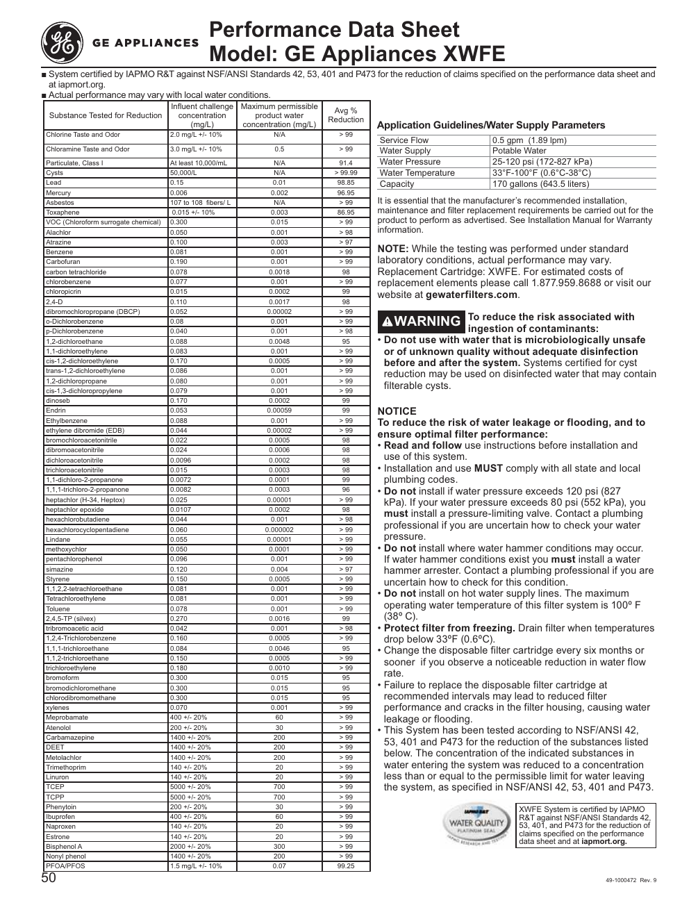

## PDF page 51

### Appliance Communication (on some models)

#### GE WiFi Connect Optional*

You refrigerator is GE WiFi Connect compatible using the GE ConnectPlus module. To connect this appliance to

the internet you will need to attach the module to your appliance through the communication port in the appliance.

The GE ConnectPlus will allow your appliance to communicate with your smart phone for remote appliance

monitoring, control and notifications. Please visit GEAppliances.com/connect to learn more about connected

appliance features, to learn what connected appliance App’s will work with your Smart Phone and to learn where you

can purchase a GE ConnectPlus.**

Plug the ConnectPlus module into the RJ45 port located on the backside of the top refrigerator control cover. No

need to remove the cover.

RJ45 Port

WiFi Connectivity: For assistance with the appliance or the ConnectPlus network connectivity (for models that are

WiFi enabled or WiFi optional), please call 1-800-220-6899.

#### REGULATORY INFORMATION

#### FCC/IC Compliance Statement:

This device complies with Part 15 of the FCC Rules. This device contains license-exempt transmitter(s)/receiver(s)

that comply with Innovation, Science and Economic Development, Canada¶s license-exempt RSS(s). Operation is

subject to the following two conditions:

1. This device may not cause harmful interference.

2. This device must accept any interference received, including interference that may cause undesired operation.

This equipment has been tested and found to comply with the limits for a Class B digital device, pursuant to Part

15 of the FCC Rules. These limits are designed to provide reasonable protection against harmful interference in a

residential installation. This equipment generates, uses and can radiate radio frequency energy and, if not installed

and used in accordance with the instructions, may cause harmful interference to radio communications. However,

there is no guarantee that interference will not occur in a particular installation. If this equipment does cause harmful

interference to radio or television reception, which can be determined by turning the equipment off and on, the user

is encouraged to try to correct the interference by one or more of the following measures:

- Reorient or relocate the receiving antenna.

‡ Increase the separation between the equipment and receiver.

- Connect the equipment into an outlet on a circuit different from that to which the receiver is connected.

- Consult the dealer or an experienced radio/television technician for help.

Labelling:Changes or modifications to this unit not expressly approved by the manufacturer could void the user’s

authority to operate the equipment.

ConnectPlus module only (or similar communication module)

RF Exposure - This device is only authorized for use in a mobile application. At least 20 cm of separation distance

between the ConnectPlus device and the user’s body must be maintained at all times.

*Select Models Only For US, US Territories and Canada Only.

51

49-1000472 Rev. 9

### Original figure / page illustration (PDF page 51)

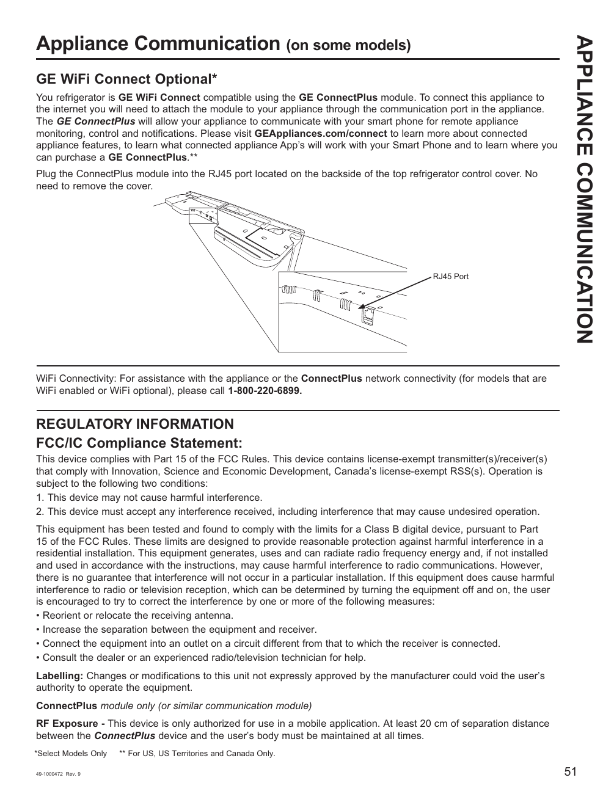

## PDF page 52

### Consumer Support

#### GE Appliances Website

Have a question or need assistance with your appliance? Try the GE Appliances Website 24 hours a day, any day of the year!

You can also shop for more great GE Appliances products and take advantage of all our on-line support services designed for

your convenience. In the US: GEAppliances.com In Canada: GEAppliances.ca

#### Register Your Appliance

Register your new appliance on-line at your convenience! Timely product registration will allow for enhanced communication and

prompt service under the terms of your warranty, should the need arise. You may also mail in the pre-printed registration card

included in the packing material.

In the US: GEAppliances.com/register

In Canada: geappliances.ca/after-sales-support

#### Schedule Service

Expert GE Appliances repair service is only one step away from your door. Get on-line and schedule your service at your

convenience any day of the year. In the US: GEAppliances.com/service or call 833.4BODEWELL during normal business hours.

In Canada: GEAppliances.ca/en/support/service-request or call 800.561.3344

#### Extended Warranties

Purchase a GE Appliances extended warranty and learn about special discounts that are available while your warranty is still

in effect. You can purchase it on-line anytime. GE Appliances Services will still be there after your warranty expires. In the US:

GEAppliances.com/extended-warranty or call 800.626.2224 during normal business hours.

In Canada: GEAppliances.ca/en/support/purchase-extended-warranty or call 866.277.9842

#### Parts and Accessories

Individuals qualified to service their own appliances can have parts or accessories sent directly to their homes

(VISA, MasterCard and Discover cards are accepted). Order on-line today 24 hours every day.

In the US: GEApplianceparts.com or by phone at 877.959.8688 during normal business hours.

Instructions contained in this manual cover procedures to be performed by any user. Other servicing generally should

be referred to qualified service personnel. Caution must be exercised, since improper servicing may cause unsafe

operation.

Customers in Canada should consult the yellow pages for the nearest authorized GE Appliances service parts distributor, visit our

website at GEAppliances.ca/en/products/parts-filters-accessories or call 800.661.1616.

#### Contact Us

If you are not satisfied with the service you receive from GE Appliances, contact us on our Website with all the details including

your phone number, or write to:

In the US: General Manager, Customer Relations _ GE Appliances, Appliance Park _ Louisville, KY 40225

GEAppliances.com/contact

In Canada: Director, Consumer Relations _ MC Commercial Inc. _ Suite 300, 5420 North Service Road _ Burlington, ON L7L 6B2

GEAppliances.ca/en/contact-us

Printed in United States

52

49-1000472 Rev. 9

