# user-guide.pdf — extracted Markdown

> Original PDF: `user-guide.pdf`; PDF page references below are 1-based.

> Source fidelity: Text and diagrams are extracted from this PDF only; image links are rasterized views of their original PDF pages.

## PDF page 1

#### FRENCHDOOR BOTTOM MOUNT

#### REFRIGERATOR

#### USE & CARE GUIDE

W W W.KI T C HE N A I D .C OM

WWW. K IT C HENAID. C A

C A N A D A : 1 - 8 0 0 - 8 0 7 - 6 7 7 7

U . S . : 1 - 8 0 0 - 4 2 2 - 1 2 3 0

W11218735B

## PDF page 2

### TABLE OF CONTENTS

Congratulations on your purchase and welcome to the

KitchenAid Brand family o f high-quality appliances. Your new

KitchenAid® French Door Refrigerator combines advanced

cooling technology with simple operation and high efficiency.

Each appliance that leave s our factory is inspected

thoroughly to ensure that it is working properly.

REFRIGERATOR SAFETY..............................................................3

What’s New Behind the Doors?...................................................5

PARTS AND FEATURES.................................................................5

INSTALLATION INSTRUCTIONS...................................................6

Unpack the Refrigerator...............................................................7

-- Remove the Packaging..............................................................7

-- Clean Before Using....................................................................7

Location Requirements.................................................................7

Remove and Replace Refrigerator Doors....................................8

-- Remove Right-Hand Refrigerator Door......................................9

-- Remove Left-Hand Refrigerator Door........................................9

-- Replace Right-Hand Refrigerator Door....................................10

-- Replace Left-Hand Refrigerator Door......................................10

-- Final Steps................................................................................10

Remove and Replace Freezer Drawer Front..............................11

-- Remove Drawer Front..............................................................11

-- Replace Drawer Front..............................................................11

-- Final Steps................................................................................11

Electrical Requirements..............................................................12

Water Supply Requirements.......................................................12

Connect the Water Supply.........................................................12

-- Connect to Water Line.............................................................13

-- Connect to Refrigerator............................................................13

-- Complete the Installation..........................................................14

Handle Installation and Removal................................................14

-- Install Handles..........................................................................14

-- Remove the Handles................................................................15

-- Remove and Replace Handle Medallions (optional)................15

Refrigerator Leveling, Door Closing and Alignment...................15

FILTERS AND ACCESSORIES.....................................................17

Water Filtration System..............................................................17

-- Install the Water Filter...............................................................17

-- The Water Filter Status Light....................................................17

-- Replace the Water Filter...........................................................18

Install Air Filter (on some models)..............................................18

-- Installing the Air Filter...............................................................18

-- Installing the Filter Status Indicator..........................................18

-- Replacing the Air Filter.............................................................19

Install Produce Preserver (on some models)..............................19

-- Installing the Produce Preserver..............................................19

-- Installing the Status Indicator...................................................20

-- Replacing the Produce Preserver............................................20

REFRIGERATOR USE...................................................................21

Accessories.................................................................................20

Opening and Closing Doors.......................................................21

Using the Controls......................................................................21

-- Viewing and Adjusting Temperature Set Points.......................21

-- Cooling On/Off.........................................................................22

2

Please read the Use and Care Instructions in this guide

before operating your new refrigerator. Like all appliances,

your refrigerator may require maintenance or repair from

time to time, but you can help to ensure that your refrigerator

provides many years of reliable service by following the

instructions in this guide.

-- Options.....................................................................................22

-- Additional Features...................................................................23

Water and Ice Dispensers...........................................................24

-- Flush the Water System...........................................................24

-- Calibrate Measured Fill.............................................................24

-- The Water Dispenser................................................................25

-- The Ice Dispenser.....................................................................26

-- The Dispenser Drip Tray...........................................................26

-- The Dispenser Light..................................................................26

-- The Dispenser Lock..................................................................26

Ice Maker and Ice Storage Bin (on some models).....................27

-- Ice Production Rate..................................................................27

-- Ice Maker in the Refrigerator (on some models)......................27

-- Ice Maker in the Freezer (on some models).............................27

REFRIGERATOR FEATURES.......................................................28

Refrigerator Shelves...................................................................28

-- Shelves and Shelf Frames........................................................28

-- Tuck Away Shelf (on some models).........................................28

Crisper and Crisper Cover..........................................................29

Temperature-Controlled Drawer (on some models)...................29

-- Manual Control.........................................................................29

-- Drawer Divider..........................................................................30

-- Meat Storage Guide.................................................................30

DOOR FEATURES.........................................................................30

Door Bins....................................................................................30

FREEZER FEATURES...................................................................30

Pizza Pocket and Drawer Divider...............................................30

REFRIGERATOR CARE................................................................31

Cleaning......................................................................................31

-- Exterior Cleaning......................................................................31

-- Interior Cleaning.......................................................................31

-- Condenser Cleaning.................................................................32

Lights..........................................................................................32

Vacation and Moving Care.........................................................32

-- Vacations..................................................................................32

-- Moving......................................................................................32

TROUBLESHOOTING...................................................................33

Operation....................................................................................33

Noise...........................................................................................34

Temperature and Moisture..........................................................35

Ice and Water..............................................................................36

Doors...........................................................................................39

PERFORMANCE DATA SHEET....................................................40

WARRANTY...................................................................................41

SERVICE NUMBERS............................................... BACK COVER

## PDF page 3

### REFRIGERATOR SAFETY

#### Your safety and the safety of others are very important.

We have provided many important safety messages in this manual and on your appliance. Always read and obey all safety

This symbol alerts you to potential hazards that can kill or hurt you and others.

All safety messages will follow the safety alert symbol and either the word “DANGER” or “WARNING.”

All safety messages will tell you what the potential hazard is, tell you how to reduce the chance of injury, and tell you what can

#### IMPORTANT SAFETY INSTRUCTIONS

messages.

This is the safety alert symbol.

These words mean:

### DANGER

### WARNING

happen if the instructions are not followed.

You can be killed or seriously injured if you don't immediately

follow instructions.

Youcan be killed or seriously injured if you don't follow

instructions.

WARNING: To reduce the risk of fire, electric shock, or injury when using your refrigerator, follow these basic precautions:

#### SAVE THESE INSTRUCTIONS

IPlug into a grounded (earthed) outlet.

IDo not remove ground prong.

IDo not use an adapter.

IDo not use an extension cord.

IDisconnect power before servicing.

IReplace all parts and panels before operating.

IRemove doors from your old refrigerator.

IUse nonflammable cleaner.

IDo not store or use petrol, flammable liquids or gas in the

vicinity of this or other electrical appliances. The fumes can

cause fires or explosions.

IDo not store explosive substances such as aerosol cans

with a flammable propellant in this refrigerator.

IDo not use or place electrical devices inside the refrigerator

compartments if they are not of the type expressly

authorized by the manufacture.

IUse two or more people to move and install refrigerator.

IDisconnect power before installing ice maker (on ice maker

kit ready models only).

IA qualified service technician must install the water line and

ice maker.

IConnect to a potable water supply only.

IUse a sturdy glass when dispensing ice (on some models).

IThis appliance is not intended for use by persons (including

children) with reduced physical, sensory or mental

capabilities, or lack of experience and knowledge, unless

they have been given supervision or instruction concerning

use of the appliance by a person responsible for their safety.

IChildren should be supervised to ensure that they do not

play with the appliance.

ITo avoid the risk of children becoming trapped and

suffocating, do not allow them to play or hide inside the

refrigerator.

IIf the power supply cord is damaged, it must be replaced by

the manufacturer or its service agent or a similarly qualified

person.

3

## PDF page 4

### REFRIGERATOR SAFETY

Proper Disposal of Your Old Refrigerator

Before You Throw Away Your Old

Refrigerator or Freezer:

Take off the doors.

### WARNING

- 

- 

Leave the shelves in place so that

- 

- 

children may not easily climb inside.

Suffocation Hazard

Remove doors from your old refrigerator.

Failure to do so can result in death or brain damage.

Important information to know about disposal of

IMPORTANT: Child entrapment and suffocation are not

refrigerants:

problems of the past. Junked or abandoned refrigerators are still

dangerous—even if they will sit for “just a few days.” If you are

Dispose of refrigerator in accordance with Federal and Local

getting rid of your old refrigerator, please follow these instructions

regulations. Refrigerants must be evacuated by a licensed,

to help prevent accidents.

EPA certified refrigerant technician in accordance with

established procedures.

4

## PDF page 5

### PARTS AND FEATURES

A

B

C

I

D

H

A. Ice maker

B. Air filter

C. Water filter

E

D. Door bins

E. Crispers

F. Pantry drawer

G. Freezer drawer

F

H. LED ramp-on lighting

I. In-Door-Ice® ice dispensing system

J. Pull Out Tray

G

J

#### What’s New Behind the Doors?

Your KitchenAid® French Door Refrigerator comes equipped with

various innovative storage and energy efficient features.

Energy and Normal Operating Sounds

More Storage Space

Your new French Door Bottom Mount refrigerator has been

The French Door Bottom Mount has the most fresh food storage

designed to optimize energy efficiency, and better regulate

space available, including a full-width, temperature controlled,

temperatures to match cooling demand. You may notice that it

pantry drawer perfect for storing veggie trays or party platters.

operates differently than your previously owned refrigerator. It is

In-Door-Ice® Ice Dispensing System

normal for the high-efficiency compressor to run for extended

The ice storage bin located in the door provides an entire extra

periods of time at varying speeds in order to consume only the

shelf of storage space and the storage bin is removable for easy

energy necessary for optimum efficiency. In addition, during

access to filtered ice.

various stages of the cooling cycle, you may hear normal

operating sounds that are unfamiliar to you.

5

### Original figure / page illustration (PDF page 5)

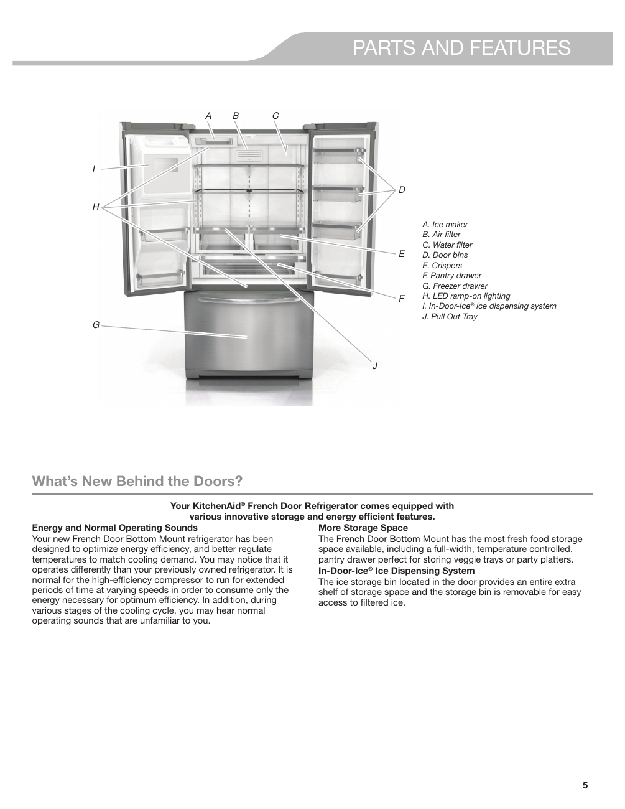

## PDF page 6

### INSTALLATION INSTRUCTIONS

LED Lighting

Dual Evaporator (on some models)

The LED lights do not ever need to be replaced.

The refrigerator compartment and freezer compartment have

Shelves with under-shelf lighting (on some models)

separate evaporators to provide fresh food and frozen food with

By moving LED lighting to a new spot under the shelves, this

separate climates. The refrigerator stays cool and humid for the

leading-edge technology elevates the look and feel of your

optimum storage of fresh foods while the freezer stays cold and

refrigerator.

dry. Humidity from the refrigerator does not mix with dry freezer

Door Alarm

air, so frost is controlled, which reduces freezer burn. Since no air

is shared between the refrigerator and freezer, the transfer of food

A helpful alarm sounds when the refrigerator door or freezer

odors and tastes from the refrigerator to the freezer is eliminated.

drawer is left ajar.

Pull Out Tray

Power Outage Indicator

This full-width slide-out shelf tucked between the crispers and the

If the power should go out while you are away from home, this

lowest shelf is perfect for leftover family-sized casserole dishes,

indicator will let you know that the refrigerator has been without

pizza boxes, and large party platters.

power.

Water Filter

NSF® Certified filter reduces chlorine taste and odor, particulates

(class I), lead, and mercury. Replacing the water filter every 6

months ensures clean, filtered drinking water.

Air Filter

An air filter is 15 times more powerful than baking soda at

reducing common food odors inside the refrigerator.

Produce Preserver (on some models)

Ethylene is a natural gas produced by fruits and vegetables to

promote ripening. The Produce Preserver absorbs ethylene, to

delay the over-ripening of fresh produce. As a result, certain

produce items will stay fresh longer.

Water Dispenser with Measured Fill

The measured fill feature allows you to dispense the desired

amount of filtered water.

6

## PDF page 7

### INSTALLATION INSTRUCTIONS

#### Unpack the Refrigerator

### WARNING

Excessive Weight Hazard

Use two or more people to move and install

refrigerator.

Failure to do so can result in back or other injury.

Remove the Packaging

Remove tape and glue residue from surfaces before turning

- 

- 

on the refrigerator. Rub a small amount of liquid dish soap

over the adhesive with your fingers. Wipe with warm water

and dry.

Do not use sharp instruments, rubbing alcohol, flammable

- 

- 

fluids, or abrasive cleaners to remove tape or glue. These

products can damage the surface of your refrigerator.

Dispose of/recycle all packaging materials.

- 

- 

#### Location Requirements

### WARNING

Explosion Hazard

Keep flammable materials and vapors, such as

gasoline, away from refrigerator.

Failure to do so can result in death, explosion, or fire.

IMPORTANT: This appliance is intended to be used in household

and similar applications such as:

Staff kitchen areas in shops, offices and other working

- 

- 

environments;

Farm houses and by clients in hotels, motels and other

- 

- 

residential type environments;

Bed and breakfast type environments;

- 

- 

Catering and similar non-retail applications.

- 

- 

To ensure proper ventilation for your refrigerator, allow for a

1/2" (1.25 cm) of space on each side and at the top. Allow for

a 1" (2.54 cm) space behind the refrigerator. If your refrigerator

has an ice maker, allow extra space at the back for the water line

connections. When installing your refrigerator next to a fixed wall,

leave a 33/4" (9.5 cm) minimum space between the refrigerator

and wall to allow the door to swing open.

When Moving Your Refrigerator:

Your refrigerator is heavy. When moving the refrigerator for

cleaning or service, be sure to cover the floor with

cardboard or hardboard to avoid floor damage. Always pull

the refrigerator straight out when moving it. Do not wiggle or

“walk” the refrigerator when trying to move it, as floor

damage could occur.

Clean Before Using

After you remove all of the packaging materials, clean the inside

of your refrigerator before using it. See the cleaning instructions in

“Refrigerator Care.”

Important information to know about glass shelves

and covers:

Do not clean glass shelves or covers with warm water when

they are cold. Shelves and covers may break if exposed to

sudden temperature changes or impact, such as bumping.

Tempered glass is designed to shatter into many small,

pebble-size pieces. This is normal. Glass shelves and covers

are heavy. Use both hands when removing them to avoid

dropping.

NOTE: This refrigerator is intended for use in a location where the

temperature ranges from a minimum of 55°F (13°C) to a maximum

of 110°F (43°C). The preferred room temperature range for

optimum performance, which reduces electricity usage and

provides superior cooling, is between 60°F (15°C) and 90°F

(32°C). It is recommended that you do not install the refrigerator

near a heat source, such as an oven or radiator.

1/2" (1.25 cm)

3¾ " (9.5 cm)

7

## PDF page 8

### INSTALLATION INSTRUCTIONS

#### Remove and Replace Refrigerator Doors

NOTE: Measure the width of your door opening, to see whether or not you need to remove the refrigerator doors to move the refrigerator

into your home. If door removal is necessary, see the following instructions.

IMPORTANT: If the refrigerator was previously installed and you are moving it out of the home, before you begin, turn the refrigerator

control OFF. Unplug the refrigerator or disconnect power. Remove food and adjustable door or utility bins from doors.

Gather the required tools and read all instructions before removing doors.

TOOLS NEEDED: 3/16" hex- key wrench and a #2 Phillips screwdriver

### WARNING

Electrical Shock Hazard

Disconnect power before removing doors.

Failure to do so can result in death or electrical shock.

#### Door Removal and Replacement

Style 1 – Water Dispenser

Style 1 – Water Dispenser

Top Right Hinge

Tubing Connection

Tubing Connection

B

C

A

D

A. 3/16" Internal hex-head Screws

B. Hinge Cover Screw

C. Top Hinge Cover

D. Top Hinge

A

A

A. Outer Ring

A. Outer Ring

Wiring Plug

Top Left Hinge

A

B

C

A. 3/16" Internal hex-head Screws

B. Ground Wire (Do Not Remove)

C. Screws (Do Not Remove)

8

### Original figure / page illustration (PDF page 8)

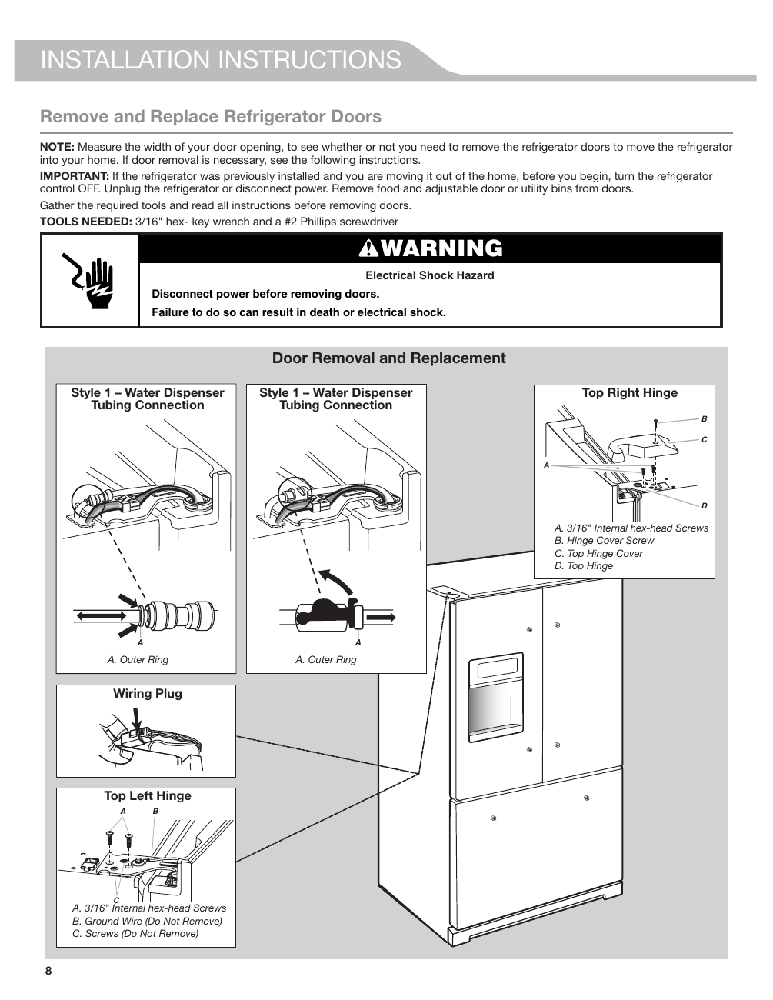

## PDF page 9

Remove Right-Hand Refrigerator Door

### WARNING

Electrical Shock Hazard

Disconnect power before removing doors.

Failure to do so can result in death or electrical shock.

1. Unplug refrigerator or disconnect power.

2. Keep the refrigerator doors closed until you are ready to lift

them free from the cabinet.

NOTE: Provide additional support for the refrigerator door

while the hinges are being removed. Do not depend on the

door gasket magnets to hold the door in place while you are

working.

3. Using a Phillips screwdriver, remove the cover from the Top

Hinge.

4. Using the 3/16" hex-key wrench, remove the two internal hex-

head screws from the top hinge, and set aside.

NOTE: Do not remove the two locator screws. These screws

will help you align the hinge when you replace the door.

A

B

E

C

D

A. Top hinge cover screw

D. Top Hinge

E. Locator Screws

B. Top hinge cover

C. 3/16" Internal hex-head screws

### WARNING

Excessive Weight Hazard

Use two or more people to lift the refrigerator door.

Failure to do so can result in back or other injury.

5. Lift the refrigerator door from the bottom hinge pin. The top

hinge will come away with the door.

### INSTALLATION INSTRUCTIONS

Remove Left-Hand Refrigerator Door

IMPORTANT: The tubing and wiring for the water dispenser run

through the left-hand door hinge, so they must be disconnected

before removing the door.

1. Using a Phillips screwdriver, remove the cover from the top

hinge.

A

B

A. Top hinge cover screw

B. Top hinge cover

2. Disconnect the water dispenser tubing located on top of the

door hinge.

Style 1 - Press the outer ring against the face of the fitting and

gently pull the dispenser tubing free.

NOTE: The water dispenser tubing remains attached to the

left-hand refrigerator door.

A B

A. Outer ring

B. Face of fitting

9

### Original figure / page illustration (PDF page 9)

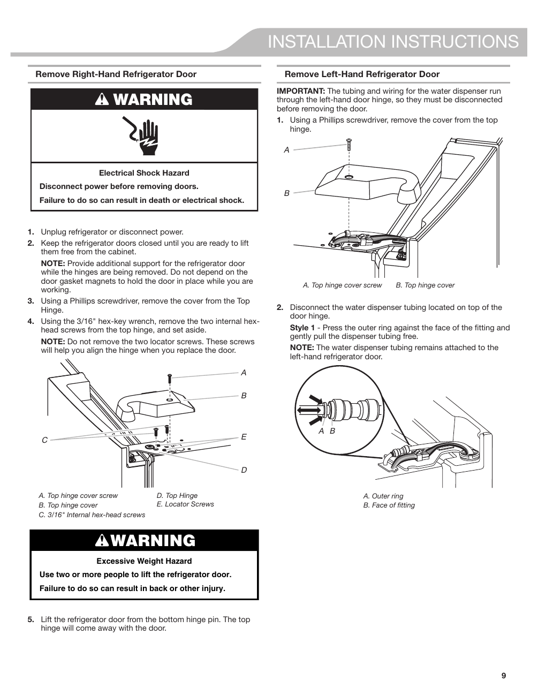

## PDF page 10

### INSTALLATION INSTRUCTIONS

Style 2 - Firmly pull up on the clasp. Then, pull the tubing out

of the fitting.

NOTE: The water dispenser tubing remains attached to the

left-hand refrigerator door.

3. Disconnect the wiring plug located on top of the door hinge.

Grasp each side of the wiring plug. With your left thumb,

- 

- 

press down to release the catch and pull the sections of

the plug apart.

NOTE: Do not remove the green, ground wire. It should

remain attached to the door hinge.

4. Using the 3/16" hex-key wrench, remove the two internal hex-

head screws from the top hinge, and set aside.

NOTES:

Provide additional support for the refrigerator door while

- 

- 

the hinges are being removed. Do not depend on the door

gasket magnets to hold the door in place while you are

working.

Do not remove the two locator screws. These screws will

- 

- 

help you align the hinge when you replace the door.

A

B

C

A. 3/16" Internal hex-head screws

C. Locator screws (do not remove)

B. Ground wire (do not remove)

10

5. Lift the refrigerator door from the bottom hinge pin. The top

hinge will come away with the door.

NOTE: It may not be necessary to remove the bottom hinges

and brake feet assemblies to move the refrigerator through a

doorway.

Only if necessary, use a driver with a #2 square bit tip to

- 

- 

remove the bottom hinges and a 3/8" nut driver to remove

the brake feet screws.

Replace Right-Hand Refrigerator Door

1. Set the right-hand door onto the bottom hinge pin.

2. Insert the top hinge pin into the open hole in the top of the

refrigerator door.

3. Using the two 3/16" internal hex-head screws, fasten the

hinge to the cabinet. Do not tighten the screws completely.

Replace Left-Hand Refrigerator Door

IMPORTANT: Do not intertwine the water tubing and wiring

bundles when reconnecting them.

1. Set the left-hand door onto the bottom hinge pin.

2. Using the two 3/16" internal hex-head screws, fasten the

hinge to the cabinet. Do not tighten the screws completely.

3. Reconnect the water dispenser tubing.

Style 1 - Insert the tubing into the fitting until it stops and the

outer ring is touching the face of fitting.

Style 2 - Insert the tubing firmly into the fitting until it stops.

Close the clasp around the tubing. The clasp snaps into place

between the fitting and the collar.

4. Reconnect the electrical wiring.

Push together the two sections of the wiring plug.

- 

- 

Final Steps

1. Completely tighten the four internal hex-head screws (two

on the right-hand door hinge and two on the left-hand door

hinge).

2. Replace both top hinge covers.

### Original figure / page illustration (PDF page 10)

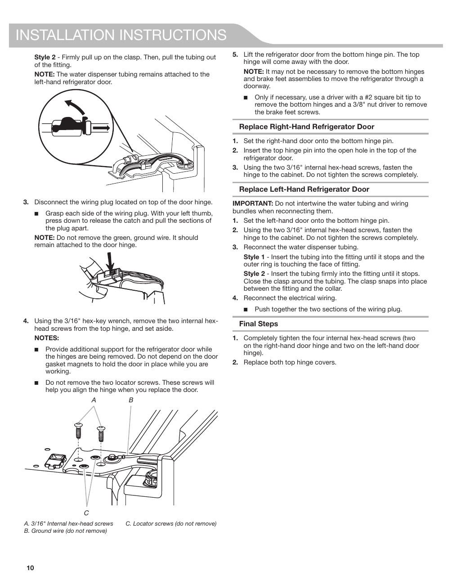

## PDF page 11

#### Remove and Replace Freezer Drawer Front

Depending on the width of your door opening, it may be

necessary to remove the freezer drawer front to move the

refrigerator into your home.

IMPORTANT:

If the refrigerator was previously installed and you are moving

- 

- 

it out of the home, before you begin, turn the refrigerator

control OFF, and unplug the refrigerator or disconnect power.

Remove food from the freezer drawer.

Two people may be required to remove and replace the

- 

- 

freezer drawer front.

Tool Needed: 1/4" hex driver

Remove Drawer Front

1. Open the freezer drawer to its full extension.

2. Remove the two screws at the top, inside the drawer front

(one on the left-hand side and one on the right-hand side) that

fasten the drawer front to the drawer glides.

3. Lift up on the drawer front to release the plastic studs from

the drawer glide bracket slots.

A

A. Drawer glide bracket slots

4. Slide the drawer glides back into the freezer.

Replace Drawer Front

1. Pull out the freezer drawer glides to their full extension.

2. Holding the drawer front by its sides, align the two plastic

studs, located at the bottom, inside the drawer front, with the

drawer glide bracket slots.

NOTE: It helps if one person holds the drawer glides steady

while another person aligns the drawer front and inserts the

studs into the slots.

### INSTALLATION INSTRUCTIONS

3. Replace and tighten the two screws at the top of the drawer

front (one on the left-hand side and one on the right-hand

side).

A

B

A. Drawer front screw

B. Drawer front plastic stud

Final Steps

### WARNING

Electrical Shock Hazard

Plug into a grounded 3 prong outlet.

Do not remove ground prong.

Do not use an adapter.

Do not use an extension cord.

Failure to follow these instructions can result in death,

fire, or electrical shock.

1. Plug into a grounded 3 prong outlet.

2. Reset the controls. See “Using the Controls.”

3. Return all removable door parts to doors and the food to

refrigerator.

11

### Original figure / page illustration (PDF page 11)

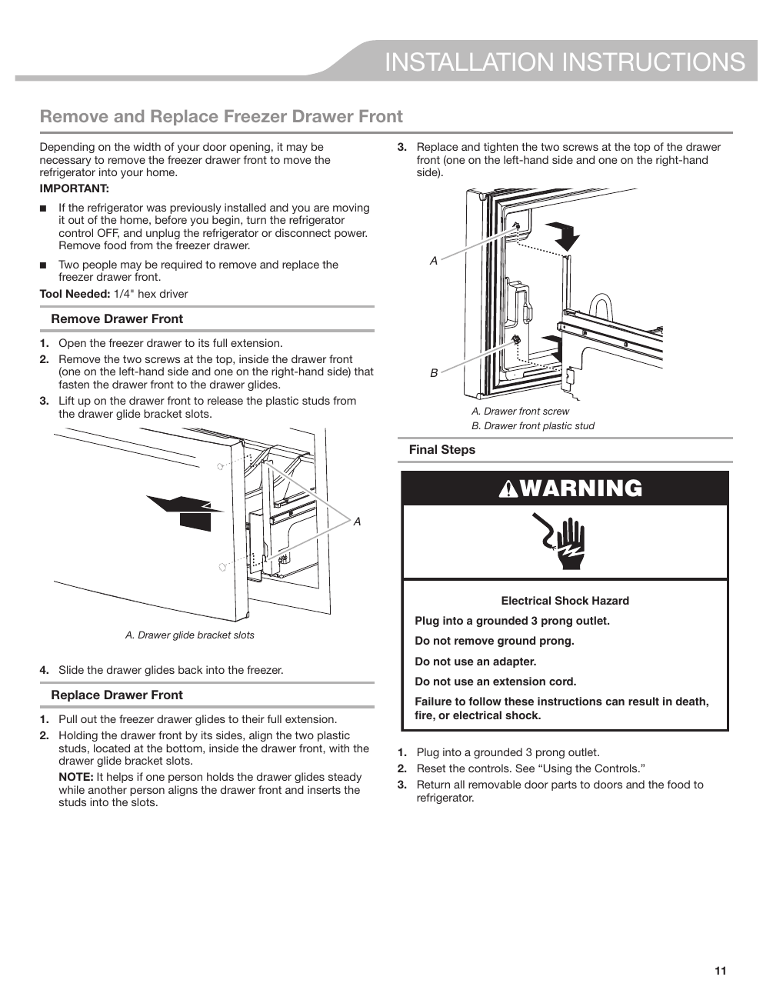

## PDF page 12

### INSTALLATION INSTRUCTIONS

#### Electrical Requirements

### WARNING

Electrical Shock Hazard

Plug into a grounded 3 prong outlet.

Do not remove ground prong.

Do not use an adapter.

Do not use an extension cord.

Failure to follow these instructions can result in death,

fire, or electrical shock.

#### Water Supply Requirements

A cold water supply with water pressure between 35 and 120 psi

(241 and 827 kPa) is required to operate the water dispenser and

ice maker. If you have questions about your water pressure, call a

licensed, qualified plumber.

NOTE: If the water pressure is less than what is required, the flow

of water from the water dispenser could decrease or ice cubes

could be hollow or irregular shaped.

Reverse Osmosis Water Supply

IMPORTANT: The pressure of the water supply coming out of

a reverse osmosis system going to the water inlet valve of the

refrigerator needs to be between 35 and 120 psi

(241 and 827 kPa).

If a reverse osmosis water filtration system is connected to your

cold water supply, the water pressure to the reverse osmosis

system needs to be a minimum of 40 to 60 psi (276 to 414 kPa).

#### Connect the Water Supply

Read all directions before you begin.

IMPORTANT:

Connect to potable water supply only.

- 

- 

Do not use with water that is microbiologically unsafe or

of unknown quality without adequate disinfection before

or after the system. Systems certified for cyst reduction

may be used on disinfected waters that may contain

filterable cysts.

Plumbing shall be installed in accordance with the

- 

- 

International Plumbing Code and any local codes and

ordinances.

The gray water tubing on the back of the refrigerator (which

- 

- 

is used to connect to the household water line) is a PEX

(cross-linked polyethylene) tube. Copper and PEX tubing

connections from the household water line to the refrigerator

are acceptable, and will help avoid off-taste or odor in your

ice or water. Check for leaks.

12

Before you move your refrigerator into its final location, it is

important to make sure you have the proper electrical connection.

Recommended Grounding Method

A 115 V, 60 Hz, AC only 15 or 20 A fused, grounded electrical

supply is required. It is recommended that a separate circuit

serving only your refrigerator be provided. Use an outlet that

cannot be turned off by a switch. Do not use an extension cord.

NOTE: Before performing any type of installation, cleaning, or

removing a light bulb, turn Cooling OFF, and then disconnect the

refrigerator from the electrical source. When you have finished,

reconnect the refrigerator to the electrical source and turn

Cooling ON. See “Using the Controls.”

Check to see whether the sediment filter in the reverse

- 

- 

osmosis system is blocked. Replace the filter if necessary.

Allow the storage tank on the reverse osmosis system to refill

- 

- 

after heavy use. The tank capacity could be too small to keep

up with the requirements of the refrigerator.

NOTE: Faucet mounted reverse osmosis systems are not

recommended.

If your refrigerator has a water filter, it may further reduce

- 

- 

the water pressure when used in conjunction with a reverse

osmosis system. Remove the water filter. See “Water Filtration

System.”

If you have questions about your water pressure, call a licensed,

qualified plumber.

If PEX tubing is used instead of copper, we recommend the

following Whirlpool Part Numbers:

W10505928RP (7 ft [2.14 m] jacketed PEX),

8212547RP (5 ft [1.52 m] PEX), or

W10267701RP (25 ft [7.62 m] PEX).

Install tubing only in areas where temperatures will remain

- 

- 

above freezing.

TOOLS NEEDED:

Gather the required tools and parts before starting installation.

Flat-blade screwdriver

- 

- 

7⁄16" and 1/2" open-end wrenches or two adjustable

- 

- 

wrenches

1/4" nut driver

- 

- 

NOTE: Do not use a piercing-type or 3/16" (4.76 mm) saddle

valve which reduces water flow and clogs easier.

## PDF page 13

Connect to Water Line

IMPORTANT: If you turn the refrigerator on before the water is

connected, turn the ice maker OFF.

1. Unplug refrigerator or disconnect power.

2. Turn OFF main water supply. Turn ON nearest faucet long

enough to clear line of water.

3. Use a quarter-turn shutoff valve or the equivalent, served by a

1/2" (12.7 mm) household supply line.

NOTE: To allow sufficient water flow to the refrigerator, a

minimum 1/2" (12.7 mm) size household supply line is

recommended.

A

B

C

D

C. Copper tubing (to refrigerator)

A. Sleeve

D. Household supply line (1/2" [12.7 mm] minimum)

B. Nut

4. Now you are ready to connect the copper tubing to the

shutoff valve. Use 1/4" (6.35 mm) OD soft copper tubing to

connect the shutoff valve and the refrigerator.

Ensure that you have the proper length needed for the job.

- 

- 

Be sure both ends of the copper tubing are cut square.

Slip compression sleeve and compression nut onto

- 

- 

copper tubing as shown. Insert end of tubing into outlet

end squarely as far as it will go. Screw compression nut

onto outlet end with adjustable wrench. Do not

overtighten.

A

B

C

A. Compression sleeve

C. Copper tubing

B. Compression nut

5. Place the free end of the tubing into a container or sink, and

turn on main water supply to flush out tubing until water is

clear. Turn OFF shutoff valve on the water pipe.

NOTE: Always drain the water line before making the final

connection to the inlet of the water valve to avoid possible

water valve malfunction.

6. Bend the copper tubing to meet the water line inlet, which

is located on the back of the refrigerator cabinet as shown.

Leave a coil of copper tubing to allow the refrigerator to be

pulled out of the cabinet or away from the wall for service.

### INSTALLATION INSTRUCTIONS

Connect to Refrigerator

Follow the connection instructions specific to your model.

Style 1

1. Remove plastic cap from water valve inlet port. Attach the

copper tube to the valve inlet using a compression nut

and sleeve as shown. Tighten the compression nut. Do not

overtighten. Confirm copper tubing is secure by pulling on

copper tubing.

2. Create a service loop with the copper tubing. Avoid kinks

when coiling the copper tubing. Secure copper tubing to

refrigerator cabinet with a “P” clamp.

A

B

C

D

A. Copper tubing

C. Compression nut

B. “P” clamp

D. Compression sleeve

3. Turn on water supply to refrigerator and check for leaks.

Correct any leaks.

Style 2

1. Unplug refrigerator or disconnect power.

2. Remove and discard the short, black plastic part from the end

of the water line inlet.

3. Thread the nut onto the end of the tubing. Tighten the nut by

hand. Then tighten it with a wrench two more turns. Do not

overtighten.

NOTE: To avoid rattling, be sure the copper tubing does not

touch the cabinet’s side wall or other parts inside the cabinet.

A

B

C

D

A. Household water line

C. Ferrule (purchased)

B. Nut (purchased)

D. Refrigerator water tubing

13

### Original figure / page illustration (PDF page 13)

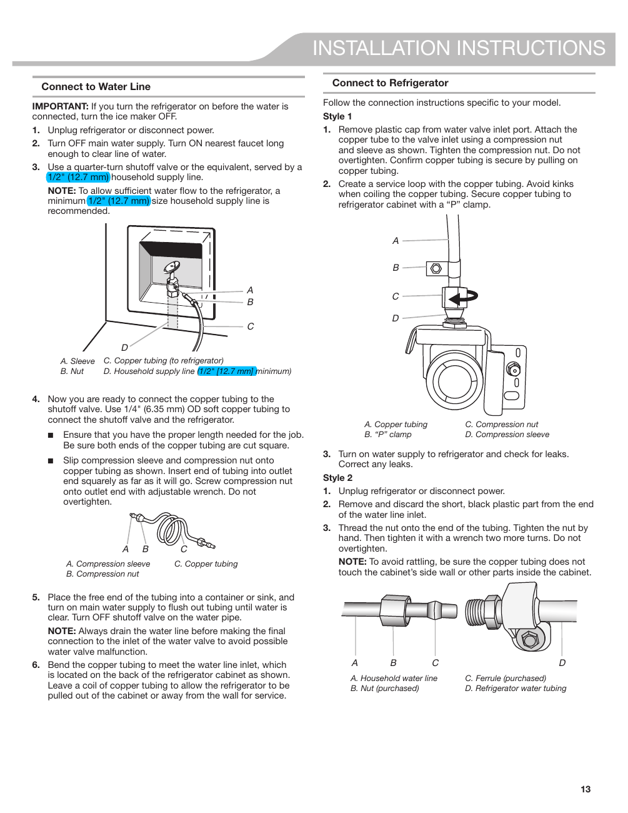

## PDF page 14

### INSTALLATION INSTRUCTIONS

4. Install the water supply tube clamp around the water supply

line to reduce strain on the coupling.

5. Turn shutoff valve ON.

6. Check for leaks. Tighten any connections (including

connections at the valve) or nuts that leak.

7. On some models, the ice maker is equipped with a built-in

water strainer. If your water conditions require a second water

strainer, install it in the 1/4" (6.35 mm) water line at either

tube connection. Obtain a water strainer from your appliance

dealer.

#### Handle Installation and Removal

Parts Included: Door handles (2), Drawer handle(s) (1 or 2

depending on model), 1/8" hex key, spare setscrew(s)

NOTE: With the handles laying on a flat surface, the handles

intended for the drawers are more curved. They will not mount

flush against the doors.

Install Handles

NOTE: Handle mounting setscrews are preinstalled inside the

handle.

1. Remove the handles from the packaging inside the

refrigerator, and place them on a soft surface.

2. Open a refrigerator compartment door. On the closed door,

place a handle onto the shoulder screws so that the

setscrews are facing the adjacent door.

A

B

A. Shoulder screws

B. Setscrews inside the handle

14

Complete the Installation

### WARNING

Electrical Shock Hazard

Plug into a grounded 3 prong outlet.

Do not remove ground prong.

Do not use an adapter.

Do not use an extension cord.

Failure to follow these instructions can result in death,

fire, or electrical shock.

1. Plug into a grounded 3 prong outlet.

2. Flush the water system. See “Water and Ice Dispensers.”

NOTE: Allow 24 hours to produce the first batch of ice.

Discard the first three batches of ice produced. Allow 3 days

to completely fill the ice storage bin.

3. Firmly push the handle toward the door until the handle base

is flush against the door.

4. While holding the handle, insert the short end of the hex key

into the upper hole and slightly rotate the hex key until it is

engaged in the setscrew.

5. Using a clockwise motion tighten the setscrew just until it

begins to contact the shoulder screw. Do not fully tighten.

6. Repeat steps 4 and 5 to fasten the lower setscrew.

7. Once both setscrews have been partially tightened as

instructed in the previous steps, fully tighten both setscrews.

IMPORTANT: When the screws feel tight, tighten them an

additional quarter-turn. The handle is not properly installed

without this extra tightening.

## PDF page 15

#### Refrigerator Leveling, Door Closing and Alignment

8. Repeat steps 2 through 7 to install the other handle onto the

adjacent refrigerator door.

9. With the drawer(s) closed, place the handle onto the shoulder

screws so that the setscrews are facing down toward the

floor.

A

B

A. Shoulder screw

B. Setscrews inside the handle

10. Firmly push the handle toward the drawer until the handle

base is flush against the drawer.

11. Insert the short end of the hex key into the left-hand hole and

slightly rotate the hex key until it is engaged in the setscrew.

12. Using a left to right motion tighten the setscrew a quarter-turn

at a time just until it begins to contact the shoulder screw. Do

not fully tighten.

13. Repeat steps 11 and 12 to fasten the right-hand setscrew to

the shoulder screw.

The base grille covers the adjustable brake feet and roller

assemblies located at the bottom of the refrigerator below the

freezer drawer. Before making any adjustments, remove the base

grille and move the refrigerator to its final location.

Tools Needed: 1/4" hex driver

Tools Provided: 1/8" hex-key wrench

1. Remove the base grille. Grasp the grille firmly and pull it

toward you. Open the freezer drawer to access the brake feet.

NOTE: To allow the refrigerator to roll easier, raise the break

feet by turning them counterclockwise. The front rollers will be

touching the floor.

### INSTALLATION INSTRUCTIONS

14. Once both setscrews have been partially tightened as

instructed in the previous steps, fully tighten both setscrews.

IMPORTANT: When the screws feel tight, tighten them an

additional quarter-turn. The handle is not properly installed

without this extra tightening.

15. For some models, repeat steps 9 through 14 to install a

handle on the second drawer.

16. Save the hex key and all instructions.

Remove the Handles

1. While holding the handle, insert the short end of the hex key

into a setscrew hole and slightly rotate the hex key until it is

engaged in the setscrew.

2. Using a right to left motion loosen the setscrew a quarter-turn

at a time.

3. Repeat steps 1 and 2 for the other setscrew. Slowly pull the

handle away from the door or drawer.

4. If necessary, use a Phillips screwdriver to remove the shoulder

screws from the door.

Remove and Replace Handle Medallions (optional)

The handles for your model have red medallions on the ends.

Replacement medallions are available for purchase. See

“Accessories” to order.

1. Using a 1/8" hex key, remove the medallion from the end of

the handle.

2. Replace medallion.

3. Using the fastener removed in Step 1, attach the medallion to

the handle.

A

A. Handle medallion

2. Move the refrigerator to its final location.

3. Lower the brake feet, by turning them clockwise, until the

rollers are off the floor and both brake feet are snug against

the floor. This keeps the refrigerator from rolling forward when

opening the refrigerator doors or freezer drawer.

IMPORTANT: If you need to make further adjustments

involving the brake feet, you must turn both brake feet the

same amount to keep the refrigerator level.

15

### Original figure / page illustration (PDF page 15)

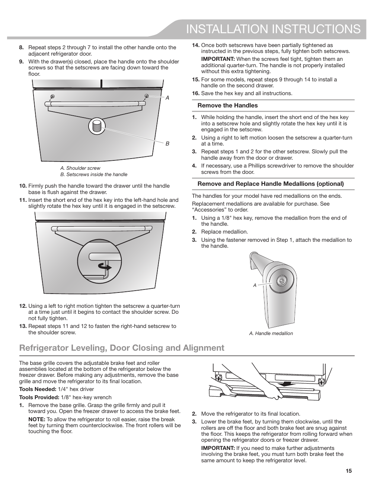

## PDF page 16

### INSTALLATION INSTRUCTIONS

4. Make sure the doors close easily. If you are satisfied with the

door opening and closing, skip the next section and go to

“Align the Doors.” If, however, the doors do not close easily or

the doors pop open, adjust the tilt.

To Adjust the Cabinet Tilt:

Open the freezer drawer. Use a 1/4" hex driver to turn

- 

- 

both brake feet clockwise the same amount. This will raise

the front of the refrigerator. It may take several turns to

allow the doors to close easier.

NOTE: Having someone push against the top of the

refrigerator takes some weight off the brake feet. This makes

it easier to turn them.

Style 1

C

A

B

A. Brake foot

B. Front roller

C. 1/4" Hex driver

Style 2

B

A

A. Brake foot

B. 1/4" Hex driver

16

5. Make sure the doors are even at the top and that the space

between the bottom of the refrigerator doors and the top of

the freezer drawer is even. If necessary, align the doors.

To Align the Doors:

Keeping both refrigerator doors closed, pull out the freezer

- 

- 

drawer. Locate the bottom hinge pin of the right-hand

refrigerator door. The alignment screw is inside the bottom

hinge pin.

Insert the short end of the 1/8" hex- key wrench (packed

- 

- 

with the Door Handle Installation Instructions) into the

bottom hinge pin until it is fully engaged in the alignment

screw.

To raise the refrigerator door, turn the hex key to the right.

To lower the door, turn the hex key to the left.

Continue to turn the alignment screw until the doors are

- 

- 

aligned.

A

B

A. Bottom hinge pin

B. 1/8" Hex-key wrench

6. Make sure the refrigerator is steady. If the refrigerator seems

unsteady or rolls forward when the door or drawer is pulled

open, adjust the brake feet.

To Steady the Refrigerator:

Open the freezer drawer. Using a 1/4" hex driver, turn both

- 

- 

brake feet clockwise the same amount until the brake feet

are snug against the floor. Check again. If not satisfied,

continue to adjust the brake feet by half turns of the screw

until the refrigerator does not roll forward when the drawer

is opened.

NOTE: Having someone push against the top of the

refrigerator takes some weight off the brake feet. This makes

it easier to turn the screws.

7. Replace the base grille by aligning the ends of the grille with

the leveling assemblies on each side and snapping the grille

into place.

### Original figure / page illustration (PDF page 16)

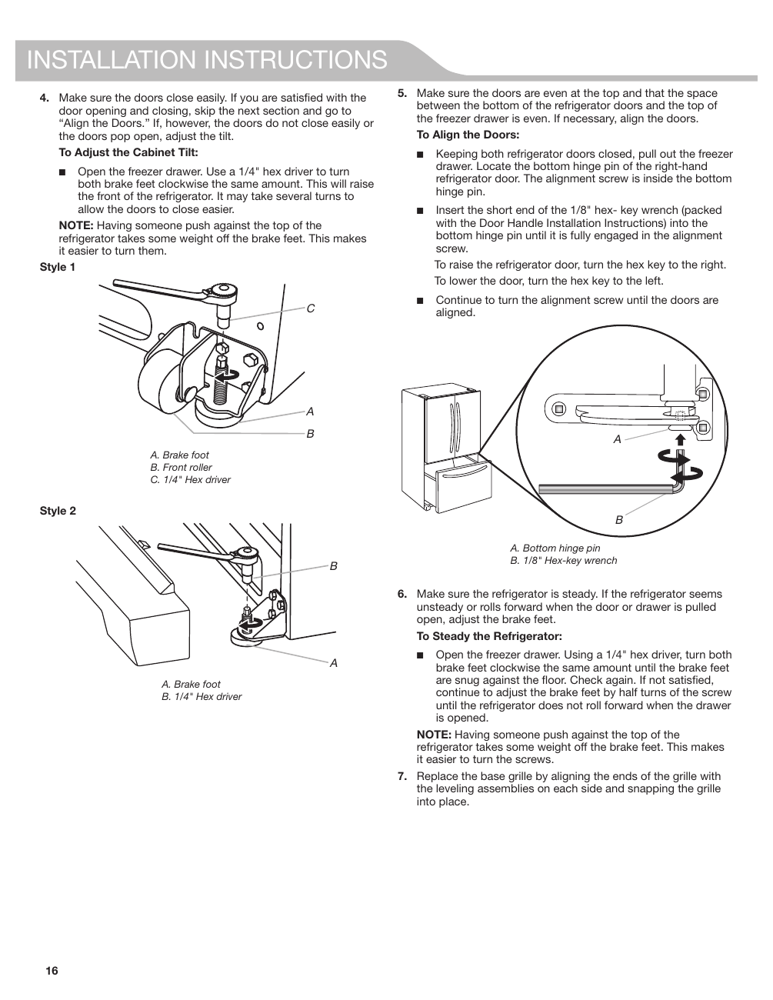

## PDF page 17

#### Water Filtration System

Do not use with water that is microbiologically unsafe or

of unknown quality without adequate disinfection before

or after the system. Systems certified for cyst reduction

may be used on disinfected waters that may contain

filterable cysts.

Install the Water Filter

1. Locate the accessory packet in the refrigerator and remove

the water filter.

2. Take the water filter out of its packaging and remove the cover

from the O-rings. Be sure the O-rings are still in place after the

cover is removed.

A

B

A. O-ring cover

B. O-rings

3. The water filter compartment is located in the right-hand side

of the refrigerator ceiling. Push up on the compartment door

to release the catch, and then lower the door.

4. Align the arrow on the water filter label with the cutout notch

in the filter housing, and insert the filter into the housing.

### FILTERS AND ACCESSORIES

5. Turn the filter clockwise 90 degrees (1/4 turn), until it locks

into the housing.

NOTE: If the filter is not correctly locked into the housing, the

water dispenser will not operate. Water will not flow from the

dispenser.

6. While the compartment door is still open, lift the filter up into

the compartment. Then, close the filter compartment door

completely.

7. Flush the water system. See “Flushing the Water Filter” in the

“Water and Ice Dispensers” section.

IMPORTANT: If you do not flush the water system, you may

experience dripping and/or decreased flow from the water

dispenser.

The Water Filter Status Light

Press OPTIONS on the control panel to launch the Options menu.

Press OPTIONS, under Filter Status, again to display the

percentage of filter life remaining (from 100% to 0%). Press ICE

MODE to return to the Normal screen.

The water filter status lights will help you know when to change

your water filter.

ORDER (yellow) - it is almost time to change the water filter.

- 

- 

While you are dispensing water, “Order Filter” will blink seven

times and sound an alert tone three times.

REPLACE (red) - Replace the water filter. While you are

- 

- 

dispensing water, “Replace Filter” will blink seven times and

an alert tone will sound three times.

RESET the water filter status tracking feature. After you

- 

- 

replace the disposable water filter with a new filter, closing the

filter compartment door will automatically reset the filter status

tracking feature. See “Using the Controls.”

NOTE: “Replace Filter” will remain illuminated if a filter is not

installed or is installed incorrectly.

17

### Original figure / page illustration (PDF page 17)

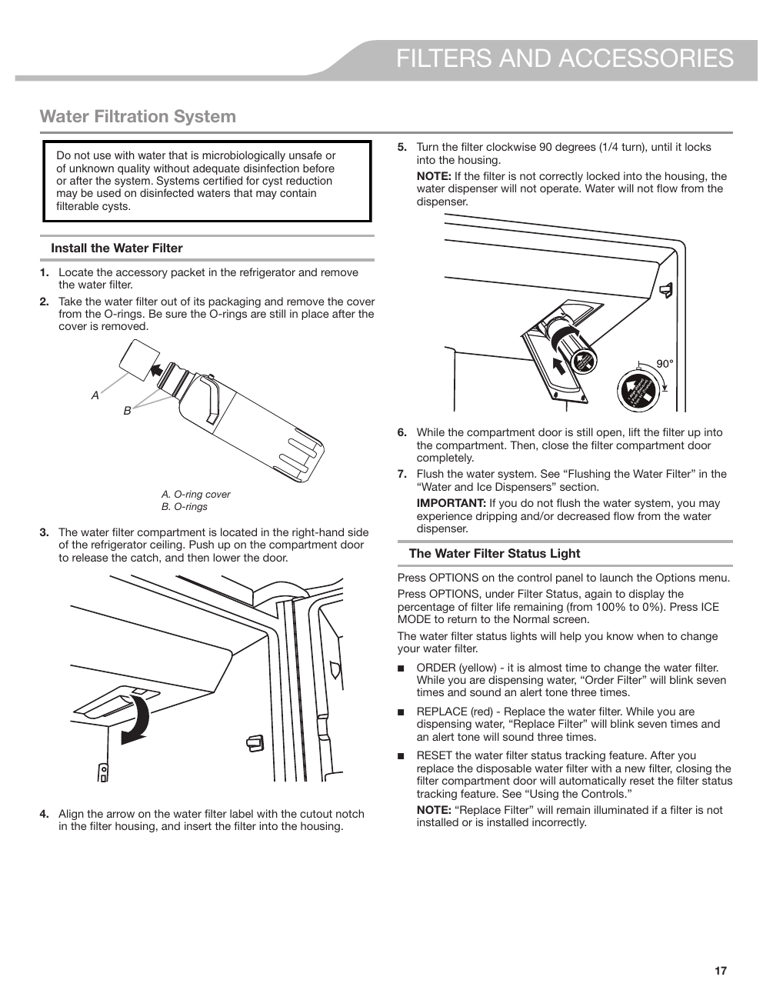

## PDF page 18

### FILTERS AND ACCESSORIES

Replace the Water Filter

To purchase a replacement water filter, see “Accessories.”

Replace the disposable water filter when indicated on the water

filter status display or at least every 6 months. If water flow to

your dispenser or ice maker decreases noticeably, change the

water filter sooner.

1. Locate the water filter compartment in the right-hand side

of the refrigerator ceiling. Push up to release and lower the

compartment door.

#### Install Air Filter (on some models)

An air filter is 15 times more powerful than baking soda at

reducing common food odors inside the refrigerator.

Your refrigerator's accessory packet includes an air filter, which

must be installed prior to use.

Installing the Air Filter

Install the air filter behind the vented door, located on the rear wall

near the top of the refrigerator compartment.

1. Remove the air filter from its packaging.

2. Lift open the vented door.

3. Snap the filter into place.

A

A. Air filter

18

2. Turn the water filter counterclockwise (to the left), and pull it

straight out of the compartment.

NOTE: There may be some water in the filter. Some spilling

may occur. Use a towel to wipe up any spills.

3. Install the replacement water filter by following steps 2

through 7 in the “Install the Water Filter” section.

Installing the Filter Status Indicator

The filter comes with a status indicator, which should be activated

and installed at the same time the air filter is installed.

1. Place the indicator face-down on a firm, flat surface.

2. Apply pressure to the bubble on the back of the indicator until

the bubble pops to activate the indicator.

3. Lift open the vented air filter door. On some models, there are

notches behind the door.

Models with notches:

With the indicator screen facing outward, slide the

- 

- 

indicator down into the notches.

NOTE: The indicator will not easily slide into the notches if the

bubble has not been popped.

Close the air filter door, and check that the indicator is

- 

- 

visible through the window in the door.

A

B

C

A. Status indicator window

B. Air filter status indicator

C. Notches

### Original figure / page illustration (PDF page 18)

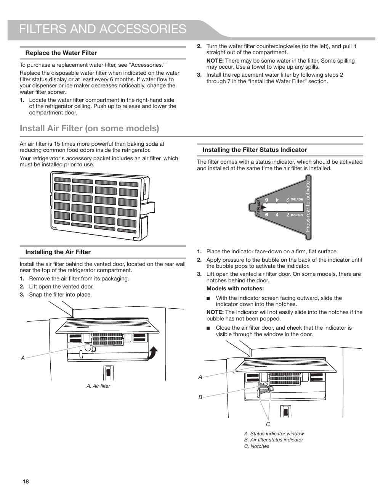

## PDF page 19

#### Install Produce Preserver (on some models)

Models without notches:

Place the indicator somewhere it is easily visible — either

- 

- 

inside the refrigerator, or elsewhere in your kitchen or home.

Replacing the Air Filter

The disposable air filter should be replaced every 6 months when

the status indicator has completely changed from white to red.

To order a replacement air filter, contact us. See “Accessories”

in the User Guide, Use and Care Guide or User Instructions for

information on ordering.

The Produce Preserver absorbs ethylene to slow the ripening

process of many produce items. As a result, certain produce

items will stay fresh longer.

Ethylene production and sensitivity varies depending on the type

of fruit or vegetable. To preserve freshness, it is best to separate

produce with sensitivity to ethylene from fruits that produce

moderate to high amounts of ethylene.

Sensitivity to

Ethylene

Ethylene

Production

Apples

High

Very High

Asparagus

Med.

Very Low

Berries

Low

Low

Broccoli

High

Very Low

Cantaloupe

Med.

High

Carrots

Low

Very Low

Citrus Fruit

Med.

Very Low

Grapes

Low

Very Low

Lettuce

High

Very Low

Pears

High

Very High

Spinach

High

Very Low

### FILTERS AND ACCESSORIES

1. Remove the used air filter by squeezing in on the side tabs.

2. Remove the used status indicator.

3. Install the new air filter and filter status indicator using the

instructions in the previous sections.

Installing the Produce Preserver

CAUTION: IRRITANT

MAY IRRITATE EYES AND SKIN. DANGEROUS FUMES

FORM WHEN MIXED WITH OTHER PRODUCTS.

Do not mix with cleaning products containing ammonia,

bleach or acids. Do not get in eyes, on skin or clothing. Do

not breathe dust. Keep out of reach of children.

FIRST AID TREATMENT: Contains potassium

permanganate. If swallowed, call a Poison Control Center or

doctor immediately. Do not induce vomiting. If in eyes, rinse

with water for 15 minutes. If on skin, rinse with water.

1. Find the Produce Preserver housing inside the refrigerator.

2. Open the housing by pulling up and out on the back.

3. Remove the Produce Preserver pouches from the packaging

and place them into the housing.

NOTE: For best performance, always use two pouches.

4. Adhere the Produce Preserver housing to the back wall of the

crisper drawer according to the instructions included in the

package.

19

## PDF page 20

### FILTERS AND ACCESSORIES

Installing the Status Indicator

The produce preserver comes with a status indicator, which

should be activated and installed at the same time the pouches

are installed.

1. Place the indicator face-down on a firm, flat surface.

2. Apply pressure to the bubble on the back of the indicator until

the bubble pops, to activate the indicator.

#### Accessories

The following accessories are available for your refrigerator. To

order an accessory, contact us and ask for the part number.

In the U.S.A., visit our webpage www.kitchenaid.com/

accessories or call 1-800-901-2042.

In Canada, visit our webpage www.kitchenaid.ca

or call 1-800-807-6777.

Affresh® Stainless Steel Cleaner:

In U.S.A., order Part #W10355016

In Canada, order Part #W10355016B

Affresh® Stainless Steel Wipes:

In U.S.A., order Part #W10355049

In Canada, order Part #W10355049B

20

3. Slide open the cap on the top of the produce preserver

housing.

4. Place the indicator in the top of the housing, facing outward.

5. Slide the cap closed, and check that the indicator is visible

through the rectangular hole in the cap.

NOTE: The cap will not easily close if the indicator’s bubble

has not been popped.

Replacing the Produce Preserver

The disposable pouches should be replaced every 6 months or

when the status indicator changes completely from white to red.

To order replacements, contact us. See “Accessories” for

information on ordering.

1. Remove the used pouches from the produce preserver

housing.

2. Remove the used status indicator.

3. Install the replacement pouches and status indicator using

the instructions in the previous sections.

Affresh® Kitchen & Appliance Cleaner:

In U.S.A., order Part #W10355010

In Canada, order Part #W10355010B

Water Filter:

Order Part #W10413645A or FILTER2

Air Filter:

Order Part #W10311524 or AIR1

Produce Preserver:

Order Part # W10346771A or FRESH1

Produce Preserver Starter Kit:

Order Part # P1UB6S1

Produce Preserver Refill Kit:

Order Part # P1KC6R1

Water Filter, Air Filter and Produce Preserver Bundle Pack:

Order Part # W10413643BL

Door Handle Medallions:

Order Part #W10762987 (Black)

Order Part #W10762993 (Chrome)

## PDF page 21

#### Opening and Closing Doors

There are two refrigerator compartment doors. The doors can be

opened and closed either separately or together.

There is a vertically-hinged seal on the left refrigerator door.

When the left side door is opened, the hinged seal

- 

- 

automatically folds inward so that it is out of the way.

When both doors are closed, the hinged seal automatically

- 

- 

forms a seal between the two doors.

#### Using the Controls

The controls are located above the external dispenser.

IMPORTANT: The display screen on the dispenser control panel

will turn off automatically and enter Sleep mode when the control

buttons and dispenser paddles have not been used for 2 minutes

or more. Press any control button to reactivate the display screen.

The home screen will appear as shown.

Viewing and Adjusting Temperature Set Points

For your convenience, your refrigerator and freezer temperature

controls are set to the recommended set points at the factory.

When you first install your refrigerator, make sure the temperature

controls are still set to the recommended set points. The

recommended set points are 37°F (3°C) for the refrigerator and

0°F (-18°C) for the freezer.

IMPORTANT:

Wait 24 hours before you put food into the refrigerator. If you

- 

- 

add food before the refrigerator has cooled completely, your

food may spoil.

### REFRIGERATOR USE

A

A. Hinged seal

NOTE: Adjusting the set points to a colder than

recommended setting will not cool the compartments any

faster.

If the temperature is too warm or too cold in the refrigerator

- 

- 

or freezer, first check the air vents to be sure they are not

blocked before adjusting the controls.

The recommended set points should be correct for normal

- 

- 

household use. The controls are set correctly when milk or

juice is as cold as you like and when ice cream is firm.

NOTE: Areas such as a garage or porch may experience

hotter or colder temperatures and higher humidity than inside

the home. You may need to adjust the temperature away

from the recommended set points to accommodate for these

conditions.

Wait at least 24 hours between adjustments. Recheck the

- 

- 

temperatures before other adjustments are made.

View Temperature Set Points

1. Press and hold TEMPERATURE for 3 seconds to activate

Temperature mode.

2. When Temperature mode is activated, press TEMPERATURE

to toggle between the Refrigerator zone and the Freezer

zone. The display will show the temperature set point of the

selected compartment, as shown.

NOTE: When Temperature mode is activated, to view

temperatures in degrees Celsius, press the LIGHT button,

under Units. To return the display setting to Fahrenheit, press

the LIGHT button again.

Recommended Refrigerator Temperature

21

### Original figure / page illustration (PDF page 21)

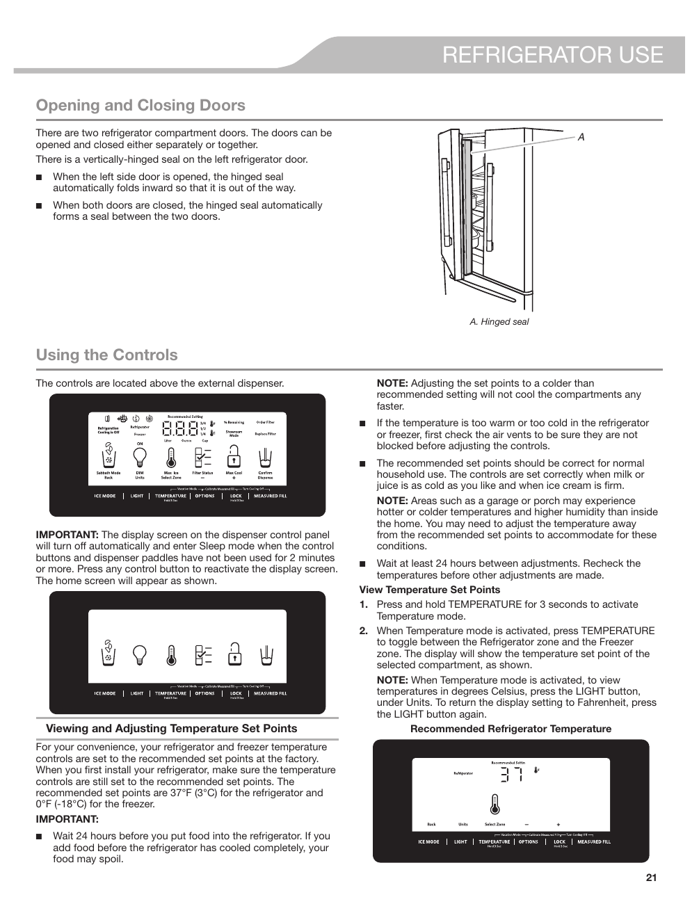

## PDF page 22

### REFRIGERATOR USE

Recommended Freezer Temperature

Adjust Temperature Set Points

Refrigerator set point range: 33°F to 45°F (0°C to 7°C).

Freezer set point range: -5°F to 5°F (-21°C to -15°C).

1. Press and hold TEMPERATURE for 3 seconds to activate

Temperature mode.

2. When Temperature mode is activated, press TEMPERATURE

to select the Refrigerator zone. The display will show the

temperature set point of the selected compartment as shown.

3. Press LOCK, under plus, to raise the set point, or press

OPTIONS, under minus, to lower the set point.

4. When you have finished adjusting the refrigerator set point,

press TEMPERATURE to change the display to show

the freezer set point. When the zone has been changed,

“FREEZER” appears on the display screen.

5. Press LOCK, under the plus button, to raise the set point,

or press OPTIONS, under the minus button, to lower the set

point.

Save/Confirm Temperature Settings

When you have finished adjusting both the refrigerator and

- 

- 

freezer set points, press MEASURED FILL “Confirm” to save

the settings.

NOTE: To exit Temperature mode without saving changes, press

the ICE MODE button under Back at any time, or allow about

60 seconds of inactivity. The temperature mode will turn off

automatically and return to the normal screen.

When adjusting temperature set points,

use the following chart as a guide:

CONDITION:

TEMPERATURE

ADJUSTMENT:

REFRIGERATOR too cold

REFRIGERATOR Setting 1°

higher

REFRIGERATOR too warm

REFRIGERATOR Setting 1°

lower

FREEZER too cold

FREEZER Setting

1° higher

FREEZER too warm /

FREEZER Setting

Too little ice

1° lower

22

Cooling On/Off

Your refrigerator and freezer will not cool when cooling is turned

off.

To turn cooling off, press and hold the LOCK and MEASURED

- 

- 

FILL buttons at the same time for 3 seconds. When cooling

is off, “Refrigeration Cooling is Off” will appear on the display

screen as shown.

IMPORTANT: To avoid unintentionally locking the dispenser

or changing other settings, be sure to press both buttons at

exactly the same time.

A

A. Press LOCK and MEASURED FILL at the same time.

To turn cooling back on, press and hold LOCK and

- 

- 

MEASURED FILL for 3 seconds again. COOLING IS OFF will

disappear from the display screen.

Options

Press the OPTIONS button to open the Options menu and select

between Max Cool, Max Ice and Water Filter Status.

Press the ICE MODE button at any time to return to the normal

screen.

Max Cool

The Max Cool feature assists with periods of high refrigerator use,

full grocery loads, or temporarily warm room temperatures.

To turn on the Max Cool feature, press the OPTIONS button to

- 

- 

enter Options mode, then press the LOCK button, under Max

Cool, to activate the feature. When the feature is on, the Max

Cool icon will appear on the dispenser display screen. The

Max Cool feature will remain on for 24 hours unless manually

turned off.

To manually turn off the Max Cool feature, press the OPTIONS

- 

- 

button to enter Options mode (unless you are already in

Options mode), then press LOCK again. When the feature has

been turned off, the Max Cool icon will disappear from the

dispenser display.

NOTE: Setting the freezer to a colder temperature may make

some foods, such as ice cream, harder.

### Original figure / page illustration (PDF page 22)

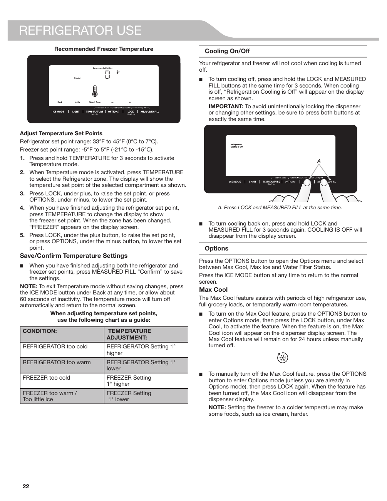

## PDF page 23

Max Ice

The Max Ice feature assists with temporary periods of heavy ice

use by increasing ice production.

To turn on the Max Ice feature, press the OPTIONS button to

- 

- 

enter Options mode, then press the TEMPERATURE button,

under Max Ice, to activate the feature. When the feature is on,

the Max Ice icon will appear on the dispenser display screen.

The Max Ice feature will remain on for 24 hours unless

manually turned off.

To manually turn off the Max Ice feature, press the OPTIONS

- 

- 

button to enter Options mode (unless you are already in

Options mode), then press TEMPERATURE again. When the

feature has been turned off, the Max Ice icon will disappear

from the dispenser display.

Water Filter Status

Press FILTER STATUS to display the percentage of use remaining

in the water filter (from 100% to 0%).

ALSO

The water filter status lights will let you know when to change

your water filter.

ORDER FILTER (Yellow) - Order a replacement water filter.

- 

- 

REPLACE FILTER (Red) - Replace the water filter. Replacing

- 

- 

the disposable water filter will automatically reset the water

filter status tracking feature. See “Water Filtration System.”

NOTE: REPLACE FILTER will remain illuminated if a filter is

not installed or installed incorrectly.

Additional Features

Sabbath Mode

Sabbath Mode is designed for those whose religious observances

require turning off the lights and dispensers.

In Sabbath Mode, the temperature set points remain unchanged,

but the interior and dispenser lights turn off. Sounds, alarms, and

the dispenser paddles are disabled.

To turn on Sabbath Mode, press and hold LIGHT and

- 

- 

OPTIONS at the same time for 3 seconds. When the feature

turns on, “Sabbath Mode” will appear on the dispenser

display.

To turn off Sabbath Mode, press and hold LIGHT and

- 

- 

OPTIONS at the same time for 3 seconds. The screen will

display the settings as they were before Sabbath Mode was

turned on. However, the Max Cool and Max Ice features, will

remain off until they are selected again.

NOTES:

Turning “Cooling Off” will cancel Sabbath Mode.

- 

- 

### REFRIGERATOR USE

If a power outage occurs while in Sabbath Mode, Power

- 

- 

Outage will not be indicated on the display no matter how

long the power was out.

Vacation Mode

In Vacation Mode, the freezer will defrost less often to conserve

energy.

To turn on Vacation Mode, press and hold TEMPERATURE

- 

- 

and OPTIONS at the same time for 3 seconds. When the

feature turns on, “VAC” will appear on the dispenser display.

To turn off Vacation Mode, press and hold TEMPERATURE

- 

- 

and OPTIONS at the same time, again, for 3 seconds. The

screen will display the settings as they were before Vacation

Mode was turned on.

NOTES:

During the first hour after Vacation Mode is turned on,

- 

- 

opening and closing the refrigerator door will not affect the

setting. After 1 hour has passed, opening and closing the

refrigerator door will turn off Vacation Mode.

While in Vacation Mode, if Max Ice, Max Cool or Sabbath

- 

- 

Mode is turned on, it will cancel Vacation Mode.

Power Outage Indicator

The power outage indicator lets you know if the power supply to

the refrigerator has been cut off and the freezer temperature has

risen to 18°F (-8°C) or higher.

When power has been restored, “PO” repeatedly flashes on the

control panel display. All other control and dispenser functions are

disabled and “PO” will continue to blink until you acknowledge

the power outage.

Press the MEASURED FILL button to confirm. The Power

- 

- 

Outage “PO” will disappear, and the control panel will return

to the Normal screen.

Door Ajar Alarm

The Door Ajar Alarm feature sounds an alarm when the

refrigerator door(s) or freezer drawer is open for 5 minutes and

cooling is turned on. The alarm will repeat every 2 minutes. Close

all doors and drawer to turn it off. The feature then resets and will

reactivate when either door is left open again for 5 minutes.

NOTE: To mute the audible alarm while keeping the doors open,

such as while cleaning the inside of the refrigerator, press any

button on the control panel. The alarm sound will be temporarily

turned off, but the Door Ajar icon will still be displayed on the

dispenser control panel.

Disabling Sounds

To turn off control and dispenser sounds, press and hold ICE

- 

- 

MODE and MEASURED FILL at the same time for 3 seconds.

All normal operating tones are disabled. Only alert tones will

be audible.

To turn all sounds back on, press and hold ICE and

- 

- 

MEASURED FILL at the same time for 3 seconds again.

Showroom Mode

This mode is used only when the refrigerator is on display in

a retail store. If you unintentionally turn on Showroom mode,

the words SHOWROOM MODE will light up on the display. Exit

Showroom mode by pressing and holding LIGHT and LOCK at

the same time for 3 seconds.

23

### Original figure / page illustration (PDF page 23)

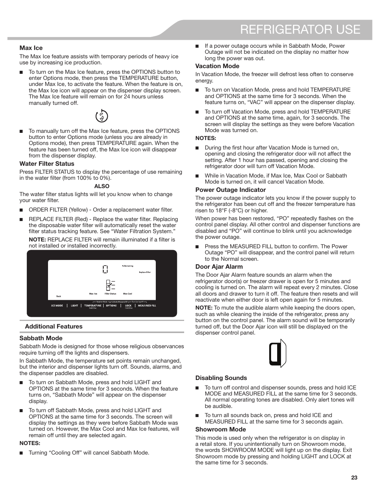

## PDF page 24

### REFRIGERATOR USE

#### Water and Ice Dispensers

IMPORTANT:

Allow 3 hours for the refrigerator to cool down and chill water.

- 

- 

Allow 24 hours to produce the first batch of ice. Discard the

- 

- 

first three batches of ice produced.

The dispensing system will not operate when either the

- 

- 

refrigerator door or freezer drawer is open.

Flush the Water System

Air in the water dispensing system can cause the water dispenser

to drip. After connecting the refrigerator to a water source or

replacing the water filter, flush the water system.

Flushing the water dispensing system forces air from the water

line and filter and prepares the water filter for use. Additional

flushing may be required in some households.

NOTE: As air is cleared from the system, water may spurt out of

the dispenser.

1. Using a sturdy container, depress and hold the water

dispenser paddle for 5 seconds.

2. Release the dispenser paddle for 5 seconds. Repeat steps 1

and 2 until water begins to flow.

3. Once water begins to flow, continue depressing and releasing

the dispenser pad (5 seconds on, 5 seconds off) until a total

of 3 gal. (12 L) has been dispensed.

Calibrate Measured Fill

Household water pressure may affect the accuracy of the

Measured Fill feature. So, for optimum performance of your water

dispenser, you must first calibrate Measured Fill.

IMPORTANT: Flush the water system before calibrating

Measured Fill.

1. Place a sturdy measuring cup (1 cup [237 mL] size) on the

dispenser tray centered in front of the water dispenser paddle.

NOTE: Depending on your model, a measuring cup may be

provided.

A

B

A. Water dispenser paddle

B. Measuring cup (1 cup)

24

2. Press and hold the OPTIONS and LOCK buttons at the same

time for 3 seconds. The words “Back” and “1 Cup” will

appear on the display screen. Also, the Calibrate Measured

Fill icon will illuminate and remain lit while the Measured Fill

feature is being calibrated.

NOTE: You may press ICE MODE “Back” at any time to exit

calibration mode. The Calibrate Measured Fill icon will turn off.

3. Press and release the water dispenser paddle, as needed, to

dispense water to the 1 cup fill line.

NOTE: If overfilling or spilling occurs, discard the water and

press ICE MODE “Back” to restart the calibration process.

### Original figure / page illustration (PDF page 24)

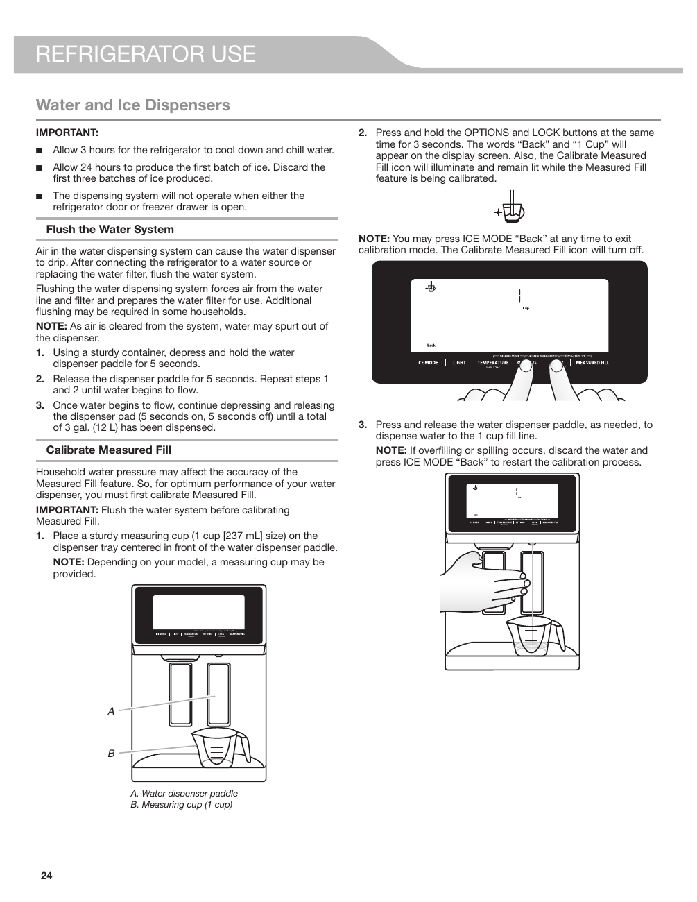

## PDF page 25

4. When 1 cup of water has been correctly dispensed into the

measuring cup, press the MEASURED FILL button under the

word “Confirm” to confirm the calibration.

A

A. 1 cup of water

5. When Measured Fill calibration has been confirmed the icons

will disappear and the display will return to the home screen.

The Water Dispenser

IMPORTANT:

Dispense at least 1 qt (1 L) of water every week to maintain a

- 

- 

fresh supply.

If the flow of water from the dispenser decreases, it could be

- 

- 

caused by low water pressure.

With the water filter removed, dispense 1 cup (237 mL)

- 

- 

of water. If 1 cup (237 mL) of water is dispensed in 8

seconds or less, the water pressure to the refrigerator

meets the minimum requirement.

If it takes longer than 8 seconds to dispense 1 cup

- 

- 

(237 mL) of water, the water pressure to the refrigerator

is lower than recommended. See “Water Supply

Requirements” and “Troubleshooting” for suggestions.

To Dispense Water - Standard:

1. Press a sturdy glass against the dispenser paddle.

2. Remove the glass to stop dispensing.

To Dispense Water - Measured Fill:

Measured Fill allows you to dispense a specified amount of water

with the touch of a few buttons.

NOTE: The amount of water you select will be dispensed. Make

sure the container is empty and that it can hold the entire volume.

If ice is in the container, you may need to adjust your selection.

1. Press MEASURED FILL to turn the feature on. When the

feature is on, the Measured Fill screen appears on the display.

### REFRIGERATOR USE

Press ICE MODE, under Back, to manually turn off the Measured

Fill feature and return to the home screen.

NOTE: The dispenser will automatically turn off Measured Fill

after 1 minute of inactivity. When Measured Fill is turned off,

any changes you have made will be lost and all defaults will be

restored.

2. You can dispense water by the ounce, cup, or liter. The default

unit is ounces. To switch to cups or liters, press the LIGHT

button under Units.

Default, minimum, and maximum volumes are listed in the

following chart:

Units

Default

Minimum

Maximum

Ounces

8

1

128

Cups

1

1/4

16

Liters

0.25

0.05

4.00

3. Press the LOCK (+) and OPTIONS (-) buttons to adjust the

volume as desired. The LOCK button increases the volume,

and the OPTIONS button lowers the volume.

NOTES:

When increasing or decreasing the dispense volumes, if an

- 

- 

adjustment button (-/+) is held for approximately 10 seconds

or longer the control may stop responding. Release the button

for approximately 2 seconds and then continue making the

adjustment.

Most coffee cups (commonly 4 to 6 oz [118 to 177 mL]

- 

- 

per cup) are not the same size as a measuring cup

(8 oz [237 mL]). You may need to adjust the volume

to avoid unintentionally overfilling coffee cups.

4. To dispense water, press a sturdy glass against the water

dispenser lever OR place the glass below the water dispenser

and press the MEASURED FILL button.

NOTE: While dispensing water, the digital display will count

down how much water remains to be dispensed according to

the volume you selected. The flow of water will automatically

stop once the desired volume has been dispensed.

5. To stop dispensing before the selected volume has been

dispensed, remove the glass from the dispenser lever OR

press the MEASURED FILL button a second time.

NOTE: If you stop dispensing before the desired volume has

been dispensed, the digital display will continue to show how

much water remains to be dispensed. The display will turn off

after 1 minute of inactivity.

6. To select a new volume or start dispensing the same volume

again, you must first finish dispensing the selected volume, or

turn off the Measured Fill feature (either by waiting 1 minute

so it will automatically turn off or by pressing ICE MODE to

manually turn it off) and then turn it back on.

25

### Original figure / page illustration (PDF page 25)

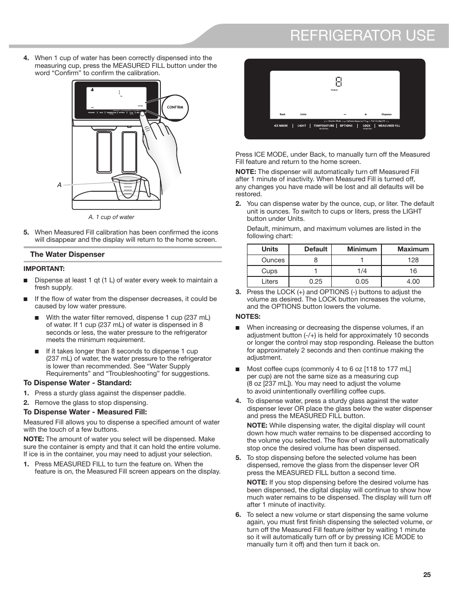

## PDF page 26

### REFRIGERATOR USE

The Ice Dispenser

Ice dispenses from the ice maker storage bin. To turn off the ice

maker, see “Ice Maker and Storage Bin.”

The dispenser may continue to make noise and ice may continue

to dispense for several seconds after releasing the dispenser

button or paddle.

IMPORTANT: If the ice cubes are hollow or have an irregular

shape, it could be because of low water pressure. See “Water

Supply Requirements.”

To Clean the Ice Dispenser Chute:

Humidity causes ice to naturally clump together. Ice particles can

build up until the ice dispenser chute becomes blocked.

If ice is not dispensed regularly, it may be necessary to empty the

ice storage bin and clean the ice delivery chute, the ice storage

bin and the area beneath the storage bin every 2 weeks.

If necessary, remove the ice clogging the storage bin and

- 

- 

delivery chute, using a plastic utensil.

Clean the ice delivery chute and the bottom of the ice storage

- 

- 

bin using a warm, damp cloth and dry thoroughly.

To Dispense Ice:

### WARNING

Cut Hazard

Use a sturdy glass when dispensing ice.

Failure to do so can result in cuts.

IMPORTANT: You do not need to apply a lot of pressure to the

paddle to activate the ice dispenser. Pressing hard will not make

the ice dispense faster or in greater quantities.

1. Press ICE MODE to select cubed ice (default) or crushed ice.

The display screen indicates which type of ice is selected.

CRUSHED

CUBED

2. Press a sturdy glass against the dispenser paddle. Remove

the glass to stop dispensing. Hold the glass close to the

dispenser opening so ice does not fall outside of the glass.

NOTE: When changing from crushed to cubed, a few ounces of

crushed ice will be dispensed along with the first cubes.

26

The Dispenser Drip Tray

There is an insert in the dispenser drip tray. The insert can be

removed from the drip tray to carry to the sink to empty or clean.

Push down on the rear edge of the insert to tilt up the front

- 

- 

edge for easy removal.

A

A. Dispenser tray insert

The Dispenser Light

When you use the dispenser, the light will automatically turn on.

To turn on the light when you are not dispensing:

Press LIGHT to toggle through the following choices in a

continuous loop:

OFF (default): The dispenser light is off.

- 

- 

ON: The dispenser light is on at 100% brightness

- 

- 

DIM: The dispenser light is on at 50% brightness

- 

- 

The dispenser lights are LEDs that cannot be changed. If it

appears that your dispenser lights are not working, see

“Troubleshooting” for more information.

The Dispenser Lock

The dispenser can be disabled for easy cleaning or to avoid

unintentional dispensing by small children and pets.

NOTE: The lock feature does not shut off power to the

refrigerator, to the ice maker, or to the dispenser light. It simply

deactivates the controls and dispenser levers. To turn off the ice

maker, see “Ice Maker and Storage Bin.”

Press and hold LOCK for 3 seconds to lock the dispenser.

- 

- 

Press and hold LOCK for 3 seconds to unlock the dispenser.

- 

- 

The display screen indicates when the dispenser is locked.

LOCKED

UNLOCKED

## PDF page 27

#### Ice Maker and Ice Storage Bin (on some models)

IMPORTANT: To avoid low ice production and poor quality ice,

flush the water system before turning on the ice maker. See

“Water Dispenser.”

Allow 24 hours to produce the first batch of ice. Discard the

- 

- 

first three batches of ice produced. Allow 2 to 3 days for the

storage bin to fill completely following installation.

The quality of your ice will be only as good as the quality of

- 

- 

the water supplied to your ice maker. Avoid connecting the ice

maker to a softened water supply. Water softener chemicals

(such as salt) can damage parts of the ice maker and lead

to poor quality ice. If a softened water supply cannot be

avoided, make sure the water softener is operating properly

and is well maintained.

If the ice in the storage bin clumps together, break up ice

- 

- 

using a plastic utensil and discard. Do not use anything sharp

to break up the ice. This can cause damage to the ice bin and

the dispenser mechanism.

Do not store anything in the ice storage bin.

- 

- 

Ice Production Rate

The ice maker should produce approximately 3 lbs (1.4 kg) of

- 

- 

ice per day under normal operation.

To increase ice production, select the increased ice

- 

- 

production feature from the Options menu on the control

panel. See “Using the Controls.”

Ice Maker in the Refrigerator (on some models)

The ice maker is located on the left-hand side of the refrigerator

compartment ceiling. Ice cubes are ejected into the ice storage

bin, located on the left-hand refrigerator door.

Turn the Ice Maker On/Off

1. Push up on the latch on the left-hand side of the ice

compartment to open the door.

A

A. Ice compartment door latch

2. Turn on the ice maker by moving the switch to the (left) ON

position.

NOTES:

To manually turn off the ice maker, move the control to the

- 

- 

OFF (right) position.

### REFRIGERATOR USE

Your ice maker has an automatic shutoff. The sensor will

- 

- 

automatically stop ice production if the storage bin is full,

if the door is open or the storage bin is removed. The

control will remain in the ON (left) position.

A

A. Ice storage bin release latch

3. Close the ice compartment door.

Remove and Replace the Ice Storage Bin

Remove the ice storage bin by inserting your fingers into the

- 

- 

hole at the base of the bin and squeezing the latch to release

the bin from the compartment. Lift the storage bin up and pull

it straight out.

Replace the storage bin inside the ice compartment and push

- 

- 

down to make sure it is firmly in place.

Ice Maker in the Freezer (on some models)

Turn the Ice Maker On/Off

To turn the ice maker ON, simply lower the wire shutoff arm.

To manually turn the ice maker OFF, lift the wire shutoff arm to the

OFF (arm up) position and listen for the click.

NOTE: Your ice maker has an automatic shutoff. As ice is made,

the ice cubes will fill the ice storage bin and the ice cubes will

raise the wire shutoff arm to the OFF (arm up) position. Do not

force the wire shutoff arm up or down.

NOTE: Turn off the ice maker before removing the ice storage bin

to serve ice or to clean the bin. This will keep the ice cubes from

dropping out of the ice maker and into the freezer compartment.

After replacing the ice storage bin, turn on the ice maker.

27

### Original figure / page illustration (PDF page 27)

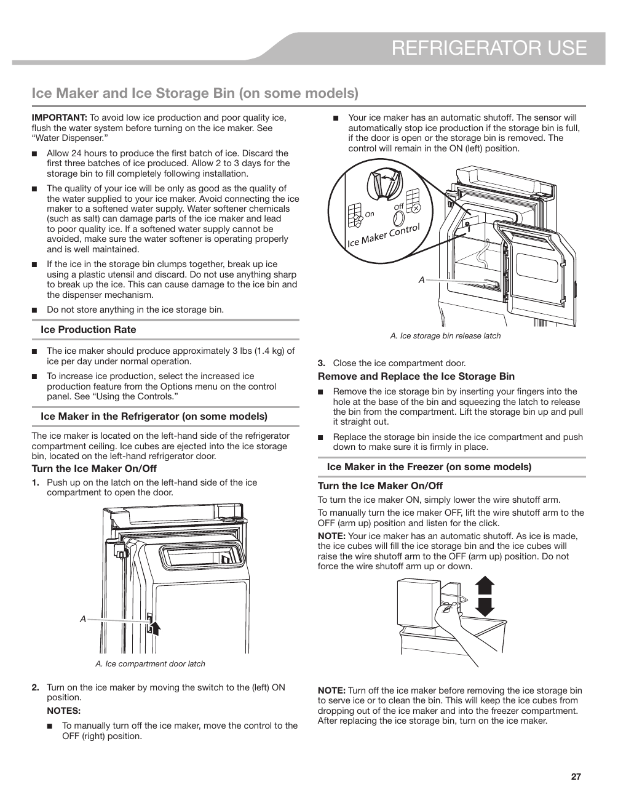

## PDF page 28

### REFRIGERATOR FEATURES

Important information to know about glass shelves

and covers:

Do not clean glass shelves or covers with warm water when

they are cold. Shelves and covers may break if exposed to

sudden temperature changes or impact, such as bumping.

Tempered glass is designed to shatter into many small,

pebble-size pieces. This is normal. Glass shelves and covers

are heavy. Use both hands when removing them to avoid

dropping.

#### Refrigerator Shelves

The shelves in your refrigerator are adjustable to meet your

individual storage needs.

Tuck Away Shelf (on some models)

Storing similar food items together in your refrigerator and

To remove and replace a shelf/shelf frame:

adjusting the shelves to fit different heights of items will make

1. Remove the shelf/frame by tilting it up at the front and lifting it

finding the exact item you want easier. It will also reduce the

out of the shelf supports.

amount of time the refrigerator door is open and save energy.

2. Replace the shelf/frame by guiding the rear shelf hooks into

Shelves and Shelf Frames

the shelf supports. Tilt the front of the shelf up until rear shelf

hooks drop into the shelf supports.

To remove and replace a shelf/shelf frame:

3. Lower the front of the shelf and make sure that the shelf is in

1. Remove the shelf/frame by tilting it up at the front and lifting it

position.

out of the shelf supports.

To retract and extend the front section of the shelf:

2. Replace the shelf/frame by guiding the rear shelf hooks into

1. To retract the front-section of the shelf, slightly lift up on the

the shelf supports. Tilt the front of the shelf up until rear sh elf

front edge and push the adjustable portion of the shelf back

hooks drop into the shelf supports.

toward the rear of the refrigerator.

3. Lower the front of the shelf and make sure that the shelf is in

2. Extend the front of the shelf by pulling the retracted portion of

position.

the shelf outward until it is fully extended.

Shelves with under-shelf lighting (on some models):

The hooks on the rear of the shelf must be fully engaged in

- 

- 

the shelf supports to maintain proper electrical flow.

No more than two shelves with under-shelf lighting may be

- 

- 

used in the refrigerator at one time.

28

### Original figure / page illustration (PDF page 28)

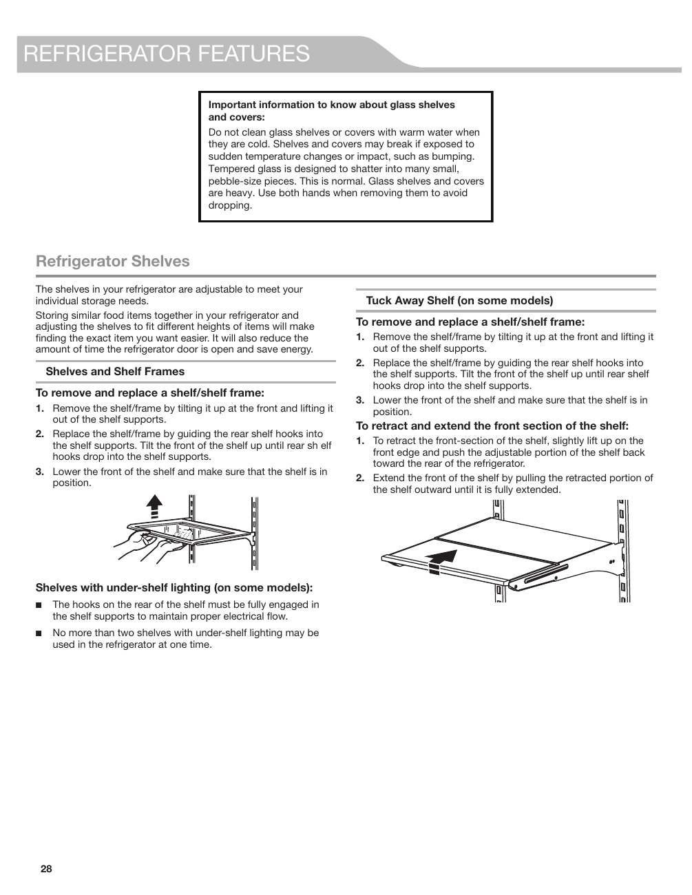

## PDF page 29

#### Temperature-Controlled Drawer (on some models)

#### Crisper and Crisper Cover

The humidity level in the crisper drawers is automatically

regulated, so there is no humidity control.

To remove and replace a crisper drawer:

1. Remove the drawer by pulling it open halfway. Then, lift up on

the drawer to remove it completely.

NOTE: If you unintentionally pull open the drawer to the

drawer stop, it will lock in place and you will not be able to lift

the drawer up and out.

2. Replace a drawer by placing it on the slide rails and pushing it

back into position past the drawer stop.

IMPORTANT: This control sets the temperature for only this

drawer. It does not set the temperature for, or turn off cooling to

the refrigerator or freezer compartments.

The full-width, temperature-controlled drawer can be used to

store large deli trays, fresh meat, beverages or other items that

you want to store at an optimum temperature.

NOTE: Do not place leafy vegetables in the temperature

controlled drawer. The colder temperatures could damage leafy

produce.

### REFRIGERATOR FEATURES

To remove the crisper(s) cover:

1. Remove crisper(s).

2. Holding the glass insert firmly with one hand, press up in

center of glass insert until it rises above the plastic frame.

Gently slide the glass insert forward to remove.

3. Lift the cover frame up and remove it.

To replace crisper(s) cover:

1. Fit back of cover frame into supports on side walls of the

refrigerator and lower the front of the cover frame into place.

2. Slide rear of glass insert into cover frame and lower front into

place.

Manual Control

Slide the control to the temperature setting best suited for the

items stored in the drawer.

Coldest - Fish and Meat

- 

- 

Colder - Deli and Cheese

- 

- 

Cold - Wine

- 

- 

Fish-Meat

Wine

Deli-Cheese

29

## PDF page 30

### REFRIGERATOR FEATURES

Drawer Divider

To remove the divider:

1. Pull the drawer out to its full extension.

2. Lift the front of the divider and lift the divider out.

To replace the divider:

1. Position the divider so that the features on the bottom of the

divider align with the matching features in the drawer.

2. Lower the divider into place.

### DOOR FEATURES

#### Door Bins

To remove and replace the bins:

1. Remove the bin by lifting it up and pulling it straight out.

2. Replace the bin by sliding it in above the desired support and

pushing it down until it stops.

### FREEZER FEATURES

#### Pizza Pocket and Drawer Divider

The drawer divider is not removable. For storage flexibility, the

divider can be moved a few inches to either side allowing you to

store larger items in one section of the freezer drawer.

30

Meat Storage Guide

Store most meat in original wrapping as long as it is airtight and

moisture-proof. Re-wrap if necessary. See the following chart for

storage times. When storing meat longer than the times given,

freeze the meat.

Fresh fish or shellfish.........................use same day as purchased

Chicken, ground beef, variety meats (liver) ...................... 1-2 days

Cold cuts, steaks/roasts ..................................................3-5 days

Cured meats...................................................................7-10 days

Leftovers - Cover leftovers with plastic wrap, aluminum foil, or

plastic containers with tight lids.

A

B

A. Drawer divider

B. Pizza pocket

## PDF page 31

#### Cleaning

### WARNING

Explosion Hazard

Use nonflammable cleaner.

Failure to do so can result in death, explosion, or fire.

Both the refrigerator and freezer sections defrost automatically.

However, clean both sections about once a month to avoid

buildup of odors. Wipe up spills immediately.

Exterior Cleaning

Please see the exterior cleaning information specific to your

model.

Style 1 - Smooth Door

IMPORTANT: Damage to smooth finish due to improper use of

cleaning products, or using non-recommended cleaning products,

is not covered under the warranty. Sharp or blunt instruments will

mar the finish.

DO USE

DO NOT USE

Soft, clean cloth

Abrasive cloths

✔

✘

✔

✘

Paper towels or newsprint

✘

✘

Steel-wool pads

✘

✘

Warm, soapy water - use a

Abrasive powders or

✔

✘

✔

✘

mild detergent

liquids

Window sprays

✘

✘

Ammonia

✘

✘

Acidic or vinegar based

✘

✘

cleaners

Oven cleaners

✘

✘

Flammable fluids

✘

✘

NOTE: Paper towels scratch and may dull the clear coat of the

painted door. To avoid possible damage, use only soft clean

cloths to polish and wipe the door.

### REFRIGERATOR CARE

Style 2 - Stainless Steel

IMPORTANT:

Damage to stainless steel finish due to improper use of

- 

- 

cleaning products, or using non-recommended cleaning

products, is not covered under the warranty.

DO USE

DO NOT USE

Soft, clean cloth

Abrasive cloths

✔

✘

✔

✘

Paper towels or newsprint

✘

✘

Steel-wool pads

✘

✘

Warm, soapy water

Abrasive powders or

✔

✘

✔

✘

liquids

Ammonia

✘

✘

Citrus-based cleaners

✘

✘

Acidic or vinegar-based

✘

✘

cleaners

Oven cleaners

✘

✘

For heavy soil, ONLY a

Stainless steel cleaner is

✔

✘

✔

✘

stainless steel cleaner

for stainless steel parts

designed for appliances.

only! Do not allow the

To order the cleaner, see

Stainless Steel Cleaner

“Accessories.”

and Polish to come into

contact with any plastic

parts such as the trim

pieces, dispenser covers

or door gaskets.

NOTES:

If unintentional contact does occur, clean plastic part with a

- 

- 

sponge and mild detergent in warm water. Dry thoroughly with

a soft cloth.

Just because a cleaner is a liquid does not mean it is

- 

- 

nonabrasive. Many liquid cleansers formulated to be gentle on

tile and smooth surfaces still damage stainless steel.

Citric acid permanently discolors stainless steel. To avoid

- 

- 

damaging the finish of your stainless steel refrigerator:

Do not allow these substances to remain on the finish

Mustard

Citrus-based sauces

✘

✘

✘

✘

Tomato juice

Citrus-based products

✘

✘

✘

✘

Marinara sauce

✘

✘

Interior Cleaning

1. Unplug refrigerator or disconnect power.

2. Hand wash, rinse, and dry removable parts and interior

surfaces thoroughly. Use a clean sponge or soft cloth and a

mil d detergent in warm water.

NOTE: Do not use abrasive or harsh cleaners such as window

prays, scouring cleansers, flammable fluids, cleaning waxes,

concentrated detergents, bleaches or cleansers containing

petroleum products on plastic parts, interior and door liners or

gaskets.

3. Plug in refrigerator or reconnect power.

31

## PDF page 32

The lights in both the refrigerator and freezer compartments are LEDs which do not need to be replaced. If the lights do not illuminate

when the door or drawer is opened, call for assistance or service. In the U.S.A., call 1-800-253-1301. In Canada call 1-800-807-6777.

### REFRIGERATOR CARE

Condenser Cleaning

There is no need for routine condenser cleaning in normal

home operating environments. If the environment is particularly

greasy or dusty or there is significant pet traffic in the home, the

condenser should be cleaned every 2 to 3 months to ensure

maximum efficiency.

If you need to clean the condenser:

1. Unplug refrigerator or disconnect power.

2. Remove the base grille.

#### Lights

#### Vacation and Moving Care

Vacations

If You Choose to Leave the Refrigerator On While

You’re Away:

1. Use up any perishables and freeze other items.

2. If your refrigerator has an automatic ice maker, and is

connected to the household water supply, turn off the water

supply to the refrigerator. Property damage can occur if the

water supply is not turned off.

3. If you have an automatic ice maker, turn off the ice maker.

NOTE: Depending on your model, raise the wire shutoff arm

to OFF (up) position, or press the switch to OFF.

4. Empty the ice bin.

If You Choose to Turn Off the Refrigerator Before You

Leave:

1. Remove all food from the refrigerator.

2. If your refrigerator has an automatic ice maker:

Turn off the water supply to the ice maker at least one day

- 

- 

ahead of time.

When the last load of ice drops, raise the wire shutoff

- 

- 

arm to the OFF (up) position or press the switch to OFF,

depending on your model.

3. Turn off the Temperature control(s). See “Using the Controls.”

4. Clean refrigerator, wipe it, and dry well.

5. Tape rubber or wood blocks to the tops of both doors to prop

them open far enough for air to get in. This stops odor and

mold from building up.

32

3. Use a vacuum cleaner with a soft brush to clean the grille, the

open areas behind the grille and the front surface area of the

condenser.

4. Replace the base grille when finished.

5. Plug in refrigerator or reconnect power.

Moving

When you are moving your refrigerator to a new home, follow

these steps to prepare it for the move.

1. If your refrigerator has an automatic ice maker:

Turn off the water supply to the ice maker at least one day

- 

- 

ahead of time.

Disconnect the water line from the back of the refrigerator.

- 

- 

When the last load of ice drops, raise the wire shutoff

- 

- 

arm to the OFF (up) position or press the switch to OFF,

depending on your model.

2. Remove all food from the refrigerator and pack all frozen food

in dry ice.

3. Empty the ice bin.

4. Turn off the Temperature control(s). See “Using the Controls.”

5. Unplug refrigerator.

6. Clean, wipe, and dry thoroughly.

7. Take out all removable parts, wrap them well, and tape them

together so they don’t shift and rattle during the move.

8. Depending on the model, raise the front of the refrigerator so

it rolls more easily or raise the leveling screws so they don't

scrape the floor. See “Adjust the Doors or “Door Closing and

Door Alignment.”

9. Tape the doors closed and tape the power cord to the back of

the refrigerator.

When you get to your new home, put everything back and refer to

the “Installation Instructions” section for preparation instructions.

Also, if your refrigerator has an automatic ice maker, remember to

reconnect the water supply to the refrigerator.

## PDF page 33

First try the solutions suggested here. If you need further assistance or more recommendations that may help you avoid a service call,

refer to the warranty page in this manual, or visit http://kitchenaid.custhelp.com.

In Canada, visit www.kitchenaid.ca (website may not be compatible with some mobile devices).

Contact us by mail with any questions or concerns at the address below:

### WARNING

Electrical Shock Hazard

Plug into a grounded 3 prong outlet.

Failure to follow these instructions can result in death,

In the U.S.A.:

KitchenAid Brand Home Appliances

Customer eXperience Center

553 Benson Road

Benton Harbor, MI 49022-2692

Please include a daytime phone number in your correspondence.

#### Operation

Do not remove ground prong.

Do not use an adapter.

Do not use an extension cord.

fire, or electrical shock.

### TROUBLESHOOTING

In Canada:

KitchenAid Brand Home Appliances

Customer eXperience Centre

200 – 6750 Century Ave.

Mississauga, Ontario L5N 0B7

33

### Table (PDF page 33)

| Problem | Possible causes | Solutions |
| --- | --- | --- |
| The refrigerator will not operate | Check electrical supply   Check controls   New installation   Refrigerator control is in Showroom mode (on some models) | Plug the power cord into a grounded 3 prong outlet.   Do not use an extension cord.   Make sure there is power to the outlet. Plug in a lamp to see if the outlet is working.   Reset a tripped circuit breaker. Replace any blown fuses. NOTE: If problems continue, contact an electrician.   Make sure the controls are turned on. See “Using the Controls.”   Allow 24 hours following installation for the refrigerator to cool completely. NOTE: Adjusting the temperature controls to the coldest setting will not cool either compartment more quickly.   If the refrigerator is in Showroom mode, cooling is turned off and “Showroom” will be illuminated on the control panel. See “Using the Controls” for more information. |

## PDF page 34

To listen to normal refrigerator sounds, go to the Product Help/FAQ section of the brand website and search for “normal sounds.”

### TROUBLESHOOTING

#### Noise

Be low are listed some normal sounds with explanations.

34

### Table (PDF page 34, 1)

| Problem | Possible causes | Solutions |
| --- | --- | --- |
| The motor seems to run too much | High efficiency compressor and fans   The room or outdoor temperature is hot.   A large amount of warm food has been recently added.   The door(s) are opened too frequently or for too long.   The refrigerator door or freezer drawer is ajar.   The refrigerator control is set too cold.   The door or drawer gasket is dirty, worn, or cracked. | Larger, more efficient refrigerators run longer at lower, more energy efficient speeds.   It is normal for the refrigerator to work longer under these conditions. For optimum performance, place the refrigerator in an indoor, temperature controlled environment. See “Location Requirements.”   Warm food will cause the refrigerator to run longer until the air cools to the desired temperature.   Warm air entering the refrigerator causes it to run more. Open the door less often.   Make sure the refrigerator is level. See “Door Closing and Door Alignment.” Keep food and containers from blocking the door.   Adjust the refrigerator control to a less cold setting until the refrigerator temperature is as desired.   Clean or change the gasket. Leaks in the door seal will cause the refrigerator to run longer in order to maintain desired temperatures. |
| The lights do not work | Your refrigerator is equipped with LED lighting which does not need to be replaced.   The dispenser light is set to OFF   Doors have been open longer than 10 minutes | If there is power to the refrigerator and the lights do not illuminate when a door or drawer is opened, call for service or assistance.   On some models, the dispenser light will operate only when a dispenser paddle is pressed. If you want the dispenser light to stay on continuously, see “Water and Ice Dispensers.”   Close the doors and drawer to reset, and open to resume lighted task. |
| Shelves with under-shelf LEDs do not light up (on some models) | Shelf hooks are not fully engaged in shelf supports.   Shelf supports, fastened to the back wall of the refrigerator cabinet, are loose   Doors have been open longer than 10 minutes. | Check that the rear shelf hooks are completely seated into the slots in the shelf supports.   Check all shelf support screws to ensure they are fully tightened. Tighten all loose screws.   Close the doors and drawer to reset, and open to resume lighted task. |
| Pantry Temperature Control not lit/ unresponsive | The refrigerator is in Cooling Off mode   The refrigerator ’s control initialization process did not complete successfully. | Exit Cooling Off mode. See “Using the Control(s).”   Unplug the refrigerator, wait 5 seconds. Plug in the refrigerator, and wait 30 seconds before opening any of the refrigerator doors or touching the control panel. |

### Table (PDF page 34, 2)

| Problem | Possible causes | Solutions |
| --- | --- | --- |
| The refrigerator seems noisy | The compressor in your new refrigerator regulates temperature more efficiently while using less energy, and operates quietly. | Due to this reduction in operating noise you may notice unfamiliar noises that are normal. |
| Sound of the compressor running longer than expected | High-efficiency compressor and fans | Larger, more efficient refrigerators run longer at lower, more energy efficient speeds. |

## PDF page 35

#### Temperature and Moisture

### TROUBLESHOOTING

35

### Table (PDF page 35, 1)

| Problem | Possible causes | Solutions |
| --- | --- | --- |
| Pulsating/Whirring | Fans/compressor adjusting to optimize performance during normal compressor operation | This is normal. |
| Popping | Contraction/expansion of inside walls, especially during initial cool-down | This is normal. |
| Hissing/Dripping | Flow of refrigerant, or flow of oil in the compressor | This is normal. |
| Vibration | The refrigerator may not be steady | Adjust the leveling screws and lower the leveling foot firmly against the floor. See “Door Closing and Door Alignment.” |
| Rattling/Banging | Movement of the water lines against the refrigerator cabinet, or of items placed on top of the refrigerator cabinet | Move excess water line away from the refrigerator cabinet or fasten excess tubing to the cabinet. See “Connecting the Water,” or remove items from the top of the refrigerator. |
| Sizzling | Water dripping on the heater during defrost cycle | This is normal. |
| Water running/Gurgling | May be heard when ice melts during the defrost cycle and water runs into the drain pan | This is normal. |
| Buzzing and Clicking | Heard when the water valve opens and closes to dispense water and/or fill the ice maker. | If the refrigerator is connected to a water line, this is normal. If the refrigerator is not connected to a water line, turn off the ice maker. |
| Repetitive Clicking | Dual evaporator valve regulating the cooling operation | You may hear rapid repetitive clicking sounds as the unit switches from cooling one compartment to cooling the other. This sound is normal. |
| Creaking/Cracking/Grinding | May be heard as ice is being ejected from the ice maker mold | This is normal. |
| Clatter | May be heard when the ice falls into the ice storage bin | This is normal. |

### Table (PDF page 35, 2)

| Problem | Possible causes | Solutions |
| --- | --- | --- |
| Temperature is too warm | The refrigerator has just been installed.   Cooling is turned off.   The controls are not set correctly for the surrounding conditions.   The door(s) are opened often or not closed completely.   A large load of food was recently added. | Allow 24 hours following installation for the refrigerator to cool completely.   Turn on cooling. See “Using the Controls.”   Adjust the controls a setting colder. Check the temperature in 24 hours. See “Using the Controls.”   Allows warm air to enter refrigerator. Minimize door openings and keep doors fully closed.   Allow several hours for refrigerator to return to normal temperature. |

## PDF page 36

### TROUBLESHOOTING

#### Ice and Water

36

### Table (PDF page 36, 1)

| Problem | Possible causes | Solutions |
| --- | --- | --- |
| Temperature is too cold in the refrigerator/crisper | The refrigerator air vent(s) are blocked.   The controls are not set correctly for the surrounding conditions.   The ice storage bin is not in the correct position. | If the air vent located in the top, left, rear corner of the refrigerator compartment is blocked by items placed directly in front of it, the refrigerator will get too cold. Move items away from the air vent.   Adjust the controls a setting warmer. Check the temperature in 24 hours. See “Using the Controls.”   See “Ice Maker and Ice Storage Bin.” |
| Temperature is too cold in the pantry drawers | The control is not set correctly for the items stored in drawer. | Adjust the temperature setting. See “Temperature Controlled Drawer” in the “Refrigerator Features” section. |
| There is interior moisture buildup NOTE: Some moisture buildup is normal. | The room is humid   The door(s) are opened often or not closed completely.   The door is blocked open   A bin or shelf is in the way   Storing liquid in open containers | A humid environment contributes to moisture buildup.   Allows humid air to enter the refrigerator. Minimize door openings and close doors completely.   Move food packages away from door.   Push bin or shelf back into the correct position.   This adds humidity to the refrigerator interior. Keep all containers tightly covered. |
| There is frost/ice buildup in the freezer compartment | The drawer is opened often or left open.   Poor door seal   Temperature controls are not set correctly | Minimize drawer openings and close drawer completely after use.   Ensure door seals are making full contact with the refrigerator cabinet to allow for an adequate seal.   See “Using the Controls” for recommended temperature settings. |

### Table (PDF page 36, 2)

| Problem | Possible causes | Solutions |
| --- | --- | --- |
| The ice maker is not producing ice or is not producing enough ice | The refrigerator is not connected to a water supply or the water supply shutoff valve is not turned on.   There is a kink in the water source line.   The ice maker is not turned on.   The refrigerator has just been installed.   The refrigerator door is not closed completely.   A large amount of ice was recently removed.   An ice cube is jammed in the ice maker ejector arm.   A water filter is installed on the refrigerator.   A reverse osmosis water filtration system is connected to your cold water supply. | Connect refrigerator to water supply and turn water shutoff valve fully open.   A kink in the line can reduce water flow. Straighten the water source line.   Make sure the ice maker is on. See “Ice Maker and Ice Storage Bin.”   Wait 24 hours after ice maker installation for ice production to begin. Wait 3 days for full ice production.   Close the door firmly. If it does not close completely, see “The doors will not close completely.”   Allow sufficient time for ice maker to produce more ice. See “Ice Maker and Ice Storage Bin” for ice production rates.   Remove ice from the ejector arm with a plastic utensil.   Remove the water filter and operate the ice maker. If ice volume improves, then the filter may be clogged or incorrectly installed. Replace filter or reinstall it correctly.   This can decrease water pressure See “Water Supply Requirements.” |

## PDF page 37

### TROUBLESHOOTING

37

### Table (PDF page 37)

| Problem | Possible causes | Solutions |
| --- | --- | --- |
| The ice cubes are hollow or small NOTE: This is an indication of low water pressure. | The water shutoff valve is not fully open.   There is a kink in the water source line. A kink in the line can reduce water flow. Straighten the water   A water filter is installed on the refrigerator.   A reverse osmosis water filtration system is connected to your cold water supply.   Questions remain regarding water pressure. | Turn the water shutoff valve fully open.   source line.   Remove filter and operate ice maker. If ice quality improves, then the filter may be clogged or incorrectly installed. Replace filter or reinstall it correctly.   This can decrease water pressure. See “Water Supply Requirements.”   Call a licensed, qualified plumber. |
| Off-taste, odor or gray color in the ice or water | Newly installed refrigerator requires flush of water system.   Recently installed or replaced plumbing connections. New plumbing connections can cause discolored or off-flavored ice and water.   Using a water supply connection type other than recommended.   The ice has been stored too long.   The water has been stored too long.   Odor from stored food has transferred to the ice.   There are minerals (such as sulfur) in the water.   There is a water filter installed on the refrigerator.   The water filter needs to be replaced. | Flush the water system. See “Water and Ice Dispensers” for water system flushing instructions.   Discard the ice and wash the ice storage bin. Flush the water system with 3 gal. (12 L) of water. Allow 24 hours for the ice maker to make new ice, and discard the first 3 batches of ice produced.   It is recommended to use copper tubing or Whirlpool supply line, Part Number 8212547RP. See “Connect to Water Line.”   Discard ice. Wash ice storage bin. Allow 24 hours for ice maker to make new ice.   Dispense at least 1 qt (1 L) of water per week to maintain a fresh supply.   Use airtight, moisture proof packaging to store food.   A water filter may need to be installed to remove the minerals.   Gray or dark discoloration in ice may indicate that the water filtration system needs additional flushing. Flush the water system after installing and before using a new water filter. See “Water and Ice Dispensers” for water filter flushing instructions.   Replace the disposable water filter at least every 6 months or when indicated. See “Water Filtration System.” |

## PDF page 38

### TROUBLESHOOTING

38

### Table (PDF page 38)

| Problem | Possible causes | Solutions |
| --- | --- | --- |
| The water and ice dispenser will not operate properly | The refrigerator is not connected to a water supply or the water supply shutoff valve is not turned on.   There is a kink in the water source line   The refrigerator has just been installed.   The water pressure to the house is not at or above 35 psi (241 kPa).   A reverse osmosis water filtration system is connected to your cold water supply.   The water filter may be clogged.   The water filter is installed incorrectly Remove the water filter and reinstall. See “Water Filtration   The refrigerator door or freezer drawer is not closed completely.   The refrigerator doors were recently removed.   Ice is clogged in the ice storage bin or ice is blocking the ice delivery chute. | Connect the refrigerator to the water supply and turn the water shutoff valve fully open.   A kink in the water line can reduce water flow from the water dispenser and result in hollow or irregular shaped ice. Straighten the water source line.   Flush and fill the water system. See “Water and Ice Dispensers.”   The water pressure to the house determines the flow from the dispenser. See “Water Supply Requirements.”   A reverse osmosis water filtration system can decrease water pressure. See “Water Supply Requirements.”   Remove the water filter and operate dispenser. If water flow increases, your filter is clogged and needs to be replaced. See “Water Filtration System.”   System.”   Close the door or drawer firmly. If it does not close completely, see “The doors will not close completely.”   Make sure the water dispenser wire/tube assembly has been properly reconnected at the top of the refrigerator door. See “Refrigerator Doors and Drawer.”   Remove the ice clogging the storage bin and delivery chute, using a plastic utensil if necessary. Clean the ice delivery chute and the bottom of the ice storage bin using a warm, damp cloth, then dry both thoroughly. To avoid clogging and to maintain a fresh supply of ice, empty the storage bin and clean both the storage bin and delivery chute every 2 weeks. |
| The ice dispenser jams while dispensing crushed ice | Crushed ice is blocking the ice delivery chute. | Switch from crushed ice to cubed ice to clear the ice dispenser. Then switch back to crushed ice. |
| Water is leaking or dripping from the dispenser system NOTE: A few drops of water after dispensing is normal. | The glass was not held under the dispenser long enough. | Hold the glass under the dispenser 2 to 3 seconds after releasing the dispenser lever. |
| Water continues to drip from the dispenser beyond the first few drops. | The refrigerator has just been installed.   The water filter was recently installed or replaced. | Flushing the water system removes the air from the lines which causes the water dispenser to drip. Flush the water system. See “Water and Ice Dispensers.”   Flushing the water system removes the air from the lines which causes the water dispenser to drip. Flush the water system. See “Water and Ice Dispensers.” |
| Water is leaking from the back of the refrigerator | The water line connections were not fully tightened.   Recently removed the doors and did not fully tighten water line connection | See “Connecting the Water.”   See “Refrigerator Doors and Drawer.” |

## PDF page 39

### WARNING

Explosion Hazard

Failure to do so can result in death, explosion, or fire.

To view an animation showing how to adjust and align the doors, refer to the Product Help/FAQ section of the brand website and search

#### Doors

Use nonflammable cleaner.

for “door closing and door alignment.”

### TROUBLESHOOTING

39

### Table (PDF page 39, 1)

| Problem | Possible causes | Solutions |
| --- | --- | --- |
| Water from the dispenser is warm | Water from the dispenser is chilled to 50°F (10°C).   The refrigerator has just been installed.   A large amount of water was recently dispensed.   Water has not been recently dispensed.   The refrigerator is not connected to a cold water pipe. | This is normal.   Allow 24 hours after installation for the water supply to cool completely.   Allow 3 hours for the water supply to cool completely.   The first glass of water may not be cool. Discard the first glass of water dispensed.   Make sure the refrigerator is connected to a cold water pipe. See “Water Supply Requirements.” |

### Table (PDF page 39, 2)

| Problem | Possible causes | Solutions |
| --- | --- | --- |
| The doors will not close completely | The door is blocked open.   A bin or shelf is in the way.   Recently installed | Move food packages away from door.   Push bin or shelf back into the correct position.   Remove all packaging materials. |
| The doors are difficult to open | The door gaskets are dirty or sticky. | Clean gaskets and contact surfaces with mild soap and warm water. Rinse and dry with soft cloth. |
| The doors appear to be uneven | The doors need to be aligned, or the refrigerator needs to be leveled. | See “Refrigerator Leveling, Door Closing and Alignment.” |
| The refrigerator is unsteady or it rolls forward when opening and closing doors | The refrigerator brake feet are not snug against the floor | Remove the base grille. Turn both brake feet (one on each side) clockwise, the same amount, until they are snug against the floor. See “Refrigerator Leveling, Door Closing and Alignment.” |

## PDF page 40

#### Water Filtration System

### PERFORMANCE DATA SHEET

#### Model P9WB2L/P9RFWB2L Capacity 200 Gallons (757 Liters)

System tested and certified by NSF International against

NSF/ANSI Standard 42, Standard 53, and Standard 401 for

the reduction of contaminants specified on the Performance

This system has been tested according to NSF/ANSI Standards 42, 53, 401, and CSA B483.1 for the reduction of the substances listed

below. The concentration of the indicated substances in water entering the system was reduced to a concentration less than or equal to

the permissible limit for water leaving the system, as specified in NSF/ANSI Standa rds 42, 53, 401, and CSA B483.1.

Test Parameters: pH = 7.5 ± 0.5 unless otherwise noted. Flow = 0.75 gpm (2.84 Lpm). Pressure = 60 psig (413.7 kPa). Temp. = 68°F to 71.6°F (20°C to

The compounds certified under NSF 401 have been deemed as “emerging compounds/incidental contaminants.” Emerging compounds/incidental

contaminants are those compounds that have been detected in drinking water supplies at trace levels. While occurring at only trace levels, these

compounds can affect the public acceptance/perception of drinking water quality.

Data Sheet.

Substance Reduction Aesthetic

Influent Challenge Concentration

Effects

Chlorine Taste/Odor

2.0 mg/L ± 10%

Particulate Class I*

At least 10,000 particles/mL

Contaminant Reduction

Influent Challenge Concentration

Lead: @ pH 6.5 / @ pH 8.5

0.15 mg/L± 10%

Benzene

0.015 mg/L ± 10%

p-Dichlorobenzene

0.225 mg/L ± 10%

Carbofuran

0.08 mg/L ± 10%

Toxaphene

0.015 ± 10%

Atrazine

0.009 mg/L ± 10%

Asbestos

107 to 108 fibers/L††

Live Cysts†

50,000/L min.

Turbidity

11 NTU ± 10%

Lindane

0.002 ± 10%

Tetrachloroethylene

0.015 mg/L ± 10%

O-Dichlorobenzene

1.8 mg/L ± 10%

Ethylbenzene

2.1 mg/L ± 10%

1,2,4-Trichlorobenzene

0.210 mg/L ± 10%

2,4 - D

0.210 mg/L ± 10%

Styrene

2.0 mg/L ± 10%

Toluene

3.0 mg/L ± 10%

Endrin

0.006 mg/L ± 10%

Atenolol

200 ± 20%

Trimethoprim

140 ± 20%

Linuron

140 ± 20%

Estrone

140 ± 20%

Nonylphenol

1400 ± 20%

22°C). Rated service capacity = 200 gallons (757 liters).

It is important that operational, maintenance, and filter replacement

- 

- 

requirements be carried out for the product to perform as advertised.

Property damage can occur if all instructions are not followed.

The disposable cartridge must be changed at least every 6 months.

- 

- 

Use replacement filter P9RFWB2L, part #EDR2RXD1/EDR2RXD1B.

- 

- 

2015 suggested retail price of $49.99 U.S.A./$49.99 Canada. Prices

are subject to change without notice.

The filter monitor system measures the amount of water that passes

- 

- 

through the filter and alerts you when it is time to replace the filter.

Refer to the “Using the Controls” or “Water Filtration System” section

(in the User Instructions or User Guide) to learn how to check the

water filter status.

After changing the water filter, flush the water system. See “Water

- 

- 

and Ice Dispensers” or “Water Dispenser” in the User Instructions or

User Guide.

These contaminants are not necessarily in your water supply. While

- 

- 

testing was performed under standard laboratory conditions, actual

performance may vary.

The product is for cold water use only.

- 

- 

The water system must be installed in compliance with state and

- 

- 

local laws and regulations.

*Class I particle size: >0.5 to <1 um

†Based on the use of Cryptosporidium parvum oocysts

†Fibers greater than 10 um in length

®NSF is a registered trademark of NSF International.

40

Maximum Permissable Product

Average % Reduction

Water Concentration

50% reduction

9 7.0%

85% reduction

>99.9%

Maximum Permissable Product

Average % Reduction

Water Concentration

0.010 mg/L

>99.3%/98.6%

0.005 mg/L

93.8%

0.075 mg/L

99.8%

0.040 mg/L

81.9%

0.003 mg/L

>95%

0.003 mg/L

87.0%

99%

>99%

99.95%

>99.99%

0.5 NTU

96.9%

0.0002 mg/L

>99.2%

0.005 mg/L

96.6%

0.60 mg/L

92.3%

0.70 mg/L

86.9%

0.07 mg/L

>99.8%

0.07 mg/L

88.5%

0.1 mg/L

99.6%

1.0 mg/L

93.5%

0.002 mg/L

81.7%

30 ng/L

95.7%

20 ng/L

96.1%

20 ng/L

96.3%

20 ng/L

95.3%

200 ng/L

95.5%

Do not use with water that is microbiologically unsafe or of unknown

- 

- 

quality without adequate disinfection before or after the system.

Systems certified for cyst reduction may be used on disinfected

waters that may contain filterable cysts.

EPA Est. No. 082047-TWN-001

Refer to the “Warranty” section (in the User Instructions or User

- 

- 

Guide) for the Manufacturer’s limited warranty, name, and telephone

number.

Application Guidelines/Water Supply Parameters

Water Supply

Potable City or Well

Water Pressure

35 - 120 psi (241 - 827 kPa)

Water Temperature

33° - 100°F (1° - 38°C)

Service Flow Rate

0.75 gpm (2.84 L/min.) @ 60 psi (413.7 kPa)

### Original figure / page illustration (PDF page 40)

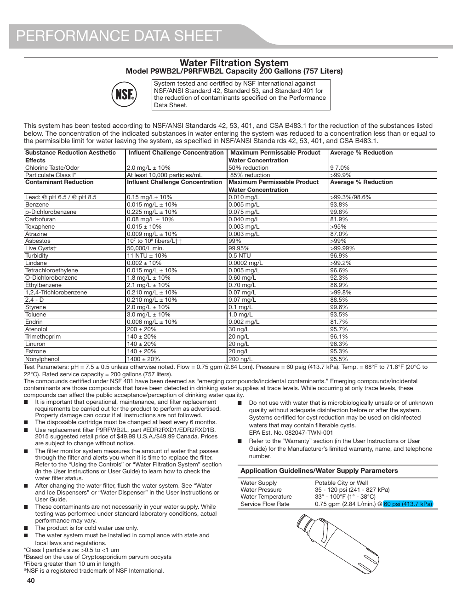

## PDF page 41

1. Before contacting us to arrange service, please determine whether your product requires repair. Some questions can be addressed without

service. Please take a few minutes to review the Troubleshooting section of the Use and Care Guide or visit

2. All warranty service is provided exclusively by our authorized KitchenAid Service Providers. In the U.S. and Canada, direct all requests for

KitchenAid Customer eXperience Center

### KITCHENAID®

### REFRIGERATION

### LIMITED WARRANTY

#### IF YOU NEED SERVICE:

http://www.kitchenaid.com/customer-service/

warranty service to:

ATTACH YOUR RECEIPT HERE. PROOF OF PURCHASE

IS REQUIRED TO OBTAIN WARRANTY SERVICE.

Please have the following information available when you call the

Customer eXperience Center:

Name, address, and telephone number

- 

- 

Model number and serial number

- 

- 

A clear, detailed description of the problem

- 

- 

Proof of purchase, including dealer or retailer name and address

- 

- 

In the U.S.A., call 1-800-422-1230. In Canada, call 1-800-807-6777.

If outside the 50 United States or Canada, contact your authorized KitchenAid dealer to determine whether another warranty applies.

TEN YEAR LIMITED WARRANTY

installed, operated, and maintained according to instructions attached to or

its sole discretion, replace the product. In the event of product replacement,

your appliance will be warranted for the remaining term of the original unit’s

this major appliance is installed, operated, and maintained according to the

Sealed refrigeration system (includes compressor, evaporator, condenser,

specified replacement parts to correct defects in materials or workmanship

DISCLAIMER OF IMPLIED WARRANTIES

IMPLIED WARRANTIES, INCLUDING ANY IMPLIED WARRANTY OF MERCHANTABILITY OR IMPLIED WARRANTY OF FITNESS FOR A

PARTICULAR PURPOSE, ARE LIMITED TO TEN YEARS OR THE SHORTEST PERIOD ALLOWED BY LAW. Some states and provinces do

not allow limitations on the duration of implied warranties of merchantability or fitness, so this limitation may not apply to you. This warranty

gives you specific legal rights, and you also may have other rights that vary from state to state or province to province.

WHAT IS COVERED

ONE YEAR LIMITED WARRANTY (PARTS AND LABOR)

For one year from the date of purchase, when this major appliance is

furnished with the product, KitchenAid brand of Whirlpool Corporation or

Whirlpool Canada LP (hereafter “KitchenAid”) will pay for factory specified

replacement parts and repair labor to correct defects in materials or

workmanship that existed when this major appliance was purchased or, at

warranty period.

SECOND THROUGH FIFTH YEAR LIMITED WARRANTY ON CAVITY

LINER AND SEALED REFRIGERATION SYSTEM (PARTS AND LABOR)

In the second through fifth years from the date of original purchase, when

instructions attached to or furnished with the product, KitchenAid will pay

for factory specified replacement parts and repair labor for the following

components to correct non-cosmetic defects in materials or workmanship

in this part that prevent function of the refrigerator and that existed when

this major appliance was purchased:

Refrigerator/freezer cavity liner if the part cracks due to defective

- 

- 

materials or workmanship.

- 

- 

dryer, and connecting tubing).

SIXTH THROUGH TENTH YEAR LIMITED WARRANTY ON SEALED

REFRIGERATION SYSTEM (PARTS ONLY—LABOR NOT INCLUDED)

In the sixth through tenth year from the date of purchase, when this major

appliance is installed, operated, and maintained according to instructions

attached to or furnished with the product, KitchenAid will pay for factory

in the sealed refrigeration system (includes compressor, evaporator,

condenser, dryer, and connecting tubing) that existed when this major

appliance was purchased.

YOUR SOLE AND EXCLUSIVE REMEDY UNDER THIS LIMITED

WARRANTY SHALL BE PRODUCT REPAIR AS PROVIDED HEREIN.

Service must be provided by a KitchenAid designated service company.

This limited warranty is valid only in the United States or Canada and

applies only when the major appliance is used in the country in which it

was purchased. This limited warranty is effective from the date of original

consumer purchase. Proof of original purchase date is required to obtain

service under this limited warranty.

WHAT IS NOT COVERED

1. Commercial, non-residential, or multiple-family use, or use

inconsistent with published user, operator, or installation

instructions.

2. In-home instruction on how to use your product.

3. Service to correct improper product maintenance or

installation, installation not in accordance with electrical or

plumbing codes, or correction of household electrical or

plumbing (e.g., house wiring, fuses, or water inlet hoses).

4. Consumable parts (e.g., light bulbs, batteries, air or water

filters, preservation solutions).

5. Defects or damage caused by the use of non-genuine

KitchenAid parts or accessories.

6. Damage from accident, misuse, abuse, fire, floods, acts of

God, or use with products not approved by KitchenAid.

7. Repairs to parts or systems to correct product damage

or defects caused by unauthorized service, alteration, or

modification of the appliance.

8. Cosmetic damage, including scratches, dents, chips, and

other damage to the appliance finishes, unless such damage

results from defects in materials and workmanship and is

reported to KitchenAid within 30 days.

9. Discoloration, rust, or oxidation of surfaces resulting from

caustic or corrosive environments including, but not limited

to, high salt concentrations, high moisture or humidity, or

exposure to chemicals.

10. Food or medicine loss due to product failure.

11. Pickup or delivery. This product is intended for in-home repair.

12. Travel or transportation expenses for service in remote

locations where an authorized KitchenAid servicer is not

available.

13. Removal or reinstallation of inaccessible appliances or built-

in fixtures (e.g., trim, decorative panels, flooring, cabinetry,

islands, countertops, drywall) that interfere with servicing,

removal, or replacement of the product.

14. Service or parts for appliances with original model/serial

numbers removed, altered, or not easily determined.

The cost of repair or replacement under these excluded

circumstances shall be borne by the customer.

DISCLAIMER OF REPRESENTATIONS OUTSIDE OF WARRANTY

KitchenAid makes no representations about the quality, durability, or need for service or repair of this major appliance other than the

representations contained in this warranty. If you want a longer or more comprehensive warranty than the limited warranty that comes

with this major appliance, you should ask KitchenAid or your retailer about buying an extended warranty.

LIMITATION OF REMEDIES: EXCLUSION OF INCIDENTAL AND CONSEQUENTIAL DAMAGES

YOUR SOLE AND EXCLUSIVE REMEDY UNDER THIS LIMITED WARRANTY SHALL BE PRODUCT REPAIR AS PROVIDED HEREIN.

KITCHENAID SHALL NOT BE LIABLE FOR INCIDENTAL OR CONSEQUENTIAL DAMAGES. Some states and provinces do not allow the

exclusion or limitation of incidental or consequential damages, so these limitations and exclusions may not apply to you. This warranty gives

you specific legal rights, and you also may have other rights that vary from state to state or province to province.

04/17

41

## PDF page 42

NOTES

87

### Original figure / page illustration (PDF page 42)

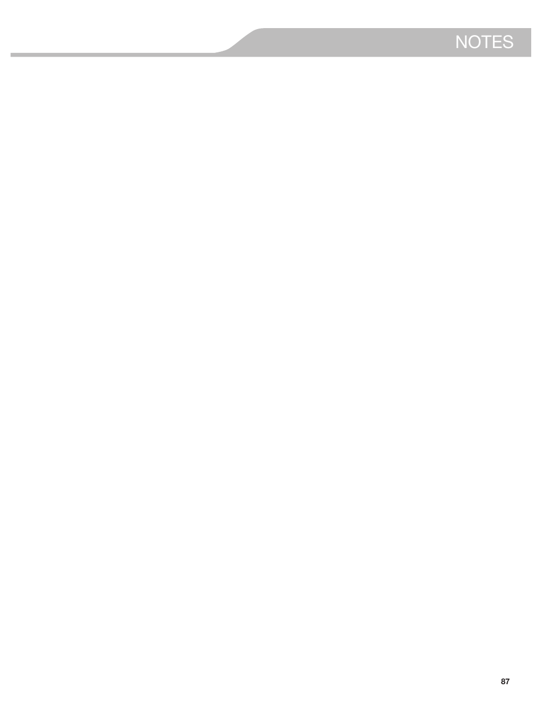

## PDF page 43

### AT YOUR SERVICE

#### WE CAN HELP WITH YOUR QUESTIONS

You will need the model and serial number, located on the inside wall of the refrigerator compartment.

For future reference, record the model and serial number here.

or Visit Us Online At

www.kitchenaid.com

www.kitchenaid.ca

Serial Number

Country

Call

U.S.A.

1-800-422-1230

Canada

1-800-807-6777

Model Number

Write

KitchenAid Brand Home Appliances

Customer eXperience Center

553 Benson Road

Benton Harbor, MI 49022-2692

KitchenAid Brand Home Appliances

Customer eXperience Center

200 – 6750 Century Ave.

Mississauga, Ontario L5N 0B7

