# repair-guide.pdf — extracted Markdown

> Original PDF: `repair-guide.pdf`; PDF page references below are 1-based.

> Source fidelity: Text and diagrams are extracted from this PDF only; image links are rasterized views of their original PDF pages.

## PDF page 1

### Fast Track Troubleshooting

IMPORTANT SAFETY NOTICE – “For Technicians Only”This service data

sheet is intended for use by persons having electrical, electronic, and mechanical experience

and knowledge at a level generally considered acceptable in the appliance repair trade. Any

attempt to repair a major appliance may result in personal injury and property damage. The

manufacturer or seller cannot be responsible, nor assume any liability for injury or damage of any

kind arising from the use of this data sheet.

Hold buttons - Freezer, Fridge

and Flex Zone for 6 seconds. All

on/off LED’s will blink. Stop

pressing buttons to view load

Refer to PAGE 3 for more detail

Model:

RF28K9070

RF22K9381

RF28K9380

Support Information:

Production; DRRF28K9070

HELP: 1-888-751-4086 (Tech Sup. – ASC/SSD) - 1-866-894-0637 (Tech Sup. - FE/ME)

- 060616

GSPN: http://gspn3.samsungcsportal.com/main.jsp

E-Learning: samsungasc.earlyconnect.com

MCP & E-Learning Support: 1-800-749-9421 – e-learning@sea.samsung.com

Demo MODE / Cooling off

Load Mode

Mode

Hold buttons - Freezer, Fridge

and Door Alarm for 6 seconds

until 0 –FF is displayed. Repeat

to exit

status.

Force Mode / Defrost

Hold Freezer and Flex zone for 6 seconds until screen

goes blank and you hear a beep . Press Flex zone again

to enter first mode 1

To exit; after mode 5 the screen will be blank, if left

alone for 1min, it will exit to normal operation

mode 1

DISPLAY

Operating

F-Fan

R-Fan

Time

Freezer

Fridge

(Freezer)

(Fridge)

The

Continuous

FF

24hr

temperature

operation

is controlled

Continuous

Continuous

FF

r

24hr

operation

operation

Continuous

Continuous

FF

F

24hr

operation

operation

Continuous

Continuous

FF

C

24hr

operation

operation

Diagnostic Mode

Hold buttons – Freezer and

Fridge for 6 seconds, screen will

blink, continue to hold until

blank screen or errors displayed.

After 1 min the mode will exit

Refer to PAGE 4 to 6 for Error

Code details

mode 2

mode 3

mode 4

mode 5

FD = Defrost, all

heaters will

turn on

Operation

CV-Fan

F Valve

R Valve

CV Valve

(FlexZone)

Continuous

Swing

Swing

Swing

operation

Continuous

OFF

ON

OFF

operation

Continuous

ON

OFF

OFF

operation

Continuous

OFF

OFF

ON

operation

### Original figure / page illustration (PDF page 1)

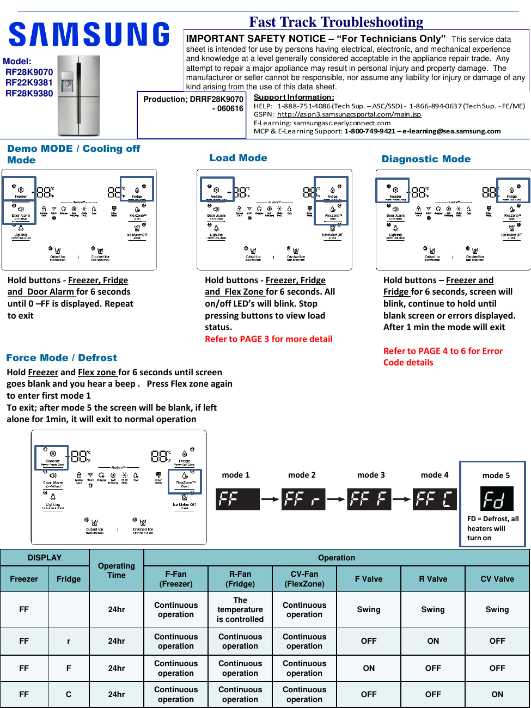

## PDF page 2

Some time

Make sure before measuring voltage of any

DC component that circuit ground is used.

Any marked GND on the main PCB will be

A Sensor Resistance over 100K ohm is considered OPEN

your circuit ground.

A Sensor Resistance under 2K ohm is considered Shorted

If Chassis ground is used, measurements

But Note that a sensor could also give wrong values if it is

will be incorrect.

out of tolerance

### Original figure / page illustration (PDF page 2)

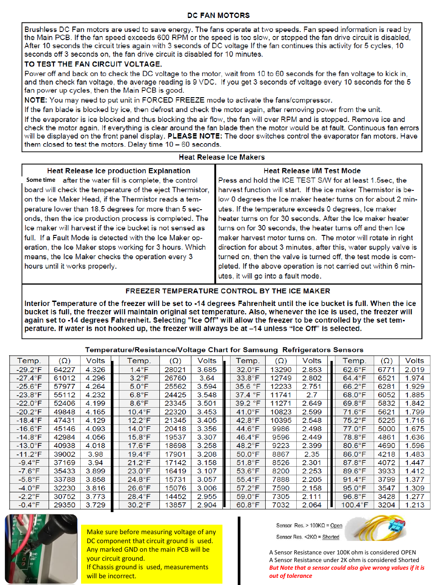

## PDF page 3

### Load Mode

Hold buttons - Freezer, Fridge and Flex

Zone for 6 seconds. All on/off LED’s will

blink, Stop pressing to view load status.

Refer to next

26

WiFi Status

Not connected to the IP sharer (AP) or the Internet: Off

Router(AP) connected: Blink

Internet connected: On

### Table (PDF page 3)

| NO | Part | DISPLAY LED | Description |
| --- | --- | --- | --- |
| 1 | R-FAN HIGHEST | "a" and "b" at the lowest order digit of the R compartment | In the case of the R-FAN HIGHEST operation, the corresponding LED is turned on. |
| 2 | R-FAN HIGH | "a" at the lowest order digit of the R compartment | In the case of the R-FAN HIGH operation, the corresponding LED is turned on. |
| 3 | R-FAN LOW | "b" at the lowest order digit of the R compartment | In the case of the R-FAN LOW operation, the corresponding LED is turned on. |
| 4 | Overload | "e" at the lowest order digit of the R compartment | If the external air temperature is 34℃ or higher, the corresponding LED is turned on. |
| 5 | Low Temperature | "f" at the lowest order digit of the R compartment | If the external air temperature is 21℃ or less, the corresponding LED is turned on. |
| 6 | Demo Mode | "g" at the lowest order digit of the R compartment | The LED is turned on in Demo Mode. |
| 7 | COMP | "a" at the lowest order digit of the F compartment | In the case of the F COMP operation, the corresponding LED is turned on. |
| 8 | F-FAN HIGHEST | "b" and "c" at the lowest order digit of the F compartment | In the case of the F-FAN HIGHEST operation, the corresponding LED is turned on. |
| 9 | F-FAN HIGH | "b" at the lowest order digit of the F compartment | In the case of the F-FAN HIGH operation, the corresponding LED is turned on. |
| 10 | F-FAN LOW | "c" at the lowest order digit of the F compartment | In the case of the F-FAN LOW operation, the corresponding LED is turned on. |
| 11 | F compartment defrost heater | "d" at the lowest order digit of the F compartment | The LED is turned on when the freezer defrosting heater operates. |
| 12 | C-FAN HIGHEST | "e" and "f" at the lowest order digit of the F compartment | In the case of the C-FAN HIGHEST operation, the corresponding LED is turned on. |
| 13 | C-FAN HIGH | "e" at the lowest order digit of the F compartment | In the case of the C-FAN HIGH operation, the corresponding LED is turned on. |
| 14 | C-FAN LOW | "f" at the lowest order digit of the F compartment | In the case of the C-FAN LOW operation, the corresponding LED is turned on. |
| 15 | F Valve | "b" at the second lowest order digit of the F compartment | In the case of the F valve open, the LED is turned on. |
| 16 | CV Valve | "c" at the second lowest order digit of the F compartment | If the CV valve opens, the LED is turned on. |
| 17 | R Valve | "f" at the second lowest order digit of the F compartment | If the R valve opens, the LED is turned on. |
| 18 | French Heater | "g" at the second lowest order digit of the F compartment | In the case of the French Heater operation, the corresponding LED is turned on. |
| 19 | CV-FAN HIGHEST | “Freezer” or “Thin Ice” for the CV compartment | In the case of the CV-FAN HIGHEST operation, the corresponding LED is turned on. |
| 20 | CV-FAN HIGH | “Freezer” for the CV compartment | In the case of the CV-FAN HIGH operation, the corresponding LED is turned on. |
| 21 | CV-FAN LOW | “Thin Ice” for the CV compartment | In the case of the CV-FAN LOW operation, the corresponding LED is turned on. |
| 22 | CV compartment defrosting heater | “Fridge” for the CV compartment | When the CV compartment defrosting heater operates, the LED is turned on. |
| 23 | Normal | "e" and "f" in the lowest order digits of the R compartment, and the LEDs are all turned off. | When the external temperature is within the range of 22℃~ 33℃. |
| 24 | Ice Room-FAN | "d" at the second lowest order digit of the F compartment | When Ice Room-FAN operates, applicable LED ON. |
| 25 | Ice maker full | “e" at the second lowest order digit of the R compartment | When the Ice Maker's Bucket is full, applicable LED ON |

### Original figure / page illustration (PDF page 3)

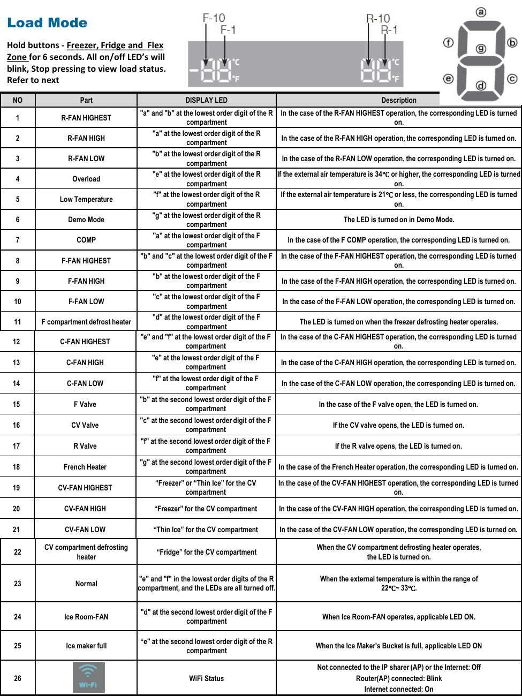

## PDF page 4

### Diagnostic mode

Hold buttons – Freezer and Fridge for 6 seconds, screen will blink, continue to hold until blank screen or errors

displayed. After 1 min the mode will exit

ERROR

Item

Diagnostic method

Location Image

NUMBER

Freezer sensor

1

error

Check if the Sensor is Open or Shorted

The voltage between the Main PCB CN30 pins 1

and 3 should be within the 4.5V~1.0V range.

Check if the sensor is open or shorted

Fridge sensor

2

The voltage between the Main PCB CN30 pins 1

error

and 5 should be within the 4.5V~1.0V range.

Check if the sensor is open or shorted

Freezer defrost

4

The voltage between the Main PCB CN30 pins 1

sensor error

and 4 should be within the 4.5V~1.0V range.

Check if the sensor is open or shorted

Fridge defrost

5

The voltage between the Main PCB CN30 pins 1

sensor error

and 6 should be within the 4.5V~1.0V range.

Check if the sensor is open or shorted

Ambient sensor

6

The voltage between the Main PCB CN30 pins 1

error

and 2 should be within the 4.5V~1.0V range.

Check if the sensor is open or shorted

Convertible zone

9

The voltage between the Main PCB CN30 pins 11

sensor error

and 12 should be within the 4.1V~0.8V range.

Check if the sensor is open or shorted

Convertible zone

11

The voltage between the Main PCB CN30 pins 11 and 13

defrost sensor error

should be within the 4.1V~0.8V range.

Humidity sensor

The voltage between the Main PCB CN30 pins 7

13

error

and 9 should be within the 4.1V~0.8V range.

Check if the sensor is open or shorted

Fridge Ice maker

14

The voltage between MAIN PCB CN90 3↔

sensor error

8 should be within 4.5V~1.0V.

Check if the sensor is open or shorted

Ice room sensor

15

The voltage between MAIN PCB CN30 10↔

error

11should be within 4.5V~1.0V.

Check if the sensor is open or shorted

Fridge humidity

16

The voltage between the Main PCB CN30 pins 7

sensor error

and 8 should be within the 4.1V~0.8V range.

The voltage of the MAIN PCB CN74 1↔4: should

21

Freezer fan error

be between 7V~12V.

The voltage of the MAIN PCB CN74 1↔3: should

22

Fridge fan error

be between 7V~12V.

Comp room fan

The voltage of the MAIN PCB CN74 1↔6: should

23

error

be between 7V~12V.

After separating MAIN PCB CN70_1 wire from PCB,

resistance value between CN70_1-7 ↔ 3 shall be 63(230)

Freezer defrost

24

ohm ± 7%. (Resistance value is varied by

error

input power) 0 ohm : heater short, ∞ ohm : wire/

bimetal open (Must power off)

### Original figure / page illustration (PDF page 4)

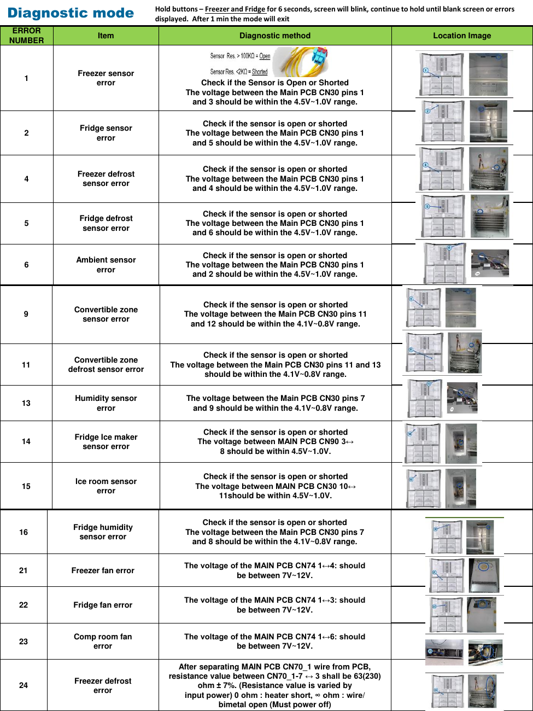

## PDF page 5

ERROR

Item

Diagnostic method

Location Image

NUMBER

After separating MAIN PCB CN70 wire from PCB,

resistance value between CN70_1-7 ↔ 1 shall be

Convertible zone

29

63(230) ohm ± 7%. (Resistance value is varied by

defrost error

input power) 0 ohm : heater short, ∞ ohm : wire/

bimetal open (Must power off)

Convertible zone

The voltage of the MAIN PCB CN74 1↔5: should

31

fan error

be between 7V~12V.

35

Freezer low regist

ERROR_Freezer low regist

Convertible zone

37

ERROR_Convertible zone low regist

low regist

After changing the Ice Maker(R), plug the

Ice maker function

39

refrigerator power code again, and check the

error

operation.

The voltage of MAIN PCB CN52-1↔ 6: shall be between

40

Ice maker fan error

7V~12V

Actually, If there is not a problem, it is desirable to

MAIN < - > Panel

41

replace Main and Panel PCB With the oscilloscope after

Comm error

a cable problem confirming.

Actually, If there is not a problem, it is desirable to

MAIN < - > INV

44

replace Main and Inverter PCB With the

Comm error

oscilloscope after a cable problem confirming.

I/O Expander

46

It is desirable to replace Main PCB.

Comm error

After separating MAIN PCB CN51 wire from PCB,

resistance value between CN51 4↔6 shall be 135 ohm ±

Ice duct heater

61

7%. (Resistance value is varied by input

error

power) 0 ohm : heater short, ∞ ohm :

(Must power off)

After separating MAIN PCB CN51 wire from PCB,

Ice bucket heater

65

resistance value between CN51 4↔7 wire shall be 135 ohm±

error

7%. 0 ohm : heater short, ∞ Ohm : wire.

After separating MAIN PCB CN51 wire from PCB,

Door handle

66

resistance value between CN51 1↔2 wire shall be 135 ohm±

heater error

7%. 0 ohm : heater short, ∞ Ohm : wire.

The temperature has been abnormally increased. Check if

the door has been open for a long time or if hot food has

Freezer abnormal

71

been stored in the compartment. If the reason for the error is

temp. error

removed, the error code disappears after a pre-determined

period of time.

Check if the door has been open for a long time or if hot

Fridge abnormal

food has been stored in the compartment. If the reason for

72

temp. error

the error is removed, the error code disappears after a pre-

determined period of time.

Check if the door has been open for a long time or if hot

Convertible zone

food has been stored in the compartment. If the reason for

73

chill error

the error is removed, the error code disappears after a pre-

determined period of time.

### Original figure / page illustration (PDF page 5)

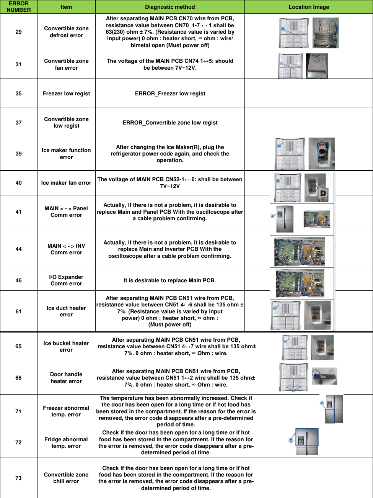

## PDF page 6

#### ERROR

#### Item

#### Diagnostic method

#### Location Image

#### NUMBER

Check the soldering status of the inverter PCB.

(Check if any parts have short-circuited). Check if the DC 15V output

81

COMP run error

is less than 13.5V. Check the

Comp and Cycle.

Check the soldering status of the inverter PCB.

(Check if any parts have short-circuited). Check if the DC 15V output

82

COMP IPM fault

is less than 13.5V. Check the

Comp and Cycle.

Check the compressor wire connections. Check

COMP current

the soldering status of the inverter PCB. (Check if any parts have

83

error

short-circuited). Check the Comp

and Cycle.

Check if the compressor and the Cycle is normal.Check the input

voltage. Check the soldering of

84

COMP Motor stall

the inverter PCB. (Check if any parts have short-

circuited.)

Check the input voltage. (This error occurs when the input voltage is

85

COMP low voltage

AC 106 V or lower.)

### Communication error between Display and Main PCB – check

### connections

### Original figure / page illustration (PDF page 6)

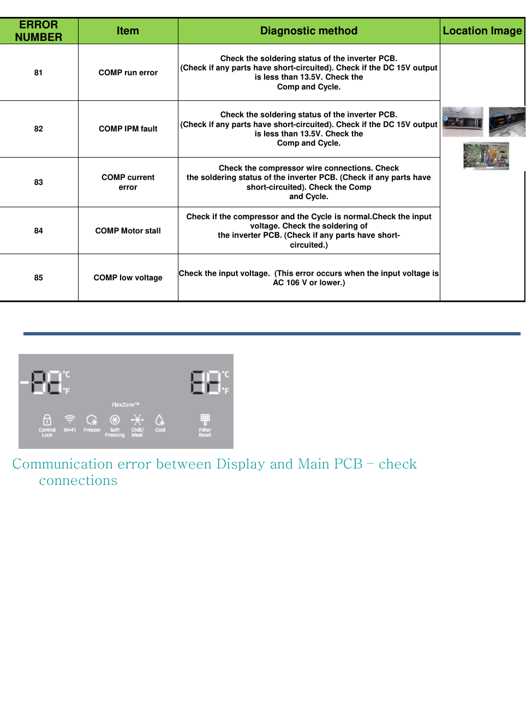

## PDF page 7

#### General

#### Symptom

#### Action

- To prevent condensation from forming, the refrigerator has heat-proof piping in the front corners. If

the ambient temperature rises, this equipment may not work effectively. This is not a system failure.

The front corners and sides become warm and form

- Make sure the door is closed properly. Condensation may form if you leave the door open for an

condensation.

extended period of time.

- Condensation may form on the exterior surface of the refrigerator if humid air comes into contact with

the cool surface of the refrigerator.

- If you have used all the ice in the ice bucket, you must wait for 12 hours for the refrigerator to make

more ice.

- See if the Ice Maker Off icon is lit. On the family hub under Fridge Manager, if off turn on

The ice maker does not make ice.

- Make sure the freezer temp is set properly.

- Make sure the water tank is filled with water.

- Check if the ice bucket contains ice clumps. If it does, empty the ice bucket and try again.

- Check if the water tank is frozen. If so, select a higher fridge temperature.

- Make sure the water tank is filled with water.

The water dispenser is not functioning.

- Make sure the water tank is installed properly.

- Make sure the water filter is installed properly.

You hear a bubbling sound.

- This is normal. The bubbling sound comes from refrigerant circulating through the refrigerator.

- Check for any spoiled food. We recommend cleaning the refrigerator on a regular basis and removing

any spoiled or suspect food items.

A bad smell comes from inside the refrigerator.

- Make sure strong smelling food is wrapped tightly or stored in air tight containers.

- Make sure no food blocks the vents of the refrigerator. It is also important to arrange food items

evenly for ventilation.

Frost forms on the interior walls.

- Make sure the door is closed properly.

- This happens when food containing a high proportion of water is stored uncovered, or the door has

Condensation forms on the interior walls or around

been left open for an extended period of time.

vegetables.

- Make sure food is covered or put in sealed containers.

### Original figure / page illustration (PDF page 7)

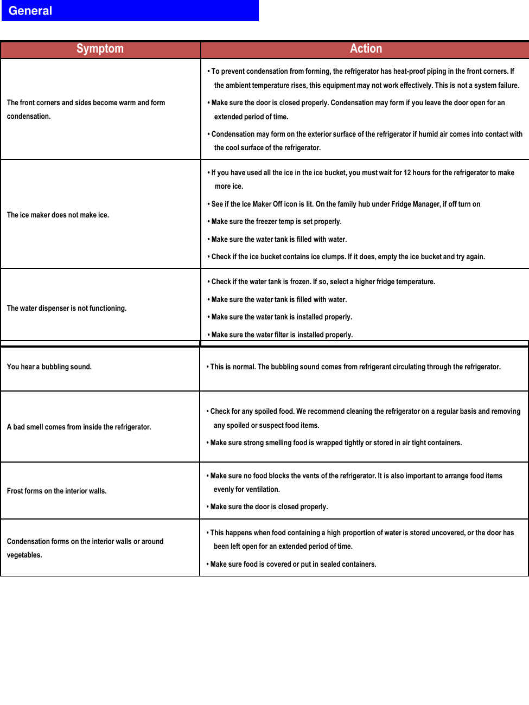

## PDF page 8

#### Samsung Smart Home - Troubleshooting

Symptom

Action

- The Samsung Smart Home app is available for smartphones that run Android 4.0 (ICS) or higher, or

Could not find “Samsung Smart Home” in the app market.

iOS 7.0 or higher

- The Samsung Smart Home app is available on applicable models only.

The Samsung Smart Home app fails to operate.

- The old Samsung Smart Refrigerator app cannot connect with Samsung Smart Home models.

- You must log into your Samsung account to use the app. • Make sure that your router is operating

normally.

The Samsung Smart Home app is installed but is not

- If the Wi-Fi icon on the refrigerator’s display is off, this indicates that no network connection has

connected to my refrigerator.

been established yet. In this case, use the Samsung Smart Home app to connect and register your

refrigerator to the access point (AP) of your house.

- You must log into your Samsung account to use the app.

Could not log into the app.

- If you don’t have a Samsung account, follow the app’s onscreen instructions to create one.

An error message appears when I try to register my

- Easy Connection may fail due to the distance from your access point (AP) or electrical interference

refrigerator.

from the surrounding environment. Wait a moment and try again.

- Exit and restart the Samsung Smart Home app, or disconnect and reconnect the router.

The Samsung Smart Home app is successfully connected to

my refrigerator but does not run.

- Unplug the power cord of the refrigerator, and plug it again after 1 minute.

### Original figure / page illustration (PDF page 8)

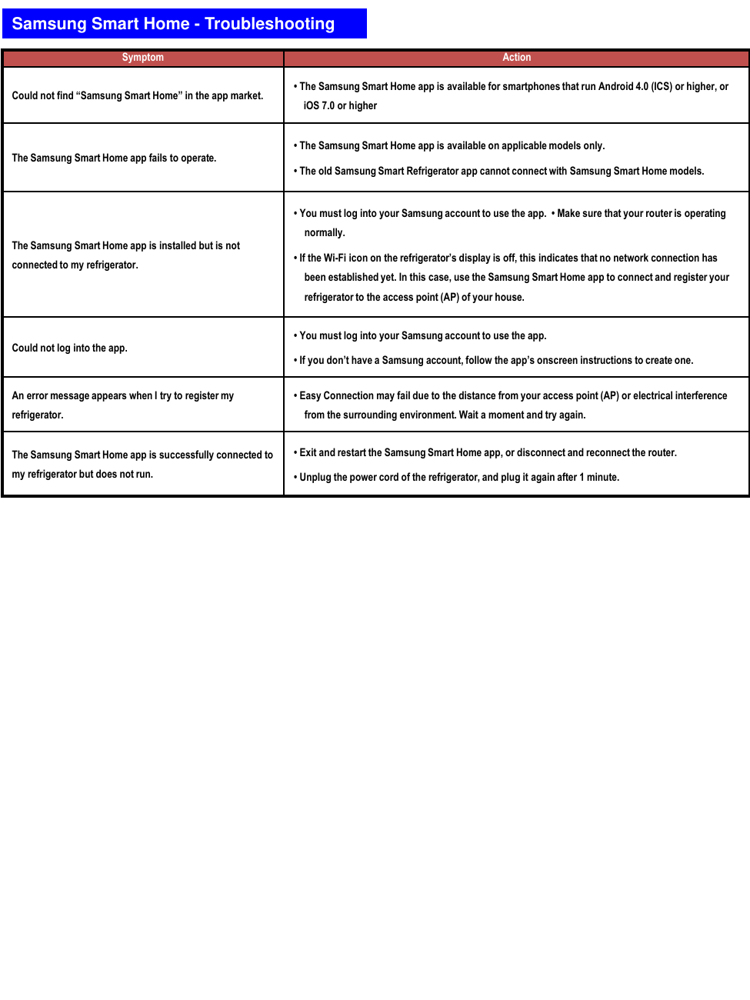

## PDF page 9

Removal of Ice Bucket and Ice Maker

Removal of the Auger Motor Assy

### Original figure / page illustration (PDF page 9)

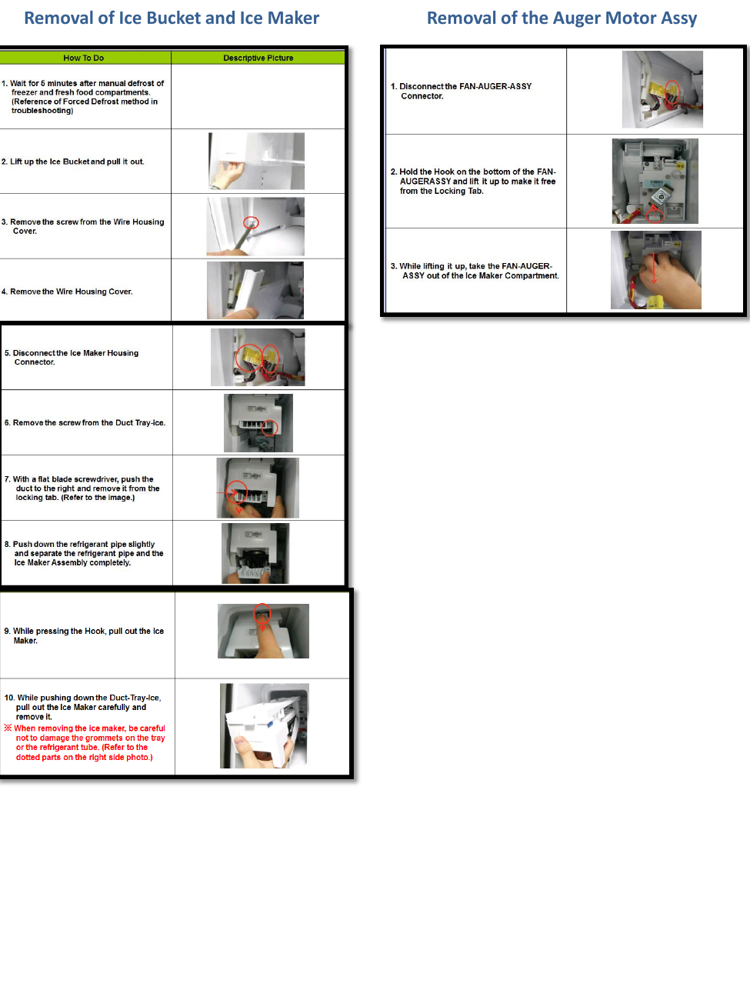

## PDF page 10

TDM VALVE

#1 Input from Drier

#3 Outputs to Evaporators

FF Section – Yellow Tube

FRE Section – No Color

Conv. Zone – Red Tube

### Original figure / page illustration (PDF page 10)

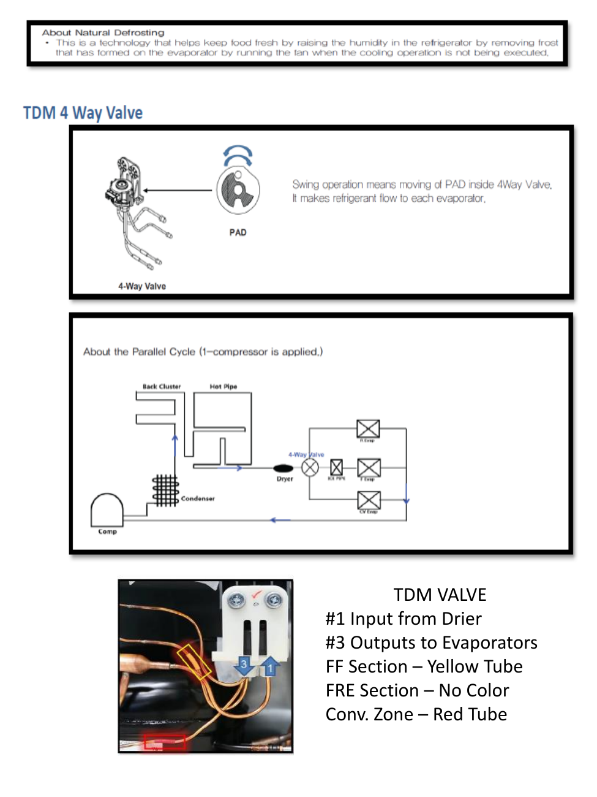

## PDF page 11

#### Main Board of Fridge Layout

#### SMPS

#### Inverter Board (Compressor)

[Caution]

AC input power and high voltage

generated at SMPS PCB and INVERTER

PCB power terminal. Please be cautious

during repair and measurement.

### Original figure / page illustration (PDF page 11)

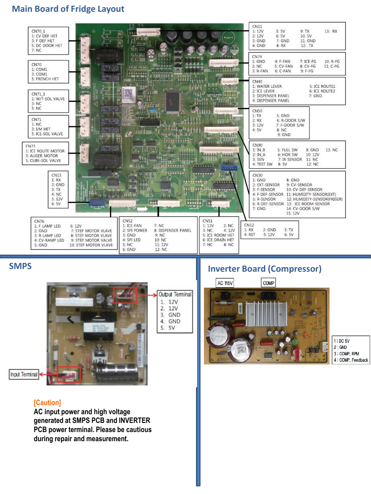

## PDF page 12

Wiring Diagram

Dispenser

### Original figure / page illustration (PDF page 12)

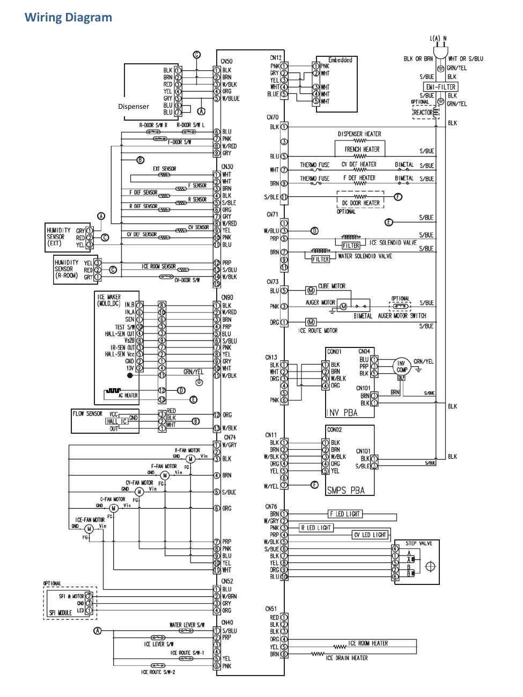

