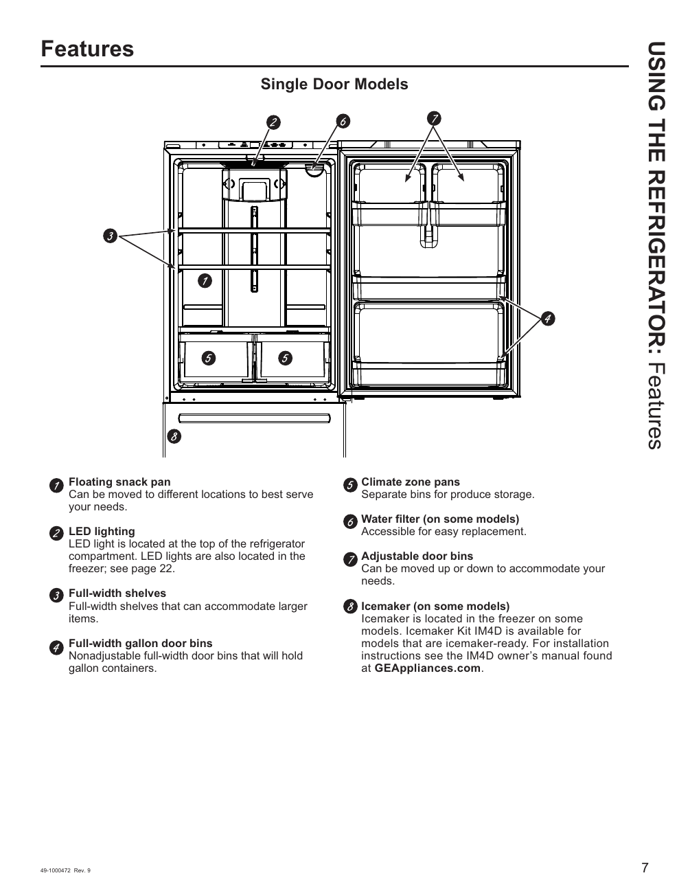

# GE GNE27JYMFS User Guide - Page 007
This page provides a visual diagram of the GE GNE27JYMFS refrigerator, specifically focusing on the "Single Door Models." The diagram includes various components of the refrigerator, each annotated with a brief explanation of its function. The components highlighted in the diagram include:

1. LED lighting
2. Full-width shelves
3. Full-width gallon door bins
4. Climate zone pans
5. Water filter
6. Adjustable door bins
7. Icemaker

Understanding these components is essential for users to effectively utilize and maintain the refrigerator. The visual representation serves as a direct aid in comprehending the layout and features of the GE GNE27JYMFS model.

<!-- llm-wiki:embedded-images -->
## Embedded Images

### Document

![The image is a diagram of a refrigerator, specifically labeled "Single Door Models." It features numbered annotations pointing to various components, including:  1. LED lighting - located at the top of the refrigerator compartment. 2. Full-width shelves - designed to accommodate larger items. 3. Full-width gallon door bins - nonadjustable bins for gallon containers. 4. Climate zone pans - separate bins for produce storage. 5. Water filter - accessible for easy replacement. 6. Adjustable door bins - can be moved up or down. 7. Icemaker - located in the freezer on some models. Each component is described with a brief explanation of its function.](../media/13-fridge-docsmd--12-gegne27jymfs--6-assets--10-user-guide--7-page007--1b8ot84/001-page_007.png)
<!-- llm-wiki:embedded-images -->
