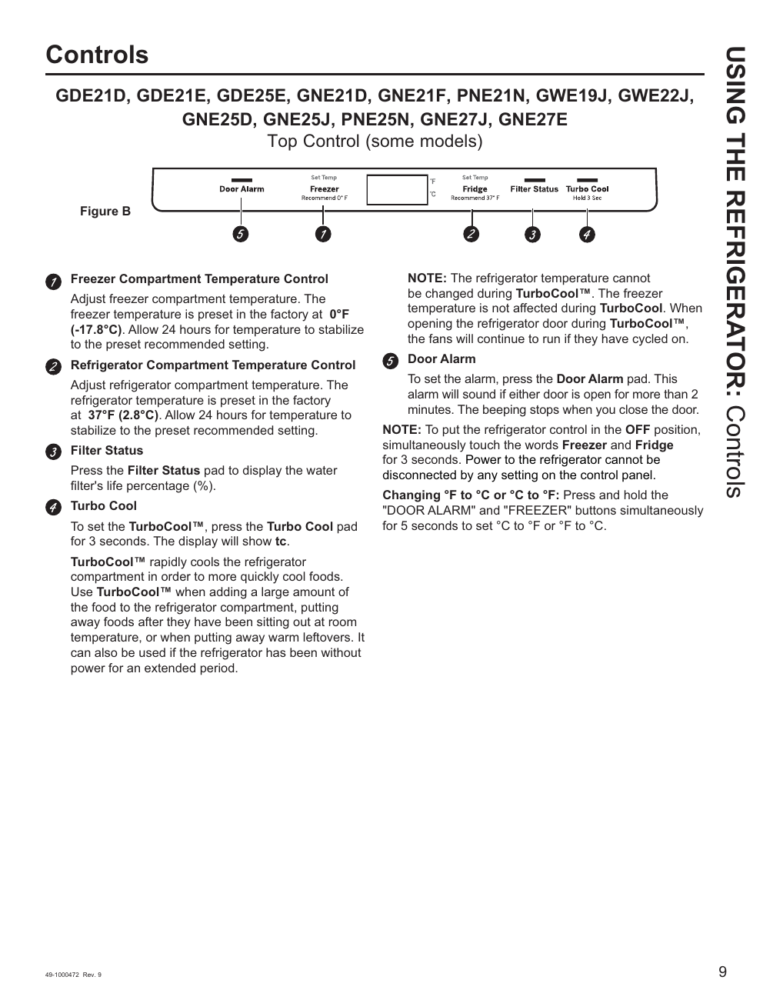

# GE GNE27JYMFS User Guide - Page 009
This page of the user guide for the GE GNE27JYMFS refrigerator provides detailed information about the control panel, including temperature settings and the Turbo Cool function. The control panel image illustrates various controls for adjusting the freezer and refrigerator temperatures, with specific settings indicated (0°F for the freezer and 37°F for the refrigerator). 

The Turbo Cool function is highlighted, indicating that it cannot be overridden to change the refrigerator temperature during its operation. Additionally, the user guide includes instructions for switching temperature units between Fahrenheit and Celsius.

<!-- llm-wiki:embedded-images -->
## Embedded Images

### Document

![The image is a control panel for a refrigerator, labeled as "Figure B." It includes various controls and settings for the freezer and refrigerator compartments. The visible text includes instructions for adjusting the freezer temperature (set at 0°F), refrigerator temperature (set at 37°F), and a filter status display. Additional features include a door alarm and a Turbo Cool function, which rapidly cools the refrigerator compartment. The note emphasizes that the refrigerator temperature cannot be changed during TurboCool™ and provides instructions for changing temperature units between Fahrenheit and Celsius.](../media/13-fridge-docsmd--12-gegne27jymfs--6-assets--10-user-guide--7-page009--rdvs5y/001-page_009.png)
<!-- llm-wiki:embedded-images -->
