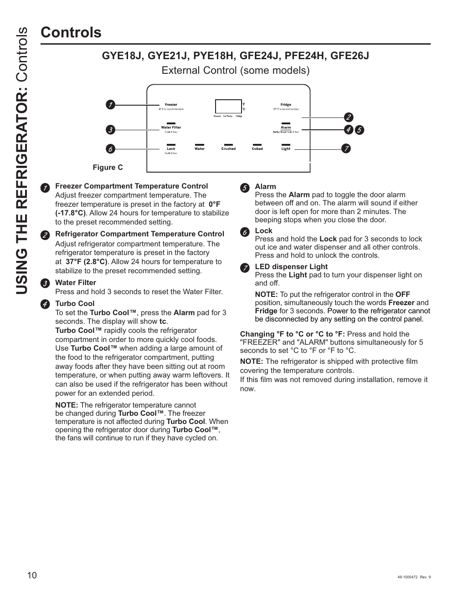

# GE GNE27JYMFS User Guide - Page 010
This page provides a visual representation of the control panel for the GE GNE27JYMFS refrigerator, detailing various functions and controls. It includes specific instructions for adjusting temperatures, resetting the water filter, and utilizing the Turbo Cool function.

The control panel features include:
- Freezer and Refrigerator Compartment Temperature Controls
- Water Filter Reset
- Alarm
- Lock
- LED Dispenser Light
- Turbo Cool Feature

Understanding these functions is crucial for users to operate the refrigerator effectively.

<!-- llm-wiki:embedded-images -->
## Embedded Images

### Document

![The image is a control panel for a refrigerator model GYE18J, GYE21J, PYE18H, GFE24J, PFE24H, GFE26J, detailing various functions. It includes labeled sections for the Freezer and Refrigerator Compartment Temperature Controls, Water Filter reset, Alarm, Lock, LED Dispenser Light, and Turbo Cool feature. Specific instructions are provided for adjusting temperatures, resetting the water filter, and using the Turbo Cool function. The image also notes that the refrigerator is shipped with protective film covering the temperature controls.](../media/13-fridge-docsmd--12-gegne27jymfs--6-assets--10-user-guide--7-page010--1vnwsqg/001-page_010.png)
<!-- llm-wiki:embedded-images -->
