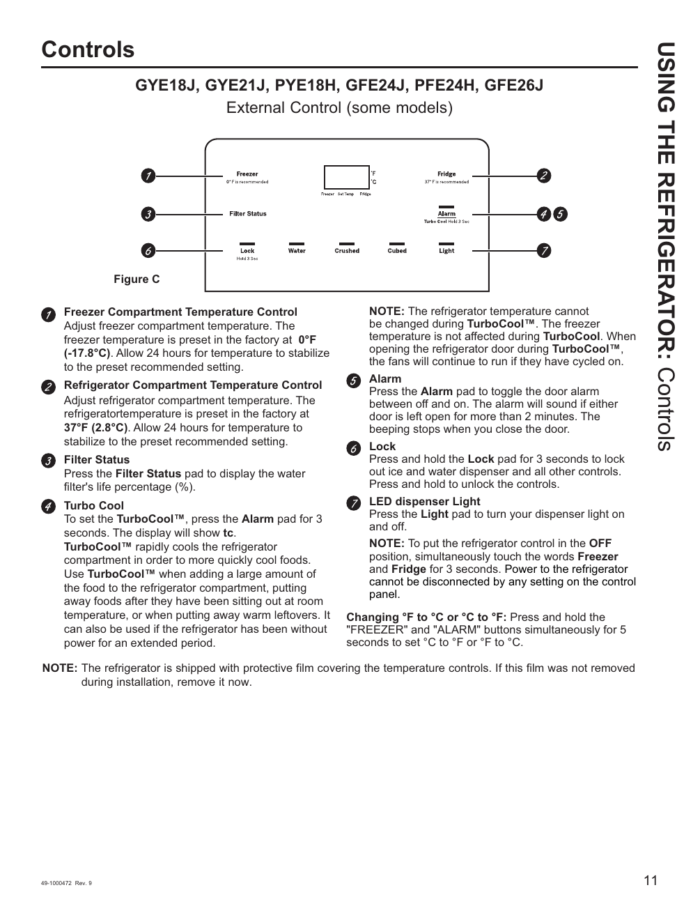

# GE GNE27JYMFS User Guide - Page 011
This page of the user guide provides detailed information about the external control panel of the GE GNE27JYMFS refrigerator. It includes labeled sections for various controls, such as the Freezer and Refrigerator Compartment Temperature Controls, Filter Status, Turbo Cool, Alarm, Lock, and LED dispenser light. The preset temperatures for the Freezer and Refrigerator are also indicated, along with instructions for adjusting these settings. The functionality of the Turbo Cool feature is explained, emphasizing its importance for enhanced cooling performance.

<!-- llm-wiki:embedded-images -->
## Embedded Images

### Document

![The image labeled "Figure C" displays the external control panel for models GYE18J, GYE21J, PYE18H, GFE24J, PFE24H, and GFE26J. It includes labeled sections for the Freezer and Refrigerator Compartment Temperature Controls, Filter Status, Turbo Cool, Alarm, Lock, and LED dispenser light. The Freezer temperature is preset at 0°F (-17.8°C) and the Refrigerator at 37°F (2.8°C), with instructions for adjusting these settings. Additional notes explain the functionality of the TurboCool feature and the importance of removing protective film from the controls.](../media/13-fridge-docsmd--12-gegne27jymfs--6-assets--10-user-guide--7-page011--1uw1evf/001-page_011.png)
<!-- llm-wiki:embedded-images -->
