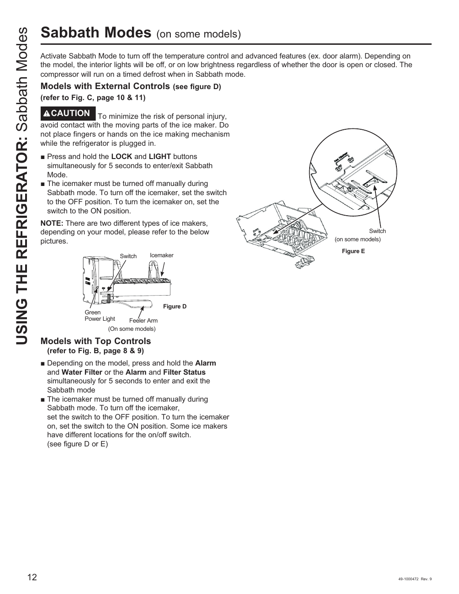

# GE GNE27JYMFS User Guide - Page 012
This page of the user guide for the GE GNE27JYMFS refrigerator provides instructions on activating the Sabbath mode, a feature that allows the appliance to operate in compliance with Jewish Sabbath laws. The guide includes a diagram (Figure D) illustrating the refrigerator's operation, including a green power light and controls for the icemaker, along with cautionary advice regarding personal injury.

## Key Features
- **Sabbath Mode**: Instructions for activating this mode are provided, which is crucial for users who observe these practices.
- **Safety Instructions**: The guide emphasizes the importance of safety when operating the refrigerator.

<!-- llm-wiki:embedded-images -->
## Embedded Images

### Document

<!-- llm-wiki:embedded-images -->
