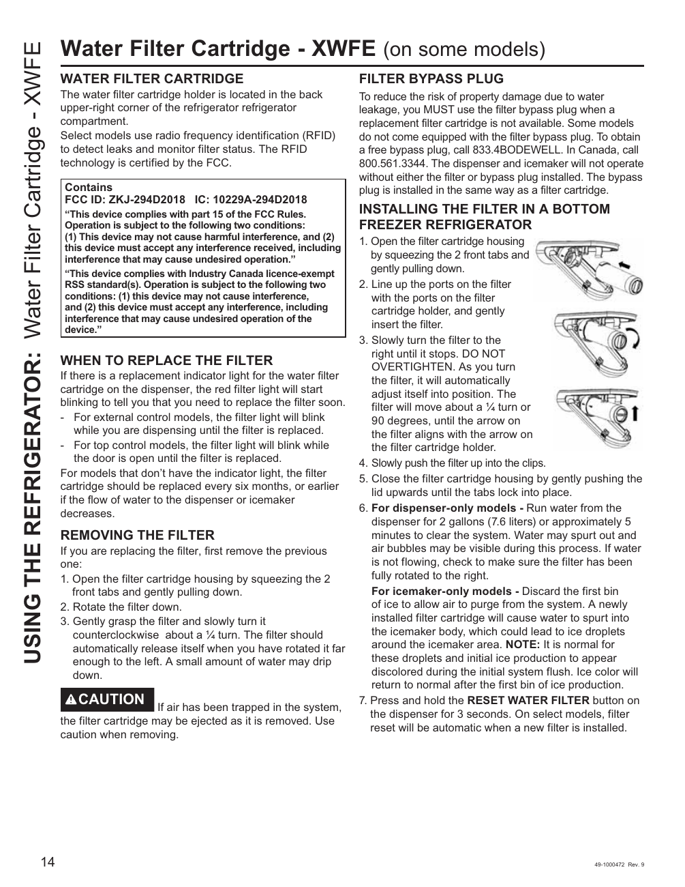

# GE GNE27JYMFS User Guide - Page 014
This page provides detailed instructions for replacing the water filter cartridge (model XWFE) in the GE GNE27JYMFS refrigerator. It includes information on the filter bypass plug and specific steps for installation.

## Key Instructions
- Locate the water filter.
- Use a filter bypass plug if a replacement cartridge is unavailable.
- Installation steps:
  - Slowly turn the filter to the right until it stops.
  - Press and hold the RESET WATER FILTER button on the dispenser for 3 seconds.

<!-- llm-wiki:embedded-images -->
## Embedded Images

### Document

![The image contains instructions for replacing the water filter cartridge (model XWFE) in a refrigerator. It includes sections titled "WATER FILTER CARTRIDGE," "FILTER BYPASS PLUG," and "INSTALLING THE FILTER IN A BOTTOM FREEZER REFRIGERATOR." Key points include the location of the filter, the need for a bypass plug if a replacement cartridge is unavailable, and detailed steps for removing and installing the filter. Specific instructions mention to "slowly turn the filter to the right until it stops" and to "press and hold the RESET WATER FILTER button on the dispenser for 3 seconds."](../media/13-fridge-docsmd--12-gegne27jymfs--6-assets--10-user-guide--7-page014--1789a3o/001-page_014.png)
<!-- llm-wiki:embedded-images -->
