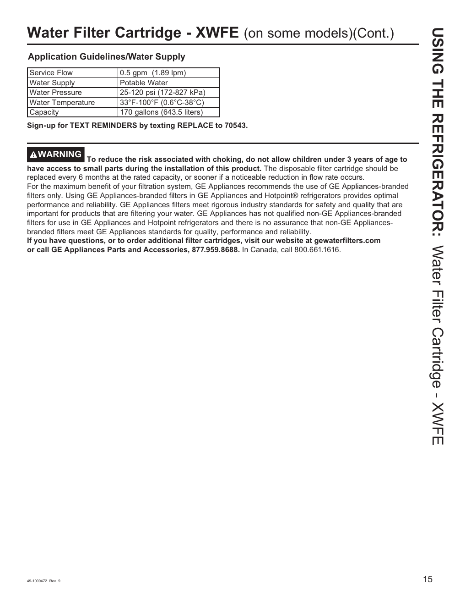

# GE GNE27JYMFS User Guide - Page 015
This page provides detailed information about the Water Filter Cartridge - XWFE, including application guidelines, water supply specifications, and filter replacement instructions. 

## Key Information
- **Water Filter Cartridge Model:** XWFE
- **Service Flow:** 0.5 gpm (1.89 lpm)
- **Water Supply:** Potable water
- **Water Pressure:** 25-120 psi (172-827 kPa)
- **Water Temperature:** 33°F-100°F (0.6°C-38°C)
- **Capacity:** 170 gallons (643.5 liters)

### Safety Warning
- **Choking Hazard:** Keep out of reach of children under 3 years of age.

### Filter Replacement Instructions
Instructions for replacing the water filter cartridge are included to ensure the proper functioning of the refrigerator's water filtration system.

<!-- llm-wiki:embedded-images -->
## Embedded Images

### Document

![The image contains information about the Water Filter Cartridge - XWFE, specifically for some models. It lists application guidelines and water supply details, including a service flow of 0.5 gpm (1.89 lpm), water supply as potable water, water pressure ranging from 25-120 psi (172-827 kPa), water temperature between 33°F-100°F (0.6°C-38°C), and a capacity of 170 gallons (643.5 liters). A warning advises against choking hazards for children under 3 years of age and provides instructions for filter replacement and contact information for GE Appliances.](../media/13-fridge-docsmd--12-gegne27jymfs--6-assets--10-user-guide--7-page015--s3f62f/001-page_015.png)
<!-- llm-wiki:embedded-images -->
