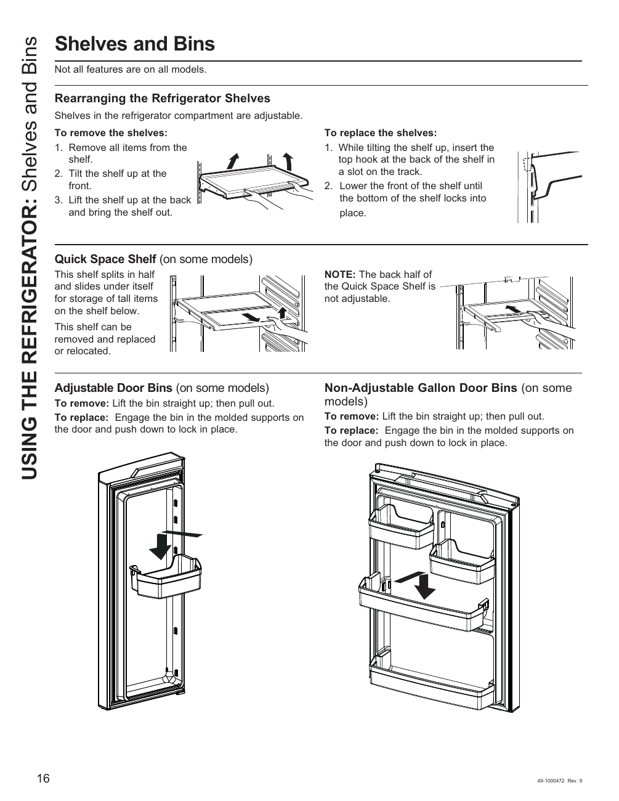

# GE GNE27JYMFS User Guide - Page 016
This page provides instructions for rearranging the refrigerator shelves of the GE GNE27JYMFS model. It includes detailed steps for removing and replacing shelves and bins, along with descriptions of various features such as the Quick Space Shelf, Adjustable Door Bins, and Non-Adjustable Gallon Door Bins. The instructions are visually supported by a diagram illustrating the components involved in the process.

## Key Instructions
- **Rearranging the Refrigerator Shelves**: 
  - To remove the shelves:
    1. Remove all items from the shelf.
    2. Tilt the shelf up at the front.
    3. Lift the shelf up at the back and bring the shelf out.

## Features Described
- **Quick Space Shelf**: A shelf that can be adjusted for convenience.
- **Adjustable Door Bins**: Bins in the refrigerator door that can be repositioned.
- **Non-Adjustable Gallon Door Bins**: Fixed bins designed to hold gallon-sized containers.

<!-- llm-wiki:embedded-images -->
## Embedded Images

### Document

![The image contains instructions for rearranging refrigerator shelves and details about various door bins. It includes the following visible text: "Rearranging the Refrigerator Shelves," "To remove the shelves: 1. Remove all items from the shelf. 2. Tilt the shelf up at the front. 3. Lift the shelf up at the back and bring the shelf out." Additionally, it describes the "Quick Space Shelf," "Adjustable Door Bins," and "Non-Adjustable Gallon Door Bins," with specific removal and replacement instructions for each. The diagram illustrates the components and actions involved in adjusting the shelves and bins.](../media/13-fridge-docsmd--12-gegne27jymfs--6-assets--10-user-guide--7-page016--1ns5n62/001-page_016.png)
<!-- llm-wiki:embedded-images -->
