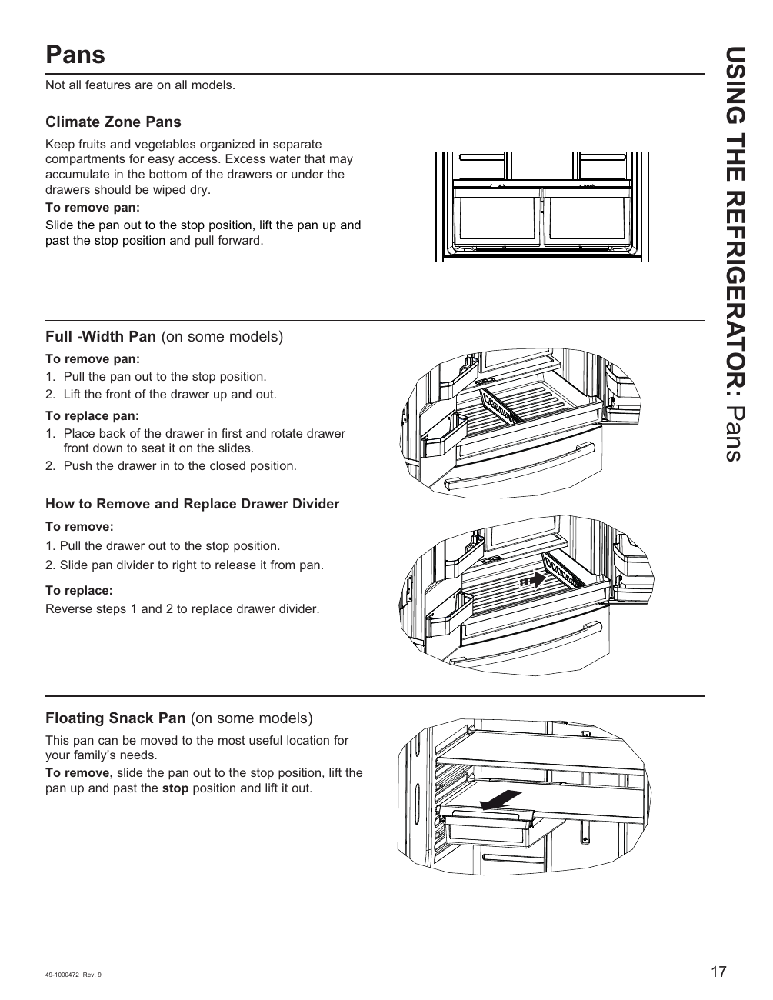

# GE GNE27JYMFS User Guide - Page 017
This page provides detailed instructions for the removal and replacement of various refrigerator pans and dividers specific to the GE GNE27JYMFS model. It includes labeled illustrations and step-by-step instructions, emphasizing the process of sliding the pan out to the stop position and lifting it.

## Key Instructions
- **Climate Zone Pans**: Instructions on handling these specialized pans designed to maintain different temperature zones within the refrigerator.
- **Full-Width Pan**: Guidance on the removal and replacement of this pan, which spans the full width of the refrigerator.
- **Floating Snack Pan**: Directions for using this smaller, adjustable pan designed for snacks and smaller items.

<!-- llm-wiki:embedded-images -->
## Embedded Images

### Document

![The image contains diagrams and instructions related to refrigerator pans, specifically detailing the removal and replacement of various types of pans and dividers. It includes labeled illustrations for "Climate Zone Pans," "Full-Width Pan," and "Floating Snack Pan," showing how to pull out and lift the pans. The text provides step-by-step instructions for removing and replacing the drawer divider, emphasizing the need to slide the pan out to the stop position and lift it. The visible text includes phrases like "To remove pan:" and "To replace pan:" followed by numbered steps.](../media/13-fridge-docsmd--12-gegne27jymfs--6-assets--10-user-guide--7-page017--f80n3x/001-page_017.png)
<!-- llm-wiki:embedded-images -->
