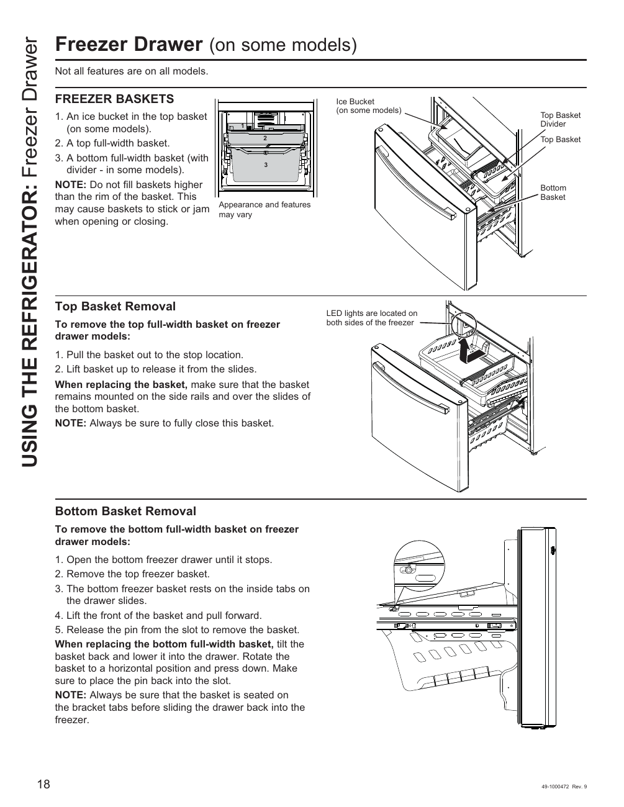

# GE GNE27JYMFS User Guide - Page 018
This page provides visual instructions for the "Freezer Drawer" of the GE GNE27JYMFS refrigerator. It includes labeled diagrams illustrating the components such as the ice bucket, top basket, and bottom basket, along with steps for removing these baskets. The instructions emphasize the importance of ensuring that the baskets are properly seated and closed to maintain functionality.

<!-- llm-wiki:embedded-images -->
## Embedded Images

### Document

<!-- llm-wiki:embedded-images -->
