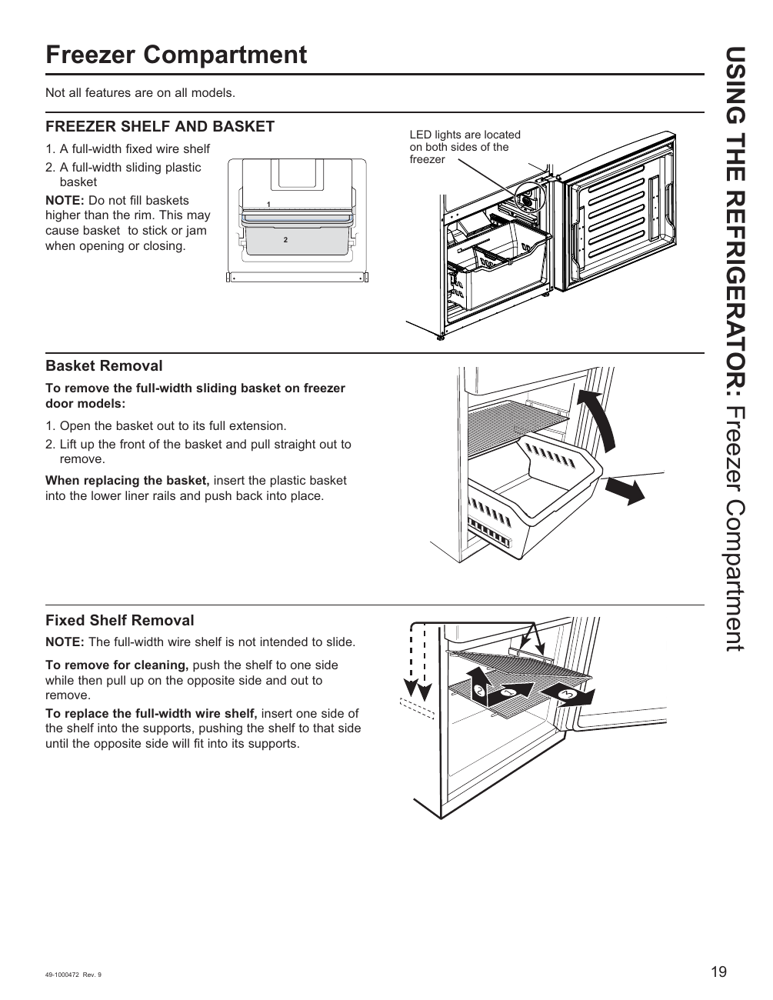

# GE GNE27JYMFS User Guide - Page 019
This page provides visual instructions for the freezer compartment of the GE GNE27JYMFS refrigerator. It includes a diagram illustrating a full-width fixed wire shelf and a full-width sliding plastic basket, along with step-by-step instructions for removing the sliding basket and the fixed wire shelf. A cautionary note advises users not to overfill the baskets to prevent jamming.

<!-- llm-wiki:embedded-images -->
## Embedded Images

### Document

<!-- llm-wiki:embedded-images -->
