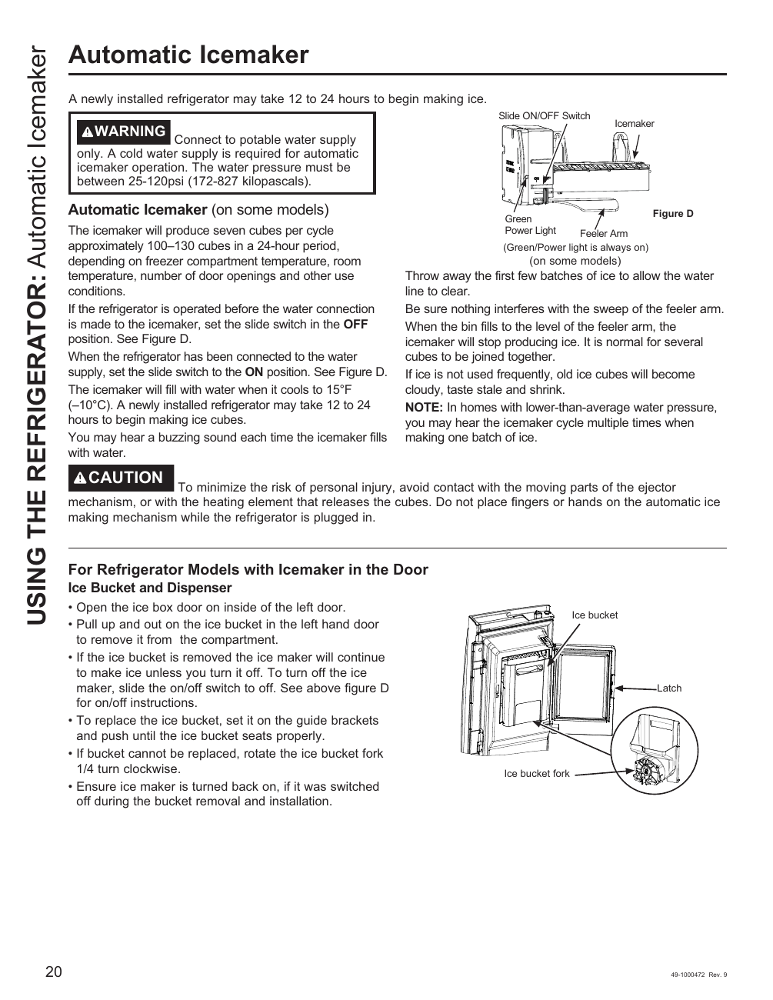

# GE GNE27JYMFS User Guide - Page 020
This page provides visual instructions for the automatic icemaker of the GE GNE27JYMFS refrigerator. It includes a diagram labeled as "Figure D," illustrating the icemaker, ice bucket, and components such as the ON/OFF switch, power light, and feeler arm. 

Key warnings emphasize the necessity of a potable water supply for operation, along with details on the ice production cycle and safety precautions. The information is presented in a clear, instructional format typical of user guides.

<!-- llm-wiki:embedded-images -->
## Embedded Images

### Document

<!-- llm-wiki:embedded-images -->
