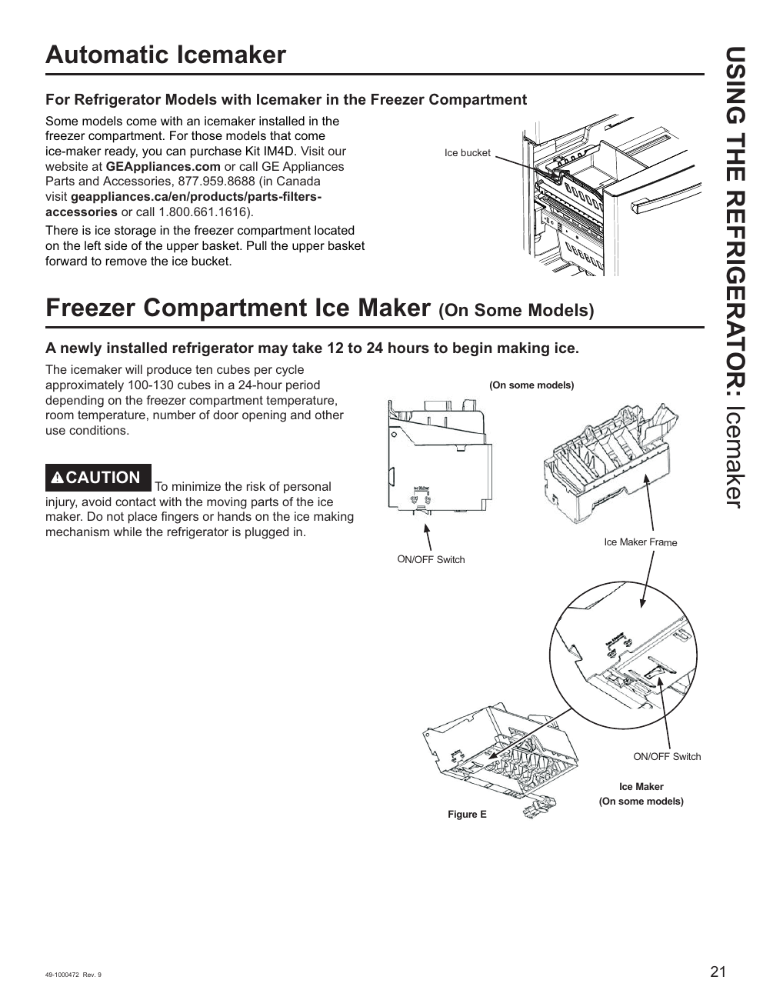

# GE GNE27JYMFS User Guide - Page 021
This page features a diagram illustrating the automatic icemaker for the GE GNE27JYMFS refrigerator model. The diagram includes labeled components such as the "Ice bucket," "ON/OFF Switch," and "Ice Maker Frame." 

## Key Features
- The icemaker may take 12 to 24 hours to start producing ice.
- It can generate approximately 100-130 cubes in a 24-hour period.

## Safety Note
A caution note is included regarding the risks of personal injury due to moving parts associated with the icemaker.

<!-- llm-wiki:embedded-images -->
## Embedded Images

### Document

![The image is a diagram illustrating the automatic icemaker for refrigerator models with an icemaker in the freezer compartment. It includes labeled components such as the "Ice bucket," "ON/OFF Switch," and "Ice Maker Frame." The diagram also features a caution note regarding personal injury risks associated with the moving parts of the icemaker. The text indicates that the icemaker may take 12 to 24 hours to begin making ice and can produce approximately 100-130 cubes in a 24-hour period. The figure is referenced as "Figure E."](../media/13-fridge-docsmd--12-gegne27jymfs--6-assets--10-user-guide--7-page021--1pcyxnw/001-page_021.png)
<!-- llm-wiki:embedded-images -->
