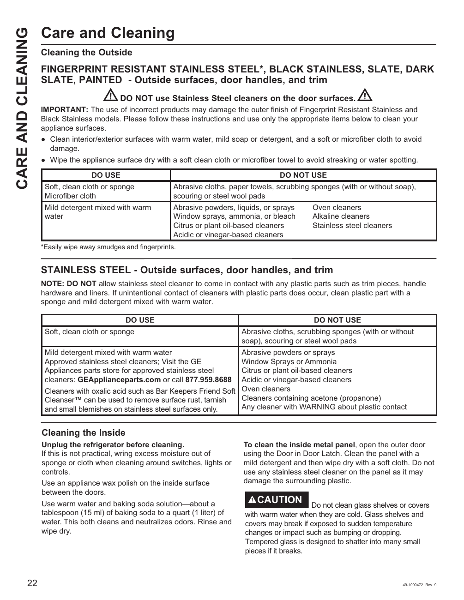

# GE GNE27JYMFS User Guide - Page 022
This page provides cleaning instructions for the GE GNE27JYMFS refrigerator, detailing specific dos and don'ts for maintaining various surfaces. The guidelines emphasize the importance of using appropriate cleaning methods to avoid damage to the appliance finishes.

## Cleaning Instructions
The document categorizes cleaning materials and methods into "DO USE" and "DO NOT USE" sections, providing clear and practical instructions for users.

<!-- llm-wiki:embedded-images -->
## Embedded Images

### Document

![The image contains instructions for cleaning various surfaces of appliances, specifically focusing on fingerprint-resistant stainless steel, black stainless, slate, dark slate, and painted surfaces. It includes a warning against using stainless steel cleaners on door surfaces and provides a list of recommended cleaning methods and materials. The "DO USE" section suggests using a soft cloth or sponge, mild detergent mixed with warm water, and approved stainless steel cleaners, while the "DO NOT USE" section lists abrasive materials and specific cleaners to avoid. The text emphasizes the importance of following these guidelines to prevent damage to the appliance finishes.](../media/13-fridge-docsmd--12-gegne27jymfs--6-assets--10-user-guide--7-page022--1638wn9/001-page_022.png)
<!-- llm-wiki:embedded-images -->
