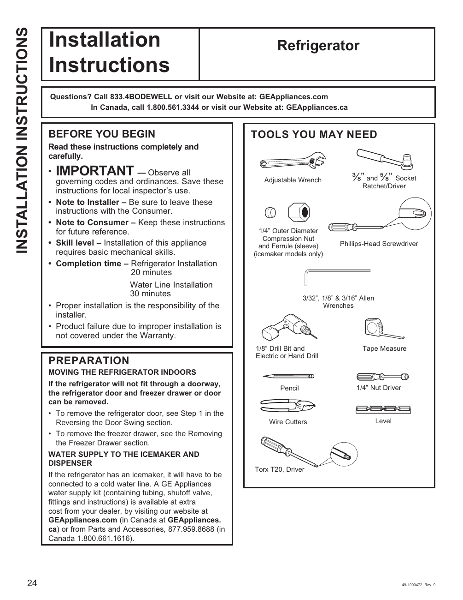

# GE GNE27JYMFS User Guide - Page 024
This page provides installation instructions for the GE GNE27JYMFS refrigerator. It emphasizes the importance of following local codes and saving the instructions for the local inspector's use. The page lists the tools needed for installation, including an adjustable wrench, Phillips-head screwdriver, and various sizes of Allen wrenches. Additionally, it outlines preparation steps for moving the refrigerator indoors and connecting the water supply for the icemaker and dispenser.

<!-- llm-wiki:embedded-images -->
## Embedded Images

### Document

![The image is a page of installation instructions for a refrigerator. It includes the title "Installation Instructions" at the top, followed by a section labeled "BEFORE YOU BEGIN," which emphasizes the importance of observing governing codes and saving the instructions for the local inspector's use. The page lists tools needed for installation, such as an adjustable wrench, Phillips-head screwdriver, and various sizes of Allen wrenches. Additionally, it provides preparation steps for moving the refrigerator indoors and connecting the water supply for the icemaker and dispenser.](../media/13-fridge-docsmd--12-gegne27jymfs--6-assets--10-user-guide--7-page024--1kayiwj/001-page_024.png)
<!-- llm-wiki:embedded-images -->
