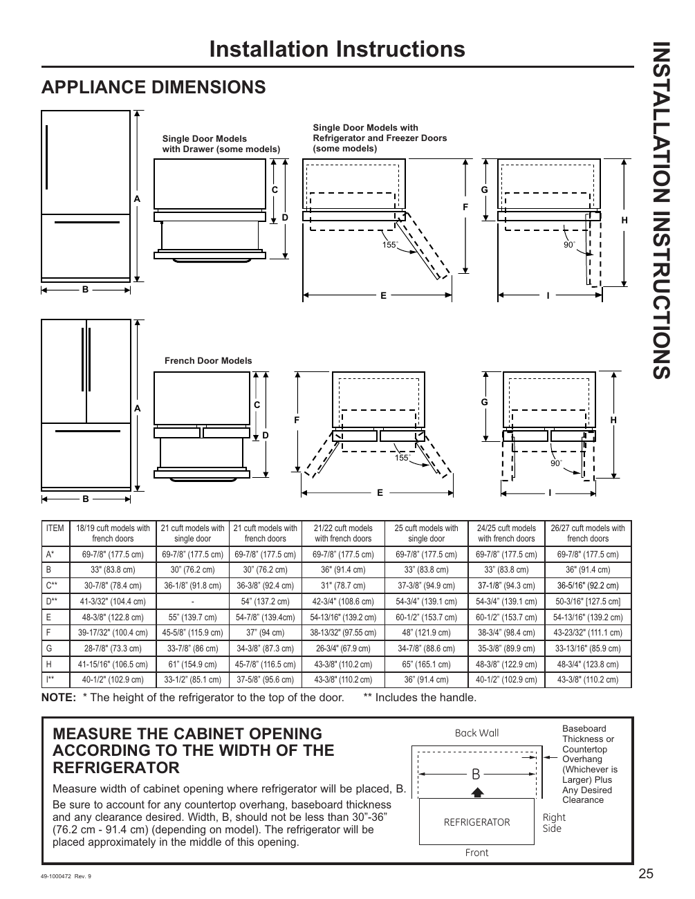

# GE GNE27JYMFS User Guide - Page 025
This page provides installation instructions for the GE GNE27JYMFS refrigerator, focusing on appliance dimensions. It includes diagrams illustrating the dimensions for various refrigerator models, with labeled measurements (A, B, C, D, E, F, G, H, I, and L). A key finding emphasizes the importance of measuring the cabinet opening to ensure it accommodates the refrigerator width, which should be between 30"-36" (76.2 cm - 91.4 cm) depending on the model.

<!-- llm-wiki:embedded-images -->
## Embedded Images

### Document

![The image displays installation instructions for various refrigerator models, labeled "APPLIANCE DIMENSIONS." It includes diagrams with dimensions for Single Door Models, Single Door Models with Refrigerator and Freezer Doors, and French Door Models. Key dimensions are labeled A, B, C, D, E, F, G, H, I, and L, with specific measurements provided in inches and centimeters. A note at the bottom emphasizes the importance of measuring the cabinet opening according to the width of the refrigerator, stating that the width should not be less than 30"-36" (76.2 cm - 91.4 cm) depending on the model.](../media/13-fridge-docsmd--12-gegne27jymfs--6-assets--10-user-guide--7-page025--1e8opc0/001-page_025.png)
<!-- llm-wiki:embedded-images -->
