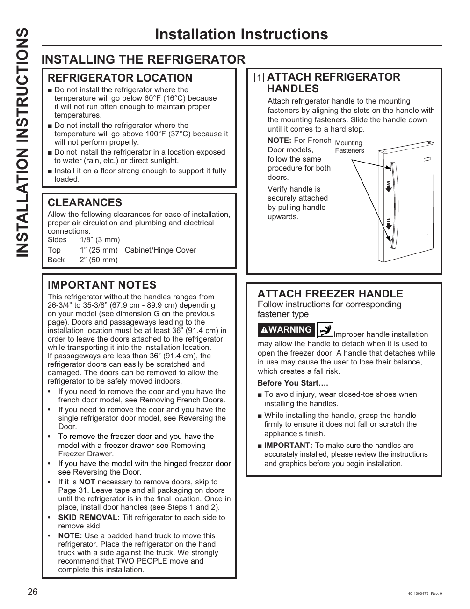

# GE GNE27JYMFS User Guide - Page 026
This page provides installation instructions for the GE GNE27JYMFS refrigerator. Key sections include guidelines on refrigerator location, clearance requirements, and important notes regarding temperature conditions and handle attachment.

## Key Points
- The refrigerator should not be installed in temperatures below 60°F (16°C) or above 100°F (37°C).
- Proper clearance around the refrigerator is necessary for optimal operation.
- Handles must be securely attached to prevent accidents.

<!-- llm-wiki:embedded-images -->
## Embedded Images

### Document

![The image contains installation instructions for a refrigerator. It includes sections titled "REFRIGERATOR LOCATION," "CLEARANCES," and "IMPORTANT NOTES." Key points include warnings against installing the refrigerator in temperatures below 60°F (16°C) or above 100°F (37°C), and the need for proper clearance around the unit. There are also instructions for attaching refrigerator handles and a warning about improper handle installation. The note emphasizes the importance of ensuring handles are securely attached to avoid accidents.](../media/13-fridge-docsmd--12-gegne27jymfs--6-assets--10-user-guide--7-page026--2fe0s9/001-page_026.png)
<!-- llm-wiki:embedded-images -->
