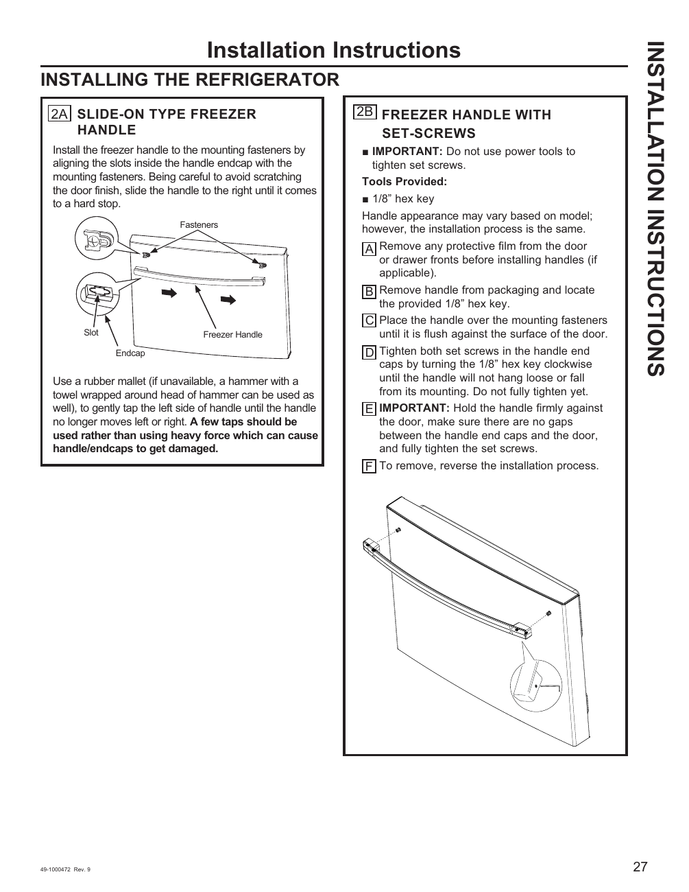

# GE GNE27JYMFS User Guide - Page 027
This page provides detailed installation instructions for the GE GNE27JYMFS refrigerator handles. It includes guidelines for two types of handles: a slide-on type and a handle with set-screws. 

The source emphasizes the importance of not using power tools during installation and lists the necessary tools, specifically a 1/8” hex key. A labeled diagram illustrates the components of the slide-on handle and the steps for installing the set-screw handle, including visual indicators for handle placement and a note to ensure there are no gaps between the handle end caps and the door.

<!-- llm-wiki:embedded-images -->
## Embedded Images

### Document

![The image shows installation instructions for a refrigerator handle, specifically detailing two types: a slide-on type and a handle with set-screws. The left side illustrates the slide-on type handle with labeled components such as "Fasteners," "Slot," and "Endcap." The right side provides steps for installing the handle with set-screws, including a warning not to use power tools and a list of tools provided, specifically a 1/8” hex key. The diagram includes arrows indicating the placement of the handle and set screws, along with a note to ensure there are no gaps between the handle end caps and the door.](../media/13-fridge-docsmd--12-gegne27jymfs--6-assets--10-user-guide--7-page027--1v7nv52/001-page_027.png)
<!-- llm-wiki:embedded-images -->
