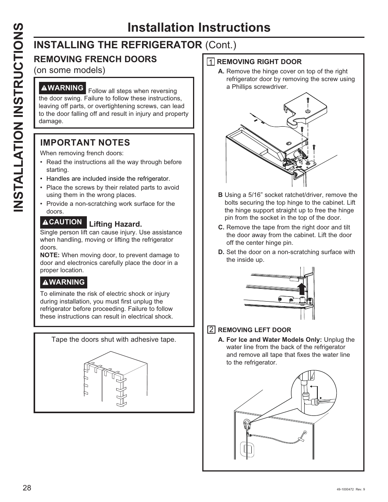

# GE GNE27JYMFS User Guide - Page 028
This page provides detailed installation instructions for removing the right door of the GE GNE27JYMFS refrigerator. It includes step-by-step guidance, safety warnings, and a diagram to assist users in the process.

## Key Instructions
- **Removing Right Door**: The section outlines steps A through D for the removal process, including the removal of the hinge cover and securing bolts.
- **Safety Precautions**: Users are warned about lifting hazards and the importance of unplugging the refrigerator before starting the process.
- **Visual Aid**: A diagram illustrates how to tape the doors shut with adhesive tape to prevent them from swinging open during the procedure.

<!-- llm-wiki:embedded-images -->
## Embedded Images

### Document

![The image contains installation instructions for removing the French doors from a refrigerator. It includes a warning about following steps carefully to avoid injury or property damage. The section labeled "1 REMOVING RIGHT DOOR" outlines steps A through D for removing the right door, including removing the hinge cover and securing bolts. There is also a note about lifting hazards and a caution regarding electric shock, emphasizing the need to unplug the refrigerator before proceeding. Additionally, there is a diagram showing how to tape the doors shut with adhesive tape.](../media/13-fridge-docsmd--12-gegne27jymfs--6-assets--10-user-guide--7-page028--e27onr/001-page_028.png)
<!-- llm-wiki:embedded-images -->
