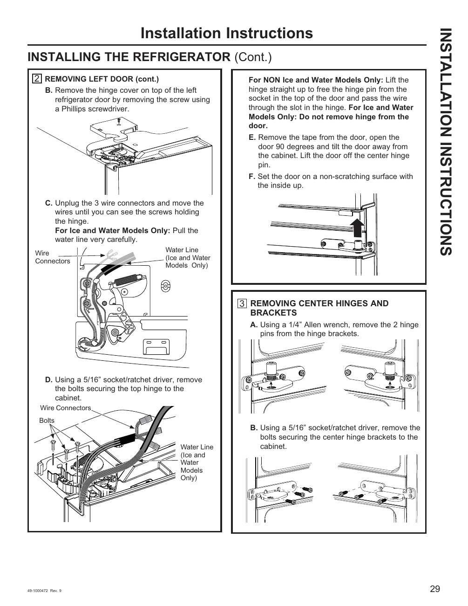

# GE GNE27JYMFS User Guide - Page 029
This page provides installation instructions for the GE GNE27JYMFS refrigerator, specifically detailing the removal of the left door and center hinges. The instructions include visual aids and step-by-step guidance to ensure proper installation.

## Key Instructions
- Unplug wire connectors.
- Remove screws using a Phillips screwdriver.
- Use a 5/16” socket/rachet driver to remove bolts.

The instructions cater to both models with and without ice and water features, ensuring clarity for users. Labeled diagrams illustrate the components involved in the process.

<!-- llm-wiki:embedded-images -->
## Embedded Images

### Document

![The image contains installation instructions for a refrigerator, specifically detailing the removal of the left door and center hinges. It includes labeled diagrams showing components such as wire connectors and a water line for ice and water models. Key steps are outlined, including unplugging wire connectors, removing screws with a Phillips screwdriver, and using a 5/16” socket/rachet driver to remove bolts. The text also specifies actions for both ice and water models and non-ice and water models.](../media/13-fridge-docsmd--12-gegne27jymfs--6-assets--10-user-guide--7-page029--g1cu84/001-page_029.png)
<!-- llm-wiki:embedded-images -->
