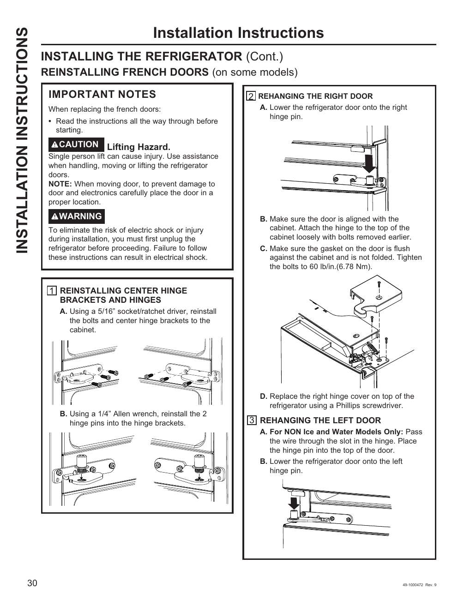

# GE GNE27JYMFS User Guide - Page 030
This page provides detailed installation instructions for re-installing the French doors on the GE GNE27JYMFS refrigerator. Key steps include reinstalling center hinge brackets and hinges, and rehanging the right door with specific alignment and tightening instructions (60 lb/in or 6.78 Nm). Safety notes emphasize lifting hazards and warnings regarding electric shock. The instructions are supported by diagrams illustrating the hinge installation process.

<!-- llm-wiki:embedded-images -->
## Embedded Images

### Document

![The image contains installation instructions for re-installing French doors on a refrigerator. It includes important notes about safety, such as a caution regarding lifting hazards and a warning about electric shock. The steps are numbered, with step 1 detailing the reinstallation of center hinge brackets and hinges, and step 2 focusing on rehanging the right door, including specific instructions for aligning the door and tightening bolts to 60 lb/in (6.78 Nm). There are also diagrams illustrating the hinge installation process.](../media/13-fridge-docsmd--12-gegne27jymfs--6-assets--10-user-guide--7-page030--fnbeom/001-page_030.png)
<!-- llm-wiki:embedded-images -->
