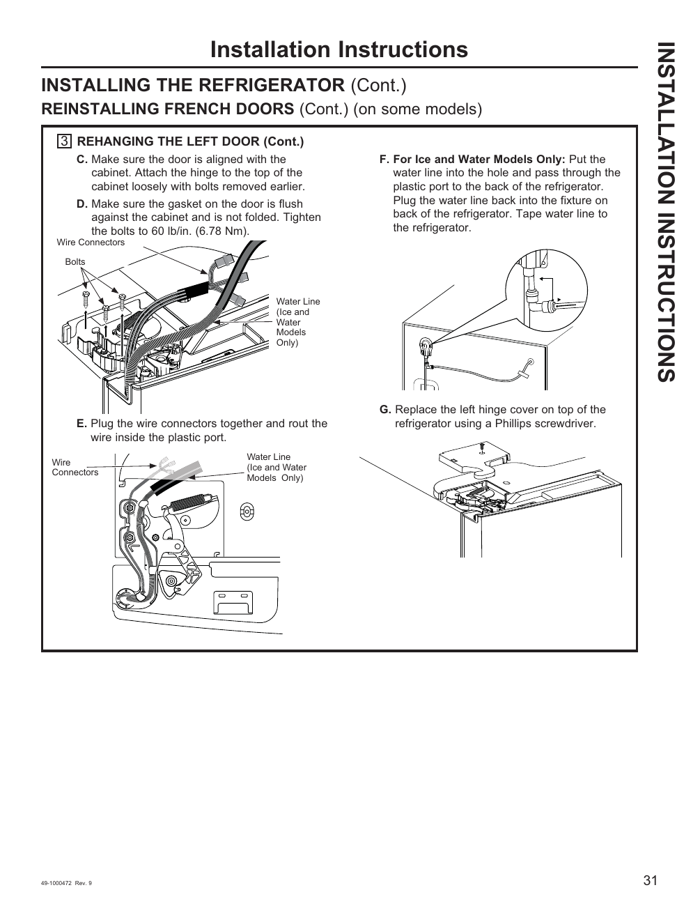

This page provides detailed visual instructions for rehanging the left door of the GE GNE27JYMFS refrigerator. It includes alignment, hinge attachment, and water line connection steps, supported by labeled diagrams and specific torque specifications (e.g., "Tighten the bolts to 60 lb/in. (6.78 Nm)"). The instructions are part of a larger section on reinstalling French doors.

<!-- llm-wiki:embedded-images -->
## Embedded Images

### Document

![The image depicts installation instructions for a refrigerator, specifically focusing on rehanging the left door. It includes labeled steps C through G, detailing the alignment of the door, attachment of the hinge, and connection of the water line for ice and water models. Key visual elements include diagrams of wire connectors, bolts, and the water line connection, with specific instructions such as "Tighten the bolts to 60 lb/in. (6.78 Nm)" and "Tape water line to the refrigerator." The text also indicates that these instructions are part of a larger section on reinstalling French doors.](../media/13-fridge-docsmd--12-gegne27jymfs--6-assets--10-user-guide--7-page031--fnnlnt/001-page_031.png)
<!-- llm-wiki:embedded-images -->
