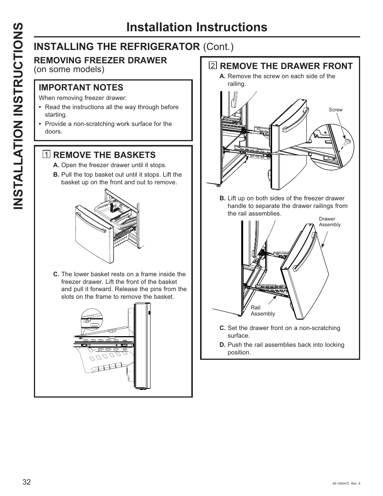

# GE GNE27JYMFS User Guide - Page 032
This page provides detailed visual instructions for removing the freezer drawer from the GE GNE27JYMFS refrigerator. The instructions include a series of labeled diagrams and steps, such as "1 REMOVE THE BASKETS" and "2 REMOVE THE DRAWER FRONT," guiding the user through the process. Safety precautions are emphasized, recommending a non-scratching work surface to prevent damage during the removal process.

<!-- llm-wiki:embedded-images -->
## Embedded Images

### Document

![The image depicts installation instructions for removing a freezer drawer from a refrigerator. It includes a series of steps labeled "1 REMOVE THE BASKETS" and "2 REMOVE THE DRAWER FRONT," with sub-steps detailing the process. Key visual elements include diagrams showing the freezer drawer, basket, and rail assemblies, along with labels for parts such as "Screw," "Drawer Assembly," and "Rail Assembly." The text emphasizes important notes for safely removing the drawer, including the need for a non-scratching work surface.](../media/13-fridge-docsmd--12-gegne27jymfs--6-assets--10-user-guide--7-page032--1rzjqls/001-page_032.png)
<!-- llm-wiki:embedded-images -->
