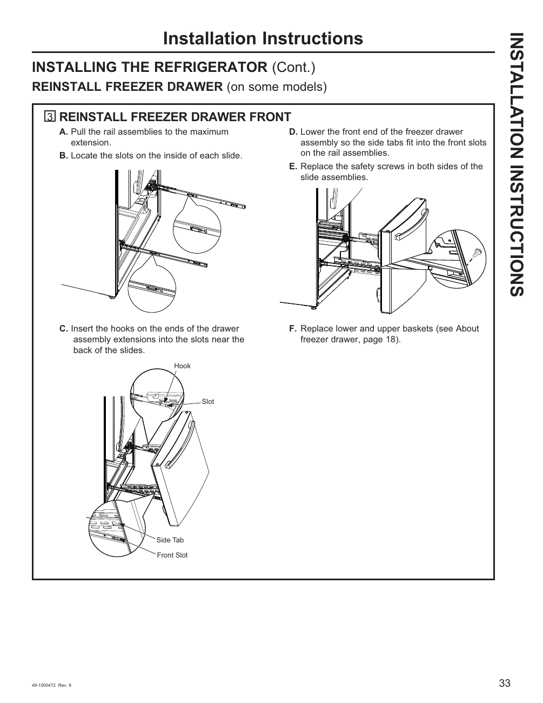

# GE GNE27JYMFS User Guide - Page 033
This page provides a visual guide for reinstalling the freezer drawer front of the GE GNE27JYMFS refrigerator. The diagram outlines six steps necessary for proper reinstallation, ensuring users can effectively reassemble the freezer drawer after maintenance or cleaning.

## Steps for Reinstallation
1. Pull the rail assemblies to maximum extension.
2. Locate the slots on the inside of each slide.
3. Insert hooks into slots near the back of the slides.
4. Lower the front end of the freezer drawer assembly into the front slots.
5. Replace safety screws in both sides of the slide assemblies.
6. Replace lower and upper baskets.

The diagram includes labeled sections and arrows indicating the process, providing clear visual instructions for users.

<!-- llm-wiki:embedded-images -->
## Embedded Images

### Document

![The image is a diagram illustrating the steps to reinstall the freezer drawer front of a refrigerator. It includes labeled sections A through F, detailing the process: A) Pull the rail assemblies to maximum extension, B) Locate the slots on the inside of each slide, C) Insert hooks into slots near the back of the slides, D) Lower the front end of the freezer drawer assembly into the front slots, E) Replace safety screws in both sides of the slide assemblies, and F) Replace lower and upper baskets. Key visual elements include arrows and labels for "Hook," "Slot," "Side Tab," and "Front Slot."](../media/13-fridge-docsmd--12-gegne27jymfs--6-assets--10-user-guide--7-page033--1rasaqr/001-page_033.png)
<!-- llm-wiki:embedded-images -->
