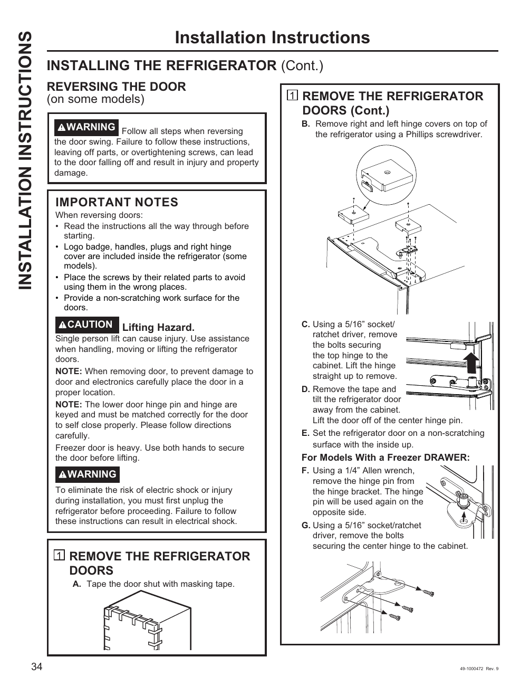

# GE GNE27JYMFS User Guide - Page 034
This page provides installation instructions for reversing the refrigerator doors on the GE GNE27JYMFS model. It emphasizes the importance of following all steps to prevent injury and property damage, highlighting safety precautions such as the need for assistance when lifting doors and warnings against electric shock.

The instructions include detailed steps labeled "1 REMOVE THE REFRIGERATOR DOORS (Cont.)" with sub-steps A through G, outlining the necessary actions and tools required (e.g., Phillips screwdriver, 5/16” socket).

<!-- llm-wiki:embedded-images -->
## Embedded Images

### Document

![The image contains installation instructions for reversing the door on certain refrigerator models. It includes a warning about following all steps to prevent injury and property damage, as well as important notes regarding the handling of the refrigerator doors. The instructions detail steps labeled "1 REMOVE THE REFRIGERATOR DOORS (Cont.)" with sub-steps A through G, including actions such as removing hinge covers, using specific tools like a Phillips screwdriver and a 5/16” socket, and ensuring safety precautions are taken. The text emphasizes the need for assistance when lifting the doors and provides caution against electric shock.](../media/13-fridge-docsmd--12-gegne27jymfs--6-assets--10-user-guide--7-page034--1q8ry0y/001-page_034.png)
<!-- llm-wiki:embedded-images -->
