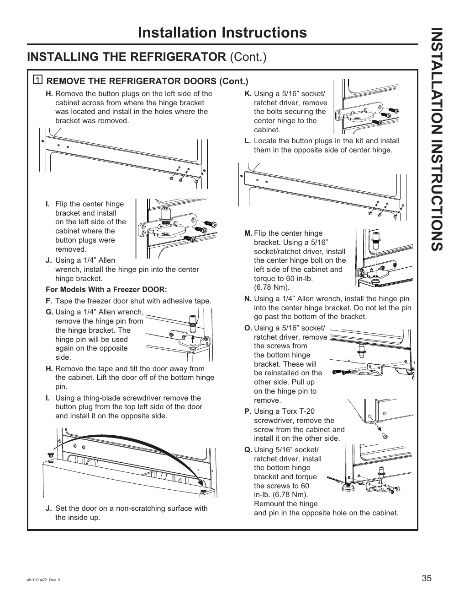

# GE GNE27JYMFS User Guide - Page 035
This page provides detailed instructions for removing the doors of the GE GNE27JYMFS refrigerator. It includes specific steps labeled H through Q, tools required (5/16” socket/ratchet driver, 1/4” Allen wrench), and torque specifications (60 in-lb or 6.78 Nm) for screws. The presence of diagrams enhances the clarity of the instructions.

<!-- llm-wiki:embedded-images -->
## Embedded Images

### Document

![The image shows a page from installation instructions for a refrigerator, specifically detailing the steps to remove the refrigerator doors. The visible text includes steps labeled H through Q, with instructions such as "Remove the button plugs on the left side of the cabinet," "Using a 5/16” socket/ratchet driver, remove the bolts securing the center hinge," and "Using a 1/4” Allen wrench, install the hinge pin into the center hinge bracket." The page also features diagrams illustrating the hinge bracket and pin locations, along with torque specifications of 60 in-lb (6.78 Nm) for certain screws.](../media/13-fridge-docsmd--12-gegne27jymfs--6-assets--10-user-guide--7-page035--1qc8305/001-page_035.png)
<!-- llm-wiki:embedded-images -->
