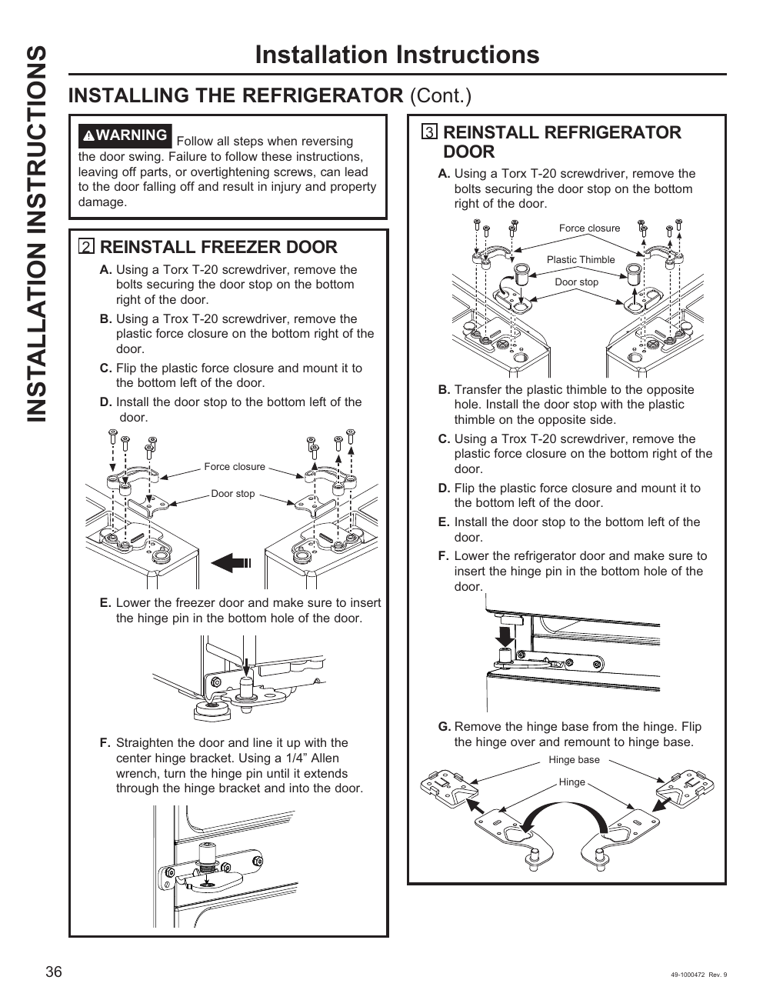

# GE GNE27JYMFS User Guide - Page 036
This page provides installation instructions for reversing the door swing of the GE GNE27JYMFS refrigerator. It includes detailed steps for reinstalling both the freezer and refrigerator doors, supported by diagrams and specific tool requirements.

## Key Instructions
- **Reinstall Freezer Door**: Step-by-step instructions labeled A through G.
- **Reinstall Refrigerator Door**: Detailed guidance with visual aids.

### Tools Required
- Torx T-20 screwdriver
- 1/4” Allen wrench

<!-- llm-wiki:embedded-images -->
## Embedded Images

### Document

![The image contains installation instructions for reversing the door swing of a refrigerator. It includes two main sections: "REINSTALL FREEZER DOOR" and "REINSTALL REFRIGERATOR DOOR," each with step-by-step instructions labeled A through G. Key visual elements include diagrams showing the placement of components such as the door stop, plastic thimble, and hinge pin, along with arrows indicating movement. The text includes warnings and specific tool requirements, such as using a Torx T-20 screwdriver and a 1/4” Allen wrench.](../media/13-fridge-docsmd--12-gegne27jymfs--6-assets--10-user-guide--7-page036--1w6kti4/001-page_036.png)
<!-- llm-wiki:embedded-images -->
