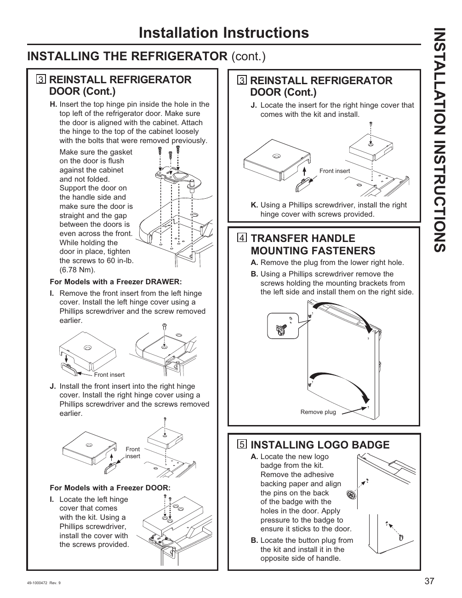

# GE GNE27JYMFS User Guide - Page 037
This page provides detailed visual and textual instructions for reinstalling the refrigerator door and transferring handle mounting fasteners for the GE GNE27JYMFS model. Key steps include inserting the top hinge pin, aligning the door, and using a Phillips screwdriver to install hinge covers and handle components. The instructions also cater to models with a freezer drawer, indicating broader applicability. Visual elements such as arrows and labeled parts enhance understanding.

<!-- llm-wiki:embedded-images -->
## Embedded Images

### Document

![The image contains installation instructions for a refrigerator, specifically detailing steps for reinstalling the refrigerator door and transferring handle mounting fasteners. Key steps include inserting the top hinge pin, aligning the door, and using a Phillips screwdriver to install hinge covers and handle components. The instructions also mention specific actions for models with a freezer drawer and include visual elements such as arrows and labeled parts. The visible text includes steps labeled "3 REINSTALL REFRIGERATOR DOOR (Cont.)" and "4 TRANSFER HANDLE MOUNTING FASTENERS."](../media/13-fridge-docsmd--12-gegne27jymfs--6-assets--10-user-guide--7-page037--3auj3j/001-page_037.png)
<!-- llm-wiki:embedded-images -->
