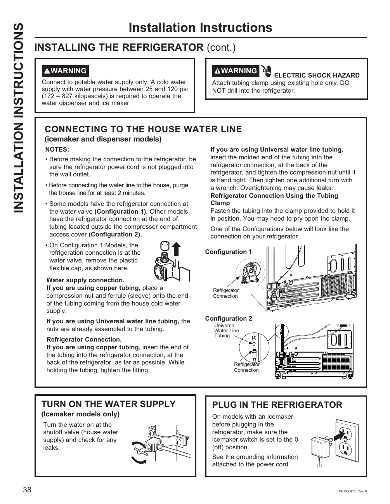

This page provides installation instructions for connecting the GE GNE27JYMFS refrigerator to a house water line, essential for the icemaker and water dispenser functionality. It includes two configurations for the connection, safety warnings about electric shock hazards, and the need for a potable water supply with specific pressure requirements. Users are instructed to turn on the water supply and check for leaks before plugging in the refrigerator.

<!-- llm-wiki:embedded-images -->
## Embedded Images

### Document

![The image contains installation instructions for connecting a refrigerator to a house water line, specifically for icemaker and dispenser models. It includes two configurations for the refrigerator connection: Configuration 1 shows a connection at the water valve, while Configuration 2 shows a connection at the end of tubing in the compressor compartment. There are warnings about electric shock hazards and the need for a potable water supply with specific pressure requirements. The text also instructs users to turn on the water supply and check for leaks before plugging in the refrigerator.](../media/13-fridge-docsmd--12-gegne27jymfs--6-assets--10-user-guide--7-page038--1d2a3hq/001-page_038.png)
<!-- llm-wiki:embedded-images -->
