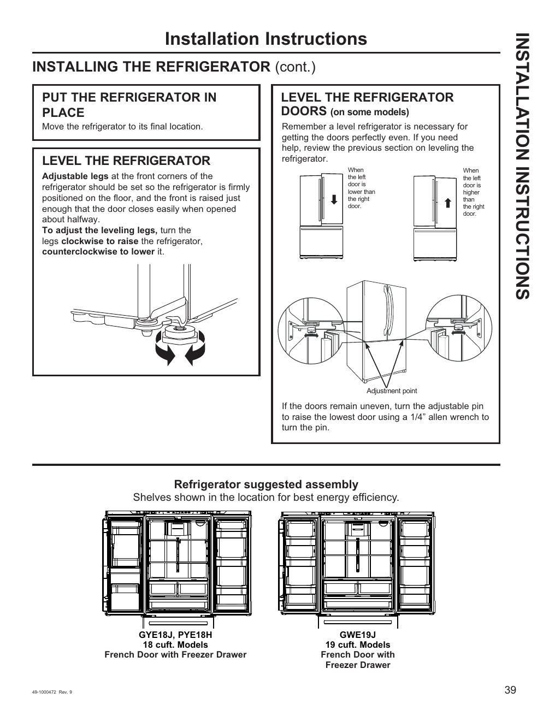

This page provides installation instructions for the GE GNE27JYMFS refrigerator, emphasizing the importance of proper leveling and shelf assembly. Key sections include "PUT THE REFRIGERATOR IN PLACE," "LEVEL THE REFRIGERATOR," and "LEVEL THE REFRIGERATOR DOORS (on some models)." The source includes diagrams for shelf assembly and guidance on adjusting the refrigerator's legs for stability.

<!-- llm-wiki:embedded-images -->
## Embedded Images

### Document

![The image contains installation instructions for a refrigerator. It includes sections titled "PUT THE REFRIGERATOR IN PLACE," "LEVEL THE REFRIGERATOR," and "LEVEL THE REFRIGERATOR DOORS (on some models)." The text provides guidance on adjusting the refrigerator's legs and leveling the doors, with arrows indicating the direction to turn the legs and an adjustment point for the door. Additionally, there are diagrams showing the suggested assembly of shelves for two models: GYE18J, PYE18H (18 cuft, French Door with Freezer Drawer) and GWE19J (19 cuft, French Door with Freezer Drawer).](../media/13-fridge-docsmd--12-gegne27jymfs--6-assets--10-user-guide--7-page039--1bl8v6p/001-page_039.png)
<!-- llm-wiki:embedded-images -->
