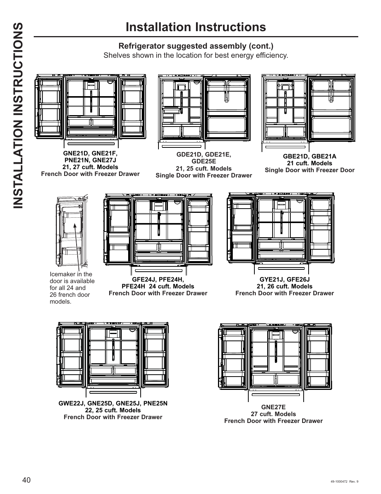

This page provides installation instructions for the GE GNE27JYMFS refrigerator model, focusing on optimal shelf assembly for energy efficiency. It includes diagrams and model references for various refrigerator configurations, specifically highlighting models with French doors and single doors with freezer drawers. The page also notes the availability of an icemaker in certain models.

<!-- llm-wiki:embedded-images -->
## Embedded Images

### Document

![The image titled "Installation Instructions" displays various refrigerator models with suggested shelf assembly for optimal energy efficiency. It includes diagrams of different refrigerator configurations, specifically highlighting models with French doors and single doors with freezer drawers. Each model is labeled with its corresponding model numbers, such as "GNE21D, GNE21F, PNE21N, GNE27J" for 21 and 27 cubic foot models, and "GDE21D, GDE21E, GDE25E" for 21 and 25 cubic foot models. Additionally, there is a note indicating that an icemaker is available in the door for all 24 and 26 cubic foot French door models.](../media/13-fridge-docsmd--12-gegne27jymfs--6-assets--10-user-guide--7-page040--pew20l/001-page_040.png)
<!-- llm-wiki:embedded-images -->
