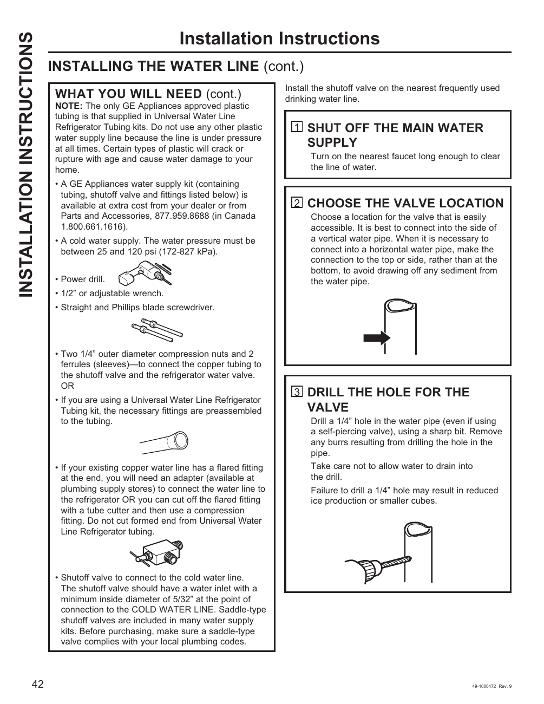

# GE GNE27JYMFS User Guide - Page 042
This page provides installation instructions for connecting a water line to the GE GNE27JYMFS refrigerator. It includes a list of required materials such as a GE Appliances water supply kit, a power drill, and various tools. The instructions are numbered and detail steps: 

1. **SHUT OFF THE MAIN WATER SUPPLY**
2. **CHOOSE THE VALVE LOCATION**
3. **DRILL THE HOLE FOR THE VALVE**

Each step provides specific guidance on how to proceed, including warnings about water pressure and sediment.

<!-- llm-wiki:embedded-images -->
## Embedded Images

### Document

![The image contains installation instructions for connecting a water line, specifically for a refrigerator. It includes a list of required materials such as a GE Appliances water supply kit, a power drill, and various tools. The instructions are numbered and detail steps: 1) "SHUT OFF THE MAIN WATER SUPPLY," 2) "CHOOSE THE VALVE LOCATION," and 3) "DRILL THE HOLE FOR THE VALVE." Each step provides specific guidance on how to proceed, including warnings about water pressure and sediment. The page number at the bottom is 42, and it is labeled as "Installation Instructions."](../media/13-fridge-docsmd--12-gegne27jymfs--6-assets--10-user-guide--7-page042--11emk33/001-page_042.png)
<!-- llm-wiki:embedded-images -->
