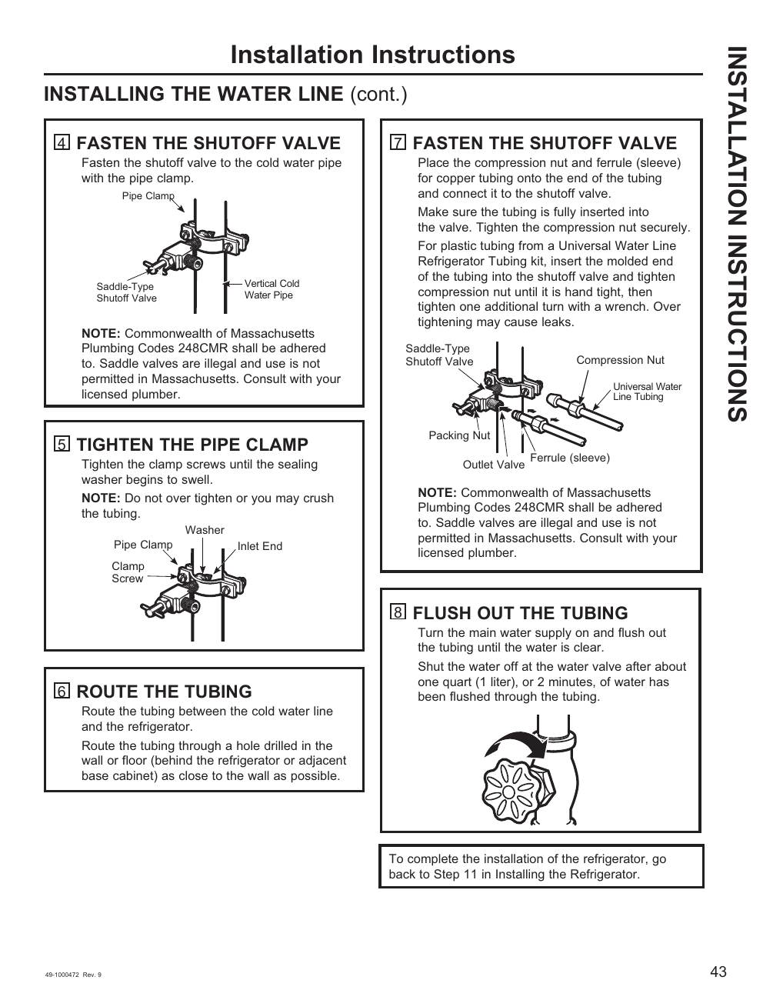

# GE GNE27JYMFS User Guide - Page 043
This page provides detailed installation instructions for connecting a water line to the GE GNE27JYMFS refrigerator. It includes steps numbered 4 to 8, detailing actions such as fastening the shutoff valve, tightening the pipe clamp, routing the tubing, and flushing out the tubing. Key components illustrated include a saddle-type shutoff valve, pipe clamp, compression nut, and ferrule (sleeve). Important notes emphasize compliance with Massachusetts Plumbing Codes and warnings against over-tightening the tubing.

<!-- llm-wiki:embedded-images -->
## Embedded Images

### Document

<!-- llm-wiki:embedded-images -->
