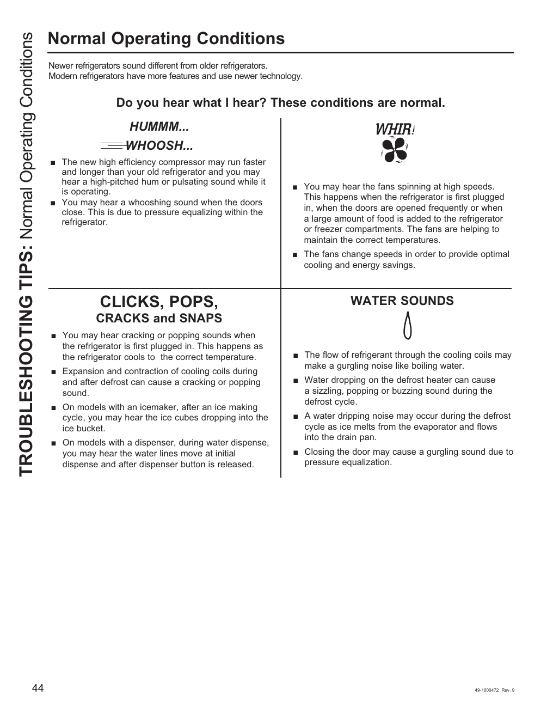

# GE GNE27JYMFS User Guide - Page 044
This page provides troubleshooting tips for various sounds that the GE GNE27JYMFS refrigerator may produce during normal operation. It categorizes sounds into sections such as "CLICK, POPS, CRACKS AND SNAPS" and "WATER SOUNDS," explaining the context of these noises. The information aims to help users understand what sounds are normal, alleviating concerns about potential malfunctions.

<!-- llm-wiki:embedded-images -->
## Embedded Images

### Document

![The image contains a section titled "Normal Operating Conditions" with troubleshooting tips for refrigerator sounds. It includes various audible conditions such as "HUMMM... WHOOSH..." and "WHIR!" along with explanations of normal sounds associated with modern refrigerators. The text describes sounds from the compressor, fans, and water flow, detailing scenarios like the fans spinning at high speeds and water noises during the defrost cycle. The layout features bullet points for clarity, with sections labeled "CLICK, POPS, CRACKS AND SNAPS" and "WATER SOUNDS."](../media/13-fridge-docsmd--12-gegne27jymfs--6-assets--10-user-guide--7-page044--1drfmnd/001-page_044.png)
<!-- llm-wiki:embedded-images -->
