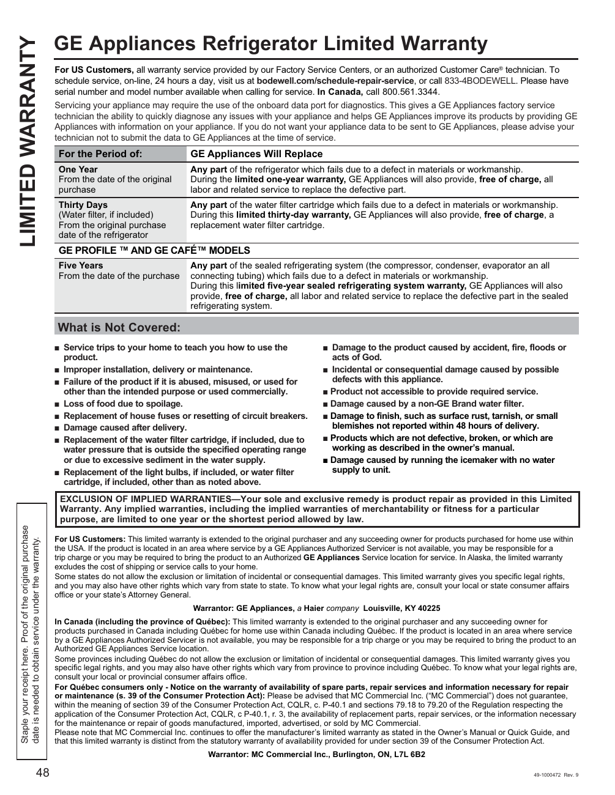

The GE GNE27JYMFS Refrigerator Limited Warranty outlines the terms of coverage for defects and repairs associated with the GE GNE27JYMFS refrigerator. It specifies that the warranty covers defects in material or workmanship for one year for the refrigerator and thirty days for the water filter cartridge. Exclusions include damages from accidents or improper installation. This warranty document serves as a formal guarantee issued by GE Appliances, providing essential information for consumers regarding their rights and the manufacturer's obligations.

<!-- llm-wiki:embedded-images -->
## Embedded Images

### Document

![The image is a warranty document titled "GE Appliances Refrigerator Limited Warranty." It outlines the warranty terms for GE refrigerators, specifying what is covered and what is not. Key sections include the duration of coverage: one year for the refrigerator and thirty days for the water filter cartridge. It details that GE Appliances will replace defective parts due to material or workmanship defects, and it lists exclusions such as damage caused by accidents or improper installation. The document also includes contact information for service inquiries and warranty claims.](../media/13-fridge-docsmd--12-gegne27jymfs--6-assets--10-user-guide--7-page048--1dtnsst/001-page_048.png)
<!-- llm-wiki:embedded-images -->
