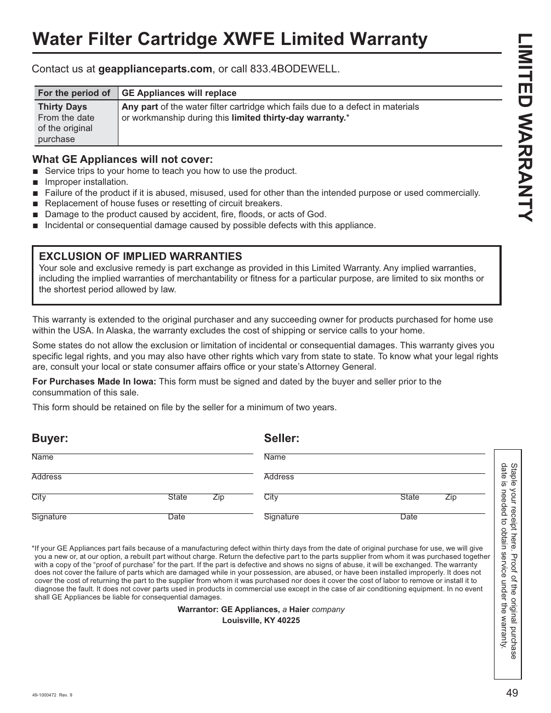

# GE GNE27JYMFS Water Filter Cartridge XWFE Limited Warranty
This document outlines the warranty terms provided by GE Appliances for the Water Filter Cartridge XWFE. It states that for thirty days from the date of original purchase, GE Appliances will replace any part of the water filter cartridge that fails due to defects in materials or workmanship. 

## Key Terms
- **Exclusions:** The warranty specifies exclusions such as improper installation, misuse, and damage caused by accidents or acts of God.
- **Documentation:** The warranty includes sections for the buyer's and seller's information, requiring signatures and dates, which adds credibility to the warranty terms.

<!-- llm-wiki:embedded-images -->
## Embedded Images

### Document

![The image is a document titled "Water Filter Cartridge XWFE Limited Warranty." It outlines the warranty terms provided by GE Appliances, stating that for thirty days from the date of original purchase, GE Appliances will replace any part of the water filter cartridge that fails due to defects in materials or workmanship. The document specifies exclusions, including improper installation, misuse, and damage caused by accidents or acts of God. It also includes sections for the buyer's and seller's information, requiring signatures and dates.](../media/13-fridge-docsmd--12-gegne27jymfs--6-assets--10-user-guide--7-page049--mkh61m/001-page_049.png)
<!-- llm-wiki:embedded-images -->
