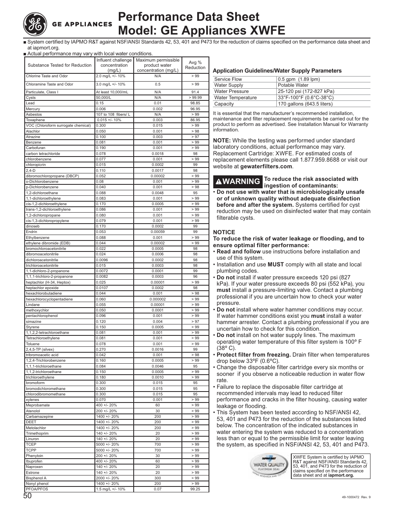

The document provides a performance data sheet for the GE Appliances model XWFE water filter cartridge. It details the effectiveness of the filter in reducing various contaminants from water supply, including Chlorine Taste and Odor, Cysts, Benzene, and Mercury, with reduction percentages mostly at or above 98%. The sheet includes influent and maximum permissible concentrations for each contaminant, average percentage reductions, and application guidelines for the water filtration system.

<!-- llm-wiki:embedded-images -->
## Embedded Images

### Document

![The image is a performance data sheet for the GE Appliances model XWFE. It lists various substances tested for reduction, including their influent and maximum permissible concentrations, average percentage reduction, and specific parameters for water supply and flow. Key substances include Chlorine Taste and Odor, Cysts, and various contaminants like Benzene and Mercury, with reduction percentages mostly at or above 98%. The document also contains application guidelines and warnings regarding installation and maintenance of the water filtration system.](../media/13-fridge-docsmd--12-gegne27jymfs--6-assets--10-user-guide--7-page050--xqzm30/001-page_050.png)
<!-- llm-wiki:embedded-images -->
