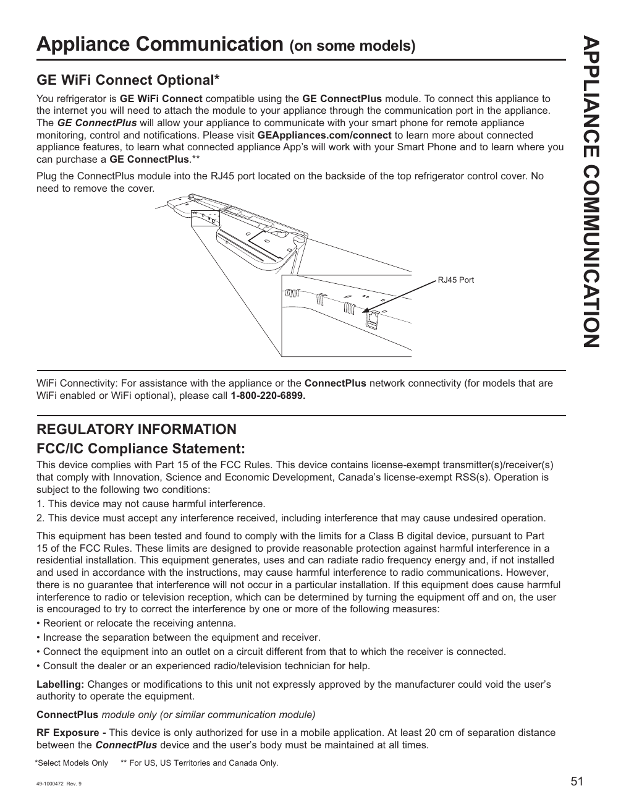

# GE GNE27JYMFS User Guide - Page 051
This page provides information about the GE WiFi Connect feature for certain refrigerator models. It includes instructions for connecting the GE ConnectPlus module to the appliance via the RJ45 port located on the backside of the top refrigerator control cover. The text emphasizes that no cover removal is necessary for this connection. Additionally, it provides a regulatory compliance statement regarding FCC/IC compliance and mentions the importance of maintaining a distance of at least 20 cm between the ConnectPlus device and the user's body during operation.

<!-- llm-wiki:embedded-images -->
## Embedded Images

### Document

![The image contains information about the GE WiFi Connect feature for certain refrigerator models. It includes instructions for connecting the GE ConnectPlus module to the appliance via the RJ45 port located on the backside of the top refrigerator control cover. The text emphasizes that no cover removal is necessary for this connection. Additionally, it provides a regulatory compliance statement regarding FCC/IC compliance and mentions the importance of maintaining a distance of at least 20 cm between the ConnectPlus device and the user's body during operation.](../media/13-fridge-docsmd--12-gegne27jymfs--6-assets--10-user-guide--7-page051--wz487z/001-page_051.png)
<!-- llm-wiki:embedded-images -->
