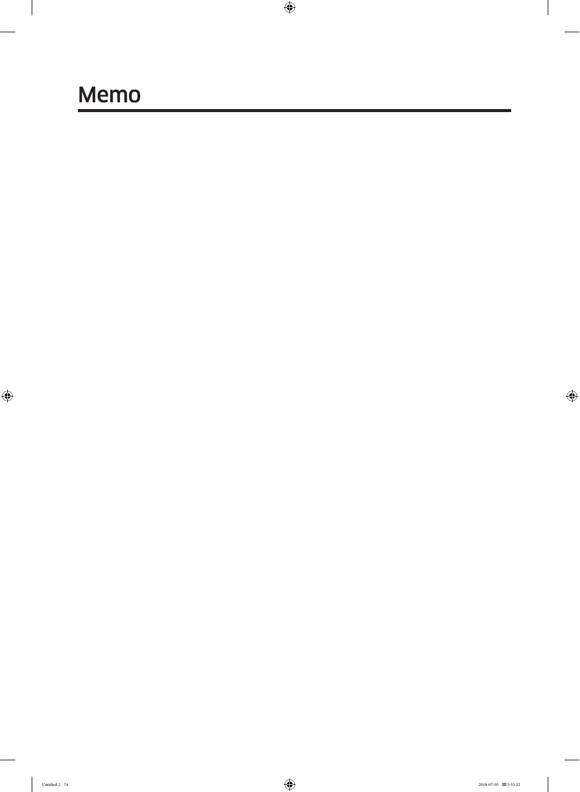
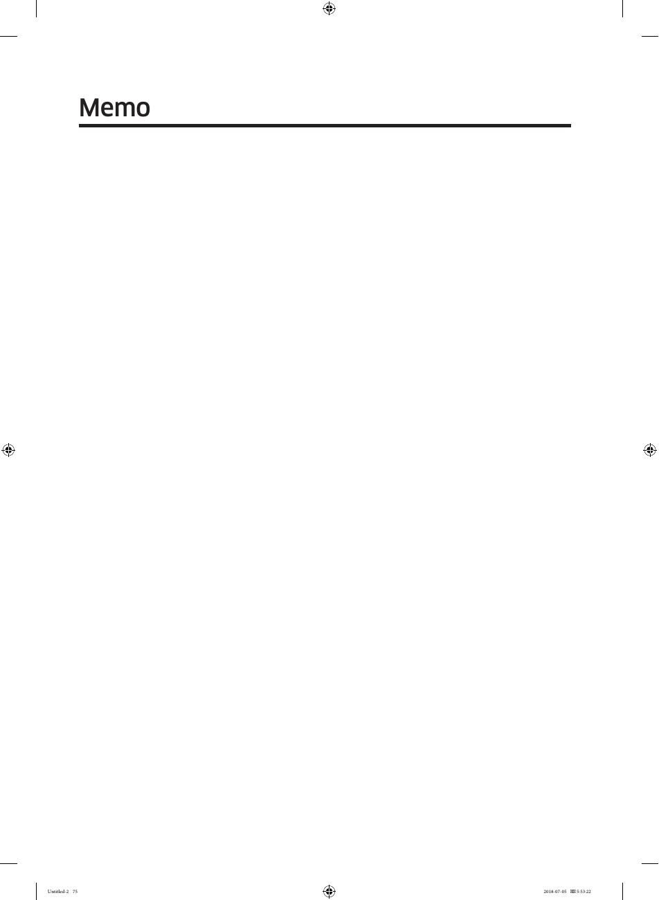

Ce document contient des extraits du manuel d'utilisation du réfrigérateur Samsung RF28K9070SG, incluant des informations de sécurité, des avertissements critiques, et des instructions d'installation. Il se concentre également sur le dépannage, fournissant des solutions aux problèmes courants rencontrés par les utilisateurs.

### Avertissements de sécurité
Les avertissements de sécurité sont essentiels pour l'utilisation sécuritaire de l'appareil, incluant des précautions concernant l'électricité et les risques d'incendie.

### Installation
Les instructions d'installation sont cruciales pour l'utilisation correcte du réfrigérateur, y compris le retrait et l'installation des portes.

### Connexion de la ligne d'eau
Des instructions détaillées sur la manière de connecter la ligne d'eau au réfrigérateur, y compris les matériaux nécessaires et les étapes à suivre.

### Dépannage
Les instructions de dépannage aident les utilisateurs à résoudre des problèmes courants, tels que la condensation, le fonctionnement de la machine à glace, et les odeurs désagréables.

<!-- llm-wiki:embedded-images -->
## Embedded Images

### Document

![L'image montre des instructions d'installation pour un appareil, probablement un réfrigérateur. Elle contient quatre étapes numérotées, chacune accompagnée d'une illustration. Le texte visible inclut : "2. While pressing the hinge shaft down, position the door so that the hinge shaft is below the shaft hole in the middle hinge. Release the hinge shaft so that it enters the shaft hole." et "3. With the door open, connect the bottom connectors in the direction of the arrows." Les illustrations montrent des flèches et des composants à connecter, ainsi qu'un tournevis utilisé pour fixer un couvercle de pied de nivellement.](../media/13-fridge-docsmd--18-samsungrf28k9070sg--10-user-guide--1a8ymzx/009-page_024.png)

![L'image montre une section du guide d'utilisateur pour un réfrigérateur, intitulée "STEP 2 Flooring". Elle contient des instructions sur la protection du sol lors de l'installation du réfrigérateur. À gauche, il y a une illustration d'un réfrigérateur avec des flèches indiquant le mouvement, et à droite, une image d'un réfrigérateur sur un carton. Le texte mentionne : "To protect the floor, put a large piece of cardboard under each leg of the refrigerator when you move it for installation." Une note en bas indique que si le réfrigérateur ne peut pas passer par l'entrée, il faut consulter la page 19 pour le retrait de la porte.](../media/13-fridge-docsmd--18-samsungrf28k9070sg--10-user-guide--1a8ymzx/013-page_029.png)
![L'image montre un diagramme illustrant l'ajustement des pieds de nivellement d'un réfrigérateur. On y voit un réfrigérateur avec une légende indiquant l'utilisation d'un tournevis à tête plate pour ajuster la hauteur des pieds avant. Le texte visible comprend des instructions : "To adjust the height of the freezer side: Insert a flat-head screwdriver into the leveller of the freezer-side front leg. Turn the leveller clockwise to raise the refrigerator. Turn it counterclockwise to lower." et "To adjust the height of the fridge side: Insert a flat-head screwdriver into the leveller of the fridge-side front leg. Turn the leveller clockwise to raise the refrigerator. Turn it counterclockwise to lower."](../media/13-fridge-docsmd--18-samsungrf28k9070sg--10-user-guide--1a8ymzx/014-page_030.png)
![L'image montre un réfrigérateur avec des instructions pour ajuster la hauteur de la porte ainsi que l'écart de la porte. Il y a un diagramme illustrant deux étapes : la première consiste à vérifier la différence de hauteur entre les portes et à soulever la porte inférieure, et la seconde montre comment insérer un anneau de snap de taille appropriée (A) entre la porte et la charnière. Le texte inclut également un avertissement concernant l'insertion d'un seul anneau de snap pour éviter des bruits de frottement.](../media/13-fridge-docsmd--18-samsungrf28k9070sg--10-user-guide--1a8ymzx/015-page_031.png)
![L'image montre des instructions d'installation pour corriger l'écart entre les portes d'un réfrigérateur modèle RF28K907. Elle inclut un diagramme du réfrigérateur avec une flèche pointant vers le boulon d'écart en haut à droite. Les étapes indiquent d'utiliser un tournevis Phillips pour retirer 6 vis sur le couvercle supérieur, puis d'utiliser une clé Allen de 4 mm pour ajuster l'écart entre les portes en tournant le boulon dans le sens des aiguilles d'une montre pour élargir l'écart et dans le sens inverse pour le réduire. Un avertissement souligne de ne pas endommager les connecteurs électriques pendant le processus.](../media/13-fridge-docsmd--18-samsungrf28k9070sg--10-user-guide--1a8ymzx/016-page_032.png)
![L'image montre un diagramme d'installation pour connecter la ligne du distributeur d'eau d'un réfrigérateur. Elle inclut des éléments étiquetés A, B et C, où A représente la ligne d'eau froide, B est le robinet d'arrêt, et C est le collier de tuyau. Les étapes d'installation sont numérotées de 1 à 3, indiquant comment couper l'eau, insérer le robinet d'arrêt et connecter le kit d'installation de la ligne d'eau. Le texte contient également des avertissements concernant la ventilation et l'utilisation d'une source d'eau potable.](../media/13-fridge-docsmd--18-samsungrf28k9070sg--10-user-guide--1a8ymzx/017-page_033.png)

![L'image montre un panneau de contrôle pour un réfrigérateur, avec des températures affichées de -80 °C pour le congélateur et 8 °C pour le réfrigérateur. Les éléments visibles incluent des icônes et des étiquettes pour des fonctions telles que "Freezer / Power Freeze", "Fridge / Power Cool", "Door Alarm", "FlexZone", "Cubed Ice", et "Crushed Ice". Il y a également une note indiquant que lorsque la température est modifiée, le panneau affiche la température réelle jusqu'à ce qu'elle corresponde à la nouvelle température réglée.](../media/13-fridge-docsmd--18-samsungrf28k9070sg--10-user-guide--1a8ymzx/019-page_036.png)
![L'image montre un panneau de contrôle de réfrigérateur avec des affichages numériques pour le congélateur et le réfrigérateur, indiquant respectivement 88°F et 89°F. Il y a des icônes pour les fonctions de glace, d'alarme de porte, et d'éclairage. Le texte visible mentionne "Freezer" et "Fridge" pour les sections correspondantes, ainsi que des instructions pour vérifier l'adresse MAC. Les instructions incluent des étapes pour activer le mode de vérification de l'adresse MAC et des exemples de format d'affichage.](../media/13-fridge-docsmd--18-samsungrf28k9070sg--10-user-guide--1a8ymzx/020-page_046.png)

![L'image montre un diagramme illustrant l'emplacement d'un porte-bouteilles dans un réfrigérateur. Il y a deux sections principales : "Under the shelf" et "In the partition guide". Sous "Under the shelf", une flèche indique comment insérer le porte-bouteilles sous l'étagère du réfrigérateur. Dans la section "In the partition guide", une flèche montre comment insérer le porte-bouteilles dans le guide de partition de la FlexZone. Le texte inclut des instructions spécifiques sur l'insertion du porte-bouteilles et un avertissement de sécurité.](../media/13-fridge-docsmd--18-samsungrf28k9070sg--10-user-guide--1a8ymzx/023-page_053.png)

![L'image montre des instructions pour l'entretien du seau à glace d'un réfrigérateur. Elle contient trois étapes numérotées pour retirer et vider le seau à glace, avec des flèches indiquant les mouvements à effectuer. Un symbole de précaution est présent, accompagné de plusieurs points d'avertissement concernant l'utilisation du seau et des conseils de sécurité. Le texte visible inclut "CAUTION" et "NOTE", ainsi que des instructions spécifiques sur la pression de l'eau requise pour la fabrication de glace.](../media/13-fridge-docsmd--18-samsungrf28k9070sg--10-user-guide--1a8ymzx/025-page_055.png)

![L'image présente une annonce concernant les logiciels open source inclus dans le produit. Elle contient un texte qui indique que le code source complet peut être obtenu pendant une période de trois ans après le dernier envoi du produit, avec une adresse e-mail pour les demandes. Un code QR est également visible, qui pourrait mener à la page de téléchargement du code source. Le texte mentionne également un lien URL pour accéder à des informations supplémentaires sur le code source et les licences open source.](../media/13-fridge-docsmd--18-samsungrf28k9070sg--10-user-guide--1a8ymzx/032-page_073.png)

<!-- llm-wiki:embedded-images -->
