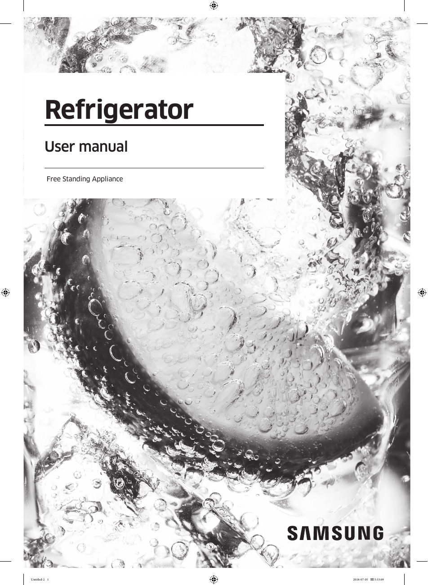

# Samsung RF28K9070SG User Manual - Page 001
This document serves as the cover page of the user manual for the Samsung RF28K9070SG refrigerator. It prominently features the brand name "SAMSUNG" and indicates that it is a user manual for a free-standing appliance. The background image of fruit submerged in water suggests freshness and quality, appealing to consumers.

The user manual is essential for understanding the features and proper usage of the RF28K9070SG refrigerator, providing vital information for customer support and product usability.

<!-- llm-wiki:embedded-images -->
## Embedded Images

### Document

<!-- llm-wiki:embedded-images -->
