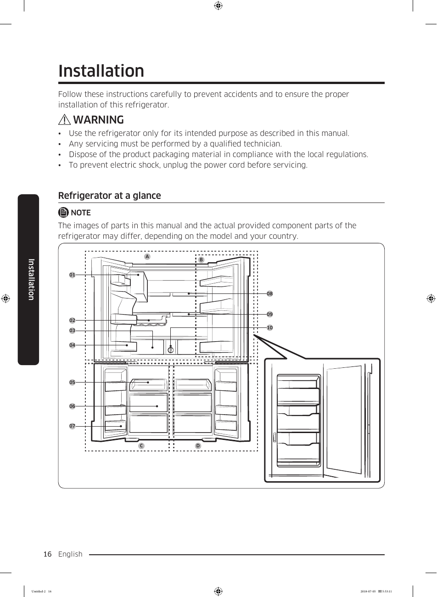

# Samsung RF28K9070SG User Manual - Page 016
This page features a diagram of the Samsung RF28K9070SG refrigerator's interior layout, labeled with various components and sections. The diagram includes parts numbered from 01 to 10 and sections labeled A and B. It emphasizes the importance of following installation instructions and safety warnings, noting that actual parts may vary by model and country. This visual representation aids users in understanding the layout and components of the refrigerator, which is crucial for installation and maintenance.

<!-- llm-wiki:embedded-images -->
## Embedded Images

### Document

<!-- llm-wiki:embedded-images -->
