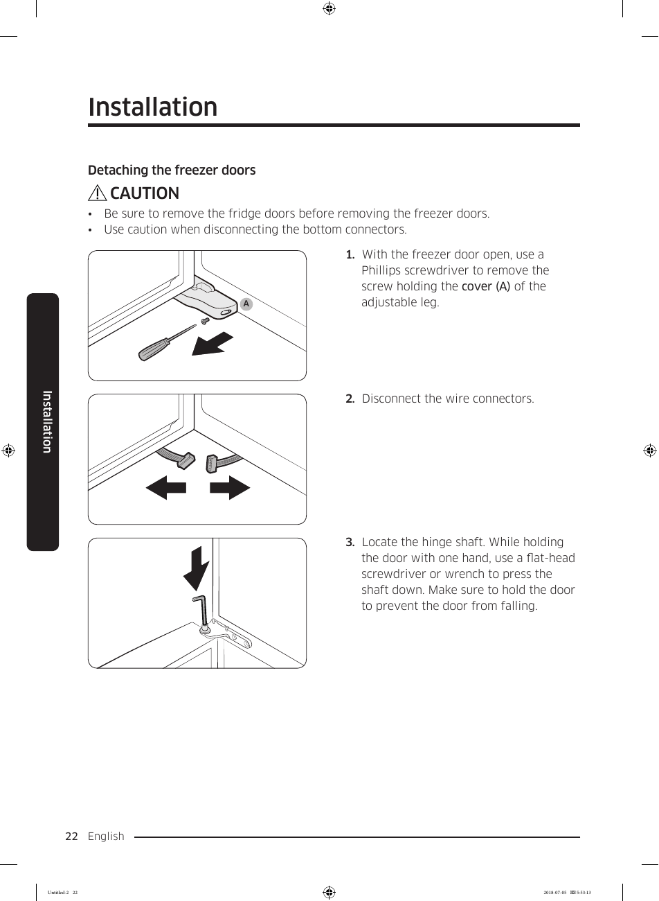

# Samsung RF28K9070SG User Manual - Page 022

This page provides a visual guide for detaching the freezer doors from the Samsung RF28K9070SG refrigerator. It includes a step-by-step process with numbered instructions, caution notes, and the tools required for the task.

## Key Instructions
1. Remove the screw with a Phillips screwdriver to access the adjustable leg cover.
2. Disconnect wire connectors.
3. Locate the hinge shaft and press it down while holding the door to prevent it from falling.

**Caution:** Be sure to remove the fridge doors before removing the freezer doors. Use caution when disconnecting the bottom connectors.

<!-- llm-wiki:embedded-images -->
## Embedded Images

### Document

![The image depicts a step-by-step guide for detaching freezer doors from a refrigerator. It includes a caution note stating: "Be sure to remove the fridge doors before removing the freezer doors" and "Use caution when disconnecting the bottom connectors." The steps are numbered 1 to 3, detailing the process: 1) removing a screw with a Phillips screwdriver to access the adjustable leg cover (labeled as A), 2) disconnecting wire connectors, and 3) locating the hinge shaft and pressing it down while holding the door to prevent it from falling. The visual elements include arrows indicating movement and tools like a Phillips screwdriver and flat-head screwdriver.](../media/13-fridge-docsmd--18-samsungrf28k9070sg--6-assets--10-user-guide--7-page022--3nyndg/001-page_022.png)
<!-- llm-wiki:embedded-images -->
