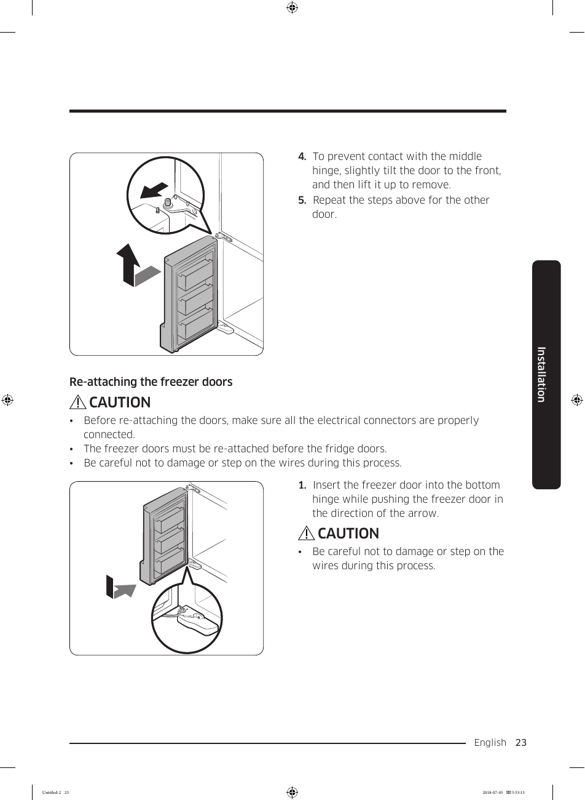

# Samsung RF28K9070SG User Manual - Page 023

This page provides detailed instructions for reattaching the freezer doors of the Samsung RF28K9070SG refrigerator. It includes a diagram illustrating the reattachment process, along with textual instructions emphasizing the need to tilt the door and ensure electrical connectors are properly connected. 

## Key Instructions
- To prevent contact with the middle hinge, slightly tilt the door to the front, and then lift it up to remove.
- Ensure all electrical connectors are properly connected and take care not to damage or step on the wires during the process.

<!-- llm-wiki:embedded-images -->
## Embedded Images

### Document

![The image depicts instructions for re-attaching freezer doors to a refrigerator. It includes a diagram showing the freezer door with an arrow indicating the direction to push while inserting it into the bottom hinge. The text states: "To prevent contact with the middle hinge, slightly tilt the door to the front, and then lift it up to remove." Additionally, there are caution notes emphasizing the importance of ensuring all electrical connectors are properly connected and advising care not to damage or step on the wires during the process.](../media/13-fridge-docsmd--18-samsungrf28k9070sg--6-assets--10-user-guide--7-page023--1tp7yav/001-page_023.png)
<!-- llm-wiki:embedded-images -->
