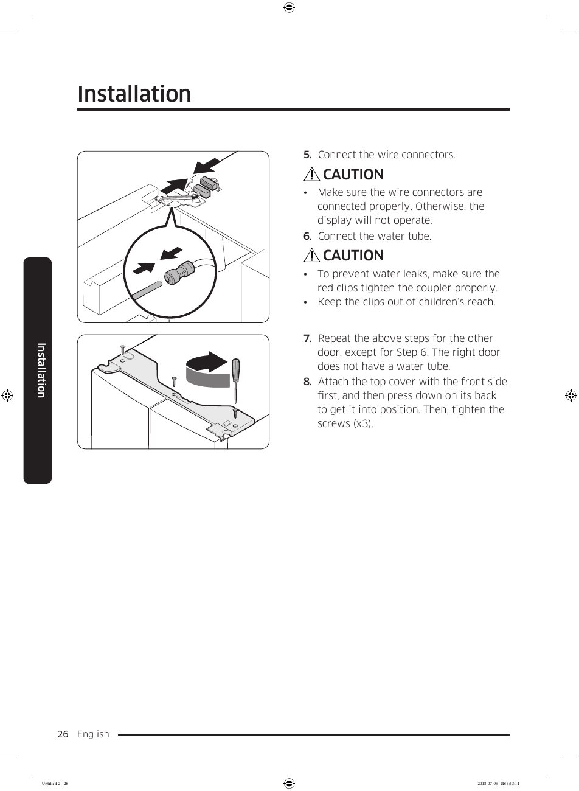

# Samsung RF28K9070SG User Manual - Page 026

This page provides installation instructions for the Samsung RF28K9070SG refrigerator. It includes critical guidelines for connecting wire connectors and securing components to ensure proper operation.

## Key Instructions

1. **Wire Connector Connection**
   - Ensure that the wire connectors are connected properly; otherwise, the display will not operate.

2. **Preventing Water Leaks**
   - Make sure the red clips tighten the coupler properly to prevent water leaks. Keep the clips out of children’s reach.

3. **Top Cover Attachment**
   - Instructions for attaching a top cover are provided, including pressing down and tightening three screws.

<!-- llm-wiki:embedded-images -->
## Embedded Images

### Document

![The image depicts installation instructions with two main sections. The first section shows a wire connector with an arrow indicating connection, accompanied by a caution note: "Make sure the wire connectors are connected properly. Otherwise, the display will not operate." Below this, another caution states: "To prevent water leaks, make sure the red clips tighten the coupler properly. Keep the clips out of children’s reach." The second section illustrates the attachment of a top cover, with an arrow indicating the direction to press down, and instructions to tighten three screws.](../media/13-fridge-docsmd--18-samsungrf28k9070sg--6-assets--10-user-guide--7-page026--rxea08/001-page_026.png)
<!-- llm-wiki:embedded-images -->
