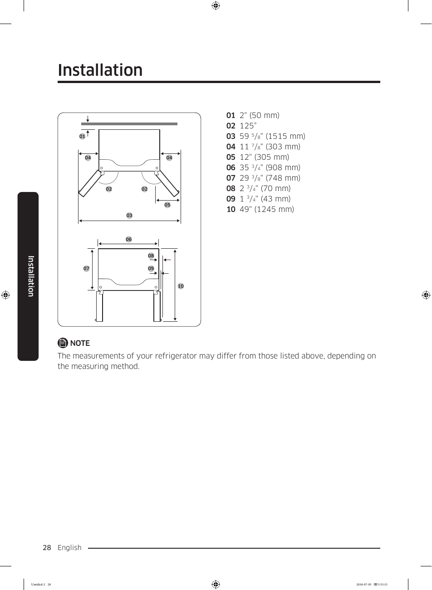

# Samsung RF28K9070SG User Manual - Page 028
This page contains an installation diagram for the Samsung RF28K9070SG refrigerator. The diagram provides essential measurements necessary for proper installation, ensuring that the refrigerator fits in the designated space. 

The diagram includes specific dimensions such as:
- "2" (50 mm)
- "59 5/8" (1515 mm)
- "11 7/8" (303 mm)
- "12" (305 mm)
- "35 3/4" (908 mm)
- "29 3/8" (748 mm)
- "2 3/4" (70 mm)
- "1 3/4" (43 mm)
- "49" (1245 mm)

It is important to note that the measurements of your refrigerator may differ from those listed above, depending on the measuring method.

<!-- llm-wiki:embedded-images -->
## Embedded Images

### Document

<!-- llm-wiki:embedded-images -->
